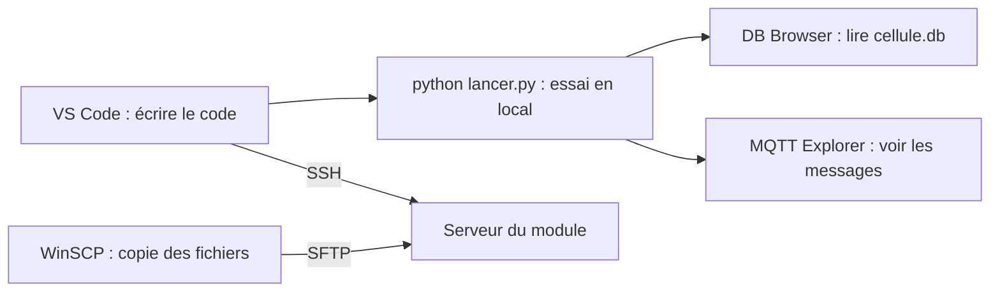

# Installation du poste de développement

Infrastructure client / serveur dans un contexte industriel

Cette fiche liste les logiciels à installer sur son ordinateur (Windows en priorité, Linux et macOS en fin de fiche) pour développer le projet : lancer la chaîne complète en local, se connecter au serveur du module, y copier ses programmes, regarder la base de données et les messages MQTT. Une fois les logiciels installés, passer à `site_web/README.md` (section « Lancement en local »).



## 1. Les logiciels

| Logiciel | Pour quoi faire | Nécessaire ? | Où le trouver |
|---|---|---|---|
| **Python 3.10 ou plus** | Lancer le collecteur, les simulateurs et le site | Oui | <https://www.python.org/downloads/> |
| **VS Code** | Écrire et lancer le code, ouvrir un terminal | Oui (recommandé) | <https://code.visualstudio.com/> |
| **WinSCP** | Copier les fichiers vers le serveur, avec une interface à deux panneaux | Oui, pour le serveur | <https://winscp.net/> |
| **Client SSH** (`ssh`, `scp`) | Ouvrir un terminal sur le serveur, lancer ses programmes | Oui, pour le serveur | Déjà dans Windows 10 et 11 (voir 4) |
| **DB Browser for SQLite** | Voir et interroger la base `cellule.db` | Oui | <https://sqlitebrowser.org/dl/> |
| **MQTT Explorer** | Voir les messages MQTT en direct, en publier | Oui | <https://mqtt-explorer.com/> |
| `curl` | Tester l'API du robot en ligne de commande | Oui (déjà dans Windows 10 et 11) | Déjà installé (voir 8) |
| **Mosquitto** | Un broker MQTT sur son poste | Non : le broker public de test suffit | <https://mosquitto.org/download/> |
| **Git** | Récupérer le dossier du projet et suivre ses modifications | Non : le dossier peut être remis en archive | <https://git-scm.com/downloads> |
| **Niryo Studio** | Programmer et calibrer le robot | Seulement pour les séances avec robot | Voir `documentation_Niryo_Ned2/` |
| Un navigateur (Chrome, Firefox, Edge) | Ouvrir le site web du tableau de bord | Oui | Déjà installé |

Les installateurs se lancent avec les options proposées par défaut, sauf indication contraire ci-dessous.

## 2. Python

Dans l'installateur, **cocher « Add python.exe to PATH »** dans la première fenêtre, avant de cliquer sur « Install Now ». Ouvrir ensuite un **nouveau** terminal (PowerShell) et vérifier :

```powershell
python --version
```

Si `python` ouvre le Microsoft Store ou n'est pas reconnu, essayer `py --version` : dans toutes les commandes du projet, `py` remplace alors `python`. Le reste (environnement `venv`, bibliothèques) est installé tout seul par `python lancer.py` au premier lancement.

## 3. VS Code

Installer VS Code, puis ses extensions (icône des extensions dans la barre de gauche, ou `Ctrl+Maj+X`) :

| Extension | Utilité |
|---|---|
| **Python** (Microsoft) | Colorer le code, repérer les erreurs, lancer un fichier |
| **Remote - SSH** (Microsoft) | Ouvrir un dossier du serveur et y travailler comme en local (voir 4) |
| **SQLite Viewer** | Ouvrir un fichier `.db` directement dans VS Code (facultatif si DB Browser est installé) |

Ouvrir le dossier du projet : *Fichier > Ouvrir le dossier*, choisir le dossier qui contient `lancer.py`. *Terminal > Nouveau terminal* ouvre un terminal dans ce dossier : c'est là qu'on tape `python lancer.py site`. Le bouton **+** du panneau Terminal ouvre un terminal de plus (un programme par terminal).

## 4. Se connecter au serveur : SSH

Le serveur n'est joignable que depuis **le réseau du module** (salle de cours ou fab lab), pas depuis chez soi. L'enseignant remet à chaque équipe :

- l'**adresse du serveur** : au fab lab, `192.168.10.10` (NUC de l'IRUP) ou `192.168.10.11` (Raspberry Pi d'ISTP) ;
- l'**identifiant** de l'équipe (`g1e1`, `t1e2`, `r1e3`...) et son **mot de passe**, les mêmes pour SSH et pour la copie de fichiers.

Le client SSH est déjà dans Windows 10 et 11. Vérifier dans PowerShell :

```powershell
ssh -V
```

S'il est absent : *Paramètres > Applications > Fonctionnalités facultatives > Ajouter une fonctionnalité > Client OpenSSH*. Puis se connecter :

```powershell
ssh g1e1@192.168.10.10
```

- À la première connexion, SSH demande de confirmer l'identité du serveur : répondre `yes`.
- Le mot de passe **ne s'affiche pas pendant la saisie** (pas d'étoiles) : c'est normal, taper puis valider.
- On arrive dans le dossier personnel de l'équipe (`~`). `exit` ferme la connexion.

**Variante : travailler directement sur le serveur avec VS Code.** Avec l'extension Remote - SSH : `F1`, « Remote-SSH: Connect to Host... », `g1e1@192.168.10.10`, puis *Ouvrir le dossier* `~/supervision`. Les fichiers se modifient sur le serveur, sans copie. Attention : à la première connexion, VS Code installe un composant sur le serveur, ce qui demande un **accès Internet du serveur**. Sans Internet, développer sur son poste et copier avec WinSCP.

## 5. Copier ses fichiers vers le serveur : WinSCP

Dans WinSCP, fenêtre « Connexion » :

| Champ | Valeur |
|---|---|
| Protocole | SFTP |
| Nom d'hôte | L'adresse du serveur (`192.168.10.10`) |
| Numéro de port | 22 |
| Nom d'utilisateur | L'identifiant de l'équipe (`g1e1`) |
| Mot de passe | Celui de l'équipe |

*Enregistrer* garde la session pour la prochaine fois. À la première connexion, WinSCP demande de confirmer la clé du serveur : *Oui*.

La fenêtre a deux panneaux : **à gauche, son ordinateur** (le dossier du projet), **à droite, le serveur**. Glisser un fichier d'un panneau à l'autre le copie.

Ce qu'il faut copier, dans le dossier `supervision` du serveur (à créer s'il n'existe pas) :

| À copier | Source sur son poste |
|---|---|
| `creer_bdd.py`, `collecteur.py` | `collecteur/` |
| `supervision.py` | `site_web/` |
| `templates/`, `static/` | `site_web/` |

**À ne jamais copier :**

- le dossier `venv` : il est propre à son ordinateur (Windows) et ne marche pas sur le serveur (Linux), qui a déjà son environnement Python ;
- `cellule.db` de son poste : elle contient des messages d'essai ; le serveur crée la sienne avec `python3 creer_bdd.py`.

**Avant de copier, vérifier les paramètres en tête des fichiers** : sur le serveur, `BROKER = "localhost"` (le broker tourne sur le serveur), et `EQUIPE` est l'identifiant de l'équipe. Pour lancer les programmes sur le serveur : `site_web/README.md`, section « Mode d'emploi sur le serveur du module ».

La même copie en ligne de commande, depuis le dossier du projet :

```powershell
scp collecteur/creer_bdd.py collecteur/collecteur.py site_web/supervision.py g1e1@192.168.10.10:~/supervision/
scp -r site_web/templates site_web/static g1e1@192.168.10.10:~/supervision/
```

## 6. Voir la base de données : DB Browser for SQLite

1. Lancer DB Browser, *Ouvrir une base de données*, choisir `cellule.db` (à la racine du projet en local).
2. Onglet **Parcourir les données** : choisir la table (`messages`, `robots`, `cycles`) dans la liste.
3. Onglet **Exécuter le SQL** : taper une requête (`SELECT * FROM cycles ORDER BY id DESC LIMIT 10;`), puis `Ctrl+Entrée`.

Précautions, parce que le collecteur écrit dans la base pendant ce temps :

- ouvrir la base en **lecture seule** (menu *Fichier > Ouvrir une base de données en lecture seule*) quand on veut seulement regarder ;
- ne pas laisser de modification non enregistrée : une base verrouillée par DB Browser fait échouer l'écriture du collecteur (`database is locked`) ;
- pour regarder la base **du serveur**, arrêter d'abord le collecteur (`Ctrl+C`), puis la copier avec WinSCP (`~/supervision/cellule.db`) : une base copiée pendant une écriture peut être incohérente. Sur le serveur, on peut aussi l'interroger sans la copier : `sqlite3 ~/supervision/cellule.db "SELECT * FROM cycles;"`.

## 7. Suivre les messages MQTT : MQTT Explorer

Créer une connexion (bouton **+**) :

| Champ | En local | Sur le serveur |
|---|---|---|
| Protocol | `mqtt://` | `mqtt://` |
| Host | `localhost`, ou `test.mosquitto.org` | L'adresse du serveur |
| Port | 1883 | 1883 |
| Username, Password | **Vides** : pas de compte | **Vides** |

Cliquer sur **Connect** : les sujets (`cellule/g1e1/cycle`, `etat`, `defaut`, `tache`) apparaissent dans l'arbre à gauche au fur et à mesure des messages, avec leur contenu à droite. Pour publier un message à la main, utiliser le panneau *Publish* en bas à droite : sujet, contenu JSON, puis *Publish*.

Sur le broker du serveur (ou le broker public), tout le monde voit les sujets des autres équipes : repérer le sien (`cellule/<identifiant>/...`).

## 8. Tester l'API du robot : curl

`curl.exe` est déjà dans Windows 10 et 11. Dans **PowerShell**, il faut écrire **`curl.exe`** et non `curl` : `curl` y est un raccourci vers une autre commande, qui n'accepte pas les mêmes options.

```powershell
curl.exe http://127.0.0.1:5001/robot/etat
curl.exe -X POST http://127.0.0.1:5001/robot/ledring/vert
```

(Le premier appel interroge le simulateur d'API lancé par `python lancer.py api` ; avec le robot, remplacer l'adresse par `http://192.168.10.21:3000`.)

## 9. Vérifier son poste

Dans PowerShell, chaque commande doit afficher un numéro de version, sans erreur :

```powershell
python --version
ssh -V
curl.exe --version
```

Puis, depuis le dossier du projet :

- [ ] `python lancer.py site` démarre (au premier lancement : installation de l'environnement, une à deux minutes), et `http://127.0.0.1:8001` s'ouvre dans le navigateur (arrêt : `Ctrl+C`) ;
- [ ] `cellule.db` apparaît à la racine et s'ouvre dans DB Browser ;
- [ ] MQTT Explorer se connecte au broker (`test.mosquitto.org`) ; après `python lancer.py mqtt`, un cycle envoyé depuis le menu du simulateur apparaît dans l'arbre ;
- [ ] au réseau du module : `ssh` et WinSCP se connectent avec l'identifiant de l'équipe.

## 10. Linux et macOS

Mêmes logiciels, mêmes réglages. Les commandes changent :

- **Python** : `python3` à la place de `python` (`python3 lancer.py site`). Sous Ubuntu et Debian : `sudo apt install python3-venv` si `python3 -m venv` échoue.
- **Outils** (Ubuntu) : `sudo apt install git curl sqlitebrowser mosquitto-clients`. VS Code, MQTT Explorer et DB Browser ont aussi un installateur sur leur site (`.deb`, `.dmg`, AppImage).
- **SSH et copie** : `ssh` et `scp` sont déjà installés ; WinSCP n'existe que sous Windows : utiliser `scp` (voir 5) ou un logiciel de copie SFTP comme FileZilla.
- **curl** : `curl` tel quel, sans `.exe`.
