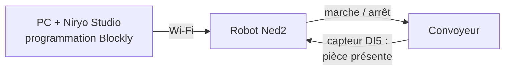
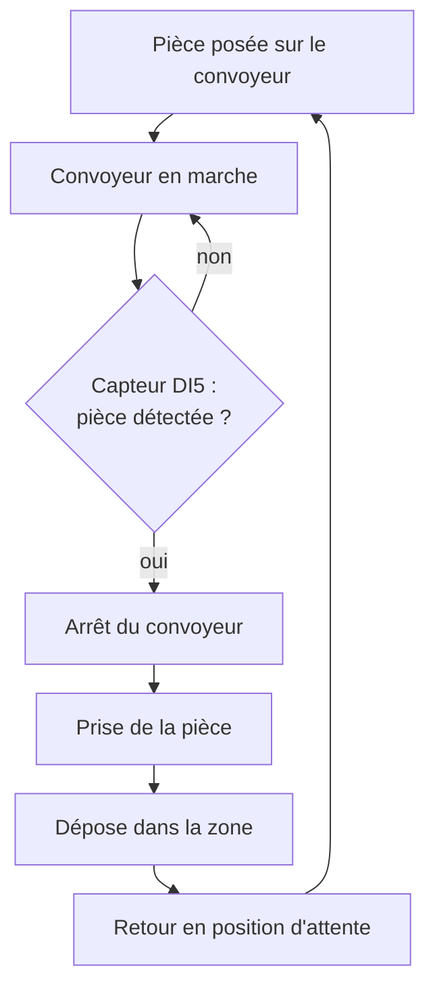
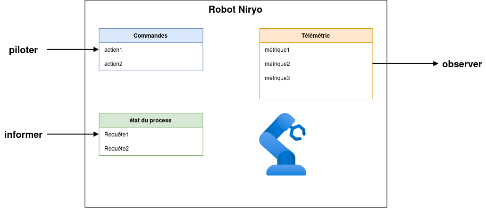
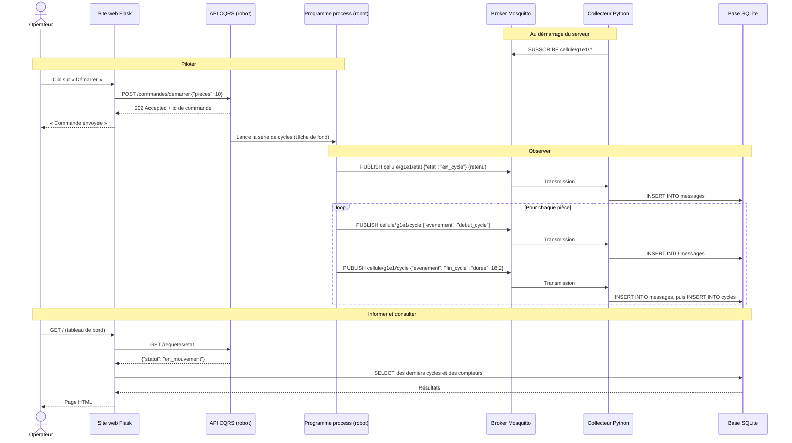
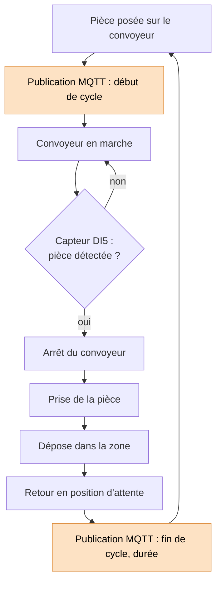
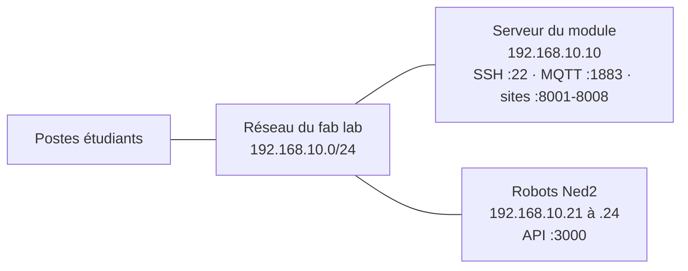
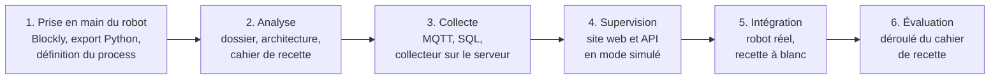

# Infrastructure client / serveur dans un contexte industriel

Ce cours est organisé autour d'un **projet fil rouge** : chaque équipe conçoit, réalise et fait recetter une **cellule robotisée supervisée**. Il est **modulaire** : un même socle de supports est décliné en une progression pédagogique par classe.

Ce document se lit dans l'ordre : on part de la cellule telle qu'elle existe (**contexte**), on exprime ce qui lui manque (**besoins**), on fixe le résultat attendu (**objectifs**), on en déduit les **fonctions** à réaliser, puis on montre comment elles s'assemblent et communiquent (**synoptique**).


## 1. Contexte : la cellule robotisée existante

Dans l'industrie, un poste de production n'est plus isolé : les machines remontent leurs données vers des serveurs, qui les stockent, les affichent aux opérateurs et renvoient des ordres aux machines. Cette chaîne repose sur des architectures **client / serveur** et sur des protocoles standards (TCP/IP, MQTT, HTTP, SQL).

Le point de départ du cours est un poste de pick & place du fab lab, qui fonctionne déjà de façon autonome :

- un **robot Niryo Ned2** (bras six axes avec pince) ;
- un **convoyeur** piloté par le robot, avec un **capteur de présence** de pièce câblé sur l'entrée **DI5** du robot ;
- un **PC** équipé de **Niryo Studio**, relié au robot, qui sert à le programmer en Blockly et à lancer le programme. Le programme peut être exporté en Python : l'export utilise le Python ROS Wrapper de Niryo et s'exécute sur le robot. Le projet garde cette bibliothèque : le programme process et l'API de commande tournent sur le robot.

Plusieurs postes identiques sont disponibles, un par équipe.



**Ce que fait la cellule aujourd'hui**



**Ses limites** : la cellule fonctionne en îlot.

- Pour savoir ce que fait le robot, il faut être devant lui ou devant le PC qui le programme.
- Rien n'est conservé : nombre de pièces, durées de cycle et défauts sont perdus à la fin du programme.
- Le programme se lance depuis Niryo Studio : aucun autre poste ne peut démarrer, arrêter ou calibrer la cellule.
- Chaque robot est isolé : il n'existe aucune vue d'ensemble des cellules de l'atelier.


## 2. Besoins : ce que l'on veut ajouter

Le responsable de production veut superviser la cellule sans être à côté du robot. Ses besoins se résument en trois verbes.



| Besoin | Question à laquelle il répond | Exemple |
|--------|-------------------------------|---------|
| **Piloter** | « Que doit faire le robot ? » | Démarrer une série de 10 pièces, arrêter, calibrer, à distance |
| **Informer** | « Que fait le robot maintenant ? » | En cycle, au repos, arrêté, hors ligne |
| **Observer** | « Qu'a fait le robot ? » | Cycles, durées, nombre de pièces, défauts, conservés dans le temps |

S'y ajoutent des contraintes :

- tout se consulte depuis un **navigateur**, sur le réseau de l'atelier, sans logiciel à installer ;
- plusieurs cellules partagent le même serveur, et **chaque équipe ne voit et ne commande que la sienne** ;
- le fonctionnement doit être **prouvé** par un cahier de recette.


## 3. Objectifs : ce que l'on souhaite obtenir

### Le résultat attendu

À la fin du projet, chaque équipe démontre sa cellule supervisée :

1. depuis un navigateur, l'opérateur ouvre le tableau de bord de sa cellule et voit l'état du robot ;
2. il clique sur « Démarrer » : le robot enchaîne les cycles sans passer par Niryo Studio ;
3. chaque cycle apparaît dans le tableau de bord peu après sa fin, avec sa durée ;
4. l'historique et les compteurs (pièces produites, durée moyenne, défauts) restent disponibles après l'arrêt du robot ;
5. chaque test du cahier de recette, rédigé par l'équipe, est déroulé et déclaré conforme.

**Livrables** : dossier d'analyse (process, architecture, dictionnaire des données), cahier de recette, code (programme process, collecteur, site web, API).

### Les compétences visées

| Code | Compétence |
|------|------------|
| C1 | Programmer une séquence robotisée (Blockly puis Python) |
| C2 | Analyser un process industriel et le spécifier (dossier d'analyse, cahier de recette) |
| C3 | Mettre en œuvre une communication client / serveur (MQTT, HTTP) |
| C4 | Collecter et stocker des données de production (SQL / SQLite) |
| C5 | Développer une interface web et une API en Python (Flask) |
| C6 | Intégrer, tester et valider un système (recette) |

Prérequis : bases de Python, notions de réseau (révisées dans le support `reseau_TCP_IP.md`).


## 4. Fonctions : ce qu'il faut réaliser

Pour répondre aux trois besoins, la cellule existante est complétée par des fonctions réparties entre le robot et un serveur.

| Fonction | Rôle | Besoin servi | Brique | Technologie |
|----------|------|--------------|--------|-------------|
| F1 Exécuter le cycle | Convoyeur, détection DI5, prise, dépose : le cycle existant, repris en Python | (existant) | Programme process | Python (export Niryo Studio, Python ROS Wrapper) |
| F2 Recevoir les commandes | Accepter « démarrer », « arrêter », « calibrer » et les exécuter sur le robot | Piloter | API de commande (CQRS) | Flask, Python ROS Wrapper |
| F3 Exposer l'état | Répondre à tout moment à « que fait le robot ? », sans gêner un mouvement en cours | Informer | API de commande (CQRS) | Flask |
| F4 Publier les événements | Signaler début et fin de cycle, changements d'état, défauts | Observer | Client MQTT du robot | `paho-mqtt` |
| F5 Transmettre les messages | Recevoir les messages des robots, les distribuer aux abonnés, isoler les équipes | Observer | Broker | Mosquitto, un compte par équipe |
| F6 Collecter et stocker | S'abonner, valider les messages, enregistrer le journal brut et les cycles | Observer | Collecteur + base | Python, `sqlite3`, SQLite (`cellule.db`) |
| F7 Présenter | Tableau de bord (état, cycles, compteurs) et boutons de commande | Les trois | Site web | Flask, Jinja2, HTML / CSS |

L'API suit le principe **CQRS** : les ordres (commandes, pour piloter) et la lecture de l'état (requêtes, pour informer) ont chacun leur propre chemin.

La pile est volontairement légère : pas de Docker, pas de serveur de base de données, pas d'outil de supervision tiers. Le tableau de bord est le site Flask.


## 5. Synoptique : comment tout s'assemble

### Architecture

Les fonctions se répartissent sur deux machines : le **robot** (programme process, client MQTT, API) et le **serveur du module** (broker, collecteur, base, site web). L'opérateur n'utilise qu'un navigateur. Chaque élément porte le numéro des fonctions qu'il réalise (F1 à F7, voir section 4).


### Deux modes de communication

| Canal | Modèle | Qui parle à qui | Besoins servis |
|-------|--------|-----------------|----------------|
| HTTP | Requête / réponse : le client attend une réponse | Navigateur → site web, site web → API du robot | Piloter, informer |
| MQTT | Publication / abonnement : l'émetteur ne sait pas qui écoute | Robot → broker → collecteur | Observer |
| SQL | Écriture puis lecture d'une base commune | Collecteur → base → site web | Observer |

L'historique ne passe pas par l'API : l'API répond à « que fait le robot maintenant ? », la base à « qu'a-t-il fait ? ».

### Les échanges : un scénario complet

Exemple de l'équipe `g1e1` : l'opérateur lance une série de pièces, puis consulte le tableau de bord.



### Le cycle instrumenté

Par rapport au cycle existant (section 1), seules les publications MQTT sont ajoutées (en couleur) : le mouvement du robot ne change pas.



Chaque équipe définit son propre process sur ce modèle.

### Le réseau

Pour le projet, les robots quittent leur Wi-Fi propre et rejoignent le réseau du fab lab, où ils peuvent joindre le serveur.




## 6. Données échangées

Le contenu exact des messages est fixé par chaque équipe dans son dossier d'analyse (dictionnaire des données). Les supports de cours partent de la proposition suivante.

| Élément | Convention |
|---------|------------|
| Topics MQTT | `cellule/<equipe>/cycle`, `cellule/<equipe>/etat` (message retenu), `cellule/<equipe>/defaut`, `cellule/<equipe>/tache` (début et fin des tâches de l'API du robot), avec `<equipe>` de la forme `g1e1` |
| Tables | `messages(id, recu_le, sujet, charge, qos, retain)` (journal brut), `robots(id, nom, equipe, adresse_ip)`, `cycles(id, robot_id, debut, duree, zone, statut)` (lue par le site web) |
| API CQRS (cible) | `GET /requetes/etat`, `POST /commandes/demarrer`, `POST /commandes/arreter`, `POST /commandes/calibrer` (réponse `202 Accepted` et identifiant de commande) |
| API fournie (point de départ) | `GET /robot/etat`, `POST /robot/home`, `POST /robot/autocalibrate`, `POST /robot/ledring/<couleur>` (réponse à la fin de la tâche, `409` si le robot est occupé) |
| Ports | API simulée 5001 à 5008, site web 8001 à 8008 (un par équipe), API sur le robot 3000 (le port 5000 du robot est pris par le logiciel système de Niryo) |

Exemples de messages (JSON) :

```json
{"evenement": "debut_cycle", "piece": 12, "horodatage": "2026-11-17T08:30:00"}
{"evenement": "fin_cycle", "piece": 12, "duree": 18.2, "zone": "A", "horodatage": "2026-11-17T08:30:18"}
{"etat": "en_cycle", "horodatage": "2026-11-17T08:30:00"}
{"defaut": "piece_non_detectee", "message": "DI5 inactif après 30 s", "horodatage": "2026-11-17T08:42:03"}
{"evenement": "fin_tache", "tache": "home", "statut": "terminee", "horodatage": "2026-11-17T08:45:12"}
```


## 7. Démarche du projet

Le robot n'est disponible qu'au fab lab : la partie serveur est développée en premier, avec des éléments simulés, puis le robot réel prend leur place lors de l'intégration.

| Élément réel | Remplacé avant l'intégration par |
|--------------|----------------------------------|
| Programme process du robot | Un **simulateur de process** (`simulateurs/simulateur_mqtt.py`) qui publie les mêmes messages sur les mêmes topics : le collecteur ne voit pas la différence |
| API sur le robot | La même API en **mode simulé** (`RobotSimule`), exécutée sur le serveur du module, ou le **simulateur d'API** (`simulateurs/simulateur_api.py`), qui a les endpoints de l'API fournie (`api_robot/`) |

Pour ne pas partir de zéro, chaque brique a un **point de départ fourni** (section 8), volontairement simple, que chaque équipe adapte à son process : les simulateurs, le collecteur et le script de création de la base, la base du tableau de bord, l'API du robot. L'API CQRS du support `API_CQRS_REST_Flask.md` en est la version cible, avec des commandes qui répondent tout de suite (`202 Accepted`) au lieu d'attendre la fin de la tâche.



L'évaluation repose sur l'exécution, devant l'enseignant, du cahier de recette rédigé par l'équipe, complétée par des questions individuelles. Le découpage en séances, les dates et la pondération sont propres à chaque classe.


## 8. Organisation du dossier

**Supports de cours** (`cours/`, communs à toutes les classes)

| Fichier | Contenu | Étape |
|---------|---------|-------|
| `01_prise_en_main_robot.md` | Séance 1, commune à toutes les classes : prise en main du robot Ned2, export Python, définition du process ; scripts d'essai sur le robot (partie 7) | 1, 5 |
| `reseau_TCP_IP.md` | Révisions réseau : TCP/IP, adressage, routage, sous-réseaux, configuration statique et DHCP, réseau de la cellule | 3, 5 |
| `collecteur_MQTT.md` | Collecteur de messages MQTT en Python vers une base de données | 3 |
| `SQL.md` | Rappels de SQL avec SQLite | 3 |
| `site_web_HTML_CSS.md` | HTML et CSS : réaliser les pages du tableau de bord | 4 |
| `intro_flask.md` | Le framework Flask : routes, templates, lecture de la base, appel de l'API | 4 |
| `API_CQRS_REST_Flask.md` | Une API CQRS pour le robot Niryo, comparée à REST, avec Flask | 4, 5 |
| `vision_OpenCV.md` (à écrire) | Vision industrielle : la caméra du Ned2 et OpenCV (extension) | 5 |
| `dashboard_Grafana.md` (à écrire) | Dashboard de production avec Grafana et SQLite (extension) | 4, 5 |

**Progressions pédagogiques** (`progression_pedagogique/`, une par classe)

| Classe | Fichier |
|--------|---------|
| BACHINGE24 | `BACHINGE24.md` |
| B3RNSPP26 | `B3RNSPP26.md` |
| BACHTECH24 | `BACHTECH24.md` |

La séance 1 (prise en main du robot) est la même pour toutes les classes : son support est `cours/01_prise_en_main_robot.md`.

Pour BACHINGE24 et B3RNSPP26, une présentation du module (`presentation_BACHINGE24.md`, `presentation_B3RNSPP26.md`, Marp, exportées en PDF) reprend la démarche de ce document puis le déroulé des séances de la classe.

Chaque progression précise le calendrier, les séances, les supports utilisés, les livrables, la configuration du serveur et la grille d'évaluation de la classe.

**Installation des serveurs** (`install/`) : préparation pas à pas du Raspberry Pi d'ISTP (`install_raspberry.md`, SQLite) et du NUC de l'IRUP (`install_nuc.md`, SQLite et Grafana).

**Installation sur les robots** (`install_robot/`) : bibliothèques Python du projet (Flask, paho-mqtt) prêtes à installer hors ligne sur le Ned2, avec `install.sh`, le lanceur `lancer.sh` et le script de vérification `test.py` ; mode d'emploi dans `install_robot/README.md`.

**Simulateurs** (`simulateurs/`) : `simulateur_mqtt.py` envoie au choix, dans un menu, les messages du robot (cycles, état, défaut, tâche, messages mal formés, rafale) pour tester le collecteur ; `simulateur_api.py` a les endpoints de l'API du robot sans robot, pour développer le site web.

**Collecteur fourni** (`collecteur/`) : version simplifiée du collecteur du support `collecteur_MQTT.md`, prête à lancer sur le serveur. `creer_bdd.py` crée la base `cellule.db` ; `collecteur.py` y enregistre tous les messages de l'équipe (table `messages`) et en tire les cycles (table `cycles`). Chaque équipe l'adapte à son process (format des messages, nouvelles tables). Mode d'emploi dans `collecteur/README.md`.

**Base du tableau de bord** (`site_web/`) : site Flask minimal d'une page, à compléter par chaque équipe : boutons de commande du robot (avec paramètre si besoin), état du robot et derniers messages MQTT mis à jour toutes les 2 secondes. Il appelle l'API du robot ou son simulateur, et lit la base remplie par le collecteur. Mode d'emploi dans `site_web/README.md`.

**API fournie du robot** (`api_robot/`) : API de départ à lancer sur le robot (port 3000), qui reprend les scripts d'essai 7 à 9 : état du robot, retour en position home, calibration, anneau de LED. Un endpoint par tâche, qui contient les appels au robot ; chaque tâche est annoncée sur MQTT au début et à la fin.

**Scripts d'essai sur le robot** (`essai_robot/`) : neuf scripts courts qui testent chacun une brique sur le robot (calibration, convoyeur, cycle, MQTT, API, lecture de l'état et endpoint `GET /robot/etat`), avec leurs énoncés dans la partie 7 de `cours/01_prise_en_main_robot.md`.

**Documentation Niryo** : PDF du constructeur dans `documentation_Niryo_Ned2/`, et documentation en ligne du logiciel du robot et du Python ROS Wrapper : <https://niryorobotics.github.io/ned_ros/> (index principal et pages utiles dans la partie 9 de `cours/01_prise_en_main_robot.md`).

**Schémas** (racine) : `robot_niryo.drawio` (pages principe et architecture, exportées en PNG), modifiable avec draw.io.
