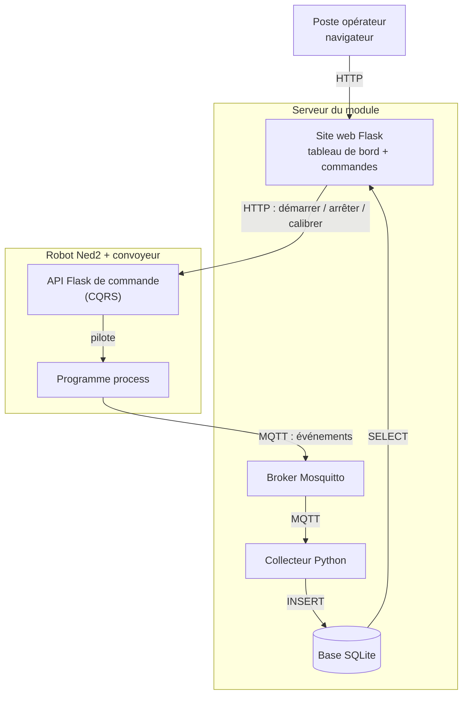
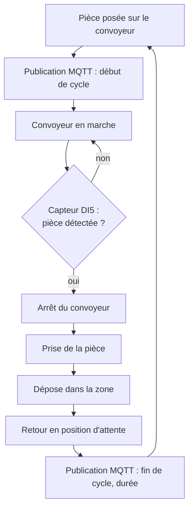
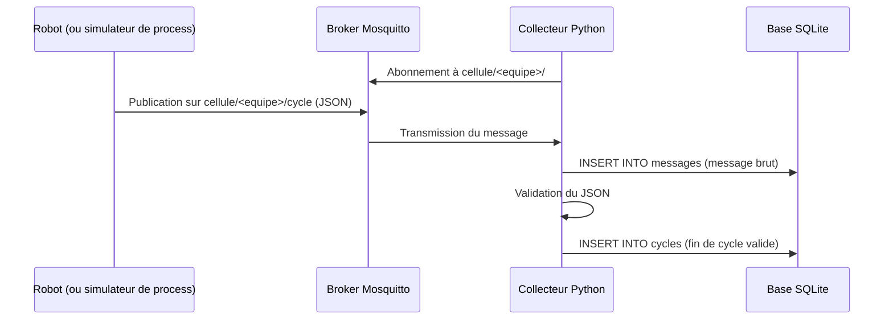
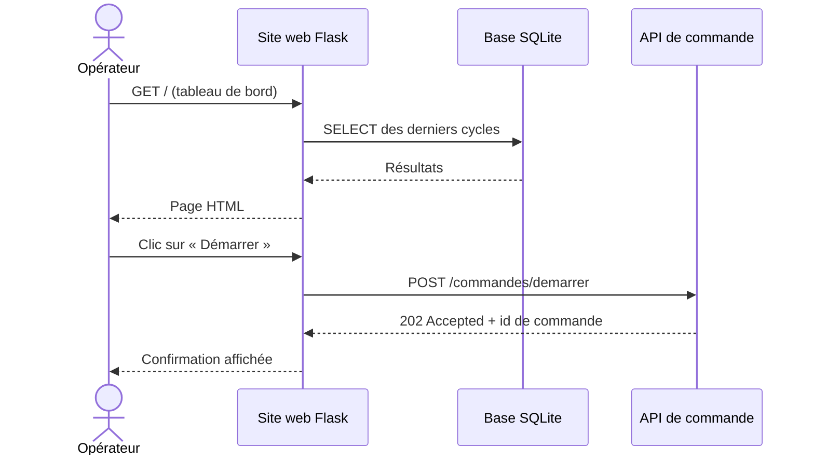
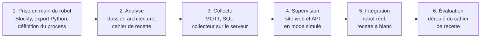

# Infrastructure client / serveur dans un contexte industriel

Ce cours est organisé autour d'un **projet fil rouge** : chaque équipe conçoit, réalise et fait recetter une **cellule robotisée supervisée**. Il est **modulaire** : un même socle de supports est décliné en une progression pédagogique par classe.

## Contexte

Dans l'industrie, un poste de production n'est plus isolé : les machines remontent leurs données vers des serveurs, qui les stockent, les affichent aux opérateurs et renvoient des ordres aux machines. Cette chaîne repose sur des architectures **client / serveur** et sur des protocoles standards (TCP/IP, MQTT, HTTP, SQL).

Le support matériel du cours est un poste de pick & place : un **robot Niryo Ned2** associé à un **convoyeur** équipé d'un capteur de présence (entrée DI5). Plusieurs robots sont disponibles au fab lab, un par équipe.

## Besoin

Le responsable de production veut superviser la cellule sans être à côté du robot :

- savoir à tout moment **ce que fait le robot** (en cycle, arrêté, en défaut) ;
- conserver l'**historique de production** : cycles, durées, pièces, défauts ;
- consulter ces informations depuis un **navigateur**, sur le réseau de l'atelier ;
- **piloter** la cellule à distance : démarrer, arrêter, calibrer ;
- disposer d'un **cahier de recette** qui prouve que le système fait ce qui est demandé.

## Objectifs pédagogiques

| Code | Compétence |
|------|------------|
| C1 | Programmer une séquence robotisée (Blockly puis Python) |
| C2 | Analyser un process industriel et le spécifier (dossier d'analyse, cahier de recette) |
| C3 | Mettre en œuvre une communication client / serveur (MQTT, HTTP) |
| C4 | Collecter et stocker des données de production (SQL / SQLite) |
| C5 | Développer une interface web et une API en Python (Flask) |
| C6 | Intégrer, tester et valider un système (recette) |

Prérequis : bases de Python, notions de réseau (révisées dans le support `reseau_TCP_IP.md`).

## Fonctionnalités de la cellule à réaliser

| Brique | Rôle | Technologie |
|--------|------|-------------|
| Programme process | Exécute le cycle (convoyeur, détection, prise, dépose) et publie les événements | Python, `pyniryo`, `paho-mqtt` |
| Broker | Reçoit les messages des robots et les distribue aux abonnés | Mosquitto, un compte par équipe |
| Collecteur | S'abonne aux messages de l'équipe, les valide et les enregistre | Python, `paho-mqtt`, `sqlite3` |
| Base de données | Conserve le journal brut des messages et les cycles de production | SQLite (`cellule.db`) |
| Site web | Tableau de bord : dernier état, liste des cycles, compteurs, boutons de commande | Flask, Jinja2, HTML / CSS |
| API de commande | Reçoit les ordres et expose l'état du robot, selon le principe CQRS | Flask, mode simulé puis robot réel |

La pile est volontairement légère : pas de Docker, pas de serveur de base de données, pas d'outil de supervision tiers. Le tableau de bord est le site Flask.

## Synoptiques

### Architecture de la cellule

### Cycle du process (exemple)

Chaque équipe définit son propre process sur ce modèle.

### Collecte des données

### Consultation et commande

### Réseau du fab lab

## Conventions communes

| Élément | Convention |
|---------|------------|
| Topics MQTT | `cellule/<equipe>/cycle`, `cellule/<equipe>/etat` (message retenu), `cellule/<equipe>/defaut`, avec `<equipe>` de la forme `g1e1` |
| Message | `{"evenement": "fin_cycle", "piece": 12, "duree": 18.2, "zone": "A", "horodatage": "2026-11-17T08:30:18"}` |
| Tables | `messages(id, recu_le, sujet, charge, qos, retain)`, `robots(id, nom, equipe, adresse_ip)`, `cycles(id, robot_id, debut, duree, zone, statut)` |
| API CQRS | `GET /requetes/etat`, `POST /commandes/demarrer`, `POST /commandes/arreter`, `POST /commandes/calibrer` |
| Ports | API simulée 5001 à 5008, site web 8001 à 8008 (un par équipe), API sur le robot 5000 |

## Démarche du projet

Le robot n'est disponible qu'au fab lab : la partie serveur est développée en premier, avec un process simulé, puis le robot réel prend sa place lors de l'intégration.

L'évaluation repose sur l'exécution, devant l'enseignant, du cahier de recette rédigé par l'équipe, complétée par des questions individuelles. Le découpage en séances, les dates et la pondération sont propres à chaque classe.

## Organisation du dossier

**Supports de cours** (`cours/`, communs à toutes les classes)

| Fichier | Contenu | Étape |
|---------|---------|-------|
| `reseau_TCP_IP.md` | Révisions réseau : TCP/IP, adressage, routage, sous-réseaux, configuration statique et DHCP, réseau de la cellule | 3, 5 |
| `collecteur_MQTT.md` | Collecteur de messages MQTT en Python vers une base de données | 3 |
| `SQL.md` | Rappels de SQL avec SQLite | 3 |
| `site_web_HTML_CSS.md` | HTML et CSS : réaliser les pages du tableau de bord | 4 |
| `intro_flask.md` | Le framework Flask : routes, templates, lecture de la base, appel de l'API | 4 |
| `API_CQRS_REST_Flask.md` | Une API CQRS pour le robot Niryo, comparée à REST, avec Flask | 4, 5 |

**Progressions pédagogiques** (`progression_pedagogique/`, une par classe)

| Classe | Fichier |
|--------|---------|
| BACHINGE24 | `BACHINGE24.md` |
| B3RNSPP26 | à rédiger |
| BACHTECH24 | à rédiger |

Chaque progression précise le calendrier, les séances, les supports utilisés, les livrables, la configuration du serveur et la grille d'évaluation de la classe.

**Schémas** (racine) : `robot_niryo.drawio` (principe et architecture, exportés en PNG) et `architecture_mqtt_niryo.drawio`, modifiables avec draw.io.
