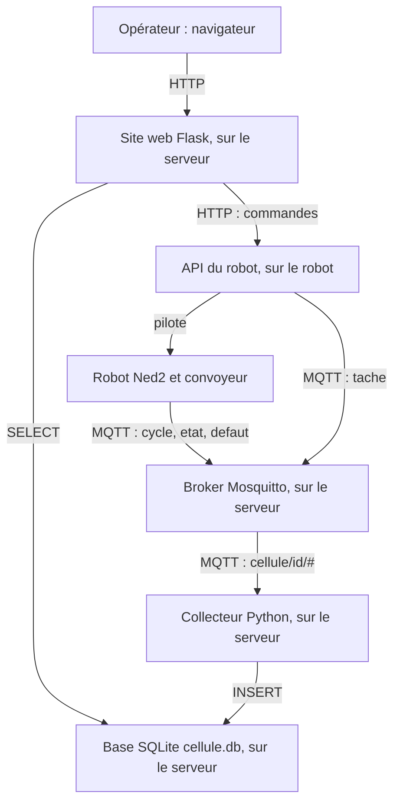

# Dossier d'analyse de la cellule robotisée supervisée

Infrastructure client / serveur dans un contexte industriel

Ce document est le **dossier d'analyse de l'équipe** : il décrit le process choisi et réunit, au même endroit, tout ce qu'il faut savoir et régler pour que la chaîne fonctionne : paramètres des programmes, connexion au serveur et au robot, messages MQTT, base de données, endpoints de l'API, pages du site. Il suit le plan du `README.md` du projet (contexte, besoins, objectifs, fonctions, synoptique, données).

## Comment le remplir

- **Copier ce fichier** dans votre dossier de rendu (ou le renseigner directement dans votre copie du projet) et le compléter **au fur et à mesure** : dès qu'une information est connue (un paramètre réglé, un message défini, une table créée, un endpoint ajouté), l'écrire. Il est **rendu une seule fois, à la fin du projet**, complet.
- Ce qui est **déjà écrit** est ce que fournit le projet (valeurs par défaut, messages, endpoints des programmes fournis). Le vérifier, puis l'adapter à votre process quand c'est nécessaire.
- Les cases marquées **À COMPLÉTER** sont à remplir. Une case qui ne s'applique pas à votre équipe : écrire « sans objet » et dire pourquoi.
- **Ne jamais écrire de mot de passe** dans ce document : il est partagé et rendu à l'enseignant. Les mots de passe sont remis par l'enseignant ; écrire « remis par l'enseignant » à la place.
- Les noms des programmes, des paramètres et des tables sont ceux des fichiers du projet : en changer un ici suppose de le changer dans le code.

| Rubrique | À renseigner surtout pendant |
|---|---|
| 1. L'équipe | le lancement du projet |
| 2. Le process | la prise en main du robot et l'analyse |
| 3. Architecture et connexions | l'analyse (schéma), puis la collecte et l'intégration (adresses, ports) |
| 4. Paramètres à configurer | chaque étape, à mesure que l'on règle un programme |
| 5. Messages MQTT | l'analyse (liste des données), puis la collecte (messages exacts) |
| 6. Base de données | la collecte |
| 7. API du robot : endpoints | la supervision |
| 8. Site web | la supervision |
| 9. Exigences | l'analyse |
| 10. Vérification du dossier | avant le rendu |

Le **cahier de recette** (`cahier_recette.md`, dans ce dossier : au moins 8 tests, chacun relié à une exigence de la rubrique 9) est présenté le jour de l'évaluation. Les **questions** auxquelles chaque étudiant doit pouvoir répondre ce jour-là sont dans `questions.md`.

## 1. L'équipe

| Élément | Valeur |
|---|---|
| Classe | À COMPLÉTER |
| Groupe (s'il y en a un) | À COMPLÉTER |
| Identifiant technique de l'équipe (`EQUIPE`) | À COMPLÉTER (exemples : `g1e1`, `t1e2`, `r1e4`) |
| Nom de l'équipe | À COMPLÉTER |
| Membres | À COMPLÉTER |
| Numéro du robot affecté | À COMPLÉTER (1 à 4) |
| Intitulé du process | À COMPLÉTER |

L'identifiant technique est **écrit en minuscules, sans accent**. Il sert de compte sur le serveur, de nom dans les topics MQTT (`cellule/<identifiant>/...`) et de nom de nœud du robot : il doit être **le même partout**.

## 2. Le process

### 2.1 Description

| Élément | Description |
|---|---|
| Objectif du process | À COMPLÉTER |
| Pièces manipulées (forme, nombre, couleur) | À COMPLÉTER |
| Déclencheur d'un cycle | À COMPLÉTER (par exemple : le capteur DI5 détecte une pièce au bout du convoyeur) |
| Fin d'un cycle | À COMPLÉTER |
| Durée d'un cycle attendue | À COMPLÉTER (secondes) |
| Zones de dépose | À COMPLÉTER (par exemple : A et B) |
| Situations de défaut | À COMPLÉTER (par exemple : pièce non détectée, robot non calibré, convoyeur bloqué) |

### 2.2 Séquence d'un cycle

Décrire le cycle étape par étape (liste numérique, grafcet simplifié ou schéma). Pour chaque étape : l'action, la condition pour passer à la suivante, le message MQTT publié.

| Étape | Action du robot ou du convoyeur | Condition de passage | Message publié |
|---|---|---|---|
| 1 | À COMPLÉTER | À COMPLÉTER | À COMPLÉTER |
| 2 | À COMPLÉTER | À COMPLÉTER | À COMPLÉTER |
| 3 | À COMPLÉTER | À COMPLÉTER | À COMPLÉTER |

### 2.3 Poses et matériel du robot

Les poses se relèvent en mode FreeMotion dans Niryo Studio, au format `[x, y, z, roll, pitch, yaw]` (mètres et radians). Les valeurs ci-dessous sont les **valeurs d'exemple** de `essai_robot/config.py` : les remplacer par celles de votre robot.

| Élément | Nom dans le code | Valeur d'exemple fournie | Valeur de l'équipe |
|---|---|---|---|
| Pose d'attente | `POSE_ATTENTE` | `[0.14, 0.0, 0.203, -0.017, 0.761, -0.001]` | À COMPLÉTER |
| Pose de prise | `POSE_PRISE` | `[-0.168, 0.182, 0.149, -1.832, 1.483, -0.371]` | À COMPLÉTER |
| Pose de dépose (zone A) | `POSE_DEPOSE_A` | `[0.20, 0.20, 0.10, 0.0, 1.57, 0.0]` | À COMPLÉTER |
| Pose de dépose (zone B), si elle existe | à créer | sans objet | À COMPLÉTER |
| Position home (angles des 6 axes, radians) | `JOINTS_HOME` | `[0.0, 0.3, -1.3, 0.0, 0.0, 0.0]` | À COMPLÉTER |
| Vitesse du convoyeur (%) | `VITESSE_CONVOYEUR` | `50` | À COMPLÉTER |
| Délai maximal d'attente d'une pièce (s) | `DELAI_MAX_PIECE` | `30` | À COMPLÉTER |
| Capteur de pièce | entrée `DI5` | `HIGH` sans pièce, `LOW` pièce détectée (à vérifier sur chaque convoyeur) | À COMPLÉTER : valeurs constatées |

## 3. Architecture et connexions

### 3.1 Schéma

Ce schéma est celui du projet : l'opérateur n'utilise qu'un navigateur ; le site lit la base et envoie les commandes à l'API ; le robot et l'API publient en MQTT, et le collecteur enregistre les messages dans la base. **À COMPLÉTER** : le redessiner avec les éléments propres à votre process (capteurs supplémentaires, tâches, pages, dashboard...) ou le remplacer par votre propre schéma, en indiquant sur chaque flèche le protocole et le contenu échangé.

### 3.2 Réseau et adresses

| Élément | Valeur fournie | Valeur de l'équipe |
|---|---|---|
| Réseau du fab lab | `192.168.10.0/24` | sans objet (donné) |
| Serveur du fab lab (NUC de l'IRUP) | `192.168.10.10` | À COMPLÉTER : le serveur de votre classe |
| Serveur d'ISTP (Raspberry Pi) | `192.168.10.11` au fab lab ; adresse de la salle de cours remise par l'enseignant | À COMPLÉTER |
| Robots du fab lab | `192.168.10.21` à `192.168.10.24` | À COMPLÉTER : adresse du robot de l'équipe |
| Adresse de votre poste sur le réseau | donnée par le réseau (DHCP) | À COMPLÉTER (utile pour les essais) |

### 3.3 Connexion au serveur

Le serveur n'est joignable que sur le réseau du module (salle de cours ou fab lab), pas depuis chez soi.

| Élément | Valeur fournie | Valeur de l'équipe |
|---|---|---|
| Adresse du serveur | voir 3.2 | À COMPLÉTER |
| Protocole de connexion | SSH, port 22 | sans objet (donné) |
| Compte | l'identifiant de l'équipe (`EQUIPE`) | À COMPLÉTER |
| Mot de passe | remis par l'enseignant | **ne pas écrire ici** |
| Commande de connexion | `ssh <identifiant>@<adresse du serveur>` | À COMPLÉTER : la commande complète |
| Copie de fichiers | WinSCP (SFTP, port 22) ou `scp` | sans objet (donné) |
| Dossier de travail sur le serveur | `~/supervision` | À COMPLÉTER si différent |
| Environnement Python du serveur | `/opt/cellule/venv` (commun à toutes les équipes, déjà installé) | sans objet (donné) |
| Lancer un programme qui doit continuer après la déconnexion | session `tmux` | À COMPLÉTER : nom de votre session |

### 3.4 Connexion au broker MQTT

| Élément | Valeur fournie | Valeur de l'équipe |
|---|---|---|
| Adresse du broker depuis le serveur | `localhost` | sans objet (donné) |
| Adresse du broker depuis un poste ou le robot | l'adresse du serveur (voir 3.2) | À COMPLÉTER |
| Port | `1883` | sans objet (donné) |
| Compte et mot de passe | **aucun** : le broker du projet est ouvert | sans objet (donné) |
| Broker pour les essais sans serveur | `localhost` (Mosquitto installé), ou `test.mosquitto.org` (public : identifiant d'équipe unique obligatoire, rien de confidentiel) | À COMPLÉTER : celui que vous utilisez en local |
| Topics de l'équipe | `cellule/<identifiant>/...` | À COMPLÉTER : liste exacte en 5 |
| Identifiants de client MQTT (fixés dans le code) | `<identifiant>_collecteur`, `<identifiant>_simulateur`, `<identifiant>_simulateur_api`, `<identifiant>_api_robot` | sans objet (donné) |

Deux clients de même identifiant se déconnectent l'un l'autre : **deux équipes ne doivent jamais avoir le même identifiant technique** sur un même broker.

### 3.5 Connexion au robot

| Élément | Valeur fournie | Valeur de l'équipe |
|---|---|---|
| Adresse IP du robot | `192.168.10.21` à `.24` | À COMPLÉTER |
| Compte du robot | `niryo` | sans objet (donné) |
| Mot de passe du robot | voir `install_robot/README.md` | **ne pas écrire ici** |
| Dossier du projet sur le robot | `~/cellule` | sans objet (donné) |
| Lancer un programme sur le robot | `~/cellule/lancer.sh <programme>.py` | sans objet (donné) |
| Nom du nœud ROS de l'équipe | `cellule_<identifiant>` (API : `cellule_api_<identifiant>`) | À COMPLÉTER |
| Port de l'API sur le robot | `3000` (le port `5000` est pris par le logiciel système de Niryo) | sans objet (donné) |
| Logiciel Niryo Studio : version et adresse de connexion | version compatible avec le robot (5.3 ou plus) | À COMPLÉTER |

### 3.6 Ports

| Service | Port | Valeur de l'équipe |
|---|---|---|
| SSH, WinSCP | 22 | sans objet (donné) |
| Broker MQTT | 1883 | sans objet (donné) |
| API du robot, sur le robot | 3000 | sans objet (donné) |
| API simulée (`simulateur_api.py`), un port par équipe | 5001 à 5008 (`5000 + n`) | À COMPLÉTER |
| Site web de l'équipe, un port par équipe | 8001 à 8008 (`8000 + n`) | À COMPLÉTER |
| Grafana, sur le serveur (classes qui l'utilisent) | 3000 | À COMPLÉTER ou « sans objet » |

Les ports de chaque équipe sont donnés dans la fiche matériel de la classe, remise par l'enseignant.

## 4. Paramètres à configurer

Chaque programme a ses **paramètres en tête de fichier** (section « Paramètres à adapter »). Cette liste est exhaustive pour les programmes fournis : la colonne « Valeur de l'équipe » doit être remplie, y compris quand la valeur par défaut convient (écrire alors la même valeur).

Rappel : `EQUIPE`, `BROKER` et les ports doivent être **cohérents entre tous les fichiers**. Là où un programme tourne change le `BROKER` : `localhost` sur le serveur, l'adresse du serveur depuis le robot ou un poste.

| Fichier | Paramètre | Rôle | Valeur par défaut fournie | Valeur de l'équipe |
|---|---|---|---|---|
| `collecteur/creer_bdd.py` | `EQUIPE` | Identifiant de l'équipe | `"g1e1"` | À COMPLÉTER |
| `collecteur/creer_bdd.py` | `ADRESSE_ROBOT` | Adresse du robot, enregistrée dans la table `robots` | `"192.168.10.21"` | À COMPLÉTER |
| `collecteur/creer_bdd.py` | `BASE` | Fichier de la base | `"cellule.db"` | À COMPLÉTER |
| `collecteur/collecteur.py` | `EQUIPE` | Identifiant ; le collecteur s'abonne à `cellule/<EQUIPE>/#` | `"g1e1"` | À COMPLÉTER |
| `collecteur/collecteur.py` | `BROKER` | Adresse du broker | `"localhost"` | À COMPLÉTER |
| `collecteur/collecteur.py` | `BASE` | Fichier de la base (le même que le site) | `"cellule.db"` | À COMPLÉTER |
| `simulateurs/simulateur_mqtt.py` | `EQUIPE` | Identifiant de l'équipe | `"g1e1"` | À COMPLÉTER |
| `simulateurs/simulateur_mqtt.py` | `BROKER` | Adresse du broker | `"localhost"` | À COMPLÉTER |
| `simulateurs/simulateur_api.py` | `EQUIPE` | Identifiant de l'équipe | `"g1e1"` | À COMPLÉTER |
| `simulateurs/simulateur_api.py` | `BROKER` | Adresse du broker | `"localhost"` | À COMPLÉTER |
| `simulateurs/simulateur_api.py` | `PORT_API` | Port du simulateur d'API (`5000 + n`) | `5001` | À COMPLÉTER |
| `simulateurs/simulateur_api.py` | `COULEURS` | Couleurs acceptées pour l'anneau de LED | `["rouge", "vert", "bleu", "jaune", "blanc"]` | À COMPLÉTER |
| `site_web/supervision.py` | `EQUIPE` | Identifiant, affiché en titre | `"g1e1"` | À COMPLÉTER |
| `site_web/supervision.py` | `URL_API` | Adresse de l'API : simulateur (`http://127.0.0.1:<PORT_API>`) ou robot (`http://<adresse du robot>:3000`) | `"http://127.0.0.1:5001"` | À COMPLÉTER |
| `site_web/supervision.py` | `BASE` | Fichier de la base (le même que le collecteur) | `"cellule.db"` | À COMPLÉTER |
| `site_web/supervision.py` | `PORT_SITE` | Port du site (`8000 + n`) | `8001` | À COMPLÉTER |
| `site_web/supervision.py` | `COULEURS` | Couleurs proposées dans le formulaire, **les mêmes que dans l'API** | `["rouge", "vert", "bleu", "jaune", "blanc"]` | À COMPLÉTER |
| `site_web/supervision.py` | `app.secret_key` | Clé des messages `flash` du site | `"dev-seulement"` | À COMPLÉTER |
| `api_robot/api_robot.py` | `EQUIPE` | Identifiant de l'équipe | `"g1e1"` | À COMPLÉTER |
| `api_robot/api_robot.py` | `BROKER` | Adresse du serveur, depuis le robot | `"192.168.10.10"` | À COMPLÉTER |
| `api_robot/api_robot.py` | `PORT_API` | Port de l'API sur le robot | `3000` | À COMPLÉTER |
| `api_robot/api_robot.py` | `JOINTS_HOME` | Position home (6 angles, radians) | `[0.0, 0.3, -1.3, 0.0, 0.0, 0.0]` | À COMPLÉTER |
| `api_robot/api_robot.py` | `COULEURS` | Couleurs de l'anneau (`[rouge, vert, bleu, 0]`) | rouge, vert, bleu, jaune, blanc | À COMPLÉTER |
| `essai_robot/config.py` | `EQUIPE` | Identifiant de l'équipe | `"g1e1"` | À COMPLÉTER |
| `essai_robot/config.py` | `BROKER` | Adresse du serveur, depuis le robot | `"192.168.10.10"` | À COMPLÉTER |
| `essai_robot/config.py` | `PORT_MQTT` | Port MQTT | `1883` | À COMPLÉTER |
| `essai_robot/config.py` | `TOPIC_ESSAI`, `TOPIC_LED` | Topics des scripts d'essai (distincts des topics du projet) | `cellule/<EQUIPE>/essai`, `cellule/<EQUIPE>/led` | À COMPLÉTER |
| `essai_robot/config.py` | `PORT_API` | Port de l'API d'essai sur le robot | `3000` | À COMPLÉTER |
| `essai_robot/config.py` | `POSE_ATTENTE`, `POSE_PRISE`, `POSE_DEPOSE_A` | Poses relevées sur le robot | voir 2.3 | voir 2.3 |
| `essai_robot/config.py` | `VITESSE_CONVOYEUR`, `DELAI_MAX_PIECE` | Convoyeur | `50`, `30` | voir 2.3 |
| `essai_robot/config.py` | `COULEURS` | Couleurs des essais de LED | rouge, vert, bleu | À COMPLÉTER |
| **Votre programme process** | À COMPLÉTER | À COMPLÉTER | À COMPLÉTER | À COMPLÉTER |
| **Autre paramètre ajouté par l'équipe** | À COMPLÉTER | À COMPLÉTER | À COMPLÉTER | À COMPLÉTER |

**Où tourne chaque programme** (pour choisir la bonne valeur de `BROKER` et des ports) :

| Programme | S'exécute sur | Lancé avec |
|---|---|---|
| Collecteur, site web, simulateurs | Le serveur (ou votre poste en local) | `python3 programme.py` depuis `~/supervision` sur le serveur ; `python lancer.py <programme>` depuis la racine du projet en local |
| API du robot, programme process, scripts d'essai | Le robot | `~/cellule/lancer.sh programme.py` |

## 5. Messages MQTT

### 5.1 Liste des messages

`<id>` désigne l'identifiant de l'équipe. Tous les messages sont du JSON, avec un champ `horodatage` ajouté par l'émetteur. Les quatre premiers sujets sont ceux du projet ; les lignes déjà remplies correspondent aux messages du simulateur MQTT et de l'API du robot.

| Sujet (topic) | Message (`evenement` ou clé) | Émis par | Quand | QoS | Retenu | Exemple |
|---|---|---|---|---|---|---|
| `cellule/<id>/cycle` | `debut_cycle` | Programme process du robot | Une pièce est détectée et le cycle démarre | 1 | non | `{"evenement": "debut_cycle", "piece": 12, "horodatage": "2026-11-17T08:30:00"}` |
| `cellule/<id>/cycle` | `fin_cycle` | Programme process du robot | La pièce est déposée | 1 | non | `{"evenement": "fin_cycle", "piece": 12, "duree": 18.2, "zone": "A", "horodatage": "2026-11-17T08:30:18"}` |
| `cellule/<id>/etat` | `etat` | Programme process du robot | Changement d'état (`en_cycle`, `attente`, `arrete`) | 1 | **oui** : le dernier état reste disponible | `{"etat": "en_cycle", "horodatage": "2026-11-17T08:30:00"}` |
| `cellule/<id>/defaut` | `defaut` | Programme process du robot | Un défaut est détecté | 1 | non | `{"defaut": "piece_non_detectee", "message": "DI5 inactif après 30 s", "horodatage": "2026-11-17T08:42:03"}` |
| `cellule/<id>/tache` | `debut_tache` | API du robot | Début d'une tâche demandée à l'API | 1 | non | `{"evenement": "debut_tache", "tache": "ledring", "couleur": "vert", "horodatage": "..."}` |
| `cellule/<id>/tache` | `fin_tache` | API du robot | Fin d'une tâche : `statut` vaut `terminee` ou `erreur` | 1 | non | `{"evenement": "fin_tache", "tache": "home", "statut": "terminee", "horodatage": "..."}` ; en erreur : `"statut": "erreur", "erreur": "..."` |
| `cellule/<id>/essai` | `essai` | Scripts d'essai 4 et 7 (prise en main) | Pendant les essais seulement | 1 | non | `{"evenement": "essai", "numero": 3, "di5": "HIGH", "horodatage": "..."}` |
| `cellule/<id>/led` | texte `rouge`, `vert` ou `bleu` | Un poste, vers le robot (script d'essai 5) | Pendant les essais seulement | 0 | non | `rouge` (texte simple, pas du JSON) |
| À COMPLÉTER | À COMPLÉTER | À COMPLÉTER | À COMPLÉTER | À COMPLÉTER | À COMPLÉTER | À COMPLÉTER |
| À COMPLÉTER | À COMPLÉTER | À COMPLÉTER | À COMPLÉTER | À COMPLÉTER | À COMPLÉTER | À COMPLÉTER |
| À COMPLÉTER | À COMPLÉTER | À COMPLÉTER | À COMPLÉTER | À COMPLÉTER | À COMPLÉTER | À COMPLÉTER |

Les sujets `essai` et `led` ne font pas partie du projet : ils servent aux scripts d'essai de la prise en main. Les supprimer de ce tableau si vous ne les utilisez plus.

Si vous ajoutez un sujet ou un message, le collecteur le garde automatiquement dans la table `messages` (il est abonné à `cellule/<id>/#`). Pour qu'il alimente aussi une table de votre base, il faut modifier le collecteur (voir 6).

### 5.2 Dictionnaire des champs

| Champ | Type | Unité ou valeurs | Présent dans | Obligatoire | Rôle |
|---|---|---|---|---|---|
| `evenement` | texte | `debut_cycle`, `fin_cycle`, `debut_tache`, `fin_tache` | `cycle`, `tache` | oui | Nature de l'événement |
| `piece` | entier | numéro de la pièce, à partir de 1 | `cycle` | oui | Identifie la pièce |
| `duree` | nombre réel | secondes | `cycle` (`fin_cycle`) | **oui** : sans `duree`, le cycle n'est pas enregistré | Durée du cycle |
| `zone` | texte | `A`, `B` | `cycle` (`fin_cycle`) | non | Zone de dépose |
| `horodatage` | texte | date et heure ISO 8601, heure locale (`2026-11-17T08:30:18`) | tous | oui | Heure de l'événement, posée par l'émetteur |
| `etat` | texte | `en_cycle`, `attente`, `arrete` | `etat` | oui | État du robot |
| `defaut` | texte | code du défaut (`piece_non_detectee`) | `defaut` | oui | Nature du défaut |
| `message` | texte | libre | `defaut` | non | Explication lisible |
| `tache` | texte | `home`, `autocalibrate`, `ledring` | `tache` | oui | Tâche de l'API concernée |
| `statut` | texte | `terminee`, `erreur` | `tache` (`fin_tache`) | oui | Résultat de la tâche |
| `erreur` | texte | libre | `tache` (`fin_tache` en erreur) | non | Message d'erreur du robot |
| `couleur` | texte | `rouge`, `vert`, `bleu`, `jaune`, `blanc` | `tache` (`ledring`) | non | Couleur de l'anneau de LED |
| À COMPLÉTER | À COMPLÉTER | À COMPLÉTER | À COMPLÉTER | À COMPLÉTER | À COMPLÉTER |
| À COMPLÉTER | À COMPLÉTER | À COMPLÉTER | À COMPLÉTER | À COMPLÉTER | À COMPLÉTER |

Un message qui n'est pas du JSON valide, ou une fin de cycle sans `duree`, est **conservé dans `messages`** mais ne produit pas de ligne dans `cycles` : le collecteur affiche « message mal formé » et continue.

## 6. Base de données

Une base SQLite par équipe, le fichier `cellule.db`. Elle est créée par `collecteur/creer_bdd.py`, remplie par le collecteur et **lue seulement** par le site web.

### 6.1 Tables fournies

| Table | Colonne | Type | Contrainte | Rôle |
|---|---|---|---|---|
| `messages` | `id` | entier | clé primaire | Numéro du message |
| `messages` | `recu_le` | texte | obligatoire | Heure de réception, en UTC |
| `messages` | `sujet` | texte | obligatoire | Sujet MQTT (`cellule/g1e1/cycle`) |
| `messages` | `charge` | texte | obligatoire | Contenu du message, tel quel |
| `messages` | `qos` | entier | obligatoire | Qualité de service reçue |
| `messages` | `retain` | entier | 0 par défaut | 1 si le message est retenu |
| `robots` | `id` | entier | clé primaire | Numéro du robot |
| `robots` | `nom` | texte | obligatoire, unique | Nom (`ned2-g1e1`) |
| `robots` | `equipe` | texte | obligatoire | Identifiant de l'équipe |
| `robots` | `adresse_ip` | texte | | Adresse du robot |
| `cycles` | `id` | entier | clé primaire | Numéro du cycle |
| `cycles` | `robot_id` | entier | obligatoire, référence `robots` | Robot concerné |
| `cycles` | `debut` | texte | obligatoire | Horodatage posé par le robot (heure locale) |
| `cycles` | `duree` | réel | obligatoire | Secondes |
| `cycles` | `zone` | texte | | Zone de dépose |
| `cycles` | `statut` | texte | `'ok'` par défaut | Résultat du cycle |

### 6.2 Tables et colonnes ajoutées par l'équipe

| Table | Colonne | Type | Contrainte | Rôle | Alimentée par (message MQTT) |
|---|---|---|---|---|---|
| À COMPLÉTER | À COMPLÉTER | À COMPLÉTER | À COMPLÉTER | À COMPLÉTER | À COMPLÉTER |
| À COMPLÉTER | À COMPLÉTER | À COMPLÉTER | À COMPLÉTER | À COMPLÉTER | À COMPLÉTER |
| À COMPLÉTER | À COMPLÉTER | À COMPLÉTER | À COMPLÉTER | À COMPLÉTER | À COMPLÉTER |

### 6.3 Requêtes utilisées par le site web

| Besoin du site | Requête SQL | Table |
|---|---|---|
| Les 20 derniers messages | `SELECT ... FROM messages ORDER BY id DESC LIMIT 20` (fournie) | `messages` |
| À COMPLÉTER (par exemple : nombre de cycles du jour, durée moyenne, dernier défaut) | À COMPLÉTER | À COMPLÉTER |

## 7. API du robot : endpoints

L'API fournie s'exécute **sur le robot, port 3000** (`http://<adresse du robot>:3000`) ; le simulateur d'API a les mêmes endpoints sur le port `5000 + n` de la machine où il tourne. Elle fait **une tâche à la fois** : une demande reçue pendant une tâche est refusée (`409`). La réponse d'une tâche n'arrive qu'**à sa fin** ; `GET /robot/etat` répond toujours tout de suite.

### 7.1 Endpoints fournis

| Méthode | URL | Paramètre | Rôle | Réponse réussie | Erreurs | Messages MQTT émis |
|---|---|---|---|---|---|---|
| `GET` | `/robot/etat` | aucun | Lit l'état du robot, sans le faire bouger | `200` : `axes`, `pose`, `di5`, `calibration_necessaire`, `temperature_raspberry`, `temperatures_moteurs`, `tache_en_cours` | aucune | aucun |
| `POST` | `/robot/home` | aucun | Place le robot en position home | `200` : `{"tache": "home", "statut": "terminee"}` | `409` robot occupé ; `500` erreur du robot (par exemple robot non calibré) | `debut_tache`, puis `fin_tache` |
| `POST` | `/robot/autocalibrate` | aucun | Lance la calibration automatique | `200` : `{"tache": "autocalibrate", "statut": "terminee"}` | `409` ; `500` | `debut_tache`, puis `fin_tache` |
| `POST` | `/robot/ledring/<couleur>` | `couleur` dans l'URL : `rouge`, `vert`, `bleu`, `jaune`, `blanc` | Fait clignoter l'anneau de LED (2 s) | `200` : `{"tache": "ledring", "statut": "terminee", "couleur": "vert"}` | `400` couleur inconnue ; `409` ; `500` | `debut_tache`, puis `fin_tache` (avec `couleur`) |

### 7.2 Endpoints ajoutés par l'équipe

Une tâche ajoutée à l'API s'ajoute aussi à son simulateur, puis au site web (rubrique 8). Reprendre le modèle en fin de `api_robot/api_robot.py`.

| Méthode | URL | Paramètre | Rôle | Réponse réussie | Erreurs | Messages MQTT émis |
|---|---|---|---|---|---|---|
| À COMPLÉTER | À COMPLÉTER | À COMPLÉTER | À COMPLÉTER | À COMPLÉTER | À COMPLÉTER | À COMPLÉTER |
| À COMPLÉTER | À COMPLÉTER | À COMPLÉTER | À COMPLÉTER | À COMPLÉTER | À COMPLÉTER | À COMPLÉTER |
| À COMPLÉTER | À COMPLÉTER | À COMPLÉTER | À COMPLÉTER | À COMPLÉTER | À COMPLÉTER | À COMPLÉTER |

### 7.3 Codes de réponse

| Code | Signification | Où |
|---|---|---|
| `200` | Tâche terminée, ou état lu | tous les endpoints |
| `400` | Paramètre refusé (couleur inconnue) | `ledring` |
| `404` | Endpoint inexistant dans l'API (commande ajoutée au site mais pas à l'API) | tous |
| `409` | Robot occupé : une autre tâche est en cours | les tâches |
| `500` | Erreur du robot pendant la tâche | les tâches |
| À COMPLÉTER | À COMPLÉTER | À COMPLÉTER |

### 7.4 Contenu de la réponse de `GET /robot/etat`

| Champ | Type | Unité | Signification |
|---|---|---|---|
| `axes` | liste de 6 nombres | radians | Angles des axes |
| `pose` | liste de 6 nombres | mètres et radians | Position `x, y, z` et orientation `roll, pitch, yaw` |
| `di5` | texte | `HIGH` ou `LOW` | Capteur de pièce |
| `calibration_necessaire` | booléen | | Vrai si le robot doit être calibré |
| `temperature_raspberry` | nombre | °C | Température de la carte du robot |
| `temperatures_moteurs` | liste de 6 nombres | °C | Températures des moteurs |
| `tache_en_cours` | texte ou `null` | | Nom de la tâche en cours |
| À COMPLÉTER | À COMPLÉTER | À COMPLÉTER | À COMPLÉTER |

## 8. Site web

Le tableau de bord de l'opérateur est un site Flask. La base fournie a **une page** : les commandes, l'état du robot et les 20 derniers messages, rechargés toutes les 2 secondes.

### 8.1 Routes fournies

| Méthode | Route | Rôle |
|---|---|---|
| `GET` | `/` | Page d'accueil : titre, messages de la dernière commande, boutons |
| `GET` | `/etat` | Morceau de page « état du robot et derniers messages », rechargé toutes les 2 secondes |
| `POST` | `/commande/home` | Envoie la commande `home` à l'API |
| `POST` | `/commande/autocalibrate` | Envoie la commande `autocalibrate` à l'API |
| `POST` | `/commande/ledring` | Envoie la commande `ledring` avec la couleur choisie dans le formulaire |

### 8.2 Pages et fonctions de l'équipe

| Page ou fonction | Contenu | Données lues (table, API) | Maquette |
|---|---|---|---|
| Page d'accueil (fournie) | Commandes, état, derniers messages | `messages`, `GET /robot/etat` | À COMPLÉTER : dessin ou capture |
| À COMPLÉTER | À COMPLÉTER | À COMPLÉTER | À COMPLÉTER |
| À COMPLÉTER | À COMPLÉTER | À COMPLÉTER | À COMPLÉTER |
| À COMPLÉTER | À COMPLÉTER | À COMPLÉTER | À COMPLÉTER |

### 8.3 Commandes proposées à l'opérateur

| Bouton | Endpoint de l'API appelé | Paramètre saisi | Message affiché à l'opérateur en cas de succès, de refus (`409`) et d'erreur |
|---|---|---|---|
| Position home | `POST /robot/home` | aucun | À COMPLÉTER |
| Calibration | `POST /robot/autocalibrate` | aucun | À COMPLÉTER |
| Anneau de LED | `POST /robot/ledring/<couleur>` | couleur (liste) | À COMPLÉTER |
| À COMPLÉTER | À COMPLÉTER | À COMPLÉTER | À COMPLÉTER |

## 9. Exigences

Les exigences sont les besoins que la cellule doit satisfaire : **chaque test du cahier de recette est relié à une exigence**. Les écrire de façon vérifiable (un chiffre, un délai, un résultat observable).

| Identifiant | Exigence | Mesure ou critère | Rubrique concernée |
|---|---|---|---|
| E1 | L'opérateur peut commander le robot depuis le site web (exemple fourni : à adapter) | Une commande envoyée depuis le site est exécutée par le robot, et sa fin est affichée | 7, 8 |
| E2 | La collecte continue de fonctionner quand elle reçoit un message mal formé (exemple fourni : à adapter) | Un message invalide est gardé dans `messages`, ne crée pas de cycle, et le collecteur reste en marche | 5, 6 |
| E3 | À COMPLÉTER | À COMPLÉTER | À COMPLÉTER |
| E4 | À COMPLÉTER | À COMPLÉTER | À COMPLÉTER |
| E5 | À COMPLÉTER | À COMPLÉTER | À COMPLÉTER |
| E6 | À COMPLÉTER | À COMPLÉTER | À COMPLÉTER |
| E7 | À COMPLÉTER | À COMPLÉTER | À COMPLÉTER |
| E8 | À COMPLÉTER | À COMPLÉTER | À COMPLÉTER |

## 10. Vérification du dossier

Avant de rendre le dossier, cocher :

- [ ] Le process est décrit : objectif, pièces, déclencheur, fin de cycle, défauts (2.1), et la séquence d'un cycle est écrite avec les messages publiés (2.2)
- [ ] Le schéma d'architecture est celui de l'équipe (3.1)
- [ ] Toutes les cases « À COMPLÉTER » sont remplies, ou remplacées par « sans objet » avec la raison
- [ ] `EQUIPE`, `BROKER` et les ports sont identiques dans tous les fichiers où ils apparaissent
- [ ] Les messages MQTT du tableau 5.1 sont exactement ceux que publie le programme (sujets, champs, `retain`)
- [ ] Les tables du 6 existent dans `cellule.db` (`creer_bdd.py` à jour)
- [ ] Les endpoints du 7 existent dans l'API **et** dans son simulateur, avec les mêmes réponses
- [ ] Les commandes de l'opérateur (8.3) correspondent aux endpoints du 7
- [ ] Au moins 8 exigences vérifiables sont écrites (9)
- [ ] Aucun mot de passe n'est écrit dans ce document
