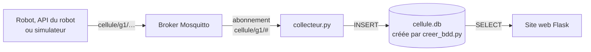

# Collecteur MQTT

Infrastructure client / serveur dans un contexte industriel

Le collecteur est le programme qui relie le broker MQTT à la base de données. Il reçoit tous les messages de l'équipe (`cellule/<equipe>/…`), publiés par le robot, par l'API du robot ou par le simulateur, et les enregistre dans la base SQLite `cellule.db`, lue ensuite par le site web (et par Grafana sur le NUC). Il applique le principe du support *Collecteur de messages MQTT en Python vers une base de données* (`cours/collecteur_MQTT.md`), en version simplifiée : chaque équipe l'adapte à son process.



| Fichier | Rôle |
|---|---|
| `creer_bdd.py` | Crée la base `cellule.db` et ses tables, et enregistre le robot de l'équipe. À lancer une fois, avant le collecteur |
| `collecteur.py` | Le collecteur : reçoit les messages et les écrit dans la base |

Les deux fichiers ont leurs **paramètres en haut du fichier**. Ils fonctionnent sur le serveur du module ou sur un poste, avec Python 3 et `paho-mqtt` version 2 (déjà installé sur le serveur ; sur un poste : `pip install paho-mqtt`). SQLite est inclus dans Python.


## La base de données

`creer_bdd.py` crée les tables des cours de SQL et de Flask :

| Table | Contenu | Remplie par |
|---|---|---|
| `messages(id, recu_le, sujet, charge, qos, retain)` | **Tous** les messages reçus, tels quels, même mal formés. `recu_le` : heure de réception, en UTC | Le collecteur, à chaque message |
| `robots(id, nom, equipe, adresse_ip)` | Le robot de l'équipe (`ned2-g1`) | `creer_bdd.py` |
| `cycles(id, robot_id, debut, duree, zone, statut)` | Un cycle par fin de cycle. `debut` : horodatage posé par le robot, en heure locale | Le collecteur, à chaque fin de cycle |

Le collecteur enregistre un cycle quand il reçoit, sur `cellule/<equipe>/cycle`, un message de la forme :

```json
{"evenement": "fin_cycle", "piece": 12, "duree": 18.2, "zone": "A", "horodatage": "2026-11-17T08:30:18"}
```

Un message mal formé (pas du JSON, `duree` absente ou qui n'est pas un nombre) est gardé dans `messages`, mais ne donne pas de cycle : le collecteur affiche « message mal formé » et **continue**. Les messages d'état, de défaut et de tâche ne sont que dans `messages` : à chaque équipe d'en tirer ce dont son site a besoin (voir *Adapter le collecteur*).

`creer_bdd.py` peut être relancé sans risque : il ne crée que ce qui manque et garde les données. Pour repartir d'une base vide, arrêter le collecteur, supprimer `cellule.db` et relancer `creer_bdd.py`.


## Mode d'emploi sur le serveur du module

1. **Copier les deux fichiers** dans le dossier du site web, `~/supervision/`, là où le site web (et Grafana sur le NUC) lit la base :

   ```bash
   mkdir -p ~/supervision
   cp /opt/cellule/fournitures/collecteur/*.py ~/supervision/
   ```

   Depuis un poste : avec VS Code Remote SSH, ou `scp creer_bdd.py collecteur.py g1@192.168.10.10:~/supervision/`.

2. **Adapter les paramètres** en haut de chaque fichier : l'identifiant de l'équipe et l'adresse de son robot dans `creer_bdd.py` ; l'identifiant et le broker dans `collecteur.py` :

   ```python
   EQUIPE = "g1"                        # identifiant de l'équipe, dans les topics MQTT
   BROKER = "localhost"                   # le collecteur tourne sur le serveur, comme le broker
   ```

3. **Créer la base**, puis **lancer le collecteur**, toujours depuis `~/supervision` (la base est cherchée dans le dossier courant) :

   ```bash
   cd ~/supervision
   python3 creer_bdd.py
   python3 collecteur.py
   ```

   ```text
   Collecteur de l'équipe g1, base cellule.db (Ctrl+C pour arrêter)
   Connecté à localhost, abonné à cellule/g1/#
   2026-11-17T07:30:18+00:00  cellule/g1/cycle  {"evenement": "fin_cycle", "piece": 1, "duree": 18.2, ...}
   ```

   Chaque message reçu s'affiche, avec son heure de réception (UTC) et son sujet. **Ctrl+C** arrête le collecteur.

4. **Le laisser tourner** après la fermeture du terminal ou de VS Code : le lancer dans une session `tmux` (installé sur le serveur).

   ```bash
   tmux new -s collecteur          # ouvre une session
   cd ~/supervision && python3 collecteur.py
   # Ctrl+B puis D : quitte la session, le collecteur continue
   tmux attach -t collecteur       # revenir voir le collecteur (Ctrl+C pour l'arrêter)
   ```

Un **seul collecteur par équipe** à la fois : deux collecteurs de même nom (`g1_collecteur`) se déconnectent l'un l'autre sans arrêt.


## Vérifier qu'il fonctionne : le simulateur

Le collecteur se vérifie avec le **simulateur MQTT** (`simulateurs/simulateur_mqtt.py`), qui envoie, au choix dans un menu, les messages du robot : le collecteur ne voit pas la différence avec le vrai robot. Mode d'emploi complet du simulateur dans `simulateurs/README.md`.

1. **Premier terminal** : le collecteur tourne (`cd ~/supervision && python3 collecteur.py`).
2. **Deuxième terminal** : copier le simulateur, lui donner **les mêmes paramètres** que le collecteur (`EQUIPE`, `BROKER`, en tête de fichier), puis le lancer :

   ```bash
   cp /opt/cellule/fournitures/simulateurs/simulateur_mqtt.py ~/
   python3 ~/simulateur_mqtt.py
   ```

3. **Pour chaque choix du menu**, vérifier que chaque message envoyé par le simulateur s'affiche dans la console du collecteur, puis compter ce qui est arrivé dans la base (troisième terminal) :

   ```bash
   cd ~/supervision
   sqlite3 cellule.db "SELECT sujet, count(*) FROM messages GROUP BY sujet;"
   sqlite3 cellule.db "SELECT count(*), round(avg(duree), 1) FROM cycles;"
   sqlite3 cellule.db "SELECT * FROM cycles ORDER BY id DESC LIMIT 5;"
   ```

| Choix du simulateur | Dans `messages` | Dans `cycles` | Dans la console du collecteur |
|---|---|---|---|
| 1. Cycle complet | 2 de plus (`cycle`) | 1 de plus | Le début et la fin du cycle |
| 2. Début de cycle | 1 de plus (`cycle`) | Aucun | Le message |
| 3. Fin de cycle | 1 de plus (`cycle`) | 1 de plus | Le message |
| 4. Changer l'état du robot | 1 de plus (`etat`) | Aucun | Le message |
| 5. Défaut | 1 de plus (`defaut`) | Aucun | Le message |
| 6. Tâche de l'API | 2 de plus (`tache`) | Aucun | Le début et la fin de la tâche |
| 7. Messages mal formés | 6 de plus (`cycle`) | Aucun | 6 fois « message mal formé », et le collecteur **continue** |
| 8. Production, par exemple 10 cycles | 22 de plus (état, début et fin ou défaut de chaque cycle, état) | Environ 9 de plus (un cycle sur dix finit en défaut) | Un cycle toutes les 2 secondes |
| 9. Rafale de 1000 messages | 1000 de plus (`cycle`) | 1000 de plus | Les 1000 messages, en quelques secondes |

Deux essais de plus, pour la fiabilité :

| Essai | Résultat attendu |
|---|---|
| Arrêter le collecteur (Ctrl+C), envoyer 3 cycles complets (choix 1), relancer le collecteur | Les 6 messages et les 3 cycles arrivent au redémarrage : le broker les a gardés pour le collecteur |
| Redémarrer le broker (enseignant) pendant que le collecteur tourne, puis envoyer un cycle | « Connecté » s'affiche à nouveau, le cycle est enregistré : le collecteur s'est reconnecté seul |

À chaque connexion, le broker renvoie le dernier message d'état (`cellule/<equipe>/etat`, choix 4 ou 8, publié avec `retain`) : il est enregistré à nouveau, avec `retain = 1`. Ce n'est pas un doublon envoyé par le robot.

Le simulateur sert aussi après chaque modification du collecteur : une nouvelle table pour les défauts se vérifie avec les choix 5 et 8. Si l'équipe a changé le format des messages, adapter d'abord les messages du simulateur.


## Messages d'erreur

| Message | Cause | Que faire |
|---|---|---|
| `Base cellule.db absente` | Base pas encore créée, ou collecteur lancé depuis un autre dossier | `cd ~/supervision`, puis `python3 creer_bdd.py` |
| `Broker localhost injoignable` | Pas de broker à cette adresse, ou broker arrêté | Vérifier `BROKER` (`localhost` sur le serveur, `192.168.10.10` depuis un poste du fab lab) |
| `Connexion refusée par le broker` | Le broker refuse la connexion (autre service sur le port 1883, broker mal configuré) | Vérifier `BROKER` ; lire le code de refus affiché |
| `message mal formé, pas de cycle enregistré` | Fin de cycle qui n'est pas du JSON, ou sans `duree`, `horodatage` ou `evenement` | Rien côté collecteur : le message est gardé dans `messages`. Corriger l'émetteur |
| `erreur d'écriture dans la base` | Table absente (`no such table`), base verrouillée, disque plein | Relancer `creer_bdd.py` ; lire le message d'erreur |
| Aucun message reçu, sans erreur | Message publié hors de `cellule/<equipe>/`, ou faute de frappe dans l'identifiant | Le collecteur ne reçoit que `cellule/<son identifiant>/…`. Espionner tout le trafic avec `mosquitto_sub -h localhost -t 'cellule/#' -v` |
| Messages dans `messages`, mais aucun cycle | Pas de robot pour l'équipe dans `robots` | Vérifier `EQUIPE` dans `creer_bdd.py`, le relancer |


## Comment il fonctionne

Le collecteur a deux parties, reliées par une **file d'attente** (`file_messages`) :

| Partie | Rôle |
|---|---|
| `on_connect` | Appelée à chaque connexion au broker, y compris après une coupure : s'abonne à `cellule/<equipe>/#` |
| `on_message` | Appelée à chaque message reçu : le dépose dans la file avec son heure de réception, **sans attendre la base** |
| `ecrivain` | Tourne à part (dans un fil, ou *thread*) : prend les messages dans la file, un par un, les écrit dans `messages` et appelle `enregistrer_cycle` pour les messages de cycle |
| `enregistrer_cycle` | Décode le JSON et, pour une fin de cycle, ajoute une ligne à `cycles` |
| `loop_forever` | Fait tourner la réception, et reconnecte le collecteur tout seul après une coupure |

Pourquoi une file : la réception ne doit jamais attendre la base. Si la base est lente ou occupée (le site web la lit en même temps), les messages s'accumulent dans la file au lieu de bloquer la réception.

Le collecteur se connecte avec un identifiant fixe (`g1_collecteur`) et `clean_session=False` : pendant qu'il est arrêté, le broker garde pour lui les messages publiés en QoS 1 (c'est le cas du robot, de l'API et du simulateur) et les envoie au redémarrage.

Par rapport au squelette du support de cours, il écrit les messages **un par un** au lieu de les écrire par lots : c'est plus simple, et assez rapide pour une cellule (environ 1000 messages en quelques secondes). Un arrêt par Ctrl+C pendant une rafale peut perdre les messages qui attendaient encore dans la file.


## Adapter le collecteur

**Changer le format des messages** : si l'équipe a choisi d'autres noms de champs (dictionnaire des données), modifier `enregistrer_cycle`. Le collecteur, le simulateur et le programme du robot doivent utiliser **les mêmes noms**.

**Enregistrer un autre type de message dans sa propre table** (défauts, changements d'état, tâches de l'API), en trois étapes :

1. dans `creer_bdd.py`, ajouter le `CREATE TABLE IF NOT EXISTS` de la nouvelle table, puis relancer `creer_bdd.py` (les données déjà en base sont gardées) ;
2. dans `collecteur.py`, écrire une fonction sur le modèle de `enregistrer_cycle` : décoder le JSON dans un `try`, insérer une ligne avec des paramètres `?` ;
3. dans `ecrivain`, l'appeler pour le bon sujet, à côté de `enregistrer_cycle` :

   ```python
   if sujet == f"cellule/{EQUIPE}/cycle":
       enregistrer_cycle(conn, charge)
   if sujet == f"cellule/{EQUIPE}/defaut":
       enregistrer_defaut(conn, charge)
   ```

Relancer le collecteur. La nouvelle table ne se remplit qu'avec les messages reçus **ensuite** ; les anciens restent dans `messages`.

**Ajouter une colonne à une table existante** : `CREATE TABLE IF NOT EXISTS` ne modifie pas une table qui existe déjà. Soit `ALTER TABLE cycles ADD COLUMN piece INTEGER;` avec `sqlite3`, soit, tant que les données ne sont que des essais, supprimer `cellule.db` et relancer `creer_bdd.py`. Modifier aussi `creer_bdd.py`, pour que la base puisse être recréée à l'identique.

**Règles à garder** :

- `on_message` ne fait que déposer le message dans la file : pas d'accès à la base ;
- les valeurs d'un message passent par des paramètres `?`, jamais dans le texte de la requête : un message MQTT est une donnée extérieure, comme une saisie de formulaire ;
- le décodage d'un message est dans un `try` : un message mal formé ne doit pas arrêter le collecteur.


## Essais réalisés

Avec un broker Mosquitto configuré comme celui du serveur du module (ouvert, sans compte) et le simulateur MQTT :

- chaque choix du menu du simulateur, dont les messages mal formés et la rafale : 1014 messages envoyés, 1014 enregistrés, 1002 cycles, les 6 messages mal formés signalés sans arrêt du collecteur ; la rafale est écrite en moins de 5 secondes ;
- message publié collecteur arrêté : reçu au redémarrage ;
- redémarrage du broker : reconnexion automatique, message suivant enregistré ;
- base absente, broker absent : message clair, arrêt du collecteur.
