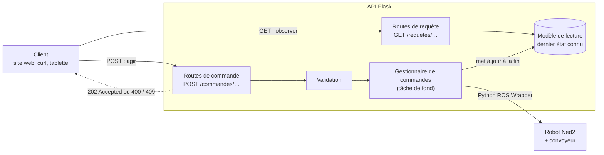
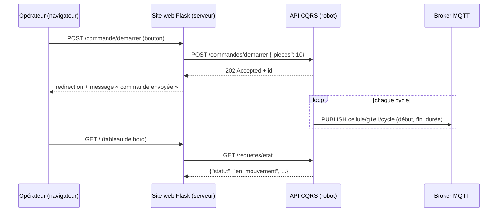

# Cours simple : une API CQRS pour le robot Niryo, comparée à REST, avec Flask

Infrastructure client / serveur dans un contexte industriel

CQRS sépare les ordres donnés au robot (commandes) de la lecture de son état (requêtes) ; ce cours montre pourquoi c'est utile pour un bras robotique et comment le coder avec Flask. Dans le projet fil rouge, c'est l'API que le site web de supervision appelle pour démarrer, arrêter et calibrer la cellule.

## Objectifs et idée générale

À la fin, vous saurez expliquer la différence entre une API RESTful et une API CQRS, puis construire une petite API Flask qui pilote un robot Niryo selon ce principe.

**Pourquoi une API pour le robot ?**

Un robot Niryo Ned2 se pilote en Python avec le **Python ROS Wrapper** de Niryo, la bibliothèque qu'utilise aussi l'export Python de Niryo Studio : le programme s'exécute sur le robot lui-même. Une API web permet de le commander depuis n'importe quel appareil du réseau : une page web, une tablette, un autre programme. L'API devient l'unique porte d'entrée vers le robot.

**Pourquoi un robot se prête bien à CQRS ?**

Un robot a deux types d'interactions très différentes :

- **Agir** : déplacer un axe, ouvrir la pince, lancer une calibration. C'est lent (le bras met du temps à bouger), cela change le monde physique et peut échouer ou être dangereux.
- **Observer** : lire les angles des axes, la position de la pince, l'état de connexion. C'est rapide, sans effet de bord, et on le répète en continu.

CQRS donne à chacune de ces interactions son propre chemin dans l'API.

**Prérequis**

- Notions de Python et d'HTTP (routes, méthodes `GET` et `POST`, codes d'état) : voir le cours *Le framework Flask : premiers pas*
- Flask installé : `pip install flask`
- Pour le vrai robot : rien à installer sur votre poste. L'API s'exécute sur le robot, où le Python ROS Wrapper est déjà présent et où Flask et paho-mqtt sont installés à l'avance par l'enseignant. Le code du cours inclut un robot simulé, vous pouvez donc tout tester sans robot.

## REST en bref

Une API RESTful modélise le système comme des ressources identifiées par des URL, manipulées avec les verbes HTTP ; une même URL sert à lire et à modifier la ressource.

**Les verbes et leur sens**

| Verbe | Sens | Exemple |
| --- | --- | --- |
| `GET` | Lire une ressource | `GET /joints` |
| `POST` | Créer une ressource | `POST /mouvements` |
| `PUT` | Remplacer une ressource | `PUT /joints` |
| `PATCH` | Modifier une partie | `PATCH /joints` |
| `DELETE` | Supprimer | `DELETE /mouvements/3` |

**Le robot en REST**

On considère les axes du robot comme une ressource `/joints` : lire et écrire passent par la même adresse et le même modèle de données.

```python
from flask import Flask, request, jsonify

app = Flask(__name__)
joints = [0.0, 0.0, 0.0, 0.0, 0.0, 0.0]   # angles des 6 axes, en radians

@app.route("/joints", methods=["GET"])
def lire_joints():
    return jsonify(joints=joints)

@app.route("/joints", methods=["PUT"])
def modifier_joints():
    global joints
    joints = request.get_json()["joints"]   # on remplace l'état
    # ... ici, appel au robot pour bouger ...
    return jsonify(joints=joints)
```

**Forces et limites de cette approche**

- Simple, uniforme et très répandue : idéale pour des données qu'on lit et écrit de façon symétrique (une liste d'utilisateurs, de produits).
- Un seul modèle sert à lire et à écrire. Or pour un robot, ce qu'on envoie (« va à cet angle ») n'est pas ce qu'on lit (« où est le bras en ce moment »).
- `PUT /joints` suggère que le changement est immédiat. En réalité le bras met du temps à arriver : l'API ment sur l'état réel pendant le mouvement.
- Les verbes `PUT` et `PATCH` décrivent la mise à jour de données, pas l'intention métier (« saisir la pièce », « retourner à la position de repos »).

## CQRS : le principe

CQRS signifie Command Query Responsibility Segregation, soit « séparation des responsabilités entre commandes et requêtes » : on traite l'écriture et la lecture avec deux chemins distincts, chacun avec son propre modèle.

**Deux notions à bien distinguer**

- **Une commande** exprime une intention de changer quelque chose : `DeplacerAxes`, `OuvrirPince`, `Calibrer`. Elle porte un verbe à l'impératif, peut être refusée, ne renvoie pas de données métier (au plus un accusé de réception). Elle modifie l'état.
- **Une requête** pose une question : `QuelsSontLesAngles`, `QuelEstLEtatDuRobot`. Elle renvoie des données et ne modifie jamais rien : on peut la répéter mille fois sans risque.

**Règle d'or** : une opération est soit une commande, soit une requête, jamais les deux.

**Ce que cela change dans l'API**

1. **Les URL expriment des actions et des questions**, pas des ressources à modifier. Les commandes sont en `POST`, les requêtes en `GET`.
2. **Chaque côté a son modèle de données.** La commande contient ce qu'il faut pour agir (angles cibles, vitesse). La requête renvoie ce qui intéresse le lecteur (angles actuels, mouvement en cours, état de connexion).
3. **Les deux côtés peuvent évoluer séparément** : on peut renforcer les contrôles sur les commandes (sécurité, validation) sans toucher aux lectures, ou mettre les lectures en cache.
4. **Une commande peut être asynchrone** : l'API répond tout de suite « ordre reçu » (code `202 Accepted`), pendant que le robot exécute. Le client consulte ensuite l'état avec une requête.

**Les trois pièces du code**

| Pièce | Rôle | Ce qu'elle fait pour le robot |
| --- | --- | --- |
| Commande + gestionnaire | Valide l'ordre, l'exécute, met à jour l'état | Vérifie les angles, appelle `move_joints` |
| Modèle de lecture | Stocke l'état sous la forme que les lecteurs demandent | Dernier état connu du robot |
| Requête | Lit le modèle de lecture, sans aucun effet de bord | Renvoie les angles et le statut |

CQRS est un principe d'architecture, pas un produit : une API Flask de quelques dizaines de lignes peut l'appliquer. Le principe se généralise ensuite à des bases de données séparées en lecture et en écriture, mais ce n'est pas nécessaire ici.

## REST contre CQRS sur le robot

REST organise l'API autour de ressources qu'on lit et modifie par la même adresse ; CQRS l'organise autour d'intentions, avec un chemin pour agir et un autre pour observer.

| Critère | API RESTful | API CQRS |
| --- | --- | --- |
| Idée centrale | Des ressources (noms) | Des commandes et des requêtes (intentions) |
| Lire l'état du robot | `GET /joints` | `GET /requetes/etat` |
| Bouger le robot | `PUT /joints` avec le nouvel état | `POST /commandes/deplacer-axes` avec l'ordre |
| Modèle de données | Un seul modèle pour lire et écrire | Un modèle par commande, un modèle de lecture |
| Réponse à une écriture | Renvoie souvent la ressource modifiée | Accusé de réception (`202`), l'état se lit à part |
| Effets de bord | `GET` sans effet, le reste modifie la ressource | Seules les commandes modifient, les requêtes jamais |
| Mouvement lent | Réponse bloquée jusqu'à la fin, ou état incohérent | Réponse immédiate, suivi par requêtes |
| Expressivité métier | Faible : `PUT`, `PATCH` | Forte : `OuvrirPince`, `Calibrer` |
| Complexité | Faible, rapide à écrire | Plus de code (deux chemins), plus de clarté |
| Cas idéal | Données simples, lecture et écriture symétriques | Actions longues, règles de sécurité, lectures fréquentes |

**Un même scénario, deux écritures**

On veut déplacer le robot, puis voir où il en est.

```text
REST
  PUT  /joints        {"joints": [0.5, 0, 0, 0, 0, 0]}   → 200 + nouvel état
  GET  /joints                                            → état

CQRS
  POST /commandes/deplacer-axes  {"joints": [0.5, 0, 0, 0, 0, 0]}
                                                           → 202 + id de commande
  GET  /requetes/etat                                      → angles + statut du mouvement
```

En REST, la même URL porte deux sens (lire, écrire) et la réponse laisse croire que le bras est arrivé. En CQRS, l'ordre est explicite, l'accusé est immédiat, et le statut (`en_mouvement`, `au_repos`) se lit à part.

**À retenir**

CQRS n'est pas « mieux » que REST : c'est un choix de conception. Les deux utilisent HTTP et JSON, et une API CQRS peut très bien rester conforme aux bonnes pratiques REST (codes d'état, JSON, verbes corrects). La différence porte sur la manière de penser l'API : des ressources d'un côté, des intentions de l'autre.

## Architecture pour le robot Niryo

Le client choisit son chemin selon son intention, et seul le gestionnaire de commandes touche au robot.



Un `POST` déclenche une commande : l'API la valide, répond `202` tout de suite, puis le gestionnaire l'exécute en tâche de fond sur le robot. Un `GET` lit le modèle de lecture, que le gestionnaire met à jour à la fin de chaque mouvement : aucune requête ne parle directement au robot, donc lire l'état ne gêne jamais un mouvement en cours.

## Flask : le code de l'API CQRS

Tout tient dans un fichier `app.py` d'environ 230 lignes ; les cinq blocs ci-dessous se placent à la suite, dans l'ordre. L'API expose six commandes (`POST`) et deux requêtes (`GET`).

**Bloc 1 : l'adaptateur robot**

L'API ne parle jamais directement au Python ROS Wrapper : elle passe par un adaptateur. Le robot simulé permet de tester sans matériel, sur n'importe quel poste ; pour le vrai robot, il suffit de changer une ligne. L'adaptateur `RobotNiryo` n'importe le Python ROS Wrapper qu'à sa création : le fichier s'exécute donc aussi sur un poste où ROS n'est pas installé.

```python
# app.py
import threading
import time
import uuid
from dataclasses import dataclass

from flask import Flask, request, jsonify, abort

app = Flask(__name__)

NB_AXES = 6
LIMITE_RAD = 3.14   # à remplacer par les limites réelles de votre modèle de robot


class RobotSimule:
    """Robot factice : mêmes méthodes que le vrai, sans matériel."""
    def __init__(self):
        self._joints = [0.0] * NB_AXES
        self._pince = "fermee"

    def get_joints(self):
        return list(self._joints)

    def move_joints(self, joints):
        time.sleep(3)                  # le bras met du temps à bouger
        self._joints = list(joints)

    def open_gripper(self):
        time.sleep(1)
        self._pince = "ouverte"

    def close_gripper(self):
        time.sleep(1)
        self._pince = "fermee"

    def etat_pince(self):
        return self._pince

    def calibrer(self):
        time.sleep(2)

    def cycle_pick_and_place(self):
        time.sleep(4)                  # convoyeur, détection, prise, dépose
        self._joints = [0.0] * NB_AXES


class RobotNiryo:
    """Adaptateur vers le vrai robot Niryo, via le Python ROS Wrapper (l'API tourne sur le robot)."""
    # Poses relevées lors de la prise en main du robot (x, y, z, roll, pitch, yaw) : à reprendre du programme exporté
    POSE_ATTENTE = [0.14, 0.0, 0.20, 0.0, 1.57, 0.0]
    POSE_PRISE = [0.25, -0.20, 0.08, 0.0, 1.57, 0.0]
    POSE_DEPOSE = [0.20, 0.20, 0.10, 0.0, 1.57, 0.0]

    def __init__(self, nom_noeud="cellule_api"):
        import rospy
        from niryo_robot_python_ros_wrapper.ros_wrapper import NiryoRosWrapper
        rospy.init_node(nom_noeud)     # nom propre à l'API, différent de celui des programmes de Niryo Studio
        self._n = NiryoRosWrapper()
        self._n.calibrate_auto()
        self._n.update_tool()          # détecte l'outil monté (pince)
        self._convoyeur = self._n.set_conveyor()
        self._pince = "inconnue"

    def get_joints(self):
        return list(self._n.get_joints())

    def move_joints(self, joints):
        self._n.move_joints(*joints)

    def open_gripper(self):
        self._n.open_gripper()
        self._pince = "ouverte"

    def close_gripper(self):
        self._n.close_gripper()
        self._pince = "fermee"

    def etat_pince(self):
        return self._pince

    def calibrer(self):
        self._n.calibrate_auto()

    def piece_detectee(self):
        # digital_read vaut vrai si DI5 est à HIGH (pas de pièce) :
        # vérifiez la polarité du capteur avec le programme exporté de Niryo Studio
        return not self._n.digital_read("DI5")

    def cycle_pick_and_place(self, delai_max=30):
        from niryo_robot_python_ros_wrapper.ros_wrapper import ConveyorDirection
        self._n.control_conveyor(self._convoyeur, True, 50, ConveyorDirection.FORWARD)
        debut = time.monotonic()
        try:
            while not self.piece_detectee():
                if time.monotonic() - debut > delai_max:
                    raise RuntimeError("pièce non détectée")
                time.sleep(0.1)
        finally:
            # arrêt du convoyeur dans tous les cas
            self._n.control_conveyor(self._convoyeur, False, 0, ConveyorDirection.FORWARD)
        self._n.pick_from_pose(*self.POSE_PRISE)
        self._n.place_from_pose(*self.POSE_DEPOSE)
        self._n.move_pose(*self.POSE_ATTENTE)
        self._pince = "ouverte"


robot = RobotSimule()                  # RobotNiryo() quand l'API tourne sur le robot
```

**Bloc 2 : le côté écriture (commandes)**

Chaque commande est un petit objet qui décrit l'intention. La validation se fait tout de suite, l'exécution en arrière-plan : le robot est lent, l'API ne doit pas rester bloquée.

```python
@dataclass
class DeplacerAxes:
    joints: list


def valider_deplacer_axes(cmd):
    ok = isinstance(cmd.joints, list) and len(cmd.joints) == NB_AXES
    if not ok or not all(isinstance(a, (int, float)) for a in cmd.joints):
        raise ValueError(f"joints doit contenir {NB_AXES} nombres")
    if any(abs(a) > LIMITE_RAD for a in cmd.joints):
        raise ValueError(f"chaque angle doit être compris entre -{LIMITE_RAD} et {LIMITE_RAD}")


# Modèle de lecture : ce que les requêtes renvoient
modele_lecture = {
    "statut": "au_repos",              # au_repos ou en_mouvement
    "joints": robot.get_joints(),
    "pince": robot.etat_pince(),
    "derniere_commande": None,
}
journal = {}                           # id de commande -> suivi
verrou = threading.Lock()


def soumettre(nom, executer):
    """Accepte la commande si le robot est libre, puis l'exécute en arrière-plan."""
    with verrou:
        if modele_lecture["statut"] == "en_mouvement":
            return None
        id_cmd = uuid.uuid4().hex[:8]
        journal[id_cmd] = {"type": nom, "statut": "acceptee", "erreur": None}
        modele_lecture["statut"] = "en_mouvement"
        modele_lecture["derniere_commande"] = id_cmd
    threading.Thread(target=_travail, args=(id_cmd, executer), daemon=True).start()
    return id_cmd


def _travail(id_cmd, executer):
    try:
        executer()
        journal[id_cmd]["statut"] = "terminee"
    except Exception as e:
        journal[id_cmd].update(statut="echouee", erreur=str(e))
    finally:
        with verrou:                   # seul endroit qui met à jour le modèle de lecture
            modele_lecture["joints"] = robot.get_joints()
            modele_lecture["pince"] = robot.etat_pince()
            modele_lecture["statut"] = "au_repos"


def reponse_commande(id_cmd):
    if id_cmd is None:
        return jsonify(erreur="robot occupé, réessayez à la fin du mouvement"), 409
    return jsonify(id=id_cmd, suivi=f"/requetes/commandes/{id_cmd}"), 202
```

**Bloc 3 : les routes de commande**

```python
@app.post("/commandes/deplacer-axes")
def commande_deplacer_axes():
    donnees = request.get_json(silent=True) or {}
    cmd = DeplacerAxes(joints=donnees.get("joints"))
    try:
        valider_deplacer_axes(cmd)
    except ValueError as e:
        return jsonify(erreur=str(e)), 400
    return reponse_commande(soumettre("DeplacerAxes", lambda: robot.move_joints(cmd.joints)))


@app.post("/commandes/ouvrir-pince")
def commande_ouvrir_pince():
    return reponse_commande(soumettre("OuvrirPince", robot.open_gripper))


@app.post("/commandes/fermer-pince")
def commande_fermer_pince():
    return reponse_commande(soumettre("FermerPince", robot.close_gripper))
```

**Bloc 4 : les routes de requête**

Ces routes ne font que lire : aucune ne modifie le robot ni le modèle de lecture.

```python
@app.get("/requetes/etat")
def requete_etat():
    with verrou:
        return jsonify(modele_lecture)


@app.get("/requetes/commandes/<id_cmd>")
def requete_commande(id_cmd):
    if id_cmd not in journal:
        abort(404)
    return jsonify(journal[id_cmd])
```

**Bloc 5 : les commandes du process (fil rouge)**

Le site web de supervision n'envoie pas d'angles : il envoie des ordres métier. Les commandes `demarrer` et `calibrer` passent par `soumettre` comme les autres. La commande `arreter` est particulière : elle doit être acceptée **pendant** un mouvement, sinon on ne pourrait jamais arrêter le process. Elle ne touche pas au robot : elle lève un drapeau que la boucle du process consulte entre deux cycles.

```python
arret_demande = threading.Event()


def executer_process(nb_pieces):
    arret_demande.clear()
    for _ in range(nb_pieces):
        if arret_demande.is_set():
            break                       # arrêt propre, en fin de cycle
        robot.cycle_pick_and_place()


@app.post("/commandes/demarrer")
def commande_demarrer():
    donnees = request.get_json(silent=True) or {}
    nb = donnees.get("pieces", 10)
    if not isinstance(nb, int) or not 1 <= nb <= 100:
        return jsonify(erreur="pieces doit être un entier entre 1 et 100"), 400
    return reponse_commande(soumettre("Demarrer", lambda: executer_process(nb)))


@app.post("/commandes/arreter")
def commande_arreter():
    arret_demande.set()                 # toujours acceptée, même robot occupé
    return jsonify(message="arrêt demandé, effectif à la fin du cycle en cours"), 202


@app.post("/commandes/calibrer")
def commande_calibrer():
    return reponse_commande(soumettre("Calibrer", robot.calibrer))


PORT = 5001                            # sur le serveur : le port de l'équipe (5001 à 5008) ; sur le robot : 3000

if __name__ == "__main__":
    app.run(host="0.0.0.0", port=PORT)
```

L'arrêt demandé par l'API est un arrêt **de production**, en fin de cycle : il ne remplace jamais l'arrêt d'urgence physique du robot.

**Lancer**

```bash
python3 app.py                         # sur le serveur ou sur votre poste, avec RobotSimule
~/cellule/lancer.sh app.py             # sur le robot, avec RobotNiryo
```

Sur le robot, Flask et paho-mqtt sont installés hors ligne dans `~/cellule/libs` ; le lanceur `~/cellule/lancer.sh` les rend visibles et charge l'environnement ROS. Le port 5000 du robot est déjà pris par le logiciel système de Niryo (Niryo Studio passe par lui) : l'API y écoute sur le port 3000.

Avec le vrai robot, lancez l'API avec `python3`, pas avec `flask --app app run --debug` : le rechargeur de Flask lance le programme deux fois, et `rospy.init_node` doit être appelé par le programme principal.

## Tester l'API et points d'attention

Un test complet se déroule en quatre temps : lire l'état, envoyer une commande, constater que le robot est occupé, suivre la fin du mouvement.

**Scénario avec curl**

```bash
# 1. Requête : état initial
curl http://127.0.0.1:5001/requetes/etat
# {"derniere_commande":null,"joints":[0,0,0,0,0,0],"pince":"fermee","statut":"au_repos"}

# 2. Commande : déplacer les axes (réponse immédiate, code 202)
curl -X POST http://127.0.0.1:5001/commandes/deplacer-axes \
     -H "Content-Type: application/json" \
     -d '{"joints": [0.5, 0.2, 0, 0, 0, 0]}'
# {"id":"a1b2c3d4","suivi":"/requetes/commandes/a1b2c3d4"}

# 3. Pendant le mouvement : le statut change, une 2e commande est refusée (409)
curl http://127.0.0.1:5001/requetes/etat
curl -X POST http://127.0.0.1:5001/commandes/ouvrir-pince

# 4. Une fois le mouvement fini : suivre la commande
curl http://127.0.0.1:5001/requetes/commandes/a1b2c3d4
# {"erreur":null,"statut":"terminee","type":"DeplacerAxes"}

# 5. Process : démarrer 3 pièces, puis demander l'arrêt
curl -X POST http://127.0.0.1:5001/commandes/demarrer \
     -H "Content-Type: application/json" -d '{"pieces": 3}'
curl -X POST http://127.0.0.1:5001/commandes/arreter
```

**Codes d'état utilisés**

| Code | Situation |
| --- | --- |
| `202 Accepted` | Commande acceptée, exécution en cours (ou arrêt demandé) |
| `400 Bad Request` | Commande invalide (angle hors limites, mauvais nombre d'axes) |
| `409 Conflict` | Robot occupé, une commande est déjà en cours |
| `404 Not Found` | Identifiant de commande inconnu |

**Points d'attention**

- **Validez toujours avant d'agir.** Un robot est un objet physique : une commande invalide ou hors limites doit être refusée avant d'atteindre le robot. Remplacez `LIMITE_RAD` par les limites réelles de votre modèle.
- **Une commande à la fois.** Le verrou et le statut `en_mouvement` évitent d'envoyer deux ordres contradictoires. Une file d'attente est une amélioration possible.
- **Rien n'est conservé au redémarrage.** `journal` et `modele_lecture` vivent en mémoire ; au redémarrage, le modèle de lecture est relu depuis le robot.
- **Un seul processus.** Gardez un seul worker (pas de serveur multi-processus) : l'état partagé et la connexion au robot ne se partagent pas entre processus.
- **Un seul programme commande le robot.** Ne lancez pas de programme depuis Niryo Studio pendant que l'API tourne : les deux enverraient des ordres au bras en même temps.
- **Sécurité réseau.** Cette API n'a aucune authentification : n'exposez-la que sur un réseau de confiance, et ajoutez au minimum une clé d'API avant tout usage sérieux, car n'importe qui pourrait bouger le bras.
- **Arrêt d'urgence.** Prévoyez toujours l'arrêt physique du robot, indépendant de l'API.

## Dans le projet fil rouge

L'API suit le projet en deux temps, sans changer de code : seul l'adaptateur et l'adresse changent.

| Étape | Où tourne l'API | Adaptateur | Adresse appelée par le site web |
| --- | --- | --- | --- |
| Développement, sans robot | Serveur du module | `RobotSimule()` | `http://127.0.0.1:5001` (un port par équipe, 5001 à 5008) |
| Intégration et recette (fab lab) | Robot Ned2 | `RobotNiryo()` | `http://192.168.10.21:3000` (adresse du robot de l'équipe) |



- Le site web relaie les boutons vers les routes `/commandes/…` (voir *Appeler l'API du robot depuis le site* dans le cours Flask) et peut afficher l'état du robot avec `GET /requetes/etat`.
- L'historique de production ne passe pas par l'API : le programme publie ses cycles en MQTT, le collecteur les range dans la base, le site les lit. L'API répond à « que fait le robot maintenant ? », la base à « qu'a-t-il fait ? ».
- Pour publier les cycles depuis l'API, appelez la fonction `publier()` du cours sur le collecteur MQTT au début et à la fin de `cycle_pick_and_place`.
- Une API de départ est fournie (`api_robot/`) : état du robot, retour en position home, calibration et anneau de LED, sur des routes `/robot/…`. Plus simple que l'API de ce support, elle a un endpoint par tâche, qui appelle une fonction du même nom, et répond à la fin de la tâche ; elle annonce chaque tâche sur `cellule/<equipe>/tache`. Son simulateur (`simulateurs/simulateur_api.py`) a les mêmes endpoints, sans robot. Pour ajouter une tâche, on copie le modèle en fin de fichier.
- Les tests du cahier de recette peuvent s'écrire directement avec `curl` : chaque ligne du scénario ci-dessus est un test (préconditions, commande, résultat attendu, code d'état).

## Exercices et pistes pour aller plus loin

Chaque exercice ajoute une commande ou une requête : c'est la meilleure façon de sentir la séparation des deux côtés.

- [ ] Requête : ajouter `GET /requetes/commandes` qui liste les dix dernières commandes, sans rien modifier
- [ ] Commande : ajouter `POST /commandes/retour-repos` qui ramène les axes à zéro
- [ ] Validation : refuser `deplacer-axes` si un angle dépasse une limite propre à chaque axe
- [ ] Commande : refuser tout ordre de mouvement tant que la commande `calibrer` n'a pas été exécutée avec succès (code `409`)
- [ ] Requête : ajouter `GET /robot/etat`, qui renvoie l'état lu directement sur le robot à chaque appel (axes, pose, capteur DI5, températures), avec une méthode `etat_materiel()` dans chaque adaptateur (valeurs fixes pour `RobotSimule`) ; comparer avec `GET /requetes/etat`
- [ ] Requête : ajouter au modèle de lecture le nombre de pièces traitées depuis le dernier `demarrer`, mis à jour à chaque cycle
- [ ] Robustesse : si `cycle_pick_and_place` lève « pièce non détectée », arrêter le process et faire apparaître l'erreur dans le suivi de la commande
- [ ] Comparaison : écrire la version REST (`GET` et `PUT /joints`) et comparer les deux fichiers : qu'est-ce qui est plus simple, plus clair, plus sûr ?
- [ ] Test : écrire un test avec le client de test de Flask qui vérifie le `409` quand on envoie deux commandes de suite

**Pistes pour aller plus loin**

1. **Une file de commandes** : accepter plusieurs ordres et les exécuter l'un après l'autre.
2. **Suivi en continu** : remplacer l'appel répété de `GET /requetes/etat` par un flux d'événements (Server-Sent Events) ou des WebSockets.
3. **Journal durable** : stocker les commandes dans une base SQLite ; c'est le point de départ de l'Event Sourcing, souvent associé à CQRS.
4. **Interface web** : une page HTML avec des boutons (commandes) et un panneau d'état rafraîchi (requêtes) : c'est le tableau de bord du cours Flask.
5. **Sécurité** : clé d'API ou jeton sur les routes `/commandes/*` uniquement, les lectures pouvant rester ouvertes.
