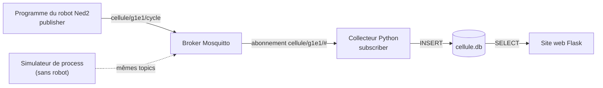
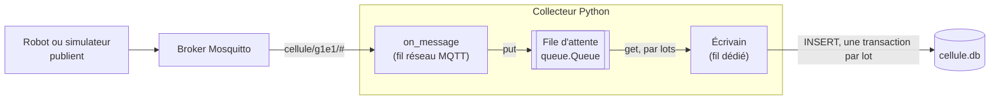

# Collecteur de messages MQTT en Python vers une base de données : présentation du principe

Fabrice Guichard · Infrastructure client / serveur dans un contexte industriel

Un collecteur MQTT est un petit programme Python qui s'abonne aux messages publiés par des capteurs ou des appareils, puis les enregistre dans une base de données pour les conserver et les interroger. Dans le projet fil rouge, il reçoit les événements publiés par le programme du robot Ned2 (début et fin de cycle, défauts) et les range dans la base SQLite lue par le site web.

## Objectif et vue d'ensemble

Les appareils (capteurs, robots, passerelles) publient leurs données sur un broker MQTT, mais le broker sert à transmettre les messages, pas à les archiver : il ne conserve ni historique ni statistiques. Le collecteur comble ce manque.

**Ce que fait le collecteur**

1. Il se connecte au broker MQTT.
2. Il s'abonne à un ou plusieurs sujets (topics).
3. À chaque message reçu, il vérifie et décode le contenu.
4. Il écrit le message dans la base de données, avec son sujet et son horodatage.

**Pourquoi un collecteur séparé**

- **Découplage** : les appareils n'ont pas à connaître la base de données.
- **Historique** : la base conserve les mesures pour les graphiques, les statistiques, l'analyse des pannes.
- **Interrogation** : une fois en base, les messages se filtrent et se résument en SQL (voir le document de rappels SQL).

**Pile technique du module**

| Brique | Choix | Où |
| --- | --- | --- |
| Broker | Mosquitto (open source, léger), avec un utilisateur par équipe | Serveur du module |
| Client Python | `paho-mqtt` version 2 | Robot (publication) et serveur (collecteur) |
| Base de données | SQLite (fichier `cellule.db`) ; PostgreSQL pour monter en charge | Serveur du module |
| Langage | Python 3 | |



## MQTT en bref

MQTT est un protocole de messagerie léger, fondé sur la publication et l'abonnement : les émetteurs ne s'adressent jamais directement aux récepteurs, ils passent par un intermédiaire, le broker.

**Les acteurs**

| Acteur | Rôle |
| --- | --- |
| Publisher (éditeur) | Envoie un message sur un sujet |
| Broker | Reçoit les messages et les redistribue aux abonnés intéressés |
| Subscriber (abonné) | Déclare les sujets qui l'intéressent et reçoit les messages correspondants. Le collecteur en est un. |

**Les sujets (topics)**

Un sujet est une chaîne hiérarchique séparée par des `/` : `cellule/g1e1/cycle`. Un abonné peut utiliser des jokers :

- `+` remplace exactement un niveau : `cellule/+/defaut` couvre les défauts de toutes les équipes.
- `#` remplace tous les niveaux restants, à la fin du sujet : `cellule/g1e1/#` couvre tout ce que publie l'équipe g1e1.

Le collecteur s'abonne en général avec un joker, par exemple `cellule/g1e1/#`, pour tout recevoir sans lister chaque sujet.

**Bonnes pratiques de nommage** : du général au particulier (cellule, équipe, type de message), en minuscules, sans espace ni accent, sans `/` au début. Pas de `+` ni `#` dans un sujet de publication.

**Un message**

Un message MQTT contient un sujet et une charge utile (payload), qui est une suite d'octets : souvent du texte ou du JSON, par exemple `{"evenement": "fin_cycle", "duree": 18.2, "zone": "A"}`. MQTT ne définit pas le format de la charge utile : c'est une convention entre émetteurs et collecteur.

**Qualité de service (QoS)**

| QoS | Garantie | Usage |
| --- | --- | --- |
| 0 | Au plus une fois : peut se perdre | Mesures fréquentes dont la perte d'une valeur est sans gravité (position du bras toutes les secondes) |
| 1 | Au moins une fois : arrive, mais peut être livré en double | Cas général pour un collecteur, avec gestion des doublons |
| 2 | Exactement une fois : arrive une seule fois, plus coûteux | Données critiques (comptage de pièces sans doublon), rarement nécessaire |

La qualité de service s'applique à chaque lien : l'éditeur vers le broker, puis le broker vers l'abonné. Le niveau effectif côté collecteur est le plus faible des deux.

**Autres notions utiles**

- **Retain** : le broker garde le dernier message d'un sujet et le renvoie à tout nouvel abonné. Pratique pour connaître le dernier état (`cellule/g1e1/etat` : « en cycle », « arrêté »), mais ce n'est pas un historique.
- **Testament (Last Will)** : message que le broker publie à la place d'un client qui disparaît sans se déconnecter proprement. Le robot peut ainsi déclarer `{"etat": "hors_ligne"}` sur son sujet d'état s'il perd le réseau.
- **Session persistante** : avec un identifiant de client fixe et une session persistante, le broker met en file les messages (QoS 1 ou 2) reçus pendant que le collecteur est déconnecté, et les livre à la reconnexion.
- **Port** : 1883 en clair, 8883 avec TLS.

## Les messages de la cellule

Le contenu des messages est une **convention** que chaque équipe fixe dans son dossier d'analyse (dictionnaire des données). Voici une proposition de départ.

**Plan des sujets**

| Sujet | Publié par | Quand | QoS | Retain |
| --- | --- | --- | --- | --- |
| `cellule/<equipe>/cycle` | Robot | Début et fin de chaque cycle | 1 | non |
| `cellule/<equipe>/etat` | Robot | À chaque changement d'état (en cycle, attente, arrêté, hors ligne) | 1 | oui |
| `cellule/<equipe>/defaut` | Robot | Pièce non détectée, prise manquée, erreur du robot | 1 | non |

`<equipe>` vaut par exemple `g1e1` : sur le broker du module, chaque équipe n'a le droit de publier et de lire que sous `cellule/<son équipe>/`.

**Charges utiles (JSON)**

```json
{"evenement": "debut_cycle", "piece": 12, "horodatage": "2026-11-17T08:30:00"}
{"evenement": "fin_cycle", "piece": 12, "duree": 18.2, "zone": "A", "horodatage": "2026-11-17T08:30:18"}
{"etat": "en_cycle", "horodatage": "2026-11-17T08:30:00"}
{"defaut": "piece_non_detectee", "message": "DI5 inactif après 30 s", "horodatage": "2026-11-17T08:42:03"}
```

- Un horodatage posé par le robot permet de calculer des durées exactes, même si le message arrive en retard.
- Le numéro de pièce rend chaque message unique, ce qui permet d'écarter les doublons (QoS 1).

**Publier depuis le programme du robot**

On ajoute quelques lignes au programme Python exporté de Niryo Studio lors de la prise en main du robot :

```python
import json
import time
from datetime import datetime

import paho.mqtt.client as mqtt

EQUIPE = "g1e1"
client = mqtt.Client(mqtt.CallbackAPIVersion.VERSION2, client_id=f"robot-{EQUIPE}")
client.username_pw_set(EQUIPE, "mot-de-passe-equipe")
client.will_set(f"cellule/{EQUIPE}/etat", json.dumps({"etat": "hors_ligne"}), qos=1, retain=True)
client.connect("192.168.10.10", 1883)      # adresse du serveur du module
client.loop_start()                         # boucle réseau dans un fil séparé


def publier(type_message, **donnees):
    donnees["horodatage"] = datetime.now().isoformat(timespec="seconds")
    client.publish(f"cellule/{EQUIPE}/{type_message}", json.dumps(donnees),
                   qos=1, retain=(type_message == "etat"))


publier("etat", etat="en_cycle")
for piece in range(1, 11):
    debut = time.monotonic()
    publier("cycle", evenement="debut_cycle", piece=piece)
    # ... convoyeur jusqu'au capteur DI5, prise, dépose (code exporté de Niryo Studio) ...
    publier("cycle", evenement="fin_cycle", piece=piece,
            duree=round(time.monotonic() - debut, 1), zone="A")
publier("etat", etat="arrete")

client.loop_stop()
client.disconnect()
```

Tant que le robot n'est pas intégré, un **simulateur de process** publie les mêmes messages sur les mêmes sujets : le collecteur ne voit pas la différence. C'est ce qui permet de développer le collecteur et le site web avant l'intégration sur le robot.

## Architecture du collecteur

Le collecteur reçoit les messages d'un côté et les écrit en base de l'autre, avec une file d'attente au milieu.



Le robot publie sur le broker, et le collecteur s'y abonne avec un sujet joker. La réception ne fait que déposer chaque message dans la file ; l'écrivain, seul fil à toucher la base, les écrit par lots. Une base lente ou momentanément indisponible ne bloque donc jamais la réception MQTT.

## Modèle de données

Le plus simple et le plus sûr : une table `messages` qui garde chaque message tel qu'il est reçu, sans l'interpréter à l'écriture.

```sql
CREATE TABLE IF NOT EXISTS messages (
    id        INTEGER PRIMARY KEY,
    recu_le   TEXT    NOT NULL,          -- horodatage de réception, en UTC
    sujet     TEXT    NOT NULL,          -- ex. cellule/g1e1/cycle
    charge    TEXT    NOT NULL,          -- contenu brut du message (souvent du JSON)
    qos       INTEGER NOT NULL,
    retain    INTEGER NOT NULL DEFAULT 0
);

CREATE INDEX IF NOT EXISTS idx_messages_sujet_date ON messages (sujet, recu_le);
```

**Choix de conception**

- **Horodatage de réception** : c'est le collecteur qui pose l'heure, en UTC, au moment où le message arrive. Si les appareils envoient leur propre heure dans la charge utile, elle reste dans `charge` et peut être extraite plus tard.
- **Charge utile brute** : on conserve le contenu original. Si le format change ou qu'un message est mal formé, rien n'est perdu et on peut le retraiter.
- **Index sur (sujet, recu\_le)** : accélère la requête typique « les messages de tel sujet entre deux dates ».

**Pour exploiter les valeurs : une seconde table**

Quand le format est stable, une table structurée facilite les calculs (durée moyenne, nombre de cycles, taux de défaut). C'est la table `cycles` du cours de SQL, lue par le site web :

```sql
CREATE TABLE IF NOT EXISTS robots (
    id INTEGER PRIMARY KEY, nom TEXT NOT NULL UNIQUE,
    equipe TEXT NOT NULL, adresse_ip TEXT
);
CREATE TABLE IF NOT EXISTS cycles (
    id        INTEGER PRIMARY KEY,
    robot_id  INTEGER NOT NULL REFERENCES robots(id),
    debut     TEXT NOT NULL,
    duree     REAL NOT NULL,
    zone      TEXT,
    statut    TEXT NOT NULL DEFAULT 'ok'
);
```

Deux approches possibles, qui se combinent : stocker d'abord le message brut (journal complet), puis en dériver les cycles pour l'analyse. La section *Extraire les cycles* montre comment.

## Principe du code Python

Le collecteur sépare la réception (rapide, déclenchée par le réseau) de l'écriture en base (plus lente), reliées par une file d'attente en mémoire.

**Pourquoi deux étages ?**

La fonction appelée à chaque message (callback) s'exécute dans le fil réseau du client MQTT. Si elle attendait la base de données, la réception ralentirait, les messages s'accumuleraient côté broker, et la connexion pourrait même être coupée faute de réponse. La callback se contente donc de déposer le message dans une file ; un second fil, l'écrivain, vide la file et écrit en base par lots.

**Squelette complet** (bibliothèque `paho-mqtt` version 2, `pip install paho-mqtt`)

```python
import queue
import sqlite3
import threading
import time
from datetime import datetime, timezone

import paho.mqtt.client as mqtt

BROKER, PORT = "localhost", 1883
SUJET = "cellule/g1e1/#"
BASE = "cellule.db"
UTILISATEUR, MOT_DE_PASSE = "g1e1", "mot-de-passe-equipe"
TAILLE_LOT = 100          # écrit dès 100 messages en attente...
DELAI_LOT = 2.0           # ... ou au plus tard toutes les 2 secondes

SCHEMA = """
CREATE TABLE IF NOT EXISTS messages (
    id INTEGER PRIMARY KEY, recu_le TEXT NOT NULL, sujet TEXT NOT NULL,
    charge TEXT NOT NULL, qos INTEGER NOT NULL, retain INTEGER NOT NULL DEFAULT 0);
CREATE INDEX IF NOT EXISTS idx_messages_sujet_date ON messages (sujet, recu_le);
"""

file_messages = queue.Queue()


# --- Étage 1 : réception (fil réseau MQTT) ---------------------------------
def on_connect(client, userdata, flags, reason_code, properties):
    if reason_code.is_failure:
        print("Connexion refusée :", reason_code)
    else:
        client.subscribe(SUJET, qos=1)   # réabonnement à chaque (re)connexion


def on_message(client, userdata, msg):
    file_messages.put((
        datetime.now(timezone.utc).isoformat(),
        msg.topic,
        msg.payload.decode("utf-8", errors="replace"),
        msg.qos,
        int(msg.retain),
    ))


# --- Étage 2 : écriture en base (fil dédié) --------------------------------
def ecrivain():
    conn = sqlite3.connect(BASE)         # la connexion reste dans ce seul fil
    conn.executescript(SCHEMA)
    lot, derniere = [], time.monotonic()
    while True:
        try:
            lot.append(file_messages.get(timeout=0.5))
        except queue.Empty:
            pass
        if lot and (len(lot) >= TAILLE_LOT or time.monotonic() - derniere >= DELAI_LOT):
            try:
                with conn:               # une transaction pour tout le lot
                    conn.executemany(
                        "INSERT INTO messages (recu_le, sujet, charge, qos, retain) "
                        "VALUES (?, ?, ?, ?, ?)", lot)
                lot.clear()
                derniere = time.monotonic()
            except sqlite3.Error as e:
                print("Écriture impossible, nouvel essai :", e)
                time.sleep(1)            # le lot est conservé et réessayé


# --- Programme principal ---------------------------------------------------
def main():
    threading.Thread(target=ecrivain, daemon=True).start()

    client = mqtt.Client(mqtt.CallbackAPIVersion.VERSION2,
                         client_id="collecteur-g1e1", clean_session=False)
    client.username_pw_set(UTILISATEUR, MOT_DE_PASSE)
    client.on_connect = on_connect
    client.on_message = on_message
    client.reconnect_delay_set(min_delay=1, max_delay=30)
    client.connect(BROKER, PORT, keepalive=60)
    client.loop_forever()                # boucle réseau, avec reconnexion automatique


if __name__ == "__main__":
    main()
```

**Les rôles, en bref**

| Élément | Rôle |
| --- | --- |
| `on_connect` | S'abonne au sujet à chaque connexion, y compris après une reconnexion |
| `on_message` | Dépose le message dans la file, sans toucher à la base |
| `file_messages` | Tampon entre réception et écriture |
| `ecrivain` | Seul fil qui écrit en base, par lots, une transaction par lot |
| `loop_forever` | Fait tourner le client et le reconnecte tout seul en cas de coupure |

## Extraire les cycles

Le collecteur ci-dessus garde les messages bruts. Pour remplir aussi la table `cycles`, l'écrivain décode les messages de fin de cycle **dans la même transaction** que l'écriture brute. Un message mal formé est conservé dans `messages` mais ne produit pas de cycle : rien n'est perdu, il pourra être retraité.

```python
import json

def extraire_cycle(conn, sujet, charge):
    """Insère un cycle si le message est une fin de cycle valide ; sinon ne fait rien."""
    parties = sujet.split("/")              # ["cellule", "g1e1", "cycle"]
    if len(parties) != 3 or parties[2] != "cycle":
        return
    equipe = parties[1]
    try:
        donnees = json.loads(charge)
        if donnees.get("evenement") != "fin_cycle":
            return
        duree = float(donnees["duree"])
    except (ValueError, KeyError, TypeError):
        print("Message ignoré :", charge)
        return
    conn.execute(
        "INSERT INTO cycles (robot_id, debut, duree, zone) "
        "SELECT id, ?, ?, ? FROM robots WHERE equipe = ?",
        (donnees.get("horodatage"), duree, donnees.get("zone"), equipe))
```

Dans `ecrivain()`, on l'appelle pour chaque message du lot, à l'intérieur du bloc `with conn:` :

```python
with conn:
    conn.executemany("INSERT INTO messages (recu_le, sujet, charge, qos, retain) "
                     "VALUES (?, ?, ?, ?, ?)", lot)
    for recu_le, sujet, charge, qos, retain in lot:
        extraire_cycle(conn, sujet, charge)
```

- `json.loads` peut échouer : le `try` empêche un message mal formé d'arrêter l'écrivain.
- Les valeurs du message passent par des paramètres `?` : un message MQTT est une donnée extérieure, comme une saisie de formulaire.
- Ici, l'heure du cycle est celle posée par le robot (`horodatage`, heure locale) ; la colonne `recu_le` de `messages` garde l'heure de réception en UTC.

## Fiabilité : ce qui peut mal tourner

Un collecteur tourne en continu pendant des mois : il doit survivre aux coupures, aux doublons, aux messages mal formés et à la croissance de la base.

| Risque | Conséquence | Parade |
| --- | --- | --- |
| Collecteur arrêté ou déconnecté | Messages manqués pendant ce temps | Identifiant de client fixe, session persistante (`clean_session=False`) et abonnement en QoS 1 : le broker garde les messages en attente |
| Broker redémarré ou réseau coupé | Connexion perdue | Reconnexion automatique de `loop_forever`, avec `reconnect_delay_set` ; réabonnement dans `on_connect` |
| Doublons (QoS 1 livre « au moins une fois ») | Un même cycle compté deux fois | Si la charge contient un identifiant (numéro de pièce) ou l'heure de l'appareil, contrainte `UNIQUE` en base et `INSERT OR IGNORE` |
| Charge utile mal formée (JSON invalide, encodage) | Plantage ou perte du message | Décodage tolérant (`errors="replace"`), stockage brut d'abord, validation plus tard ; aucune exception ne doit sortir de `on_message` |
| Base indisponible ou disque plein | Messages qui s'accumulent en mémoire | Nouvel essai de l'écrivain (déjà dans le squelette), surveillance de la taille de la file, alerte |
| Arrêt brutal du programme | Perte du lot en cours (au plus 100 messages ou 2 secondes) | Réduire la taille du lot, ou vider la file proprement à l'arrêt (gestion de `SIGTERM`) |
| Croissance continue de la base | Disque saturé, requêtes plus lentes | Politique de rétention : suppression périodique des vieux messages, ou agrégation (une moyenne par heure) |
| Broker ouvert à tous | Messages falsifiés, données exposées | Identifiant et mot de passe (un par équipe dans le module), TLS (port 8883), droits par sujet sur le broker (fichier ACL de Mosquitto) |
| Horloge du robot mal réglée | Durées ou dates aberrantes | Synchroniser l'heure (NTP), contrôler les valeurs (durée positive et raisonnable) avant d'insérer un cycle |

**Le compromis des lots**

Écrire par lots multiplie le débit (une transaction pour 100 messages au lieu de 100 transactions), au prix d'un petit risque de perte en cas d'arrêt brutal et d'un léger délai avant que le message soit visible en base. Les deux réglages, `TAILLE_LOT` et `DELAI_LOT`, se choisissent selon le rythme des messages et ce qu'on peut se permettre de perdre.

**Un exemple de dédoublonnage**

```sql
CREATE UNIQUE INDEX IF NOT EXISTS idx_messages_unique ON messages (sujet, charge);
INSERT OR IGNORE INTO messages (recu_le, sujet, charge, qos, retain) VALUES (?, ?, ?, ?, ?);
```

Cette version ne convient que si chaque charge est unique par nature (par exemple parce qu'elle contient le numéro de pièce et l'heure du robot) ; sinon deux messages identiques et légitimes seraient pris pour un doublon.

## Choisir la base de données

Pour démarrer ou pour un petit parc d'appareils (les quatre robots du fab lab), SQLite suffit ; on passe à un serveur de base de données quand plusieurs programmes écrivent ou lisent en même temps, ou que le volume devient important.

| Base | Type | Points forts | Limites | Quand la choisir |
| --- | --- | --- | --- | --- |
| SQLite | Fichier local, SQL | Aucune installation, incluse dans Python, parfaite pour apprendre et prototyper | Un seul écrivain à la fois, pas d'accès réseau natif | Prototype, petit déploiement, un seul collecteur |
| PostgreSQL | Serveur, SQL | Robuste, accès concurrents, très bon écosystème | Installation et administration à prévoir | Production, plusieurs applications qui lisent la base |
| TimescaleDB | Extension de PostgreSQL pour séries temporelles | Garde SQL, optimisée pour les données horodatées, rétention et agrégats intégrés | Un composant de plus à gérer | Gros volumes de mesures dans le temps |
| InfluxDB | Base de séries temporelles | Conçue pour les mesures horodatées, outils de tableaux de bord | Langage de requête différent de SQL | Surveillance et supervision de capteurs |

**Conseil de démarche**

1. Commencer par SQLite avec le squelette de ce document : on valide le principe de bout en bout.
2. Mesurer le rythme réel des messages et la croissance de la base sur quelques semaines.
3. Migrer vers PostgreSQL (ou TimescaleDB) si le besoin apparaît : seule la fonction d'écriture change, la réception MQTT reste identique, d'où l'intérêt de l'écrivain séparé.

Les capacités exactes de chaque produit évoluent : vérifiez dans leur documentation officielle avant un choix définitif pour un gros volume.

## Mise en service et vérification

On valide le collecteur de bout en bout en quatre gestes : lancer le broker, lancer le collecteur, publier un message de test, lire la base.

```bash
# 1. Broker : déjà lancé sur le serveur du module ; en local, dans un premier terminal
mosquitto -v

# 2. Collecteur, dans un deuxième terminal
pip install paho-mqtt
python collecteur.py

# 3. Espionner les messages de l'équipe, dans un troisième terminal
mosquitto_sub -h 192.168.10.10 -u g1e1 -P mot-de-passe-equipe -t 'cellule/g1e1/#' -v

# 4. Publier un message de test, dans un quatrième terminal
mosquitto_pub -h 192.168.10.10 -u g1e1 -P mot-de-passe-equipe -t cellule/g1e1/cycle -q 1 \
  -m '{"evenement": "fin_cycle", "piece": 1, "duree": 18.2, "zone": "A", "horodatage": "2026-11-17T08:30:18"}'

# 5. Vérifier en base (après 2 secondes, le temps du lot)
sqlite3 cellule.db "SELECT recu_le, sujet, charge FROM messages ORDER BY id DESC LIMIT 5;"
sqlite3 cellule.db "SELECT * FROM cycles ORDER BY id DESC LIMIT 5;"
```

Le message publié à l'étape 4 doit apparaître dans `mosquitto_sub` (étape 3), puis en base à l'étape 5, avec son sujet et son heure de réception. Pour qu'un cycle soit créé, le robot `g1e1` doit exister dans la table `robots`.

**Pour tester la reconnexion**

- Arrêter le broker, le relancer : le collecteur doit se reconnecter seul (visible dans les journaux du broker).
- Arrêter le collecteur, publier des messages en QoS 1, relancer le collecteur : grâce à la session persistante, il doit recevoir les messages publiés pendant son absence.

**Exploitation**

- Faire tourner le collecteur comme un service (par exemple avec `systemd`) pour qu'il redémarre automatiquement après une panne ou un redémarrage de la machine.
- Écrire des journaux (module `logging`) pour les connexions, erreurs d'écriture et taille de la file.
- Prévoir la sauvegarde du fichier de base et une politique de purge.

**Exercices**

- [ ] Publier à la main, avec `mosquitto_pub`, un début puis une fin de cycle, et vérifier les deux tables
- [ ] Publier un message JSON invalide : le collecteur doit continuer à tourner et le message doit apparaître dans `messages`
- [ ] Ajouter une table `defauts` remplie à partir des messages `cellule/<equipe>/defaut`
- [ ] Marquer `statut = 'defaut'` sur le cycle en cours quand un défaut arrive entre un début et une fin de cycle
- [ ] Ajouter une contrainte `UNIQUE (robot_id, debut)` sur `cycles` et utiliser `INSERT OR IGNORE` contre les doublons
- [ ] Arrêter le collecteur, publier trois fins de cycle, le relancer : les trois cycles doivent arriver (session persistante)

**Pour aller plus loin**

1. Ajouter TLS entre le collecteur et le broker.
2. Exposer les données avec le site web Flask (voir le cours Flask) et l'état courant avec un message retenu (`retain`).
3. Remplacer SQLite par PostgreSQL en ne changeant que l'écrivain.
