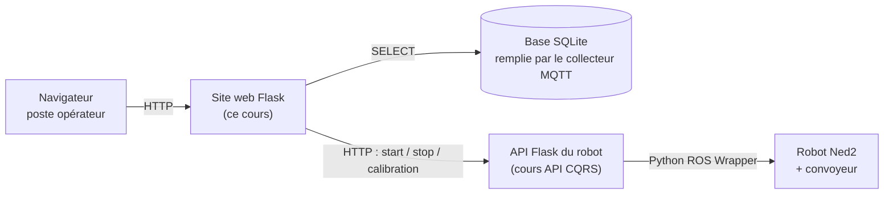

# Le framework Flask : premiers pas

Infrastructure client / serveur dans un contexte industriel

Flask est un micro-framework web Python. Dans le projet fil rouge, il sert deux fois : pour le **site web** de supervision de la cellule robotisée (tableau de bord, commandes) et pour l'**API de commande** du robot Ned2.



## Objectifs et prérequis

À la fin, vous saurez écrire une application Flask, déclarer des routes, générer des pages avec des templates Jinja2, traiter un formulaire, lire la base SQLite de la cellule et renvoyer du JSON.

**Prérequis**

- Python : variables, fonctions, dictionnaires, listes
- Le cours *HTML et CSS* (structure d'une page, formulaires, feuille de style, principe des routes)
- Le cours *Rappels de SQL* pour la partie base de données

**Installation**

```bash
mkdir supervision && cd supervision
python -m venv venv
source venv/bin/activate      # Windows : venv\Scripts\activate
pip install flask
```

Sur le serveur du module, Flask est déjà installé.

## Hello world

```python
from flask import Flask

app = Flask(__name__)

@app.route("/")
def hello():
    return "Hello world"
```

**Explications**

- `app` est une application Flask : elle est entre autres homogène à une fonction WSGI (voir la PEP 3333), donc elle peut être utilisée par n'importe quel serveur web compatible (Gunicorn, Waitress…).
- La fonction `hello` est appelée une **vue**. Elle retourne une chaîne de caractères, qui sera le contenu de la réponse. Par défaut, le statut de la réponse est 200, et le type de contenu est HTML, encodé en UTF-8. On verra plus loin comment générer d'autres types de réponses (JSON, redirection, erreur).
- La ligne qui précède la fonction `hello` est un **décorateur** Python. Il sert à indiquer l'URL pour laquelle cette vue doit être utilisée.

**La même chose pour la cellule**

```python
from datetime import datetime
from flask import Flask

app = Flask(__name__)

@app.route("/")
def accueil():
    heure = datetime.now().strftime("%H:%M:%S")
    return f"<h1>Supervision de la cellule G1-E1</h1><p>Serveur en ligne, il est {heure}.</p>"
```

Rechargez la page : l'heure change. La page n'est pas un fichier figé, elle est **calculée à chaque requête** : c'est ce qui permettra d'afficher le dernier cycle du robot.

## Serveur de développement

- Il n'est pas forcément aisé de mettre en place un serveur web pour tester notre application.
- Flask fournit son propre serveur de développement, directement dans la méthode `run` de l'application.

On peut donc créer un script `serveur.py` contenant simplement :

```python
# en supposant que votre application Flask est définie
# dans un fichier nommé 'supervision.py'
from supervision import app

app.run(debug=True)
```

Ou, sans script, en ligne de commande :

```bash
flask --app supervision run --debug
```

- Le mode debug offre de plus des fonctions avancées, notamment :
  - le rechargement automatique des fichiers Python en cas de modification,
  - l'affichage des exceptions dans le navigateur,
  - la possibilité d'interagir avec le code Python depuis le navigateur en cas d'erreur.

**Sur le serveur du module**

Par défaut, Flask n'écoute que sur `127.0.0.1` : l'application n'est joignable que depuis la machine elle-même. Pour la rendre accessible aux postes du réseau, il faut écouter sur toutes les interfaces et utiliser le port attribué à votre équipe :

```bash
flask --app supervision run --host 0.0.0.0 --port 8001
```

Le site est alors visible à l'adresse `http://<adresse-du-serveur>:8001`.

**Attention**

- Le débogueur permet d'exécuter du code Python depuis le navigateur : ne laissez jamais `--debug` actif sur une application joignable par d'autres personnes.
- N'activez pas `--debug` sur l'API qui pilote le vrai robot : le rechargeur lance le programme deux fois, donc ouvre deux connexions au robot.

## Caractéristiques de Flask

Flask fournit le cœur (routage, requêtes, réponses, templates) et laisse le reste à votre choix.

- **Léger et minimaliste** : pas de base de données, d'authentification ni de formulaires imposés. On ajoute des extensions (Flask-SQLAlchemy, Flask-Login, Flask-WTF) selon le besoin.
- **Flexible** : aucune structure de projet obligatoire, vous décidez de l'organisation du code.
- **Construit sur deux bibliothèques** : Werkzeug (serveur, requêtes, routage, WSGI) et Jinja2 (moteur de templates).
- **Serveur de développement intégré**, avec rechargement automatique et page de débogage.
- **Adapté à un petit site ou une API** : une application complète tient dans un seul fichier, ce qui convient bien au tableau de bord d'une cellule et à l'API d'un robot.

## Routes

- En développement web, on appelle **route** une URL ou un ensemble d'URL conduisant à l'exécution d'une fonction donnée.
- Dans Flask, les routes sont déclarées via le décorateur `app.route`, comme dans l'exemple ci-dessus.
- Une route peut être paramétrée, auquel cas le paramètre sera passé à la fonction vue :

```python
@app.route("/robots/<nom>")
def robot(nom):
    return f"Fiche du robot {nom}"
```

- Il est possible d'avoir plusieurs paramètres, par exemple `/robots/<nom>/cycles/<numero>`.
- Il est également possible d'imposer un type aux paramètres, par exemple `/cycles/<int:numero>` :

```python
@app.route("/cycles/<int:numero>")
def cycle(numero):
    return f"Détail du cycle numéro {numero}"
```

Le convertisseur `int` vérifie et convertit la valeur : `numero` est un entier dans la fonction, et `/cycles/abc` renvoie automatiquement une erreur 404. Autres convertisseurs : `string` (par défaut, sans `/`), `float`, `path` (accepte les `/`), `uuid`.

**Le plan des routes du site de supervision**

Avant d'écrire le code, on liste les routes : c'est ce qui figure dans le dossier d'analyse.

| URL | Méthode | Vue | Ce qu'elle renvoie |
| --- | --- | --- | --- |
| `/` | GET | `accueil` | Tableau de bord : état du robot, compteurs du jour |
| `/cycles` | GET | `cycles` | Liste des derniers cycles |
| `/cycles/<int:numero>` | GET | `cycle` | Détail d'un cycle, 404 s'il n'existe pas |
| `/incident` | GET, POST | `incident` | Formulaire de signalement d'un incident |
| `/api/etat` | GET | `api_etat` | État de la cellule en JSON |

## Génération d'URL

- Les routes permettent à Flask de trouver la vue correspondant à une URL, mais également de faire l'inverse, à savoir de reconstruire l'URL d'une vue donnée.
- La fonction `flask.url_for` prend en paramètre le nom d'une vue (le nom de la fonction, dans une chaîne de caractères), avec ses éventuels paramètres, et retourne l'URL correspondante.

Exemples :

```python
# avec les routes des exemples précédents
url_for("accueil")                     # → "/"
url_for("robot", nom="ned2-g1e1")      # → "/robots/ned2-g1e1"
url_for("cycle", numero=42)            # → "/cycles/42"
```

- On peut passer à `url_for` des paramètres supplémentaires (c'est-à-dire non prévus par la route), lesquels seront ajoutés en paramètres d'URL :

```python
url_for("cycles", zone="A", limite=20)     # → "/cycles?zone=A&limite=20"
```

- Le paramètre `_external` peut être mis à `True` pour générer une URL absolue :

```python
url_for("accueil", _external=True)     # → "http://192.168.10.10:8001/"
```

`url_for` ne fonctionne que pendant le traitement d'une requête (dans une vue ou un template) ; pour l'essayer dans la console Python, utilisez `with app.test_request_context(): print(url_for("accueil"))`.

Exemple d'utilisation :

```python
@app.route("/a-propos")
def a_propos():
    return f"""<a href="{url_for('accueil')}">Retour au tableau de bord</a>"""
```

`url_for` rend le code plus facile à maintenir : si on décide de changer l'URL d'une vue, il suffit de changer le paramètre de `app.route`, et toutes les autres vues contenant des liens vers elle s'adapteront automatiquement.

## Ressources statiques

- Une application web ne se limite pas aux contenus HTML générés par les vues ; on a également besoin de ressources statiques (CSS, images, JavaScript).
- Dans Flask, ces fichiers se rangent dans un répertoire `static`, situé dans le même répertoire que le fichier Python définissant l'application.
- L'URL de ces fichiers est donnée par la fonction `url_for` :

```python
url_for("static", filename="css/style.css")        # → "/static/css/style.css"
url_for("static", filename="img/cellule.png")      # → "/static/img/cellule.png"
```

**Structure d'un projet Flask**

```text
supervision/
├── supervision.py      # l'application : routes et vues
├── cellule.db          # base SQLite (remplie par le collecteur MQTT)
├── templates/          # pages HTML (Jinja2)
│   ├── base.html
│   ├── accueil.html
│   └── cycles.html
└── static/             # fichiers servis tels quels
    ├── css/style.css
    └── img/cellule.png
```

Les dossiers `templates` et `static` portent ces noms exacts : Flask les cherche automatiquement.

## L'objet request

- Contrairement aux fonctions WSGI, les vues Flask ne reçoivent pas directement l'information contenue dans la requête HTTP.
- Cette information est accessible via l'objet `flask.request`, valable pendant le traitement de la requête.
- Cet objet possède un certain nombre d'attributs, dont :

| Attribut | Contenu | Exemple |
| --- | --- | --- |
| `request.method` | La méthode HTTP | `"GET"` ou `"POST"` |
| `request.args` | Paramètres d'URL (après le `?`) | `/cycles?zone=A` → `request.args.get("zone")` |
| `request.form` | Champs d'un formulaire envoyé en `POST` | `request.form.get("description")` |
| `request.get_json()` | Corps JSON (appels d'API) | `{"vitesse": 50}` |
| `request.headers` | Les en-têtes, dans un objet de type dictionnaire | `request.headers.get("User-Agent")` |
| `request.remote_addr` | Adresse IP du client | `"192.168.10.105"` |
| `request.environ` | L'environnement WSGI sous-jacent (pour les nostalgiques) | |

```python
from flask import request

@app.route("/cycles")
def cycles():
    zone = request.args.get("zone", "toutes")              # /cycles?zone=A
    limite = request.args.get("limite", 20, type=int)      # converti en entier
    return f"Les {limite} derniers cycles, zone : {zone}"
```

Préférez `.get()` à `request.args["zone"]` : si le paramètre est absent, `.get()` renvoie la valeur par défaut au lieu de provoquer une erreur 400.

Voir la documentation de [l'objet Request](https://flask.palletsprojects.com/en/stable/api/#flask.Request).

## Templates Jinja2

### Qu'est-ce qu'un template ?

- Un template, ou « modèle », est un fichier dont certaines parties seront remplacées à l'exécution.
- Voici un exemple minimaliste :

```html
<p>Robot {{ nom }} : {{ etat }}</p>
```

où les parties entre doubles accolades seront remplacées par le contenu des variables `nom` et `etat`, par exemple :

```html
<p>Robot ned2-g1e1 : en cycle</p>
```

### Templates en Flask

- Flask utilise le système de templates [Jinja2](https://jinja.palletsprojects.com/), qui permet de générer n'importe quel format textuel (HTML, CSS, CSV…).
- Les templates sont stockés dans un répertoire `templates`, situé dans le même répertoire que le fichier Python définissant l'application.
- Pour appliquer un template, il suffit d'appeler la fonction `flask.render_template` en lui passant :
  - le nom du template (relatif au répertoire `templates`), et
  - les variables utilisées par le template, en paramètres nommés :

```python
from flask import render_template

@app.route("/robots/<nom>")
def robot(nom):
    return render_template("robot.html", nom=nom, etat="en cycle")
```

Retourner du HTML dans une chaîne de caractères, comme dans les premiers exemples, ne tient pas longtemps : le template sépare la logique Python (la vue) de la présentation HTML.

### Substitution

- Dans un template Jinja2, les doubles accolades `{{ }}` servent à indiquer une substitution.
- Elles peuvent contenir un nom de variable, mais également des expressions plus complexes, par exemple `{{ request.method }}`, `{{ cycle.duree }}`, `{{ cycle["zone"] }}` ou `{{ cycles[0] }}`.
- Certaines variables sont transmises automatiquement aux templates, notamment l'objet requête `request`, ainsi que les fonctions `url_for` et `get_flashed_messages`.
- Les valeurs sont **échappées automatiquement** : un texte saisi par un opérateur qui contiendrait `<script>` s'affiche tel quel et n'est pas exécuté.

**Les filtres** transforment une valeur avec la barre verticale `|` :

```html
<p>Durée : {{ "%.1f"|format(cycle.duree) }} s</p>      {# 18.2 s #}
<p>Zone : {{ cycle.zone|default("non renseignée") }}</p>
<p>{{ cycles|length }} cycles aujourd'hui</p>
<p>Statut : {{ cycle.statut|upper }}</p>
```

- `{# … #}` est un commentaire Jinja2 : il n'apparaît pas dans la page envoyée au navigateur.

### Structures de contrôle

- Jinja2 offre des structures de contrôle (conditions, boucles) similaires à celles de Python.
- Elles sont encadrées par les symboles `` et se terminent par ``, ``.

```html

  <table>
    <tr><th>N°</th><th>Début</th><th>Durée (s)</th><th>Zone</th><th>Statut</th></tr>
    
      <tr class="{{ c.statut }}">
        <td><a href="{{ url_for('cycle', numero=c.id) }}">{{ c.id }}</a></td>
        <td>{{ c.debut }}</td>
        <td>{{ "%.1f"|format(c.duree) }}</td>
        <td>{{ c.zone }}</td>
        <td>{{ c.statut }}</td>
      </tr>
    
  </table>

  <p>Aucun cycle enregistré.</p>

```

Dans une boucle, la variable `loop` donne la position : `loop.index` (à partir de 1), `loop.first`, `loop.last`.

### Héritage

Plutôt que de copier l'en-tête, le menu et le pied de page dans chaque page, on les écrit une fois dans un gabarit de base, avec des blocs que les pages remplissent.

`base.html` :

```html
<!DOCTYPE html>
<html lang="fr">
<head>
  <meta charset="UTF-8">
  <meta name="viewport" content="width=device-width, initial-scale=1">
  <title>Supervision · Cellule G1-E1</title>
  <link rel="stylesheet" href="{{ url_for('static', filename='css/style.css') }}">
</head>
<body>
  <header>
    <nav>
      <a class="logo" href="{{ url_for('accueil') }}">Cellule G1-E1</a>
      <a href="{{ url_for('cycles') }}">Cycles</a>
      <a href="{{ url_for('incident') }}">Signaler un incident</a>
    </nav>
  </header>
  <main class="contenu">
    
  </main>
  <footer>Projet fil rouge · cellule robotisée</footer>
</body>
</html>
```

`robot.html` :

```html


Robot {{ nom }}


  <h1>Robot {{ nom }}</h1>
  <p>État : {{ etat }}</p>

```

- La directive `extends` permet à un template d'hériter d'un autre ; elle doit être la première instruction du template enfant.
- La directive `block` permet :
  - au template parent de définir des zones personnalisables (avec éventuellement un contenu par défaut), et
  - au template enfant de donner un contenu aux blocs définis par son parent.

## Lire la base SQLite de la cellule

Le collecteur MQTT (cours *Collecteur de messages MQTT*) remplit la base `cellule.db`. Le site web ne fait que la **lire** : il n'écrit jamais dans les tables du collecteur. On reprend les tables du cours de SQL : `robots` et `cycles`.

```python
import sqlite3
from flask import Flask, render_template

app = Flask(__name__)
BASE = "cellule.db"

def requete(sql, parametres=()):
    """Exécute un SELECT et renvoie la liste des lignes (accès par nom de colonne)."""
    conn = sqlite3.connect(BASE)
    conn.row_factory = sqlite3.Row
    try:
        return conn.execute(sql, parametres).fetchall()
    finally:
        conn.close()

@app.route("/cycles")
def cycles():
    lignes = requete(
        "SELECT id, debut, duree, zone, statut FROM cycles "
        "ORDER BY debut DESC LIMIT ?", (20,))
    return render_template("cycles.html", cycles=lignes)
```

**Points clés**

- On ouvre une connexion par requête et on la ferme aussitôt : simple et sans risque avec SQLite, même si le collecteur écrit en même temps.
- `sqlite3.Row` permet d'écrire `c.duree` ou `c["duree"]` dans le template.
- Les valeurs venant de l'URL ou d'un formulaire passent **toujours** par des paramètres `?`, jamais par une f-string (voir l'injection SQL dans le cours de SQL).

## Formulaires

### Routes et méthodes

- Une route répond par défaut à la seule méthode `GET`. Il est possible de spécifier la ou les méthodes autorisées pour une vue :

```python
@app.route("/incident", methods=["GET", "POST"])
def incident():
    if request.method == "GET":
        ...   # afficher le formulaire
    else:
        ...   # traiter les données envoyées
```

- Flask propose aussi les raccourcis `@app.get("/…")` et `@app.post("/…")`, très utilisés pour les API.

### Récupération des paramètres

- `request.args` est un dictionnaire contenant les paramètres d'URL.
- `request.form` est un dictionnaire contenant les données de formulaires envoyées par `POST` (le cas échéant). Les clés sont les attributs `name` des champs HTML.

### Le schéma Post / Redirect / Get

Le schéma classique s'appelle Post/Redirect/Get : on affiche le formulaire (`GET`), on le traite (`POST`), puis on redirige vers une page en `GET`. Ainsi, si l'opérateur recharge la page, le formulaire n'est pas envoyé une deuxième fois.

```python
from flask import Flask, render_template, request, redirect, url_for, flash

app = Flask(__name__)
app.secret_key = "dev-seulement"          # requis pour flash et session

TYPES_INCIDENT = ["pièce non détectée", "prise manquée", "convoyeur bloqué", "autre"]
incidents = []                            # en mémoire pour l'exemple

@app.route("/incident", methods=["GET", "POST"])
def incident():
    if request.method == "POST":
        type_incident = request.form.get("type", "")
        description = request.form.get("description", "").strip()

        if type_incident not in TYPES_INCIDENT or not description:   # validation serveur
            flash("Choisissez un type et décrivez l'incident.", "erreur")
            return render_template("incident.html", types=TYPES_INCIDENT,
                                   description=description), 400

        incidents.append({"type": type_incident, "description": description})
        flash("Incident enregistré, merci.", "succes")
        return redirect(url_for("incident"))

    return render_template("incident.html", types=TYPES_INCIDENT)
```

Le template correspondant :

```html

Incident

  <h1>Signaler un incident</h1>
  <form method="post">
    <label for="type">Type d'incident</label>
    <select id="type" name="type" required>
      
        <option value="{{ t }}">{{ t }}</option>
      
    </select>

    <label for="description">Description</label>
    <textarea id="description" name="description" rows="4" required>{{ description or '' }}</textarea>

    <button type="submit">Enregistrer</button>
  </form>

```

Sans attribut `action`, le formulaire est envoyé à l'adresse de la page courante. La description est remise dans le champ en cas d'erreur pour que l'opérateur ne retape pas tout.

### Messages flash

`flash()` mémorise un message qui s'affichera **une seule fois**, à la page suivante. On les affiche dans `base.html`, juste avant le bloc de contenu :

```html

  
    <p class="message {{ categorie }}">{{ texte }}</p>
  

```

### Session

L'objet `session` se comporte comme un dictionnaire qui persiste d'une requête à l'autre, via un cookie signé avec `secret_key`. Il sert par exemple à mémoriser le nom de l'opérateur connecté :

```python
from flask import session

session["operateur"] = "alice"        # écrire
nom = session.get("operateur")        # lire
session.pop("operateur", None)        # supprimer (déconnexion)
```

Le contenu de la session est lisible par l'utilisateur (il est seulement protégé contre la modification) : n'y stockez jamais de mot de passe. En production, chargez `secret_key` depuis une variable d'environnement, jamais depuis le code.

**Bonnes pratiques**

- Revalidez toujours les données côté serveur, même avec `required` dans le HTML : n'importe qui peut envoyer une requête sans passer par votre formulaire (par exemple avec `curl`).
- Ne construisez jamais du HTML à la main à partir de saisies utilisateur : laissez Jinja2 échapper les valeurs.
- Pour des formulaires complexes, l'extension Flask-WTF ajoute validation et protection CSRF.

## Réponses personnalisées

### Erreur

Pour déclencher une réponse d'erreur (code HTTP 4xx), on peut utiliser la fonction `flask.abort` en lui passant le code de statut à retourner (et éventuellement un message personnalisé).

Exemple :

```python
abort(403, "Commande réservée au poste opérateur")
```

La fonction `abort` lève une exception (ce qui explique qu'elle ne nécessite pas de `return`). Cette exception est interceptée par l'application Flask, qui la transforme en réponse HTTP avec le code d'erreur associé.

```python
@app.route("/cycles/<int:numero>")
def cycle(numero):
    lignes = requete("SELECT * FROM cycles WHERE id = ?", (numero,))
    if not lignes:
        abort(404)
    return render_template("cycle.html", cycle=lignes[0])
```

On peut personnaliser la page affichée pour une erreur donnée :

```python
@app.errorhandler(404)
def page_introuvable(erreur):
    return render_template("404.html"), 404     # corps + code d'état
```

Une vue peut retourner un tuple `(corps, code)` pour choisir le code d'état, comme ci-dessus.

### Redirection

Pour rediriger le client vers une autre URL (code HTTP 3xx), on peut utiliser la fonction `flask.redirect`.

Exemple :

```python
return redirect(url_for("accueil"))
```

### Réponse JSON

Pour une API, ou pour qu'une page rafraîchisse ses données en JavaScript, la vue renvoie du JSON. Il suffit de retourner un dictionnaire (ou d'utiliser `jsonify`) : Flask le convertit et ajoute l'en-tête `Content-Type: application/json`.

```python
@app.get("/api/etat")
def api_etat():
    dernier = requete("SELECT debut, duree, statut FROM cycles ORDER BY debut DESC LIMIT 1")
    nb = requete("SELECT COUNT(*) AS n FROM cycles WHERE date(debut) = date('now', 'localtime')")[0]["n"]
    return {
        "dernier_cycle": dict(dernier[0]) if dernier else None,
        "cycles_du_jour": nb,
    }
```

```bash
curl http://127.0.0.1:8001/api/etat
# {"cycles_du_jour": 37, "dernier_cycle": {"debut": "2026-11-17 08:31:20", "duree": 18.4, "statut": "ok"}}
```

### Pour aller plus loin

Lorsqu'une vue retourne une chaîne de caractères (ce que nous avons vu jusqu'à maintenant), l'application Flask génère automatiquement une réponse standard (statut 200, contenu de type HTML).

Il est également possible pour une vue de retourner directement un objet `Response`, dont on peut alors personnaliser les métadonnées. Cet objet peut être produit grâce à la fonction `flask.make_response`.

Exemple : exporter les cycles au format CSV pour un tableur.

```python
from flask import make_response

@app.route("/cycles.csv")
def cycles_csv():
    lignes = requete("SELECT id, debut, duree, zone, statut FROM cycles ORDER BY debut")
    texte = "id;debut;duree;zone;statut\n"
    texte += "\n".join(";".join(str(v) for v in l) for l in lignes)
    resp = make_response(texte)
    resp.headers["Content-Type"] = "text/csv; charset=utf-8"
    resp.headers["Content-Disposition"] = "attachment; filename=cycles.csv"
    return resp
```

La fonction `redirect` vue ci-avant retourne elle aussi un objet `Response`.

## Appeler l'API du robot depuis le site

Les boutons « Démarrer », « Arrêter », « Calibrer » du tableau de bord ne pilotent pas le robot directement : le site envoie une requête HTTP à l'API du robot (voir le cours *API CQRS*). Côté site, chaque bouton est un petit formulaire en `POST` :

```html
<form method="post" action="{{ url_for('commande', nom='demarrer') }}">
  <button type="submit">Démarrer le process</button>
</form>
```

La vue relaie la commande avec la bibliothèque `requests` (`pip install requests`) :

```python
import requests

URL_API = "http://127.0.0.1:5001"          # mode simulé ; sur le robot : http://<IP du robot>:3000
COMMANDES = {"demarrer", "arreter", "calibrer"}

@app.post("/commande/<nom>")
def commande(nom):
    if nom not in COMMANDES:
        abort(404)
    try:
        r = requests.post(f"{URL_API}/commandes/{nom}", timeout=2)
        if r.status_code == 202:
            flash(f"Commande « {nom} » envoyée au robot.", "succes")
        else:
            flash(f"Commande refusée par le robot : {r.json().get('erreur')}", "erreur")
    except requests.RequestException:
        flash("API du robot injoignable.", "erreur")
    return redirect(url_for("accueil"))
```

- Le `timeout` est indispensable : sans lui, une API muette bloquerait la page indéfiniment.
- Changer l'adresse `URL_API` suffit pour passer de l'API simulée au vrai robot : c'est tout l'intérêt de séparer le site et l'API.

Une base de tableau de bord est fournie (`site_web/`, mode d'emploi dans `site_web/README.md`) : une page qui appelle l'API fournie du robot (routes `/robot/…`) ou son simulateur, avec des boutons de commande, l'état du robot et les derniers messages MQTT mis à jour toutes les 2 secondes. Elle sert de point de départ au tableau de bord de chaque équipe.

## Réalisation guidée : le tableau de bord de la cellule

On assemble tout ce qui précède dans un site de quatre pages qui lit la base de la cellule. Le style vient du cours *HTML et CSS* (fichier `static/css/style.css` de la maquette).

**Cahier des charges**

| Page | URL | Ce qu'elle montre |
| --- | --- | --- |
| Tableau de bord | `/` | Nombre de cycles du jour, durée moyenne, dernier cycle, nombre de défauts |
| Cycles | `/cycles` | Tableau des 20 derniers cycles, filtrable par zone (`?zone=A`) |
| Détail d'un cycle | `/cycles/<int:numero>` | Toutes les informations du cycle, erreur 404 si le numéro n'existe pas |
| Incident | `/incident` | Formulaire, validation serveur, message flash |

**Étape 0 : une base de test**

En attendant le collecteur, ce script crée `cellule.db` avec des cycles fictifs (même schéma que le cours de SQL) :

```python
# creer_base_test.py
import random
import sqlite3
from datetime import datetime, timedelta

conn = sqlite3.connect("cellule.db")
conn.executescript("""
DROP TABLE IF EXISTS cycles;
DROP TABLE IF EXISTS robots;
CREATE TABLE robots (id INTEGER PRIMARY KEY, nom TEXT NOT NULL UNIQUE,
                     equipe TEXT NOT NULL UNIQUE, adresse_ip TEXT);
CREATE TABLE cycles (id INTEGER PRIMARY KEY,
                     robot_id INTEGER NOT NULL REFERENCES robots(id),
                     debut TEXT NOT NULL, duree REAL, zone TEXT,
                     statut TEXT NOT NULL DEFAULT 'ok');
INSERT INTO robots (nom, equipe, adresse_ip) VALUES ('ned2-g1e1', 'g1e1', '192.168.10.21');
""")
t = datetime.now() - timedelta(hours=1)
for _ in range(60):
    duree = round(random.gauss(18.5, 1.2), 1)
    statut = "defaut" if random.random() < 0.08 else "ok"
    conn.execute("INSERT INTO cycles (robot_id, debut, duree, zone, statut) VALUES (1, ?, ?, ?, ?)",
                 (t.strftime("%Y-%m-%d %H:%M:%S"), duree, random.choice("AB"), statut))
    t += timedelta(seconds=duree + 5)
conn.commit()
conn.close()
print("cellule.db créée")
```

**Étape 1 : supervision.py**

```python
import sqlite3
from flask import Flask, render_template, request, redirect, url_for, flash, abort

app = Flask(__name__)
app.secret_key = "dev-seulement"
BASE = "cellule.db"
TYPES_INCIDENT = ["pièce non détectée", "prise manquée", "convoyeur bloqué", "autre"]


def requete(sql, parametres=()):
    conn = sqlite3.connect(BASE)
    conn.row_factory = sqlite3.Row
    try:
        return conn.execute(sql, parametres).fetchall()
    finally:
        conn.close()


@app.route("/")
def accueil():
    stats = requete("""
        SELECT COUNT(*) AS nb, AVG(duree) AS moyenne,
               SUM(statut = 'defaut') AS defauts
        FROM cycles WHERE date(debut) = date('now', 'localtime')
    """)[0]
    dernier = requete("SELECT * FROM cycles ORDER BY debut DESC LIMIT 1")
    return render_template("accueil.html", stats=stats,
                           dernier=dernier[0] if dernier else None)


@app.route("/cycles")
def cycles():
    zone = request.args.get("zone")
    if zone:
        lignes = requete("SELECT * FROM cycles WHERE zone = ? ORDER BY debut DESC LIMIT 20", (zone,))
    else:
        lignes = requete("SELECT * FROM cycles ORDER BY debut DESC LIMIT 20")
    return render_template("cycles.html", cycles=lignes, zone=zone)


@app.route("/cycles/<int:numero>")
def cycle(numero):
    lignes = requete("""
        SELECT c.*, r.nom AS robot FROM cycles AS c
        JOIN robots AS r ON r.id = c.robot_id WHERE c.id = ?""", (numero,))
    if not lignes:
        abort(404)
    return render_template("cycle.html", cycle=lignes[0])


@app.route("/incident", methods=["GET", "POST"])
def incident():
    if request.method == "POST":
        type_incident = request.form.get("type", "")
        description = request.form.get("description", "").strip()
        if type_incident not in TYPES_INCIDENT or not description:
            flash("Choisissez un type et décrivez l'incident.", "erreur")
            return render_template("incident.html", types=TYPES_INCIDENT,
                                   description=description), 400
        # à faire en exercice : enregistrer l'incident dans une table
        flash("Incident enregistré, merci.", "succes")
        return redirect(url_for("incident"))
    return render_template("incident.html", types=TYPES_INCIDENT)


@app.errorhandler(404)
def introuvable(e):
    return render_template("404.html"), 404
```

**Étape 2 : templates/base.html**

Celui de la section *Héritage*, complété par l'affichage des messages flash au début de `<main>` :

```html
<main class="contenu">
  
    
      <p class="message {{ categorie }}">{{ texte }}</p>
    
  
  
</main>
```

**Étape 3 : les pages**

```html
<!-- templates/accueil.html -->

Tableau de bord

  <h1>Tableau de bord</h1>
  <div class="grille">
    <article class="carte">
      <h2>Cycles du jour</h2>
      <p class="valeur">{{ stats.nb }}</p>
    </article>
    <article class="carte">
      <h2>Durée moyenne</h2>
      <p class="valeur">{{ "%.1f"|format(stats.moyenne or 0) }} s</p>
    </article>
    <article class="carte">
      <h2>Défauts</h2>
      <p class="valeur">{{ stats.defauts or 0 }}</p>
    </article>
  </div>

  
    <p>Dernier cycle : n° <a href="{{ url_for('cycle', numero=dernier.id) }}">{{ dernier.id }}</a>
       à {{ dernier.debut }}, {{ dernier.duree }} s,
       <span class="etat {{ dernier.statut }}">{{ dernier.statut }}</span></p>
  
    <p>Aucun cycle enregistré pour l'instant.</p>
  

```

```html
<!-- templates/cycles.html -->

Cycles

  <h1>Derniers cycles (zone {{ zone }})</h1>
  <p>
    Filtrer : <a href="{{ url_for('cycles') }}">toutes</a> ·
    <a href="{{ url_for('cycles', zone='A') }}">zone A</a> ·
    <a href="{{ url_for('cycles', zone='B') }}">zone B</a>
  </p>
  <table>
    <thead><tr><th>N°</th><th>Début</th><th>Durée (s)</th><th>Zone</th><th>Statut</th></tr></thead>
    <tbody>
      
        <tr>
          <td><a href="{{ url_for('cycle', numero=c.id) }}">{{ c.id }}</a></td>
          <td>{{ c.debut }}</td>
          <td>{{ "%.1f"|format(c.duree) }}</td>
          <td>{{ c.zone }}</td>
          <td><span class="etat {{ c.statut }}">{{ c.statut }}</span></td>
        </tr>
      
        <tr><td colspan="5">Aucun cycle.</td></tr>
      
    </tbody>
  </table>

```

Le `` d'une boucle `for` s'exécute quand la liste est vide.

```html
<!-- templates/cycle.html -->

Cycle {{ cycle.id }}

  <h1>Cycle n° {{ cycle.id }}</h1>
  <ul>
    <li>Robot : {{ cycle.robot }}</li>
    <li>Début : {{ cycle.debut }}</li>
    <li>Durée : {{ cycle.duree }} s</li>
    <li>Zone de dépose : {{ cycle.zone }}</li>
    <li>Statut : <span class="etat {{ cycle.statut }}">{{ cycle.statut }}</span></li>
  </ul>
  <a href="{{ url_for('cycles') }}">← Retour aux cycles</a>

```

```html
<!-- templates/404.html -->

Page introuvable

  <h1>Page introuvable</h1>
  <p><a href="{{ url_for('accueil') }}">Retour au tableau de bord</a></p>

```

Le template `incident.html` est celui de la section *Formulaires*.

**Étape 4 : lancer et tester**

```bash
python creer_base_test.py
flask --app supervision run --debug
```

Vérifiez : la navigation entre les pages, le filtre `/cycles?zone=A`, `/cycles/9999` (erreur 404), `/cycles/abc` (404 également, grâce au convertisseur `int`), l'envoi du formulaire vide (message d'erreur) puis rempli (message de succès), et l'affichage sur un écran étroit.

## Exercices et projets

Chaque exercice réutilise une notion du cours ; faites-les dans l'ordre sur le tableau de bord.

- [ ] Routes : ajouter `/robots/<nom>` qui affiche le robot (adresse IP, équipe) et renvoie 404 s'il n'existe pas dans la table `robots`
- [ ] `request.args` : ajouter un paramètre `?limite=50` à `/cycles`, converti en entier, borné entre 1 et 200
- [ ] Jinja2 : colorer en rouge (classe CSS) les cycles dont la durée dépasse 25 s
- [ ] Jinja2 : afficher la durée moyenne par zone sur le tableau de bord (requête `GROUP BY zone`)
- [ ] Formulaire : enregistrer les incidents dans une table `incidents` (horodatage, type, description), avec des paramètres `?`, puis les lister sur une page `/incidents`
- [ ] JSON : compléter `/api/etat` avec le nombre de défauts du jour, puis l'appeler avec `curl`
- [ ] Rafraîchissement : ajouter `<meta http-equiv="refresh" content="5">` à la page d'accueil seulement (bloc dédié dans `base.html`)
- [ ] Commandes : ajouter les boutons « Démarrer », « Arrêter », « Calibrer » qui appellent l'API simulée du robot
- [ ] Export : ajouter la route `/cycles.csv` et ouvrir le fichier dans un tableur

**Pour aller plus loin**

1. **Organisation du code** : les Blueprints découpent une grande application en modules (pages, API).
2. **Base de données** : Flask-SQLAlchemy remplace les requêtes SQL écrites à la main par des objets Python.
3. **Authentification** : Flask-Login pour réserver les commandes du robot aux opérateurs connectés.
4. **Graphiques** : afficher l'évolution de la durée de cycle avec une bibliothèque JavaScript (Chart.js) alimentée par une route JSON.
5. **Déploiement** : Gunicorn ou Waitress derrière un serveur web, `debug` désactivé, secrets en variables d'environnement, lancement automatique par un service `systemd`.

## Ressources

- [Documentation Flask](https://flask.palletsprojects.com/en/stable/)
- [Documentation Jinja2](https://jinja.palletsprojects.com/en/stable/)
- [PEP 3333 – Python Web Server Gateway Interface](https://peps.python.org/pep-3333/)
- Tutoriels vidéo : [Harvard CS50, semaine Flask](https://cs50.harvard.edu/x/2023/weeks/9/), [Neuralnine, playlist Flask tutorial](https://www.youtube.com/watch?v=o3bCVqF9gI0&list=PL7yh-TELLS1EyAye_UMnlsTGKxg8uatkM)
- Utilisation d'un conteneur Docker (non utilisé dans ce module) : [exemple docker compose](https://github.com/docker/awesome-compose/tree/master/flask)
