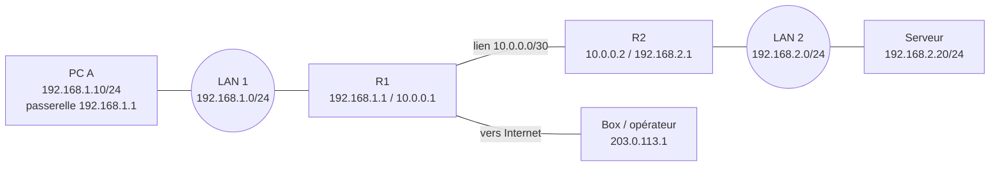
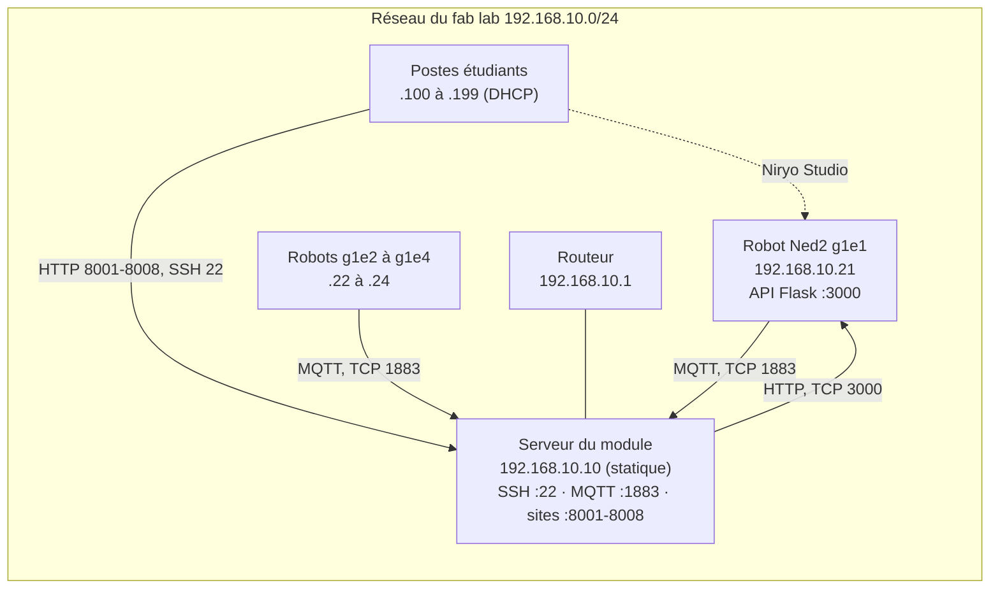

# Révisions réseau : TCP/IP, adressage, routage, sous-réseaux, configuration statique et DHCP

Infrastructure client / serveur dans un contexte industriel

Ce cours de révision reprend les bases d'un réseau IP : comment les machines sont adressées, découpées en sous-réseaux, reliées par des routeurs et configurées, à la main ou automatiquement avec DHCP. Une dernière partie applique ces notions au réseau de la cellule robotisée : robots Ned2, serveur du module et postes étudiants.

## Objectifs et plan

À la fin, vous saurez expliquer le rôle des couches TCP/IP, calculer un sous-réseau, lire une table de routage, configurer une machine en statique et décrire le fonctionnement de DHCP.

**Plan**

1. Les modèles en couches et l'encapsulation
2. Adresses MAC et IPv4
3. Masques et notation CIDR
4. Découpage en sous-réseaux
5. Communication locale : ARP et passerelle
6. Routage
7. TCP et UDP
8. Configuration statique
9. DHCP
10. DNS, IPv6 et outils de diagnostic
11. Application : le réseau de la cellule robotisée
12. Exercices corrigés et fiche mémo

**Méthode de révision**

- Apprenez les puissances de 2 jusqu'à 2⁸ et 2¹⁰ : 1, 2, 4, 8, 16, 32, 64, 128, 256, 512, 1024. Elles servent à tous les calculs.
- Refaites à la main les exercices de la dernière section, sans calculatrice, avant de regarder la correction.
- Pour chaque notion, posez-vous la question : « quel problème cela résout-il ? ».

## Modèles en couches et encapsulation

Une communication réseau est découpée en couches : chacune rend un service à celle du dessus et s'appuie sur celle du dessous, ce qui permet de modifier l'une sans toucher aux autres.

Exemple : le robot (192.168.10.21) publie une fin de cycle en MQTT vers le serveur (192.168.10.10).

```text
Application  :                                         [ PUBLISH cellule/g1e1/cycle {"duree": 18.2} ]
Transport    :                          [ TCP 52344 → 1883 | données MQTT ]
Internet     :       [ IP 192.168.10.21 → 192.168.10.10 | segment TCP ]
Accès réseau : [ Ethernet MAC robot → MAC serveur | paquet IP | FCS ]
```

Les données de l'application descendent la pile : TCP ou UDP ajoute son en-tête (les ports), IP ajoute le sien (les adresses IP), puis Ethernet ajoute l'en-tête (les adresses MAC) et une somme de contrôle de fin appelée FCS. À l'arrivée, chaque couche retire son en-tête et remet le contenu à la couche du dessus : c'est l'encapsulation, puis la désencapsulation.

**Les deux modèles**

Le modèle OSI compte sept couches et sert de référence pour parler des réseaux ; le modèle TCP/IP, plus court, décrit ce qui est réellement utilisé sur Internet.

| Couche OSI | Nom | Couche TCP/IP | Exemples |
| --- | --- | --- | --- |
| 7 | Application | Application | HTTP, DNS, DHCP, SSH |
| 6 | Présentation | Application | Encodage, chiffrement (TLS) |
| 5 | Session | Application | Ouverture et suivi des échanges |
| 4 | Transport | Transport | TCP, UDP (ports) |
| 3 | Réseau | Internet | IP, ICMP (adresses IP, routage) |
| 2 | Liaison de données | Accès réseau | Ethernet, Wi-Fi (adresses MAC, commutateurs) |
| 1 | Physique | Accès réseau | Câbles, ondes, signaux électriques |

**Le nom de l'unité de données change selon la couche**

| Couche | Unité de données |
| --- | --- |
| Application | Données, message |
| Transport | Segment (TCP) ou datagramme (UDP) |
| Réseau (Internet) | Paquet |
| Liaison (Accès réseau) | Trame |
| Physique | Bits |

**Qui s'occupe de quoi ?**

- La couche application prépare les données utiles (une page web, un message).
- La couche transport désigne l'application sur la machine (le port) et, avec TCP, fiabilise l'échange.
- La couche Internet désigne la machine (l'adresse IP) et choisit le chemin à travers les réseaux.
- La couche accès réseau livre la trame à la machine voisine sur le même lien (l'adresse MAC).

## Adresses MAC et adresses IPv4

L'adresse MAC identifie une carte réseau sur son réseau local ; l'adresse IP identifie une machine dans un réseau logique et permet de la joindre à travers plusieurs réseaux.

**Adresse MAC (couche 2)**

- 48 bits, écrits en 12 chiffres hexadécimaux : `00:1A:2B:3C:4D:5E`.
- Les 24 premiers bits (OUI) désignent le fabricant ; les 24 suivants identifient la carte.
- Elle ne sert qu'à l'intérieur d'un même réseau local : elle n'est jamais routée.
- Adresse de diffusion : `FF:FF:FF:FF:FF:FF` (toutes les machines du réseau local).

**Adresse IPv4 (couche 3)**

Une adresse IPv4 fait 32 bits, découpés en 4 octets de 8 bits écrits en décimal, séparés par des points : chaque octet vaut de 0 à 255.

**Conversion décimal vers binaire**

Chaque bit d'un octet pèse, de gauche à droite : 128, 64, 32, 16, 8, 4, 2, 1. On écrit 1 quand on utilise le poids, 0 sinon.

```text
200 = 128 + 64 + 8        →  1 1 0 0 1 0 0 0   (128 64 _ _ 8 _ _ _)
172 = 128 + 32 + 8 + 4    →  1 0 1 0 1 1 0 0

172.16.5.200 = 10101100.00010000.00000101.11001000
```

**Adresses privées (RFC 1918) : non routées sur Internet**

| Plage | Notation | Taille |
| --- | --- | --- |
| 10.0.0.0 à 10.255.255.255 | `10.0.0.0/8` | 16 777 216 adresses |
| 172.16.0.0 à 172.31.255.255 | `172.16.0.0/12` | 1 048 576 adresses |
| 192.168.0.0 à 192.168.255.255 | `192.168.0.0/16` | 65 536 adresses |

En dehors des plages privées et des adresses spéciales, une adresse unicast est en général publique (routable sur Internet). Un réseau privé accède à Internet grâce au NAT (voir la section sur le routage).

**Adresses spéciales**

| Adresse | Signification |
| --- | --- |
| `127.0.0.0/8` (surtout `127.0.0.1`) | Boucle locale : la machine elle-même |
| `169.254.0.0/16` | Adresse auto-attribuée (APIPA) quand aucun serveur DHCP ne répond |
| `0.0.0.0` | Adresse indéfinie, « toutes les interfaces » ou « route par défaut » selon le contexte |
| `255.255.255.255` | Diffusion limitée au réseau local |
| `224.0.0.0/4` | Multicast (envoi à un groupe) |

**Anciennes classes d'adresses**

Les classes A, B et C fixaient autrefois la taille du réseau selon le premier octet (1 à 126 : A, soit /8 ; 128 à 191 : B, soit /16 ; 192 à 223 : C, soit /24). Elles ne sont plus utilisées pour allouer les adresses (adressage sans classe, CIDR), mais le vocabulaire reste courant : un « réseau de classe C » désigne un /24.

## Masques et notation CIDR

Le masque de sous-réseau indique quelle partie de l'adresse IP désigne le réseau et quelle partie désigne la machine (l'hôte) : les bits à 1 du masque sont la partie réseau, les bits à 0 la partie hôte.

**Deux écritures équivalentes**

- Masque décimal : `255.255.255.0`
- Notation CIDR (préfixe) : `/24`, c'est-à-dire 24 bits à 1 au début du masque

```text
/24 = 11111111.11111111.11111111.00000000 = 255.255.255.0
/26 = 11111111.11111111.11111111.11000000 = 255.255.255.192
```

**Masques à connaître**

| CIDR | Masque | Adresses | Hôtes utilisables |
| --- | --- | --- | --- |
| /8 | 255.0.0.0 | 16 777 216 | 16 777 214 |
| /16 | 255.255.0.0 | 65 536 | 65 534 |
| /24 | 255.255.255.0 | 256 | 254 |
| /25 | 255.255.255.128 | 128 | 126 |
| /26 | 255.255.255.192 | 64 | 62 |
| /27 | 255.255.255.224 | 32 | 30 |
| /28 | 255.255.255.240 | 16 | 14 |
| /29 | 255.255.255.248 | 8 | 6 |
| /30 | 255.255.255.252 | 4 | 2 |

Formule : avec un préfixe `/n`, il reste `32 − n` bits d'hôte, donc `2^(32−n)` adresses dont `2^(32−n) − 2` utilisables.

**Pourquoi moins 2 ?**

Dans chaque réseau, deux adresses sont réservées : la première (tous les bits hôtes à 0) est l'adresse du réseau, la dernière (tous les bits hôtes à 1) est l'adresse de diffusion (broadcast). Aucune machine ne peut les utiliser.

**Trouver l'adresse du réseau : le ET logique**

L'adresse du réseau s'obtient en faisant un ET bit à bit entre l'adresse IP et le masque.

```text
192.168.10.77/26   (masque 255.255.255.192)

dernier octet :   77 = 01001101
                 192 = 11000000
                 ET  = 01000000 = 64

Réseau       : 192.168.10.64
Diffusion    : 192.168.10.127   (bits hôtes tous à 1 : 01111111 = 127)
Hôtes        : 192.168.10.65 à 192.168.10.126   (62 hôtes)
```

**Deux machines sont-elles dans le même réseau ?**

Oui si, avec le même masque, leur adresse de réseau est identique. Sinon, elles ne peuvent communiquer qu'à travers un routeur.

## Découpage en sous-réseaux

Découper un réseau en sous-réseaux consiste à emprunter des bits à la partie hôte pour les ajouter à la partie réseau : le préfixe s'allonge, chaque sous-réseau est plus petit.

**Pourquoi découper ?**

- Limiter la taille des domaines de diffusion (moins de trafic broadcast).
- Séparer des services ou des équipes (réseau des serveurs, des postes, des invités) et appliquer des règles de sécurité entre eux.
- Utiliser les adresses sans gaspillage.

**Méthode en trois étapes**

1. **Bits d'hôtes** : trouver le plus petit `h` tel que `2^h − 2` soit au moins égal au nombre d'hôtes voulu.
2. **Préfixe** : `32 − h`.
3. **Taille d'un bloc** : `2^h` adresses ; les sous-réseaux commencent à des multiples de cette taille.

Pour obtenir un nombre de sous-réseaux donné : emprunter `b` bits, avec `2^b` au moins égal au nombre voulu ; le nouveau préfixe est l'ancien plus `b`.

**Exemple 1 : quatre sous-réseaux égaux dans `192.168.1.0/24`**

Il faut 4 sous-réseaux, donc `b = 2` bits empruntés (2² = 4) : le préfixe passe de /24 à /26 ; chaque bloc fait 2⁶ = 64 adresses.

| Sous-réseau | Adresse réseau | Hôtes utilisables | Diffusion |
| --- | --- | --- | --- |
| 1 | 192.168.1.0/26 | .1 à .62 | .63 |
| 2 | 192.168.1.64/26 | .65 à .126 | .127 |
| 3 | 192.168.1.128/26 | .129 à .190 | .191 |
| 4 | 192.168.1.192/26 | .193 à .254 | .255 |

**Exemple 2 : tailles différentes (VLSM) dans `192.168.1.0/24`**

VLSM (Variable Length Subnet Mask) permet d'utiliser des masques différents selon les besoins. On traite les besoins du plus grand au plus petit, en plaçant chaque bloc juste après le précédent.

| Besoin | Bits d'hôtes | Préfixe | Adresse réseau | Hôtes utilisables | Diffusion |
| --- | --- | --- | --- | --- | --- |
| LAN A : 100 hôtes | 7 (126) | /25 | 192.168.1.0/25 | .1 à .126 | .127 |
| LAN B : 50 hôtes | 6 (62) | /26 | 192.168.1.128/26 | .129 à .190 | .191 |
| LAN C : 20 hôtes | 5 (30) | /27 | 192.168.1.192/27 | .193 à .222 | .223 |
| Lien entre deux routeurs : 2 hôtes | 2 (2) | /30 | 192.168.1.224/30 | .225 et .226 | .227 |

Il reste les adresses de 192.168.1.228 à 192.168.1.255 pour des besoins futurs. Si l'on avait commencé par les petits blocs, les gros n'auraient pas pu s'aligner sur leur frontière : toujours commencer par le plus grand.

**Agrégation de réseaux (résumé de routes)**

L'opération inverse regroupe des réseaux contigus en un seul préfixe plus court, ce qui allège les tables de routage. Condition : les blocs sont contigus et le premier est aligné sur la taille du bloc agrégé.

```text
192.168.2.0/24 + 192.168.3.0/24  →  192.168.2.0/23
```

## Communication locale : ARP et passerelle

Avant d'envoyer un paquet, une machine compare l'adresse de destination à son propre réseau : si la destination est dans le même réseau, elle l'envoie directement ; sinon, elle le confie à sa passerelle par défaut.

**La décision de la machine émettrice**

1. Elle applique son masque (ET logique) à sa propre adresse et à celle de la destination.
2. Mêmes adresses de réseau : destination locale, livraison directe.
3. Adresses différentes : destination distante, le paquet part vers la passerelle par défaut (l'adresse IP du routeur local).

**ARP : retrouver l'adresse MAC à partir d'une adresse IP**

Sur un réseau Ethernet, l'envoi d'une trame exige l'adresse MAC du destinataire (ou de la passerelle). Le protocole ARP la découvre :

1. La machine A diffuse une requête (broadcast) : « qui possède l'adresse 192.168.1.20 ? ».
2. La machine B reconnaît son adresse et répond directement à A avec sa MAC.
3. A mémorise la correspondance dans son cache ARP pour quelques minutes (commande `arp -a`).

**Exemple : A (192.168.1.10/24) envoie vers deux destinations**

| Destination | Même réseau ? | Machine dont A cherche la MAC | Adresse IP de destination du paquet |
| --- | --- | --- | --- |
| 192.168.1.20 | Oui | 192.168.1.20 elle-même | 192.168.1.20 |
| 8.8.8.8 | Non | Passerelle 192.168.1.1 | 8.8.8.8 |

Pour la destination distante, l'adresse IP du paquet reste celle de la destination finale (8.8.8.8), mais l'adresse MAC de la trame est celle de la passerelle.

**À retenir : ce qui change, ce qui ne change pas**

- Les adresses IP source et destination restent identiques de bout en bout (sauf NAT).
- Les adresses MAC changent à chaque saut, car elles ne servent que sur le lien en cours.

**Les équipements réseau**

| Équipement | Couche | Rôle | Domaine de diffusion |
| --- | --- | --- | --- |
| Commutateur (switch) | 2 | Transmet les trames selon la table des adresses MAC | Un seul, partagé par tous ses ports (sauf VLAN) |
| Routeur | 3 | Relie des réseaux IP différents, choisit le chemin des paquets | Sépare les domaines de diffusion : un par interface |
| Passerelle par défaut | 3 | Routeur vers lequel les machines envoient tout ce qui n'est pas local | Appartient au réseau local |

Un concentrateur (hub) répète tout sur tous les ports ; il est obsolète. Un VLAN découpe logiquement un commutateur en plusieurs réseaux virtuels : chaque VLAN est un réseau IP distinct et nécessite un routeur pour communiquer avec les autres.

## Routage

Un routeur relie plusieurs réseaux IP : pour chaque paquet, il consulte sa table de routage afin de choisir l'interface de sortie et le routeur voisin suivant (le prochain saut).



Table de routage de R1 :

```text
Destination        Prochain saut            Interface
192.168.1.0/24     directement connecté     eth0 (192.168.1.1)
10.0.0.0/30        directement connecté     eth1 (10.0.0.1)
192.168.2.0/24     10.0.0.2                 eth1
0.0.0.0/0          203.0.113.1              eth2
```

PC A envoie son paquet à sa passerelle R1. R1 cherche dans sa table la route qui correspond à `192.168.2.0/24` : elle indique de passer par `10.0.0.2`, donc par R2. R2, auquel le LAN 2 est directement raccordé, livre le paquet au serveur. Tout paquet qui ne correspond à aucune autre ligne de la table part par la route par défaut.

**Que contient une table de routage ?**

- La **destination** : un réseau avec son préfixe (`192.168.2.0/24`).
- Le **prochain saut** : l'adresse du routeur voisin à qui confier le paquet, ou « directement connecté » si le réseau est rattaché à une interface du routeur.
- L'**interface** de sortie et, selon les équipements, une **métrique** (le coût de la route).

On la consulte avec `ip route` (Linux) ou `route print` (Windows). Une machine ordinaire en a aussi une, très courte : son réseau local et sa passerelle par défaut.

**Comment le routeur choisit la route ?**

Plusieurs lignes peuvent correspondre à une adresse. Le routeur retient la plus précise, c'est-à-dire celle dont le préfixe est le plus long (règle du plus long préfixe). La route par défaut `0.0.0.0/0` correspond à tout, mais comme son préfixe est de longueur zéro, elle n'est choisie que si rien d'autre ne convient. Sans aucune route, le paquet est rejeté et un message ICMP « destination inaccessible » est renvoyé.

**D'où viennent les routes ?**

| Type | Origine | Remarques |
| --- | --- | --- |
| Connectée | Créée automatiquement pour chaque interface configurée | Rien à faire |
| Statique | Ajoutée à la main par l'administrateur | Simple et prévisible, mais ne s'adapte pas aux pannes |
| Par défaut | Route statique `0.0.0.0/0` vers un routeur de sortie | Chemin des destinations inconnues, souvent Internet |
| Dynamique | Apprise par un protocole de routage (RIP, OSPF, BGP) | Les routeurs échangent leurs informations et s'adaptent aux pannes |

OSPF est courant à l'intérieur d'une organisation, BGP entre opérateurs sur Internet.

**Ajouter une route statique**

```text
Linux   :  sudo ip route add 192.168.2.0/24 via 10.0.0.2
Windows :  route add 192.168.2.0 mask 255.255.255.0 10.0.0.2      (ajouter -p pour la conserver)
```

**La durée de vie (TTL)**

Chaque paquet IP porte un compteur TTL que chaque routeur décrémente de 1. À 0, le paquet est détruit : une boucle de routage ne peut donc pas durer indéfiniment.

**Le NAT : sortir d'un réseau privé**

Les adresses privées ne sont pas routables sur Internet. Le routeur de sortie fait de la traduction d'adresses (NAT) : il remplace l'adresse source privée par son adresse publique et note la correspondance ; au retour, il refait la traduction inverse. Dans sa forme la plus courante (PAT ou NAPT), il traduit aussi les ports, ce qui permet à de nombreuses machines de partager une seule adresse publique.

| Sens | Adresse et port source | Adresse et port destination |
| --- | --- | --- |
| Dans le réseau privé | 192.168.1.10:51000 | 93.184.216.34:443 |
| Après le routeur NAT | 203.0.113.5:40001 | 93.184.216.34:443 |

Conséquence : de l'extérieur, on ne peut pas joindre une machine privée de son propre chef ; il faut une redirection de port (port forwarding) vers elle.

## TCP et UDP

L'adresse IP amène le paquet jusqu'à la bonne machine ; le port désigne l'application visée sur cette machine, et le protocole de transport (TCP ou UDP) définit comment les données sont échangées.

**Les ports**

Un port est un nombre de 16 bits (0 à 65 535). L'association adresse IP et port forme un socket, par exemple `192.168.1.10:443`.

| Plage | Nom | Usage |
| --- | --- | --- |
| 0 à 1023 | Ports bien connus | Services standards |
| 1024 à 49151 | Ports enregistrés | Applications |
| 49152 à 65535 | Ports dynamiques | Choisis au hasard par le client pour chaque connexion |

**Ports courants**

| Port | Service | Transport |
| --- | --- | --- |
| 22 | SSH (accès distant sécurisé) | TCP |
| 25 | SMTP (envoi de mail) | TCP |
| 53 | DNS | UDP (et TCP) |
| 67 et 68 | DHCP (serveur et client) | UDP |
| 80 | HTTP | TCP |
| 123 | NTP (heure) | UDP |
| 443 | HTTPS | TCP |
| 502 | Modbus TCP (automates, robot Ned2) | TCP |
| 1883 | MQTT | TCP |
| 8883 | MQTT sur TLS | TCP |
| 3000 | API de commande du projet, sur le robot Ned2 | TCP |
| 5000 | Serveur de développement Flask (par défaut) ; sur le Ned2, logiciel système de Niryo (utilisé par Niryo Studio) | TCP |
| 40001 | Serveur TCP du robot Niryo, utilisé par `pyniryo` pour piloter le robot depuis un autre poste | TCP |

Une connexion est identifiée par quatre valeurs : IP source, port source, IP destination, port destination. Un navigateur ouvre ainsi plusieurs connexions vers le même serveur (port 443) avec des ports sources différents.

**TCP : fiable, avec connexion**

TCP établit une connexion avant d'échanger des données, numérote les octets, confirme leur réception, retransmet ce qui est perdu, remet les données dans l'ordre et régule le débit.

**L'établissement de connexion en trois temps (three-way handshake)**

1. Le client envoie un segment `SYN` : « je veux ouvrir une connexion ».
2. Le serveur répond `SYN-ACK` : « d'accord, et de mon côté aussi ».
3. Le client envoie `ACK` : « confirmé ». Les données peuvent circuler.

La fermeture utilise des segments `FIN` et `ACK` dans chaque sens.

**UDP : simple, sans connexion**

UDP envoie des datagrammes sans établir de connexion, sans confirmation, sans retransmission et sans garantie d'ordre. Il est léger et rapide, et laisse l'application gérer les pertes si elle le souhaite.

**TCP contre UDP**

| Critère | TCP | UDP |
| --- | --- | --- |
| Connexion | Oui (3 temps) | Non |
| Fiabilité | Garantie (confirmation, retransmission) | Aucune |
| Ordre des données | Respecté | Non garanti |
| Surcoût | Plus élevé | Faible |
| Usages | Web, mail, transfert de fichiers, SSH, MQTT, Modbus TCP | DNS, DHCP, NTP, voix et vidéo en direct, jeux |

## Configuration statique

Configurer une machine en statique, c'est saisir soi-même ses paramètres réseau, qui restent fixes tant qu'on ne les modifie pas.

**Les quatre paramètres indispensables**

| Paramètre | Rôle | Exemple |
| --- | --- | --- |
| Adresse IP | Identifie la machine dans son réseau | 192.168.10.10 (serveur du module) |
| Masque de sous-réseau | Délimite le réseau local | 255.255.255.0 (/24) |
| Passerelle par défaut | Routeur utilisé pour sortir du réseau | 192.168.10.1 |
| Serveur DNS | Traduit les noms en adresses IP | 192.168.10.1 ou 8.8.8.8 |

**Règles de cohérence**

- L'adresse IP appartient au réseau, et n'est ni l'adresse du réseau ni celle de diffusion.
- Elle est unique : deux machines ayant la même adresse provoquent un conflit.
- La passerelle appartient au même réseau que la machine (même adresse de réseau avec le masque).
- L'adresse choisie est en dehors de la plage distribuée par le serveur DHCP, pour éviter les doublons.

**Quand utiliser le statique ?**

Pour les équipements dont l'adresse doit rester prévisible : serveurs, broker MQTT, robots, automates, imprimantes, caméras, routeurs, points d'accès. Un robot dont l'adresse change après un redémarrage n'est plus joignable par le serveur qui le pilote. Pour les postes de travail, on préfère DHCP.

**Un plan d'adressage type : le réseau du fab lab `192.168.10.0/24`**

| Plage | Usage |
| --- | --- |
| 192.168.10.1 | Passerelle (routeur) |
| 192.168.10.2 à .19 | Serveurs et équipements d'infrastructure, en statique (serveur du module : 192.168.10.10) |
| 192.168.10.20 à .99 | Équipements de production : robots Ned2 (.21 à .24), automates, caméras, en statique ou réservés |
| 192.168.10.100 à .199 | Plage distribuée par DHCP (postes étudiants) |
| 192.168.10.200 à .254 | Réserve |

**Windows**

En ligne de commande (invite exécutée en administrateur) :

```text
netsh interface ip set address name="Ethernet" static 192.168.10.50 255.255.255.0 192.168.10.1
netsh interface ip set dns name="Ethernet" static 192.168.10.1
ipconfig /all
```

En PowerShell :

```powershell
New-NetIPAddress -InterfaceAlias "Ethernet" -IPAddress 192.168.10.50 -PrefixLength 24 -DefaultGateway 192.168.10.1
Set-DnsClientServerAddress -InterfaceAlias "Ethernet" -ServerAddresses 192.168.10.1
```

Ou par l'interface graphique : Paramètres réseau, propriétés de la carte, Protocole Internet version 4 (TCP/IPv4), « Utiliser l'adresse IP suivante ».

**Linux : configuration immédiate (perdue au redémarrage)**

```bash
sudo ip addr add 192.168.10.10/24 dev eth0
sudo ip link set eth0 up
sudo ip route add default via 192.168.10.1
ip addr show eth0
ip route
```

**Linux : configuration permanente (exemple avec Netplan, Ubuntu : le serveur du module au fab lab)**

```yaml
# /etc/netplan/01-reseau.yaml
network:
  version: 2
  ethernets:
    eth0:
      dhcp4: false
      addresses: [192.168.10.10/24]
      routes:
        - to: default
          via: 192.168.10.1
      nameservers:
        addresses: [192.168.10.1, 8.8.8.8]
```

```bash
sudo netplan apply
```

L'outil et le fichier de configuration dépendent de la distribution (Netplan, NetworkManager, fichiers `interfaces`) ; le nom de l'interface (`eth0`, `enp3s0`, `Ethernet`) se lit avec `ip link` ou `ipconfig`.

**Erreurs fréquentes**

| Symptôme | Cause probable |
| --- | --- |
| Joint les machines locales mais pas Internet | Passerelle absente ou fausse |
| Ne joint pas les machines du même réseau | Masque erroné, ou adresse dans un autre réseau |
| Joint Internet par adresse IP mais pas par nom | Serveur DNS absent ou faux |
| Connexion qui s'interrompt, conflit signalé | Adresse IP déjà utilisée par une autre machine |

## DHCP

DHCP (Dynamic Host Configuration Protocol) distribue automatiquement les paramètres réseau aux machines qui se connectent : adresse IP, masque, passerelle, serveurs DNS et durée de validité (le bail).

**Pourquoi DHCP ?**

À la main, chaque poste exigerait une configuration individuelle, avec un risque de doublon ou de faute de frappe. Avec DHCP, une machine branchée obtient seule une configuration valide et cohérente. Le serveur peut être un routeur domestique, une box, un serveur Linux ou Windows.

**Les échanges : DORA**

Le client n'a encore aucune adresse : il utilise `0.0.0.0` comme source et la diffusion `255.255.255.255` comme destination. DHCP utilise UDP : port 67 côté serveur, 68 côté client.

| Étape | Message | Sens | Contenu |
| --- | --- | --- | --- |
| 1. Discover | Découverte | Client vers tous (diffusion) | « Y a-t-il un serveur DHCP ? » |
| 2. Offer | Offre | Serveur vers client | « Je te propose l'adresse 192.168.1.101 avec ces paramètres » |
| 3. Request | Demande | Client vers tous (diffusion) | « J'accepte cette offre » (les autres serveurs retirent la leur) |
| 4. Acknowledge | Accusé de réception | Serveur vers client | « Confirmé : l'adresse est à toi pour la durée du bail » |

Le client configure alors son interface avec les paramètres reçus.

**Le bail (lease)**

L'adresse est prêtée pour une durée limitée, par exemple 24 heures.

- À la moitié du bail, le client demande son renouvellement au serveur qui l'a accordé.
- Si le serveur ne répond pas, vers 87,5 % du bail le client diffuse une demande à tout serveur disponible.
- À l'expiration sans renouvellement, il abandonne l'adresse et recommence la procédure.
- Sans réponse d'aucun serveur DHCP, le client s'attribue une adresse en `169.254.x.x` (APIPA), qui permet seulement de joindre les machines du même réseau local.

**Ce que configure l'administrateur sur le serveur**

| Élément | Rôle | Exemple |
| --- | --- | --- |
| Étendue (scope, pool) | Plage d'adresses à distribuer | 192.168.1.100 à 192.168.1.199 |
| Exclusions | Adresses de la plage à ne jamais distribuer | 192.168.1.150 à .159 |
| Réservation | Une même adresse toujours donnée à la même carte (selon l'adresse MAC) | Robot Ned2 de l'équipe g1e1 : toujours 192.168.10.21 |
| Durée du bail | Validité de l'adresse | 8 heures ou 24 heures |
| Options | Paramètres complémentaires envoyés au client | Masque (option 1), routeur ou passerelle (3), serveurs DNS (6), nom de domaine (15) |

Une réservation combine le confort du DHCP (configuration centralisée) et la stabilité du statique (adresse prévisible).

**Le relais DHCP**

La diffusion du client ne franchit pas un routeur. Pour qu'un seul serveur DHCP serve plusieurs réseaux, le routeur de chaque réseau fait office de relais (relay agent, souvent appelé `ip helper-address`) : il reçoit la diffusion et la retransmet en direct au serveur, qui choisit l'étendue d'après le réseau d'origine.

**Renouveler ou libérer une adresse**

```text
Windows :   ipconfig /release        (libère le bail)
            ipconfig /renew          (redemande une configuration)
Linux :     sudo dhclient -r  puis  sudo dhclient     (ou nmcli, selon la distribution)
```

**Statique contre DHCP**

| Critère | Statique | DHCP |
| --- | --- | --- |
| Configuration | Manuelle, machine par machine | Centralisée, automatique |
| Risque d'erreur ou de doublon | Élevé | Faible |
| Adresse prévisible | Oui | Non, sauf réservation |
| Dépendance | Aucune | Serveur DHCP à disposition |
| Usage typique | Serveurs, imprimantes, routeurs | Postes, portables, téléphones |

**Un risque : le faux serveur DHCP**

N'importe quelle machine du réseau peut répondre à un Discover. Un serveur DHCP non autorisé (par exemple une box branchée par erreur) distribue des paramètres faux et coupe les utilisateurs. Les commutateurs administrables offrent une protection (DHCP snooping) qui n'accepte les réponses que depuis les ports de confiance.

## DNS, IPv6 et outils de diagnostic

DNS traduit les noms en adresses IP, IPv6 élargit l'espace d'adressage, et une poignée de commandes permet de localiser une panne couche par couche.

**DNS (Domain Name System)**

Les humains retiennent des noms (`www.exemple.fr`), les machines routent des adresses IP : DNS fait la correspondance, avec le protocole UDP sur le port 53 (TCP pour les réponses volumineuses).

1. L'application demande l'adresse du nom à la machine, qui consulte d'abord son cache et le fichier `hosts`.
2. Sinon, elle interroge le serveur DNS configuré (celui reçu par DHCP ou saisi en statique).
3. Ce serveur, au besoin, interroge à son tour les serveurs racine, ceux du domaine de premier niveau (`.fr`) puis celui qui fait autorité sur le domaine, et garde la réponse en cache.

| Enregistrement | Contenu |
| --- | --- |
| `A` | Nom vers adresse IPv4 |
| `AAAA` | Nom vers adresse IPv6 |
| `CNAME` | Alias vers un autre nom |
| `MX` | Serveur de messagerie du domaine |
| `NS` | Serveurs DNS faisant autorité |
| `PTR` | Adresse IP vers nom (résolution inverse) |
| `TXT` | Texte libre (vérifications diverses) |

**IPv6 en bref**

IPv4 offre environ 4,3 milliards d'adresses, insuffisant aujourd'hui ; IPv6 utilise 128 bits.

- Écriture : 8 groupes de 16 bits en hexadécimal, séparés par `:`, par exemple `2001:0db8:0000:0000:0000:0000:0000:0001`.
- Abréviations : on omet les zéros de tête de chaque groupe, et on remplace une seule suite de groupes à zéro par `::` : `2001:db8::1`.
- Un réseau local a en général un préfixe `/64` ; les 64 derniers bits identifient la machine.
- Plus de broadcast ; le protocole NDP remplace ARP.
- Les machines peuvent s'auto-configurer (SLAAC) à partir des annonces du routeur, ou utiliser DHCPv6.

| Type | Plage | Rôle |
| --- | --- | --- |
| Globale unicast | `2000::/3` | Adresses publiques routables |
| Lien-local | `fe80::/10` | Toujours présente, valable sur le lien seulement |
| Unique locale | `fc00::/7` | Adresses privées internes |
| Multicast | `ff00::/8` | Envoi à un groupe |
| Boucle locale | `::1` | La machine elle-même |

IPv4 et IPv6 cohabitent souvent sur une même machine (double pile).

**Outils de diagnostic**

| Commande (Windows / Linux) | Usage |
| --- | --- |
| `ipconfig /all` / `ip addr` | Voir adresse, masque, DNS, adresse MAC |
| `route print` / `ip route` | Voir la table de routage |
| `ping adresse` | Tester l'accessibilité (messages ICMP echo) |
| `tracert adresse` / `traceroute adresse` | Lister les routeurs traversés |
| `arp -a` / `ip neigh` | Voir le cache ARP |
| `nslookup nom` / `dig nom` | Interroger le DNS |
| `netstat -an` / `ss -tuln` | Voir les connexions et ports en écoute |

`traceroute` envoie des paquets dont la durée de vie (TTL) augmente de 1 en 1 : chaque routeur décrémente le TTL, et celui qui le voit tomber à 0 renvoie une erreur ICMP qui révèle son adresse.

**Diagnostiquer de proche en proche**

1. `ping 127.0.0.1` : la pile TCP/IP de la machine fonctionne-t-elle ?
2. `ping` de sa propre adresse : la carte est-elle correctement configurée ?
3. `ping` de la passerelle : le réseau local fonctionne-t-il ?
4. `ping 8.8.8.8` : le routage vers Internet fonctionne-t-il ?
5. `ping www.exemple.fr` : la résolution DNS fonctionne-t-elle ?

La première étape qui échoue indique la couche à examiner (câble, adresse, passerelle, routage, DNS). Certains équipements bloquent ICMP : un ping sans réponse n'est pas toujours une panne.

## Application : le réseau de la cellule robotisée

Le projet fil rouge fait communiquer plusieurs types de machines : les robots Ned2, le serveur du module (broker MQTT, base SQLite, sites web), les postes étudiants et, tant que le robot n'est pas intégré, des programmes simulés. Toutes les notions précédentes s'y retrouvent.



**Les trois façons de se connecter à un Ned2**

| Mode | Adresse du robot | Configuration du poste | Usage |
| --- | --- | --- | --- |
| Point d'accès (hotspot) | `10.10.10.10` | Se connecter au Wi-Fi émis par le robot (le robot distribue les adresses) | Première prise en main, un seul poste |
| Ethernet direct | `169.254.200.200` | Câble entre le poste et le robot ; poste en adresse lien-local `169.254.x.x/16` (automatique, ou statique, par exemple `169.254.200.10/16`) | Dépannage, robot sans réseau |
| Réseau du fab lab (Wi-Fi ou Ethernet) | Celle donnée par le DHCP, fixée par une réservation | Poste sur le même réseau | Projet : le robot doit joindre le serveur et inversement |

En mode hotspot, le robot et le poste sont seuls dans le réseau `10.10.10.0/24` : le robot ne peut pas joindre le serveur du module. Pour le projet, les robots doivent rejoindre le réseau du fab lab.

**Les flux à autoriser**

| Flux | Client → serveur | Protocole, port | Remarque |
| --- | --- | --- | --- |
| Publication des événements | Robot → serveur | TCP 1883 (MQTT) | Le robot est client du broker |
| Commandes start / stop / calibration | Serveur (site web) → robot | TCP 3000 (API Flask) | Le robot est serveur HTTP |
| Consultation du tableau de bord | Poste → serveur | TCP 8001 à 8008 (un port par équipe) | |
| Administration, dépôt du code | Poste → serveur | TCP 22 (SSH) | |
| Copie et lancement des programmes du robot | Poste → robot | TCP 22 (SSH, `scp`) | Le programme process et l'API tournent sur le robot ; ils commandent le bras par ROS, sans passer par le réseau |

Les notions de client et de serveur dépendent du flux, pas de la machine : le robot est client pour MQTT et serveur pour l'API.

Un programme serveur doit écouter sur la bonne interface : Flask lancé sans option n'écoute que sur `127.0.0.1` (boucle locale) et reste injoignable depuis le réseau. Il faut `--host 0.0.0.0` (toutes les interfaces).

**Diagnostic de proche en proche, appliqué au projet**

```bash
ping 192.168.10.10                       # 1. le robot joint-il le serveur ? (couches 1 à 3)
nc -zv 192.168.10.10 1883                # 2. le port MQTT est-il ouvert ? (couche 4)
ss -tlnp | grep -E ':1883|:500|:800'     # 3. sur le serveur : qui écoute, et sur quelle adresse ?
mosquitto_sub -h 192.168.10.10 -t 'cellule/g1e1/#' -v   # 4. application
curl http://192.168.10.21:3000/requetes/etat                                           # 5. API du robot
```

| Symptôme | Cause probable |
| --- | --- |
| `ping` du serveur échoue depuis le robot | Robot resté en hotspot, mauvais réseau Wi-Fi, adresse dans un autre réseau |
| `ping` réussit mais `Connection refused` sur 1883 | Broker arrêté, ou n'écoutant que sur `127.0.0.1` |
| `Connection refused` sur le port du site web | Flask lancé sans `--host 0.0.0.0`, ou mauvais port |
| Délai dépassé (timeout) sur un port | Pare-feu (`ufw`) qui bloque le port |
| Le robot ne répond plus après un redémarrage | Son adresse a changé : faire une réservation DHCP ou une configuration statique |
| Durées de cycle ou dates aberrantes | Horloge du robot ou du serveur mal réglée : synchroniser avec NTP |

## Exercices corrigés et fiche mémo

Cherchez chaque exercice sans regarder la correction, puis comparez.

**Exercice 1.** Convertir `192.168.100.37` en binaire.

```text
192 = 11000000    168 = 10101000    100 = 01100100    37 = 00100101
→ 11000000.10101000.01100100.00100101
```

**Exercice 2.** Donner le masque décimal de `/20`, puis le nombre d'hôtes utilisables.

```text
/20 = 20 bits à 1 = 8 + 8 + 4 → 255.255.240.0   (11110000 = 240 dans le 3e octet)
Bits d'hôtes : 32 − 20 = 12 → 2^12 − 2 = 4094 hôtes
```

**Exercice 3.** Pour `10.20.30.140/27`, donner l'adresse du réseau, l'adresse de diffusion et la plage d'hôtes.

```text
Bloc de 2^5 = 32 adresses dans le dernier octet : 0, 32, 64, 96, 128, 160 …
140 est compris entre 128 et 159.
Réseau    : 10.20.30.128/27
Diffusion : 10.20.30.159
Hôtes     : 10.20.30.129 à 10.20.30.158   (30 hôtes)
```

**Exercice 3 bis.** Les machines `172.16.5.10/22` et `172.16.7.20/22` sont-elles dans le même réseau ?

```text
/22 → masque 255.255.252.0, blocs de 4 dans le 3e octet : 0, 4, 8 …
5 et 7 sont dans le bloc 4 à 7 → réseau 172.16.4.0/22 (172.16.4.0 à 172.16.7.255)
Oui : même réseau, elles communiquent sans routeur.
```

**Exercice 4.** Dans `192.168.50.0/24`, il faut au moins 5 sous-réseaux de 25 hôtes chacun. Quel masque, et quels sous-réseaux ?

```text
25 hôtes → 2^h − 2 ≥ 25 → h = 5 (30 hôtes) → préfixe /27 (255.255.255.224)
Un /24 contient 2^3 = 8 sous-réseaux de ce type : largement assez.
Les cinq premiers : 192.168.50.0/27, .32/27, .64/27, .96/27, .128/27
```

**Exercice 5 (VLSM).** Dans `172.16.0.0/24`, placer : serveurs 60 hôtes, postes 28 hôtes, zone isolée 10 hôtes, un lien entre deux routeurs.

| Besoin | Bits d'hôtes | Préfixe | Adresse réseau | Plage utilisable |
| --- | --- | --- | --- | --- |
| Serveurs (60) | 6 (62) | /26 | 172.16.0.0/26 | .1 à .62 |
| Postes (28) | 5 (30) | /27 | 172.16.0.64/27 | .65 à .94 |
| Zone isolée (10) | 4 (14) | /28 | 172.16.0.96/28 | .97 à .110 |
| Lien routeurs (2) | 2 (2) | /30 | 172.16.0.112/30 | .113 et .114 |

**Exercice 6.** Un poste est configuré en `192.168.5.20`, masque `255.255.255.0`, passerelle `192.168.6.1`. Quel est le problème ?

La passerelle `192.168.6.1` n'est pas dans le réseau du poste (`192.168.5.0/24`) : le poste ne peut pas la joindre directement, donc ne peut pas sortir de son réseau. Il faut une passerelle en `192.168.5.x`.

**Exercice 7 (routage).** Un routeur possède cette table. Par où part un paquet pour chacune des destinations ?

```text
10.0.0.0/8      via 192.168.1.2
10.1.0.0/16     via 192.168.1.3
10.1.2.0/24     via 192.168.1.4
0.0.0.0/0       via 192.168.1.1
```

| Destination | Routes qui correspondent | Choix (préfixe le plus long) |
| --- | --- | --- |
| 10.1.2.50 | /8, /16, /24, /0 | /24, via 192.168.1.4 |
| 10.1.9.9 | /8, /16, /0 | /16, via 192.168.1.3 |
| 10.200.0.1 | /8, /0 | /8, via 192.168.1.2 |
| 8.8.8.8 | /0 | Route par défaut, via 192.168.1.1 |

**Exercice 8.** Un poste affiche `169.254.12.7`. Que s'est-il passé ?

Aucun serveur DHCP n'a répondu : le poste s'est attribué lui-même une adresse APIPA. À vérifier : le câble ou le Wi-Fi, le serveur DHCP (en marche, étendue non épuisée), le relais DHCP s'il est sur un autre réseau.

**Exercice 9.** Classer dans l'ordre les messages DHCP : Acknowledge, Discover, Request, Offer.

Discover, Offer, Request, Acknowledge (DORA).

**Exercice 10 (cellule).** Un poste est relié directement au robot par un câble Ethernet. Il affiche l'adresse `169.254.37.5`, masque `255.255.0.0`. Peut-il joindre le robot en `169.254.200.200` ?

```text
Masque /16 → réseau du poste : 169.254.0.0/16 ; réseau du robot : 169.254.0.0/16
Oui : même réseau, communication directe (sans passerelle).
```

Le poste n'a reçu aucune réponse DHCP (il n'y a pas de serveur DHCP sur le câble) et s'est attribué une adresse APIPA : c'est justement ce qui lui permet de joindre le robot.

**Exercice 11 (cellule).** Sur le serveur, une équipe lance son site avec `flask --app supervision run --port 8001`. Le site s'affiche avec `curl http://127.0.0.1:8001` sur le serveur, mais pas depuis un poste (`Connection refused`). Pourquoi ?

Sans `--host 0.0.0.0`, Flask n'écoute que sur la boucle locale `127.0.0.1` : seules les connexions venant du serveur lui-même sont acceptées. `ss -tlnp` le montre : `127.0.0.1:8001` au lieu de `0.0.0.0:8001`.

**Exercice 12 (cellule).** Le robot g1e1 est en `192.168.10.21/24`, passerelle `192.168.10.1`. Le serveur est en `192.168.10.10/24`. Le robot publie en MQTT vers le serveur : quelles adresses IP et MAC portent la trame émise par le robot ? Même question si le broker était sur Internet, en `203.0.113.50`.

| Destination | Même réseau ? | MAC de destination de la trame | IP de destination du paquet |
| --- | --- | --- | --- |
| Serveur 192.168.10.10 | Oui | MAC du serveur | 192.168.10.10 |
| Broker 203.0.113.50 | Non | MAC de la passerelle 192.168.10.1 | 203.0.113.50 |

Dans les deux cas : port de destination TCP 1883, port source choisi au hasard dans la plage dynamique.

**Exercice 13 (cellule).** On veut séparer, dans `192.168.10.0/24`, un sous-réseau pour les postes (100 postes) et un sous-réseau pour les équipements de production (4 cellules de 7 équipements : robot, convoyeur, automate, caméra… soit 28 équipements). Proposez un découpage VLSM.

| Besoin | Bits d'hôtes | Préfixe | Adresse réseau | Plage utilisable |
| --- | --- | --- | --- | --- |
| Postes (100) | 7 (126) | /25 | 192.168.10.0/25 | .1 à .126 |
| Production (28) | 5 (30) | /27 | 192.168.10.128/27 | .129 à .158 |

Il faut alors un routeur entre les deux sous-réseaux, et le serveur doit être joignable des deux côtés (une interface dans chaque sous-réseau, ou des routes et des règles de pare-feu sur le routeur). Séparer ainsi le réseau de production des postes est une pratique courante en milieu industriel : un poste compromis n'atteint pas directement les robots.

## Fiche mémo

| Sujet | À retenir |
| --- | --- |
| Octet | Poids des bits : 128, 64, 32, 16, 8, 4, 2, 1 |
| Adresses d'un réseau /n | 2^(32−n) ; utilisables : 2^(32−n) − 2 |
| Adresse réseau | Adresse IP ET masque |
| Diffusion | Bits d'hôtes tous à 1 |
| Taille de bloc | 256 − valeur de l'octet du masque (ex. 256 − 192 = 64) |
| Privées | 10/8, 172.16/12, 192.168/16 |
| Spéciales | 127/8 boucle locale, 169.254/16 APIPA |
| Même réseau ? | Même adresse de réseau avec le même masque |
| Hors réseau | Envoi à la passerelle par défaut (ARP de la passerelle) |
| Routage | Route la plus spécifique (préfixe le plus long), sinon route par défaut |
| IP et MAC | IP de bout en bout, MAC modifiée à chaque saut |
| TCP | Connexion en trois temps : SYN, SYN-ACK, ACK |
| UDP | Sans connexion, sans garantie |
| DHCP | DORA ; UDP 67 (serveur) et 68 (client) ; bail renouvelé à 50 % |
| Config. statique | IP, masque, passerelle, DNS |
| Diagnostic | ping local, passerelle, IP distante, nom |
| Ports du projet | SSH 22, MQTT 1883, Flask 3000 (API robot), 5001-5008 (API simulées) et 8001-8008 (sites) ; 5000 pris sur le robot par Niryo |
| Ned2 | Hotspot 10.10.10.10, Ethernet direct 169.254.200.200 |
| Serveur joignable | Écouter sur `0.0.0.0`, pas sur `127.0.0.1` |
