# Séance 1 : prise en main du robot Ned2, export Python et définition du process

Infrastructure client / serveur dans un contexte industriel

Cette séance ouvre le projet fil rouge et elle est la même pour toutes les classes. Chaque équipe prend en main un robot Niryo Ned2 et son convoyeur, programme en Blockly le cycle de pick & place qui sera le cœur de la cellule (fonction F1 « Exécuter le cycle » du `README.md`), exporte ce programme en Python et décrit le process qu'elle va industrialiser. Le robot n'est ensuite plus disponible avant l'intégration : tout ce qui est produit aujourd'hui (programme, poses relevées, fiche process) doit être déposé et conservé.


## Où se situe cette séance dans le projet

La cellule complète comporte plusieurs briques. Aujourd'hui, on construit **la première** : le programme qui fait travailler le robot. Toutes les autres briques (messages MQTT, base de données, site web, API) viendront se brancher sur lui.

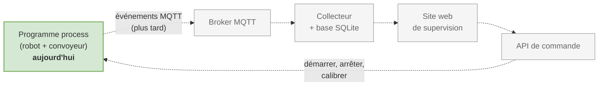

Ce que vous produisez aujourd'hui sera réutilisé tel quel : les **poses** relevées sur le robot, le **programme Python** exporté et la **fiche process** qui décrit ce que la cellule doit faire.


## Objectifs

À la fin de la séance, l'équipe sait :

- utiliser le robot Ned2 en sécurité ;
- se connecter au robot avec Niryo Studio, le calibrer, le déplacer et commander la pince ;
- programmer en Blockly un cycle avec convoyeur : le convoyeur amène la pièce jusqu'au capteur (entrée DI5), le robot la prend et la dépose dans une zone ;
- exporter ce programme en Python et en reconnaître les fonctions ;
- décrire le process de l'équipe sur une page.

**Comment lire ce document.** Chaque partie suit le même chemin :

1. **Comprendre** : la notion à connaître, avec un schéma ;
2. **Faire** : les manipulations sur le robot, dans l'ordre ;
3. **Vérifier** : une liste de points à cocher avant de passer à la suite ;
4. **À retenir** : l'essentiel en quelques lignes, à relire avant l'intégration.


## Organisation

| Lieu | Durée | Équipes | Matériel |
|------|-------|---------|----------|
| Fab lab | 3h30 | Une équipe de 2 ou 3 par robot | Robot Ned2 avec pince, convoyeur avec capteur infrarouge sur DI5, pièces, poste avec Niryo Studio |

Pas de serveur à cette étape : on travaille uniquement avec le robot.

| Durée | Activité | Partie du document |
|-------|----------|--------------------|
| 20 min | Lancement : le projet fil rouge, les équipes, la sécurité | 1 |
| 60 min | Prise en main : connexion, calibration, mouvements, pince | 2 |
| 70 min | Scénario guidé : convoyeur, détection, prise, dépose | 3 |
| 30 min | Export Python : lire le code généré | 4 |
| 30 min | Process de l'équipe : fiche process v0 | 5 |

```mermaid
gantt
    title Déroulé de la séance (3h30)
    dateFormat HH:mm
    axisFormat %H:%M
    todayMarker off
    section Découvrir
        1. Lancement et sécurité      : 00:00, 20m
        2. Prise en main du robot     : 60m
    section Programmer
        3. Scénario guidé             : 70m
        4. Export Python              : 30m
    section Concevoir
        5. Fiche process v0           : 30m
```

**Répartition des rôles dans l'équipe**, à faire tourner à chaque partie :

| Rôle | Ce qu'il fait |
|------|---------------|
| Pilote | Manipule Niryo Studio et lance les programmes |
| Sécurité | Garde la main près de l'arrêt d'urgence et surveille la zone de travail |
| Secrétaire | Note les poses, les réglages et les problèmes rencontrés |


## 1. Lancement et sécurité

### Comprendre

**Le projet** : lire les sections 1 à 3 du `README.md` (contexte, besoins, objectifs). Retenir que le programme écrit aujourd'hui deviendra le **programme process** de la cellule, celui qui publiera plus tard ses événements en MQTT.

**Les équipes** : chaque équipe reçoit un robot et un identifiant (de la forme `g1e1`) qu'elle garde jusqu'à l'évaluation. Noter dans le tableau de la partie 6 le numéro du robot et son adresse IP.

**Pourquoi des consignes de sécurité pour un petit robot ?** Le Ned2 est un robot « collaboratif » : il est léger et sa force est limitée. Il peut tout de même pincer les doigts, heurter un objet ou une personne penchée sur la table, et son bras retombe quand on coupe l'alimentation. La règle est simple : **le robot ne bouge jamais sans que toute l'équipe le sache.**

**Les consignes de sécurité** (documentation `documentation_Niryo_Ned2/01_Robot_NED2/08_Safety.pdf`)

- Le robot est posé sur une surface stable, avec assez de place autour pour qu'il ne heurte rien dans toute son amplitude.
- Personne ne se tient dans la zone de travail quand un programme tourne. On lance un programme seulement après avoir prévenu l'équipe.
- Repérer le **bouton d'arrêt d'urgence** avant tout essai. L'arrêt d'urgence ou une coupure d'alimentation fait retomber le bras : ne pas toucher le robot à ce moment-là. En fonctionnement normal, arrêter par le logiciel ou par le bouton du robot.
- Commencer chaque nouveau mouvement à **vitesse réduite** et rester à côté de l'arrêt d'urgence.
- En mode apprentissage (FreeMotion), tenir le bras par le col et garder les doigts hors des articulations et de la pince (risque de pincement).
- Les moteurs chauffent : ne pas toucher le bras après un usage prolongé.
- Ne jamais brancher ou débrancher la pince ou le convoyeur quand le robot est sous tension.

### Faire : la routine avant chaque lancement

Cette routine s'applique à **chaque** lancement de programme, pas seulement au premier.

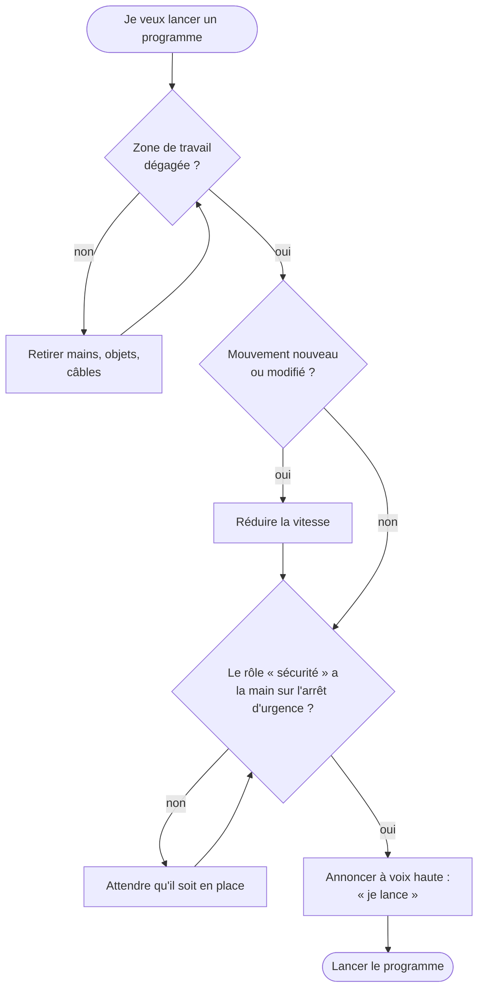

### Vérifier

- [ ] Arrêt d'urgence repéré et testé une fois par chaque membre de l'équipe
- [ ] Rôles attribués (pilote, sécurité, secrétaire)

### À retenir

- Le robot ne bouge jamais sans annonce.
- Un mouvement nouveau se teste à vitesse réduite.
- L'arrêt d'urgence sert en cas de danger ; en temps normal, on arrête par le logiciel.


## 2. Prise en main du robot

### 2.1 Comprendre : les modes du robot

Un robot n'accepte pas n'importe quel ordre à n'importe quel moment. Le Ned2 passe par plusieurs **modes**, et la couleur de l'anneau de LED, sur sa base, indique le mode courant (documentation `01_Robot_NED2/02_Operating_mode.pdf`).

| Mode | Rôle |
|------|------|
| Calibration | Le robot définit automatiquement la position zéro de chaque axe. Obligatoire avant tout mouvement |
| Collaboratif (programmation) | Le robot exécute les programmes. Il y passe seul après la calibration |
| Apprentissage (FreeMotion) | Les moteurs sont libérés et le bras se déplace à la main, en maintenant le bouton FreeMotion |

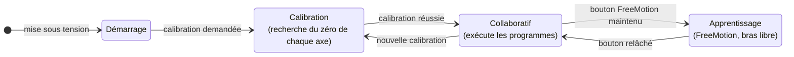

**Pourquoi calibrer ?** Au démarrage, le robot ne sait pas dans quelle position sont ses moteurs. La calibration fait tourner chaque axe jusqu'à une butée de référence : le robot connaît alors le « zéro » de chaque articulation, et toutes les positions mémorisées redeviennent justes.

### 2.2 Comprendre : comment le poste parle au robot

Le robot contient un petit ordinateur (dans sa base). Niryo Studio, sur votre poste, ne fait que lui envoyer des ordres par le réseau.

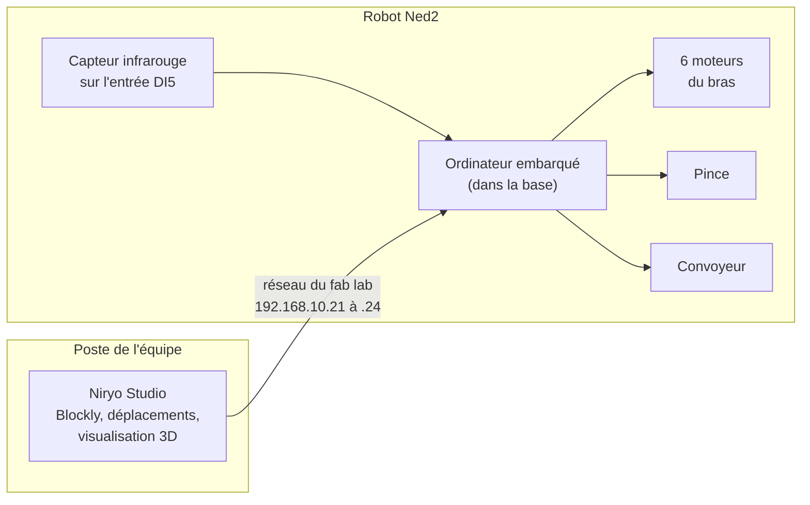

Niryo Studio trouve les robots tout seul : chaque robot annonce sa présence sur le réseau. Si le vôtre n'apparaît pas, on se connecte en tapant son adresse IP.

### 2.3 Faire : se connecter

1. Allumer le robot et attendre la fin du démarrage (anneau de LED fixe).
2. Ouvrir Niryo Studio : la fenêtre de connexion liste les robots détectés sur le réseau. Si le robot n'apparaît pas, utiliser l'option **adresse IP manuelle** avec l'adresse notée sur le robot (réseau du fab lab : `192.168.10.21` à `192.168.10.24`).
3. Cliquer sur **Connect** : l'état de connexion passe au vert.
4. Lancer la **calibration automatique** si Niryo Studio la demande.

### 2.4 Comprendre : déplacer le bras en articulaire ou en cartésien

Il y a deux façons de dire au robot où aller.

**En articulaire**, on donne l'angle de chacun des six axes, comme si l'on pliait son propre bras articulation par articulation : épaule, coude, poignet. C'est simple pour le robot, mais il est difficile de prévoir où arrivera la pince.

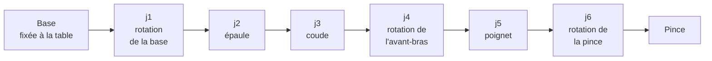

**En cartésien**, on dit où doit se trouver la pince et comment elle doit être orientée. Le robot calcule lui-même les angles des six axes. C'est ce qu'on utilise dans un programme de production, car on raisonne sur la position des pièces, pas sur celle des moteurs.

| Coordonnée | Signification | Unité |
|------------|---------------|-------|
| `x` | Vers l'avant du robot | mètre |
| `y` | Vers la gauche du robot | mètre |
| `z` | Vers le haut, depuis la base | mètre |
| `roll` | Rotation de la pince autour de l'axe `x` | radian |
| `pitch` | Rotation de la pince autour de l'axe `y` (pince inclinée vers le bas : environ 1,57 rad, soit 90°) | radian |
| `yaw` | Rotation de la pince autour de l'axe `z` | radian |

Une **pose** regroupe ces six valeurs : `[x, y, z, roll, pitch, yaw]`. Une **position articulaire** donne l'angle de chacun des six axes : `[j1, j2, j3, j4, j5, j6]`. Les programmes de la cellule utilisent des poses.

### 2.5 Faire : mouvements, pince, convoyeur et capteur

| Action dans Niryo Studio | Ce qu'on observe |
|--------------------------|------------------|
| Bouton « position d'origine » (Home) | Le bras revient en position de repos |
| Onglet de déplacement direct, mode **articulaire** | Chaque axe (`j1` à `j6`) tourne seul, en radians |
| Onglet de déplacement direct, mode **cartésien** | La pince se déplace en `x`, `y`, `z` (en mètres) et s'oriente en `roll`, `pitch`, `yaw` (en radians) |
| Bouton **FreeMotion** maintenu, puis bouton **Save** du robot | La position atteinte à la main est enregistrée dans Niryo Studio |
| Bloc **Scan & update tool**, puis ouverture / fermeture de la pince | Le robot détecte l'outil monté et l'actionne |
| Onglet Équipement, bouton **Scan**, puis marche du convoyeur | Le convoyeur est détecté et tourne |
| Panneau des entrées / sorties, entrée **DI5** | L'état du capteur change quand on passe la main ou une pièce devant lui |

**Petite expérience.** Augmentez `x` de 0,05 en mode cartésien : de combien la pince avance-t-elle ? Faites ensuite varier `j1` seul en mode articulaire : que fait la pince ? Vous venez de voir la différence entre les deux modes.

### Vérifier

- [ ] Robot connecté dans Niryo Studio, calibration faite
- [ ] Déplacement en articulaire puis en cartésien, retour en position d'origine
- [ ] Une position enregistrée en FreeMotion et rejouée par un programme Blockly de deux blocs
- [ ] Pince détectée, ouverte et fermée depuis Blockly
- [ ] Convoyeur détecté (onglet Équipement, bouton **Scan**) et mis en marche à la main
- [ ] Capteur DI5 lu dans le panneau des entrées / sorties, avec et sans pièce devant lui

### À retenir

- Pas de mouvement sans **calibration**.
- **Articulaire** : les angles des moteurs. **Cartésien** : la position de la pince. Les programmes utilisent des **poses** cartésiennes.
- Niryo Studio pilote l'ordinateur embarqué du robot **par le réseau** : c'est déjà une relation client / serveur.


## 3. Scénario guidé : le cycle avec convoyeur

### 3.1 Comprendre : le cycle à programmer

Une pièce est posée à l'entrée du convoyeur. Le convoyeur tourne jusqu'à ce que le capteur détecte la pièce, puis s'arrête. Le robot prend la pièce, la dépose dans la zone A et revient en position d'attente.

**Le trajet de la pièce dans la cellule** (schéma de principe, à adapter à votre poste) :

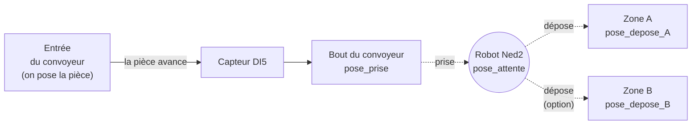

**Le cycle, étape par étape** :

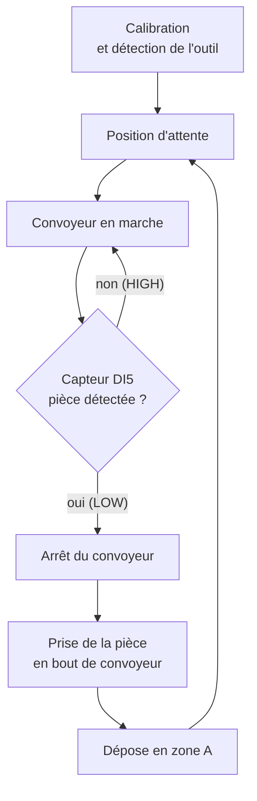

### 3.2 Comprendre : le capteur et la boucle d'attente

**Le capteur infrarouge** est branché sur l'entrée **DI5** du robot. Il renvoie **HIGH** quand rien n'est devant lui et **LOW** quand une pièce est détectée (documentation `03_Accessoires/Conveyeur/Use_the_Conveyor_Belt.pdf`). Le vérifier sur votre convoyeur avant d'écrire la boucle : le réglage de distance du capteur peut inverser le résultat attendu.

Le programme ne « reçoit » pas d'alerte quand la pièce arrive : c'est lui qui **interroge le capteur sans arrêt**, plusieurs fois par seconde, et qui sort de la boucle dès que la réponse change. On appelle cela une **boucle d'attente** (ou scrutation).

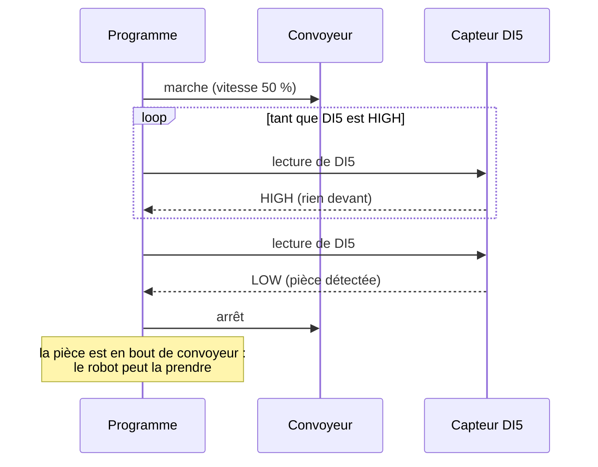

**Question.** Que se passe-t-il si aucune pièce n'arrive jamais ? Le programme reste bloqué dans la boucle, convoyeur en marche. Gardez ce cas en tête : il deviendra un **défaut** à signaler dans le process de l'équipe (partie 5).

### 3.3 Comprendre : ce que fait « prendre » et « déposer »

Le bloc **Pick from pose** n'est pas un simple mouvement : il enchaîne cinq actions pour approcher la pièce sans la heurter. **Place from pose** fait la même chose à l'envers.

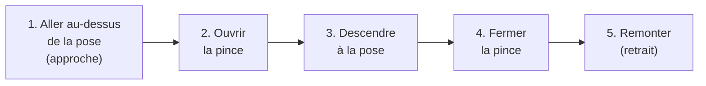

C'est pourquoi on ne relève que la **pose finale** de la pince, à hauteur de pièce : l'approche et le retrait sont calculés par le robot.

### 3.4 Faire : relever les poses

Relever chaque pose en FreeMotion (bouton **Save**), puis la ranger dans une variable Blockly. Donner des noms clairs : ce sont ceux que le programme Python reprendra.

| Variable | Rôle |
|----------|------|
| `pose_attente` | Position d'attente, au-dessus du convoyeur, hors de la trajectoire des pièces |
| `pose_prise` | Prise de la pièce en bout de convoyeur, à hauteur de pièce |
| `pose_depose_A` | Dépose dans la zone A |
| `pose_depose_B` (option) | Dépose dans une seconde zone, si le process en prévoit deux |

**Méthode pour une pose de prise précise**

1. Faire avancer une pièce jusqu'au capteur et arrêter le convoyeur.
2. Ouvrir la pince, puis amener le bras en FreeMotion pour que la pince entoure la pièce, **pince verticale**.
3. Relâcher FreeMotion, appuyer sur **Save**, ranger la pose dans la variable `pose_prise`.
4. Remonter le bras à la main avant de relever la pose suivante.
5. Recopier les six valeurs dans la fiche des poses (partie 6) : le secrétaire s'en charge.

### 3.5 Faire : construire le programme pas à pas

Ne pas écrire tout le cycle d'un coup : **ajouter une étape, la tester, puis passer à la suivante.** Une erreur se trouve alors tout de suite.

| Étape | Ce qu'on ajoute | Test attendu |
|-------|-----------------|--------------|
| 1 | Calibration, détection de la pince, aller en `pose_attente` | Le bras rejoint la position d'attente |
| 2 | Convoyeur en marche, boucle sur DI5, arrêt du convoyeur | Le convoyeur s'arrête quand la pièce passe devant le capteur |
| 3 | Pick from `pose_prise` | Le robot saisit la pièce sans toucher le convoyeur |
| 4 | Place from `pose_depose_A`, retour en `pose_attente` | La pièce est posée en zone A, le bras revient |
| 5 | Boucle Repeat 3 fois autour des étapes 2 à 4 | Trois cycles enchaînés, une pièce reposée à chaque tour |

**Les blocs à utiliser**

| Étape du cycle | Bloc Blockly |
|----------------|--------------|
| Calibrer | Calibrate auto |
| Détecter la pince | Scan & update tool |
| Aller en attente | Move pose |
| Activer le convoyeur | Set conveyor |
| Faire tourner le convoyeur | Control conveyor : marche, vitesse 50 %, sens |
| Attendre la pièce | Repeat while, avec Digital read DI5 dans la condition |
| Arrêter le convoyeur | Control conveyor : arrêt (ou Stop conveyor) |
| Prendre la pièce | Pick from pose |
| Déposer la pièce | Place from pose |
| Marquer une pause | Wait |
| Répéter le cycle | Repeat N times |
| Documenter | Comment |

Les blocs sont rangés par familles dans le menu de gauche de Blockly (mouvement, outil, entrées / sorties, convoyeur, boucles, etc.).

Le sens du convoyeur (FORWARD ou BACKWARD) dépend de la façon dont il est installé : faire un essai à vitesse lente avant de lancer le cycle.

**En cas de problème**

| Symptôme | Cause probable | Que faire |
|----------|----------------|-----------|
| Le convoyeur part dans le mauvais sens | Sens inversé pour cette installation | Passer de FORWARD à BACKWARD (ou l'inverse) |
| Le convoyeur ne s'arrête jamais | Condition de la boucle inversée, ou capteur mal réglé | Regarder DI5 dans le panneau des entrées / sorties avec une pièce devant, corriger la condition |
| Le convoyeur ne démarre pas | Convoyeur non détecté | Ajouter Set conveyor au début, ou refaire Scan dans l'onglet Équipement |
| La pince se ferme à côté de la pièce | Pose de prise imprécise | Relever de nouveau `pose_prise` avec une pièce arrêtée devant le capteur |
| Le robot refuse de bouger | Calibration à refaire, ou pose hors d'atteinte | Relancer la calibration, vérifier la pose |

### Vérifier

- [ ] Les trois poses relevées et nommées
- [ ] Le convoyeur s'arrête quand la pièce arrive devant le capteur
- [ ] Le cycle complet fonctionne une fois, à vitesse réduite
- [ ] Le cycle est répété trois fois de suite sans intervention, en reposant une pièce à chaque tour
- [ ] Le programme est enregistré dans Niryo Studio sous le nom de l'équipe (par exemple `g1e1_cycle`)

**Si vous avez fini en avance** : faire clignoter l'anneau de LED en vert à chaque fin de cycle, compter les pièces dans une variable, alterner la dépose entre les zones A et B, arrêter le cycle si aucune pièce n'arrive au bout de 30 secondes.

### À retenir

- Le cycle se lit comme une suite d'**étapes** et de **conditions** : c'est déjà la description d'un process.
- La **boucle d'attente** sur DI5 est le seul lien entre le convoyeur et le robot. Si la pièce n'arrive pas, le programme attend indéfiniment : c'est un défaut à prévoir.
- On construit un programme **étape par étape**, en testant chacune.


## 4. Export Python : lire le code généré

### 4.1 Comprendre : deux façons de piloter le robot en Python

Blockly est pratique pour apprendre, mais il ne sait pas envoyer de messages MQTT ni répondre à un site web. Pour la suite du projet, le programme doit passer en **Python**.

| | Python ROS Wrapper | `pyniryo` |
|---|---|---|
| D'où vient le code | **Export de Niryo Studio** (bouton Export, fichier `.py`) | Écrit à la main |
| Où il s'exécute | **Sur le robot** (le petit ordinateur de sa base) | Sur n'importe quel poste du réseau |
| Comment il parle au robot | Directement, par ROS | Par le réseau, en TCP (port 40001) |
| Début du programme | `n = NiryoRosWrapper()` | `robot = NiryoRobot("192.168.10.21")` |
| Dans le projet | **Le programme process et l'API de commande** (cours *Une API CQRS pour le robot Niryo*), qui tournent sur le robot | Pas utilisé dans le projet de base ; utile pour piloter le robot depuis un poste (par exemple pour la vision) |

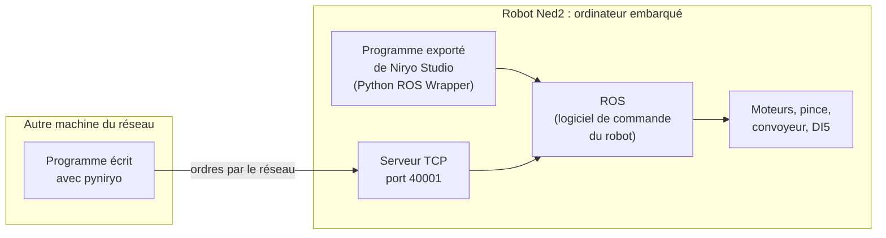

Le projet utilise le Python ROS Wrapper du début à la fin : le programme exporté aujourd'hui est la base du programme process et de l'API de commande, qui tourneront sur le robot. Ce qui est appris ici sert directement pour l'API.

### 4.2 Faire : lire le code exporté

Voici un export de Niryo Studio pour le cycle de la partie 3, nettoyé et commenté. Niryo Studio ajoute des lignes `n.highlight_block('...')` qui servent seulement à surligner les blocs pendant l'exécution : on peut les supprimer.

```python
#!/usr/bin/env python
from niryo_robot_python_ros_wrapper.ros_wrapper import *
import rospy

rospy.init_node('niryo_blockly_interpreted_code')
n = NiryoRosWrapper()          # n représente le robot

n.calibrate_auto()             # calibration (sans effet si elle est déjà faite)
n.update_tool()                # détection de la pince

# Poses relevées en FreeMotion : [x, y, z, roll, pitch, yaw]
pose_attente = [0.14, 0.0, 0.203, -0.017, 0.761, -0.001]
pose_prise = [-0.168, 0.182, 0.149, -1.832, 1.483, -0.371]
pose_depose_A = [0.20, 0.20, 0.10, 0.0, 1.57, 0.0]

n.move_pose(*pose_attente)
n.set_conveyor()               # active le convoyeur branché sur le robot
n.wait(2)

# Le convoyeur tourne tant que le capteur ne voit rien (DI5 à HIGH)
n.control_conveyor(ConveyorID.ID_1, True, 50, ConveyorDirection.BACKWARD)
while n.digital_read('DI5'):
    n.wait(0.1)
n.control_conveyor(ConveyorID.ID_1, False, 0, ConveyorDirection.BACKWARD)

n.pick_from_pose(*pose_prise)  # approche, ouverture, descente, fermeture, retrait
n.place_from_pose(*pose_depose_A)
n.move_pose(*pose_attente)
```

Les valeurs des poses sont des exemples : chaque équipe reprend celles de son propre robot. L'écriture `*pose_prise` transmet les six valeurs de la liste comme six arguments séparés.

**Lire le code en quatre blocs** : on retrouve toujours la même structure.

| Lignes | Rôle |
|--------|------|
| `import` et `NiryoRosWrapper()` | Charger la bibliothèque et obtenir l'objet `n` qui représente le robot |
| `calibrate_auto`, `update_tool` | Préparer le robot |
| `pose_... = [...]` | Les données : les poses relevées |
| `move_pose`, `control_conveyor`, `while`, `pick_from_pose`, `place_from_pose` | La séquence : le cycle lui-même |

**Exercice.** Mettre côte à côte le programme Blockly et le fichier exporté. Pour chaque bloc, surligner la ligne Python correspondante. Quel bloc est devenu une boucle `while` ? Où sont passées les variables de poses ?

### 4.3 Les fonctions à connaître

| Action | Bloc Blockly | Export Niryo Studio (`n`) |
|--------|--------------|---------------------------|
| Calibrer | Calibrate auto | `n.calibrate_auto()` |
| Forcer une nouvelle calibration | (bloc de calibration) | `n.request_new_calibration()` |
| Détecter l'outil | Scan & update tool | `n.update_tool()` |
| Aller à une position articulaire | Move joints | `n.move_joints(j1, ..., j6)` |
| Aller à une pose | Move pose | `n.move_pose(x, y, z, roll, pitch, yaw)` |
| Prendre une pièce | Pick from pose | `n.pick_from_pose(*pose)` |
| Déposer une pièce | Place from pose | `n.place_from_pose(*pose)` |
| Fermer / ouvrir la pince | Grasp / Release with tool | `n.grasp_with_tool()` / `n.release_with_tool()` |
| Activer le convoyeur | Set conveyor | `n.set_conveyor()` |
| Faire tourner le convoyeur | Control conveyor | `n.control_conveyor(ConveyorID.ID_1, True, 50, ConveyorDirection.FORWARD)` |
| Arrêter le convoyeur | Control conveyor (arrêt) | `n.control_conveyor(ConveyorID.ID_1, False, 0, ConveyorDirection.FORWARD)` |
| Lire le capteur | Digital read | `n.digital_read('DI5')` : vrai si HIGH |
| Attendre | Wait | `n.wait(1)` |
| Signal lumineux | LED ring flashing | `n.led_ring.flashing([0, 255, 0, 0], period=0.5, iterations=3, wait=False)` |
| Signal sonore | Play sound | `n.sound.play('ready.wav', wait_end=True)` |

### 4.4 Faire : préparer le programme pour la suite du projet

Le programme exporté est une longue suite d'instructions. Pour pouvoir plus tard y ajouter la publication MQTT des événements (fonction F4), on le **découpe en fonctions**, une par étape du cycle. Chaque fonction porte un nom qui dit ce qu'elle fait ; le cycle devient lisible comme une phrase.

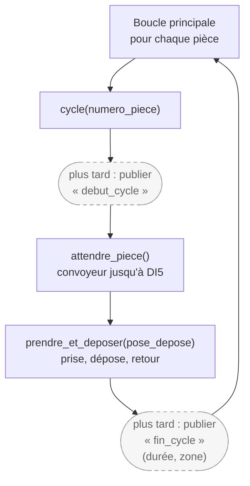

```python
def attendre_piece():
    """Fait tourner le convoyeur jusqu'à la détection de la pièce."""
    n.control_conveyor(ConveyorID.ID_1, True, 50, ConveyorDirection.BACKWARD)
    while n.digital_read('DI5'):
        n.wait(0.1)
    n.control_conveyor(ConveyorID.ID_1, False, 0, ConveyorDirection.BACKWARD)

def prendre_et_deposer(pose_depose):
    n.pick_from_pose(*pose_prise)
    n.place_from_pose(*pose_depose)
    n.move_pose(*pose_attente)

def cycle(numero_piece):
    # plus tard : publier « debut_cycle » sur cellule/<equipe>/cycle
    attendre_piece()
    prendre_et_deposer(pose_depose_A)
    # plus tard : publier « fin_cycle » avec la durée et la zone

for piece in range(1, 4):
    cycle(piece)
```

**Pourquoi découper ?** Ajouter la publication d'un message, changer de zone de dépose ou ajouter un délai maximal dans `attendre_piece` ne touchera alors qu'**une seule fonction**, sans risquer de casser le reste du cycle.

**Un nom de nœud propre à l'équipe.** Le programme sera ensuite lancé sur le robot sans Niryo Studio. Remplacer dès maintenant `rospy.init_node('niryo_blockly_interpreted_code')` par un nom propre à l'équipe, par exemple `rospy.init_node('cellule_g1e1')` : Niryo Studio utilise ce nom pour ses propres programmes, et deux nœuds ROS du même nom ne peuvent pas tourner ensemble.

### Vérifier

- [ ] Programme exporté en `.py` depuis Niryo Studio
- [ ] Dans le fichier, les poses repérées et renommées comme dans la partie 3.4
- [ ] Chaque fonction du tableau 4.3 utilisée par le programme retrouvée dans le code
- [ ] Le programme découpé en fonctions (`attendre_piece`, `prendre_et_deposer`, `cycle`), avec en commentaire les endroits où publier les événements

### À retenir

- L'export de Niryo Studio utilise le **Python ROS Wrapper** et s'exécute **sur le robot** : le programme process et l'API de commande du projet seront écrits de la même façon, et tourneront sur le robot.
- Un programme lisible se découpe en **fonctions nommées** : c'est ce qui permettra d'y brancher MQTT.


## 5. Le process de l'équipe : fiche process v0

### Comprendre

Le cycle guidé est un point de départ. L'équipe choisit maintenant **son** process, qu'elle développera pendant tout le projet. Il doit rester simple : le robot ne sera de nouveau disponible qu'à l'intégration.

Décrire un process, c'est répondre à trois questions : **que fait la cellule** (les étapes), **que peut-il arriver de travers** (les défauts), **que doit savoir le superviseur** (les données). Ces réponses deviendront plus tard les messages MQTT, les tables de la base et les écrans du site web.

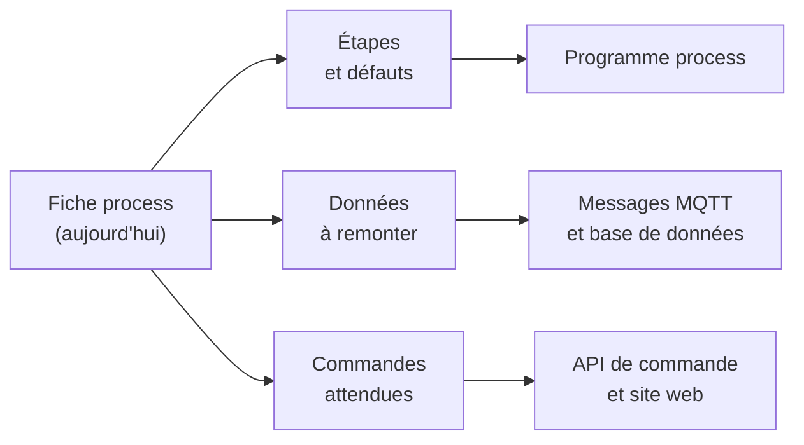

**Idées de process** : tri des pièces dans deux zones selon un compteur (une sur deux), palettisation (dépose sur une grille de positions), mise en stock avec un nombre maximal de pièces par zone, cycle avec contrôle (la pièce est reposée sur le convoyeur si elle n'est pas détectée à la fin).

### Faire : rédiger la fiche

**Contenu de la fiche (une page)**

| Rubrique | Question à se poser |
|----------|---------------------|
| Nom et but du process | Que produit la cellule ? |
| Étapes du cycle | Quelle est la suite d'actions, du début à la fin d'un cycle ? |
| Entrées / sorties | Quels capteurs et quels actionneurs sont utilisés (DI5, convoyeur, pince) ? |
| Cas d'erreur | Que se passe-t-il si aucune pièce n'arrive, si la prise échoue, si l'arrêt d'urgence est actionné ? |
| Données à remonter | Quelles informations le superviseur doit-il recevoir, et à quel moment ? |
| Commandes attendues | Que doit pouvoir faire l'opérateur à distance (démarrer, arrêter, calibrer) ? |

**Exemple de fiche**

> **Process** : tri alterné. Chaque pièce est amenée par le convoyeur ; les pièces de rang impair vont en zone A, celles de rang pair en zone B.
>
> **Étapes** : attente, convoyeur en marche, détection DI5, arrêt du convoyeur, prise, dépose en A ou B, retour en attente.
>
> **Entrées / sorties** : capteur infrarouge sur DI5 (entrée), convoyeur et pince (sorties).
>
> **Cas d'erreur** : pas de pièce au bout de 30 s (le convoyeur s'arrête, défaut « pas de pièce ») ; pince fermée à vide (défaut « prise échouée ») ; arrêt d'urgence (cycle interrompu).
>
> **Données à remonter** : début et fin de chaque cycle, numéro de la pièce, durée du cycle, zone de dépose, état du robot (en attente, en cycle, en défaut), défauts.
>
> **Commandes** : démarrer, arrêter, calibrer.

Le même process, dessiné : un schéma de ce type est conseillé dans la fiche, il remplace un long texte.

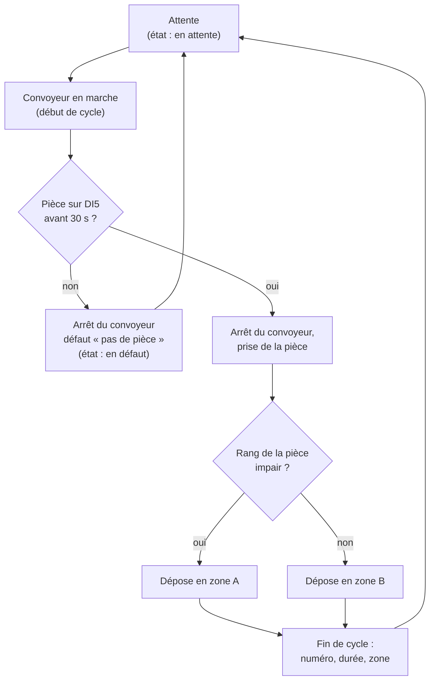

Ces données correspondent au message que la cellule publiera plus tard, par exemple `{"evenement": "fin_cycle", "piece": 12, "duree": 18.2, "zone": "A", "horodatage": "..."}` (voir le `README.md`, section 6).

### Vérifier

- [ ] Fiche process v0 rédigée et relue par l'enseignant
- [ ] Le process est dessiné sous forme de schéma (étapes, conditions, défauts)
- [ ] Au moins deux cas d'erreur sont prévus

### À retenir

- Un process se décrit par ses **étapes**, ses **défauts** et ses **données**.
- Un process simple et bien testé vaut mieux qu'un process ambitieux qui ne tourne pas le jour de l'intégration.


## 6. Livrables de la séance

À déposer en fin de séance, dans le dossier de l'équipe :

| Livrable | Contenu |
|----------|---------|
| Programme Blockly | Le programme enregistré dans Niryo Studio, et son fichier exporté |
| Programme Python | Le fichier `.py` exporté, nettoyé et découpé en fonctions (partie 4.4) |
| Fiche des poses | Le tableau ci-dessous, rempli |
| Fiche process v0 | Une page (partie 5) |

**Fiche des poses** (à recopier et à remplir)

| Équipe | Robot n° | Adresse IP du robot | Sens du convoyeur | État de DI5 avec pièce |
|--------|----------|---------------------|-------------------|------------------------|
| `g1e1` | | | FORWARD / BACKWARD | HIGH / LOW |

| Variable | x | y | z | roll | pitch | yaw |
|----------|---|---|---|------|-------|-----|
| `pose_attente` | | | | | | |
| `pose_prise` | | | | | | |
| `pose_depose_A` | | | | | | |
| `pose_depose_B` | | | | | | |

Ces valeurs seront reprises telles quelles lors de l'intégration, dans le programme process et dans l'API de commande : les noter avec soin.

**Bilan de l'équipe** : avant de partir, cocher honnêtement ce que chacun sait faire seul.

| Je sais... | Oui | Pas encore |
|------------|-----|------------|
| connecter Niryo Studio au robot et le calibrer | | |
| expliquer la différence entre position articulaire et pose | | |
| relever une pose en FreeMotion | | |
| expliquer comment le programme attend la pièce sur DI5 | | |
| retrouver dans le code exporté les lignes d'un bloc Blockly | | |
| dire où s'exécute le code exporté, et avec quelle bibliothèque il commande le robot | | |


## 7. Vocabulaire

| Mot | Sens |
|-----|------|
| Calibration | Recherche du zéro de chaque axe ; obligatoire avant tout mouvement |
| Position articulaire | Les six angles des axes du bras, `[j1, ..., j6]` |
| Pose | Position et orientation de la pince, `[x, y, z, roll, pitch, yaw]` |
| FreeMotion | Mode où l'on déplace le bras à la main pour relever une pose |
| Entrée numérique (DI) | Entrée du robot qui ne vaut que HIGH ou LOW ; le capteur du convoyeur est sur DI5 |
| Boucle d'attente | Boucle qui relit un capteur jusqu'à ce que son état change |
| Cycle | Suite d'étapes répétée pour chaque pièce |
| Process | Ce que fait la cellule : ses cycles, ses défauts, ses données |
| Export | Conversion du programme Blockly en fichier Python par Niryo Studio |


## 8. Pour aller plus loin

Documentation Niryo, dans le dossier `documentation_Niryo_Ned2/` :

- `04_Pedagogie/01_Prise_en_main_Blockly_Pick_and_Place.pdf` : positions, FreeMotion, pince, boucles
- `04_Pedagogie/02_Premiere_automatisation_Blockly.pdf` : convoyeur et capteur infrarouge en Blockly
- `04_Pedagogie/03_Unite2_Blockly_vers_Python.pdf` et `03_Unite3_Premier_script_Python.pdf` : passage de Blockly à Python, puis à `pyniryo`
- `03_Accessoires/Conveyeur/Use_the_Conveyor_Belt.pdf` : convoyeur et capteur, avec des exemples en `pyniryo` et en Python ROS Wrapper
- `01_Robot_NED2/08_Safety.pdf` et `01_Robot_NED2/02_Operating_mode.pdf` : sécurité et modes du robot

Référence de la bibliothèque `pyniryo` : <https://niryorobotics.github.io/pyniryo/>
