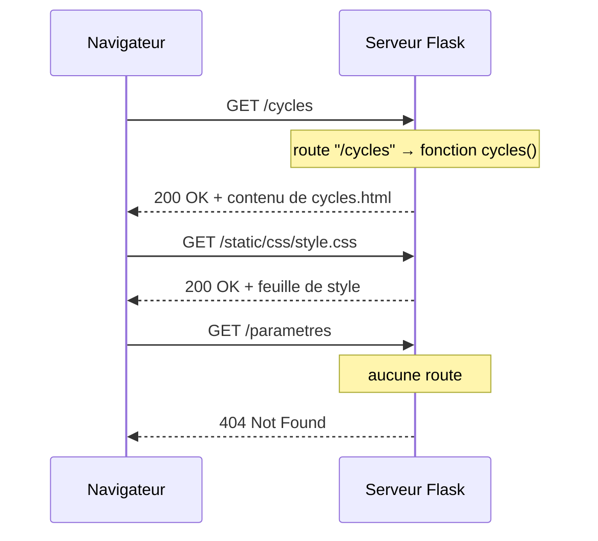

# Cours HTML et CSS : réaliser les pages d'un site web

Infrastructure client / serveur dans un contexte industriel

Ce cours apprend à construire les pages d'un site web : HTML pour le contenu, CSS pour l'apparence, et le principe des routes pour les servir. Le fil conducteur est le tableau de bord de supervision de la cellule robotisée (robot Ned2 + convoyeur). La logique côté serveur (templates, base de données, formulaires) fait l'objet du cours *Le framework Flask : premiers pas*.

## Objectifs et plan

À la fin, vous saurez écrire des pages HTML structurées, les mettre en forme avec CSS et expliquer comment un serveur les associe à des URL grâce aux routes.

**Prérequis**

- Notions de base en Python (variables, fonctions, dictionnaires, listes)
- Python 3.10 ou plus, un éditeur de code (VS Code), un navigateur
- Aucune connaissance préalable en HTML ou CSS

**Plan**

1. Le web en bref : client, serveur, HTTP
2. HTML : structure et formulaires
3. CSS : mise en forme et mise en page
4. Servir les pages : le principe des routes
5. Réalisation guidée : la maquette du tableau de bord de la cellule
6. Exercices

**Installation de l'environnement**

```bash
mkdir maquette && cd maquette
python -m venv venv
source venv/bin/activate      # Windows : venv\Scripts\activate
pip install flask
```

## Le web en bref

Un site web fonctionne par échanges : le navigateur (client) envoie une requête HTTP, le serveur renvoie une réponse, le plus souvent une page HTML.

**Le cycle requête / réponse**

1. L'utilisateur saisit une adresse (`http://192.168.10.10:8001/cycles`) ou clique sur un lien.
2. Le navigateur envoie une requête : une méthode (`GET`, `POST`), un chemin (`/cycles`) et des en-têtes.
3. Le serveur choisit le code à exécuter selon le chemin : c'est le rôle des routes, que l'on écrira avec Flask.
4. Le serveur renvoie une réponse : un code d'état (`200` OK, `404` introuvable, `302` redirection) et un corps (HTML, JSON, image).
5. Le navigateur lit le HTML, charge le CSS et les images référencés, puis affiche la page.

**Les trois langages du front**

| Technologie | Rôle | Analogie |
| --- | --- | --- |
| HTML | Structure et contenu de la page | Le squelette |
| CSS | Apparence et mise en page | Les vêtements |
| JavaScript | Comportement dans le navigateur | Les muscles |

Ce cours se concentre sur HTML et CSS ; côté serveur, on utilise Flask. Python s'exécute sur le serveur, jamais dans le navigateur.

**Méthodes HTTP à connaître**

- `GET` : lire une ressource (afficher la liste des cycles). Les paramètres apparaissent dans l'URL : `/cycles?zone=A`.
- `POST` : envoyer des données (signaler un incident, envoyer une commande au robot). Les données sont dans le corps de la requête.

## HTML : structurer une page

HTML décrit le sens du contenu avec des balises : un titre est un titre, une liste est une liste, un lien est un lien.

**Squelette minimal**

```html
<!DOCTYPE html>
<html lang="fr">
<head>
  <meta charset="UTF-8">
  <meta name="viewport" content="width=device-width, initial-scale=1">
  <title>Supervision de la cellule</title>
  <link rel="stylesheet" href="style.css">
</head>
<body>
  <h1>Cellule robotisée G1-E1</h1>
  <p>Le robot Ned2 est <strong>en cycle</strong>. Voir la <a href="/cycles">liste des cycles</a>.</p>
</body>
</html>
```

Le `<head>` contient les informations sur la page (titre, encodage, feuille de style). Le `<body>` contient ce qui s'affiche.

**Balises essentielles**

| Balise | Usage |
| --- | --- |
| `<h1>` à `<h6>` | Titres, du plus important au moins important (un seul `<h1>` par page) |
| `<p>` | Paragraphe |
| `<a href="...">` | Lien vers une autre page |
| `` | Image, avec un texte alternatif obligatoire |
| `<ul>`, `<ol>`, `<li>` | Liste à puces, liste numérotée, élément de liste |
| `<table>`, `<tr>`, `<th>`, `<td>` | Tableau, ligne, en-tête, cellule |
| `<div>`, `<span>` | Conteneurs génériques (bloc et en ligne) |

**Balises sémantiques**

Elles structurent la page et aident l'accessibilité et le référencement :

```html
<header>  <nav>…</nav>  </header>
<main>
  <section>
    <h2>Compteurs du jour</h2>
    <article class="carte">…</article>
  </section>
  <aside>Derniers incidents</aside>
</main>
<footer>Projet fil rouge · cellule robotisée</footer>
```

**Attributs utiles**

- `id` : identifiant unique d'un élément (`<section id="commandes">`)
- `class` : un ou plusieurs noms de classe, réutilisables pour le CSS
- `alt` : description d'une image, lue par les lecteurs d'écran
- `href` et `src` : cible d'un lien ou source d'une ressource

**Un tableau de données : les derniers cycles**

Un tableau HTML sert à présenter des données tabulaires (jamais à faire de la mise en page) :

```html
<table>
  <thead>
    <tr><th>N°</th><th>Début</th><th>Durée (s)</th><th>Statut</th></tr>
  </thead>
  <tbody>
    <tr><td>37</td><td>08:31:20</td><td>18,4</td><td>ok</td></tr>
    <tr><td>36</td><td>08:30:57</td><td>23,0</td><td>défaut</td></tr>
  </tbody>
</table>
```

`<thead>` regroupe la ligne d'en-tête, `<tbody>` les lignes de données. Dans le cours Flask, les lignes de `<tbody>` seront générées par une boucle à partir de la base de données.

## HTML : les formulaires

Un formulaire envoie des données au serveur : l'attribut `action` donne l'adresse cible, l'attribut `method` la méthode HTTP.

```html
<form action="/incident" method="post">
  <label for="operateur">Opérateur</label>
  <input type="text" id="operateur" name="operateur" required>

  <label for="type">Type d'incident</label>
  <select id="type" name="type">
    <option value="piece_non_detectee">Pièce non détectée (capteur DI5)</option>
    <option value="prise_manquee">Prise manquée</option>
    <option value="convoyeur_bloque">Convoyeur bloqué</option>
  </select>

  <label for="pieces">Pièces perdues</label>
  <input type="number" id="pieces" name="pieces" min="0" max="50" value="0">

  <label for="description">Description</label>
  <textarea id="description" name="description" rows="5"></textarea>

  <button type="submit">Envoyer</button>
</form>
```

**Points clés**

- L'attribut `name` de chaque champ devient la clé des données reçues côté Flask : sans `name`, le champ n'est pas envoyé.
- `<label for="…">` relie le libellé au champ (même valeur que son `id`) : cliquer sur le libellé active le champ.
- `type` change le comportement : `text`, `email`, `password`, `number`, `date`, `checkbox`, `radio`.
- `required`, `minlength`, `max` déclenchent une validation dans le navigateur.
- Utilisez `GET` pour une recherche ou un filtre (paramètres dans l'URL) et `POST` pour tout ce qui modifie quelque chose (enregistrer un incident, démarrer le robot) ou transmet des données sensibles.

La validation du navigateur améliore le confort, mais ne protège pas : n'importe qui peut envoyer une requête sans passer par le formulaire. Le serveur doit toujours revérifier les données reçues, a fortiori quand elles commandent un robot.

## CSS : sélecteurs, cascade et boîtes

CSS associe des règles de style à des éléments : un sélecteur désigne les éléments, des déclarations `propriété: valeur;` décrivent leur apparence.

```css
/* style.css */
:root {
  --couleur-principale: #2563eb;
  --texte: #1f2937;
}

body {
  font-family: system-ui, sans-serif;
  color: var(--texte);
  line-height: 1.6;
  margin: 0;
}

h1 { color: var(--couleur-principale); }
.carte { border: 1px solid #e5e7eb; border-radius: 8px; padding: 1rem; }
.etat.defaut { background: #fee2e2; }      /* badge « défaut » */
#entete { background: var(--couleur-principale); color: white; }
a:hover { text-decoration: underline; }
```

**Sélecteurs courants**

| Sélecteur | Cible |
| --- | --- |
| `p` | Tous les éléments `<p>` |
| `.carte` | Les éléments avec `class="carte"` |
| `#entete` | L'élément avec `id="entete"` |
| `.etat.defaut` | Les éléments qui ont à la fois les classes `etat` et `defaut` |
| `nav a` | Les liens situés dans un `<nav>` |
| `a:hover` | Un lien survolé par la souris |

**La cascade**

Quand plusieurs règles visent le même élément, la plus spécifique l'emporte (`id` > `classe` > balise), et à égalité la dernière écrite. Préférez les classes : elles restent simples à surcharger.

**Le modèle de boîte**

Tout élément est une boîte formée, de l'intérieur vers l'extérieur, du contenu (`width`, `height`), du `padding` (marge intérieure), de la `border` (bordure) et du `margin` (marge extérieure). Ajoutez toujours cette règle pour que la largeur inclue padding et bordure :

```css
* { box-sizing: border-box; }
```

**Unités**

- `px` : pixels, taille fixe
- `rem` : relatif à la taille de police de la page (1rem = 16px par défaut), à privilégier pour les textes et espacements
- `%`, `vw`, `vh` : relatifs au parent ou à la fenêtre

## CSS : mise en page et responsive

Flexbox organise des éléments sur une ligne ou une colonne ; Grid organise une page en lignes et colonnes. Les deux remplacent les anciens hacks à base de `float`.

**Flexbox : une barre de navigation**

```css
nav {
  display: flex;
  justify-content: space-between;  /* répartition sur l'axe principal */
  align-items: center;             /* alignement sur l'axe secondaire */
  gap: 1rem;
  padding: 1rem 2rem;
}
```

**Grid : une grille de cartes (les compteurs du tableau de bord)**

```css
.grille {
  display: grid;
  grid-template-columns: repeat(auto-fit, minmax(240px, 1fr));
  gap: 1.5rem;
}
```

Cette grille ajuste seule le nombre de colonnes : autant que la largeur disponible le permet, chacune d'au moins 240px.

**Quand choisir quoi**

| Besoin | Outil |
| --- | --- |
| Aligner des éléments dans une seule direction (menu, boutons, barre d'outils) | Flexbox |
| Disposer des blocs sur deux axes (cartes de compteurs, mise en page de page entière) | Grid |

**Responsive design**

La balise `<meta name="viewport">` du squelette HTML est indispensable sur mobile ou sur la tablette d'un poste d'atelier. Ensuite, les media queries adaptent la mise en page à la largeur de l'écran. Écrivez d'abord le style mobile, puis ajoutez les cas plus larges :

```css
.contenu { max-width: 960px; margin: 0 auto; padding: 0 1rem; }

img { max-width: 100%; height: auto; }

@media (min-width: 768px) {
  .deux-colonnes { display: grid; grid-template-columns: 2fr 1fr; gap: 2rem; }
}
```

## Servir les pages : le principe des routes

Un fichier HTML ouvert directement dans le navigateur (`file:///…/index.html`) ne se voit que sur votre poste. Pour que les opérateurs consultent le tableau de bord depuis le réseau, les pages doivent être servies par un serveur web. Dans ce module, ce serveur est une application Python écrite avec Flask, détaillée dans le cours *Le framework Flask : premiers pas*. Ici, on n'en retient que le principe : la **route**.

**Une route associe une URL à une fonction**

Quand le serveur reçoit une requête, il regarde le chemin demandé (`/`, `/cycles`) et appelle la fonction Python associée, appelée vue. Ce que renvoie la fonction devient le corps de la réponse HTTP.

```python
# app.py
from flask import Flask, render_template

app = Flask(__name__)

@app.route("/")                     # URL demandée…
def accueil():                      # … fonction appelée (la vue)
    return render_template("index.html")      # … page renvoyée

@app.route("/cycles")
def cycles():
    return render_template("cycles.html")
```

- Le décorateur `@app.route("/cycles")` déclare la route : toute requête `GET /cycles` exécute la fonction `cycles`.
- `render_template("cycles.html")` renvoie le fichier `templates/cycles.html`.
- Une URL sans route renvoie automatiquement une erreur `404`.



**Où ranger les fichiers**

```text
maquette/
├── app.py                # les routes
├── templates/            # les pages HTML
│   ├── index.html
│   ├── cycles.html
│   └── incident.html
└── static/               # fichiers servis tels quels
    ├── css/style.css
    └── img/cellule.png
```

Les fichiers de `static/` sont servis automatiquement à l'adresse `/static/…` : `static/css/style.css` devient `/static/css/style.css`. Dans les pages, les liens visent donc des **routes**, pas des fichiers :

```html
<link rel="stylesheet" href="/static/css/style.css">
<a href="/cycles">Cycles</a>             <!-- et non href="cycles.html" -->
```

**Une route peut contenir une variable**

```python
@app.route("/cycles/<int:numero>")
def cycle(numero):
    return f"Détail du cycle {numero}"
```

`/cycles/42` appelle `cycle(42)`. C'est ainsi qu'une seule fonction sert la page de n'importe quel cycle.

**Une route peut accepter un formulaire**

Une route répond par défaut à `GET`. Pour recevoir le formulaire de signalement d'incident (envoyé en `POST`, voir plus haut), on le déclare ; les champs arrivent dans `request.form`, avec pour clés les attributs `name` :

```python
from flask import request

@app.route("/incident", methods=["GET", "POST"])
def incident():
    if request.method == "POST":
        return f"Incident reçu : {request.form['type']}"
    return render_template("incident.html")
```

**Lancer le serveur**

```bash
flask --app app run --debug
```

Ouvrez `http://127.0.0.1:5000`. La suite (pages calculées à partir de la base de données avec Jinja2, `url_for`, messages flash, réponses JSON) est l'objet du cours Flask.

## Réalisation guidée : la maquette du tableau de bord de la cellule

On assemble tout ce qui précède dans la maquette du site de supervision de la cellule robotisée (robot Ned2 + convoyeur). Les valeurs sont écrites en dur dans le HTML : c'est une **maquette**. Dans le cours Flask, ces mêmes pages deviendront des templates remplis à partir de la base SQLite alimentée par le collecteur MQTT.

**Cahier des charges**

| Page | URL | Ce qu'elle montre |
| --- | --- | --- |
| Tableau de bord | `/` | État du robot, compteurs du jour (cartes), boutons de commande, derniers cycles |
| Cycles | `/cycles` | Tableau des cycles : numéro, début, durée, zone, statut |
| Incident | `/incident` | Formulaire de signalement d'un incident |

**Arborescence**

```text
maquette/
├── app.py
├── templates/
│   ├── index.html
│   ├── cycles.html
│   └── incident.html
└── static/css/style.css
```

**Étape 1 : templates/index.html**

```html
<!DOCTYPE html>
<html lang="fr">
<head>
  <meta charset="UTF-8">
  <meta name="viewport" content="width=device-width, initial-scale=1">
  <title>Tableau de bord · Cellule G1-E1</title>
  <link rel="stylesheet" href="/static/css/style.css">
</head>
<body>
  <header>
    <nav>
      <a class="logo" href="/">Cellule G1-E1</a>
      <div>
        <a href="/cycles">Cycles</a>
        <a href="/incident">Signaler un incident</a>
      </div>
    </nav>
  </header>

  <main class="contenu">
    <h1>Tableau de bord</h1>
    <p>Robot <strong>ned2-g1</strong> : <span class="etat marche">en cycle</span></p>

    <section class="grille">
      <article class="carte">
        <h2>Cycles du jour</h2>
        <p class="valeur">37</p>
      </article>
      <article class="carte">
        <h2>Durée moyenne</h2>
        <p class="valeur">18,4 s</p>
      </article>
      <article class="carte">
        <h2>Défauts</h2>
        <p class="valeur">2</p>
      </article>
    </section>

    <section class="commandes">
      <h2>Commandes</h2>
      <button type="button">Démarrer</button>
      <button type="button" class="secondaire">Arrêter</button>
      <button type="button" class="secondaire">Calibrer</button>
    </section>

    <section>
      <h2>Derniers cycles</h2>
      <table>
        <thead>
          <tr><th>N°</th><th>Début</th><th>Durée (s)</th><th>Zone</th><th>Statut</th></tr>
        </thead>
        <tbody>
          <tr><td>37</td><td>08:31:20</td><td>18,4</td><td>A</td><td><span class="etat ok">ok</span></td></tr>
          <tr><td>36</td><td>08:30:57</td><td>23,0</td><td>B</td><td><span class="etat defaut">défaut</span></td></tr>
          <tr><td>35</td><td>08:30:29</td><td>18,1</td><td>A</td><td><span class="etat ok">ok</span></td></tr>
        </tbody>
      </table>
      <p><a href="/cycles">Voir tous les cycles</a></p>
    </section>
  </main>

  <footer>Projet fil rouge · cellule robotisée</footer>
</body>
</html>
```

Les boutons de commande ne font encore rien : dans le cours Flask, chacun deviendra un petit formulaire `POST` relayé vers l'API du robot.

**Étape 2 : templates/cycles.html et templates/incident.html**

Copiez `index.html`, gardez `<head>`, `<header>` et `<footer>`, et remplacez le contenu de `<main>` :

```html
<!-- cycles.html : contenu de <main> -->
<h1>Cycles</h1>
<table>
  <thead>
    <tr><th>N°</th><th>Début</th><th>Durée (s)</th><th>Zone</th><th>Statut</th></tr>
  </thead>
  <tbody>
    <tr><td>37</td><td>2026-11-17 08:31:20</td><td>18,4</td><td>A</td><td><span class="etat ok">ok</span></td></tr>
    <tr><td>36</td><td>2026-11-17 08:30:57</td><td>23,0</td><td>B</td><td><span class="etat defaut">défaut</span></td></tr>
    <!-- … -->
  </tbody>
</table>
```

```html
<!-- incident.html : contenu de <main> -->
<h1>Signaler un incident</h1>
<form action="/incident" method="post">
  <label for="type">Type d'incident</label>
  <select id="type" name="type" required>
    <option value="piece_non_detectee">Pièce non détectée (capteur DI5)</option>
    <option value="prise_manquee">Prise manquée</option>
    <option value="convoyeur_bloque">Convoyeur bloqué</option>
    <option value="autre">Autre</option>
  </select>

  <label for="description">Description</label>
  <textarea id="description" name="description" rows="4" required></textarea>

  <button type="submit">Enregistrer</button>
</form>
```

Recopier l'en-tête et le pied de page dans chaque fichier est fastidieux et source d'oublis : l'héritage de templates, vu dans le cours Flask, règle ce problème.

**Étape 3 : static/css/style.css**

```css
* { box-sizing: border-box; }

:root {
  --principale: #0f766e;
  --texte: #1f2937;
  --fond: #f3f4f6;
  --ok: #dcfce7;
  --defaut: #fee2e2;
  --marche: #dbeafe;
}

body {
  margin: 0;
  font-family: system-ui, sans-serif;
  color: var(--texte);
  background: var(--fond);
  line-height: 1.6;
}

nav {
  display: flex;
  justify-content: space-between;
  align-items: center;
  flex-wrap: wrap;
  gap: 0.5rem;
  padding: 1rem 2rem;
  background: var(--principale);
}
nav a { color: white; text-decoration: none; margin-left: 1rem; }
nav .logo { font-weight: bold; margin-left: 0; }

.contenu { max-width: 1100px; margin: 2rem auto; padding: 0 1rem; }

/* Cartes des compteurs */
.grille {
  display: grid;
  grid-template-columns: repeat(auto-fit, minmax(200px, 1fr));
  gap: 1.5rem;
  margin: 1.5rem 0;
}
.carte {
  background: white;
  border: 1px solid #e5e7eb;
  border-radius: 8px;
  padding: 1rem;
}
.carte h2 { margin: 0; font-size: 1rem; color: #6b7280; }
.carte .valeur { margin: 0.25rem 0 0; font-size: 2rem; font-weight: bold; }

/* Badges d'état */
.etat { padding: 0.1rem 0.6rem; border-radius: 999px; font-size: 0.9rem; }
.etat.ok     { background: var(--ok); }
.etat.defaut { background: var(--defaut); }
.etat.marche { background: var(--marche); }

/* Tableaux */
table { width: 100%; border-collapse: collapse; background: white; }
th, td { padding: 0.5rem 0.75rem; border-bottom: 1px solid #e5e7eb; text-align: left; }
th { background: #f9fafb; }
tbody tr:hover { background: #f0fdfa; }

/* Boutons et formulaires */
button {
  background: var(--principale);
  color: white;
  border: 0;
  border-radius: 6px;
  padding: 0.6rem 1.2rem;
  font: inherit;
  cursor: pointer;
}
button.secondaire { background: #4b5563; }
.commandes button { margin: 0 0.5rem 0.5rem 0; }

form { display: grid; gap: 0.5rem; max-width: 480px; }
select, textarea { padding: 0.5rem; border: 1px solid #d1d5db; border-radius: 6px; font: inherit; }

footer { text-align: center; padding: 2rem; color: #6b7280; }

/* Écrans étroits (tablette d'atelier, téléphone) : le tableau défile horizontalement */
@media (max-width: 600px) {
  table { display: block; overflow-x: auto; }
  nav { padding: 1rem; }
}
```

**Étape 4 : app.py, les routes**

```python
from flask import Flask, render_template, request

app = Flask(__name__)

@app.route("/")
def accueil():
    return render_template("index.html")

@app.route("/cycles")
def cycles():
    return render_template("cycles.html")

@app.route("/incident", methods=["GET", "POST"])
def incident():
    if request.method == "POST":
        return f"Incident reçu : {request.form['type']}"
    return render_template("incident.html")
```

**Étape 5 : lancer et tester**

```bash
flask --app app run --debug
```

Vérifiez : la navigation entre les trois pages, l'envoi du formulaire vide (le navigateur le bloque grâce à `required`) puis rempli, l'URL `/parametres` (erreur 404), et l'affichage sur un écran étroit (réduisez la fenêtre ou utilisez le mode « appareil » des outils de développement, touche F12).

## Exercices et pistes pour aller plus loin

Chaque exercice réutilise une notion du cours ; faites-les dans l'ordre sur la maquette.

**Exercices**

- [ ] HTML : ajouter une page `/a-propos` (et sa route) qui décrit le process de l'équipe : un titre, deux paragraphes, la liste numérotée des étapes du cycle et une photo de la cellule avec texte alternatif
- [ ] HTML : ajouter sur le tableau de bord une liste des derniers événements (début de cycle, fin de cycle, défaut) avec leur heure
- [ ] CSS : changer la palette de couleurs en modifiant uniquement les variables de `:root`
- [ ] CSS : ajouter un badge `.etat.arret` (gris) et l'utiliser quand le robot est à l'arrêt
- [ ] CSS : afficher les cartes en une seule colonne sous 600px avec une media query
- [ ] CSS : mettre en évidence (fond rouge pâle) les lignes du tableau des cycles en défaut, avec une classe sur `<tr>`
- [ ] Formulaire : ajouter un champ « nom de l'opérateur » obligatoire et un champ « heure de l'incident » de type `time`
- [ ] Routes : ajouter la route `/cycles/<int:numero>` qui renvoie la page de détail d'un cycle (maquette statique)

**Pour aller plus loin**

1. **Templates et base de données** : remplacer les valeurs écrites en dur par les données de la base SQLite (cours Flask).
2. **Héritage de templates** : écrire l'en-tête et le pied de page une seule fois (cours Flask).
3. **JavaScript** : rafraîchir les compteurs toutes les cinq secondes sans recharger la page, à partir d'une route JSON.
4. **Accessibilité** : vérifier les contrastes des badges d'état et la navigation au clavier.

Documentation : [MDN Web Docs](https://developer.mozilla.org/fr/) pour HTML et CSS, [Flask](https://flask.palletsprojects.com).
