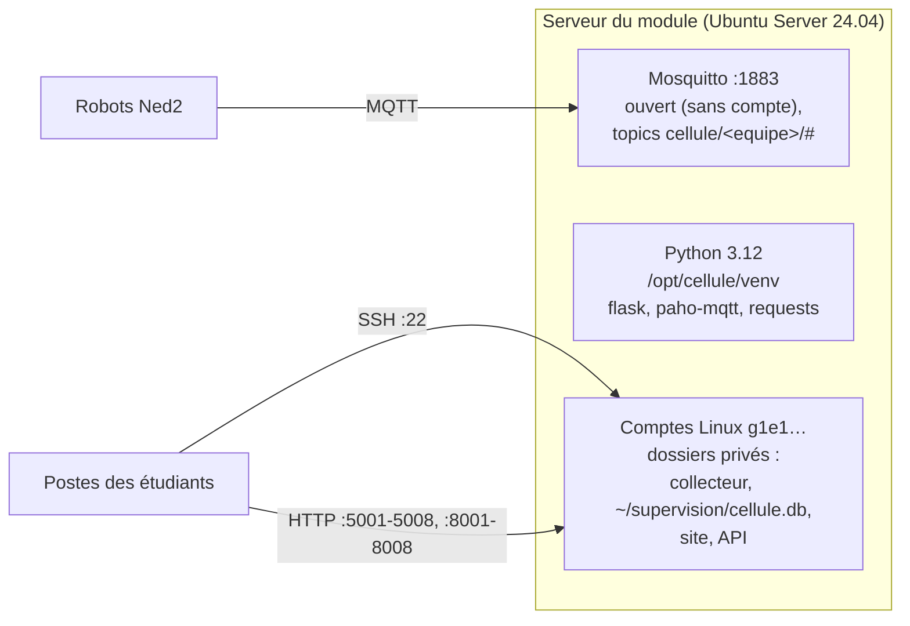

# Installation du serveur du module

Infrastructure client / serveur dans un contexte industriel

Le serveur du module héberge, pour toutes les équipes, le broker MQTT, les collecteurs, la base de données, les sites web et les API simulées. Deux serveurs existent, un par établissement, avec la même base : une base SQLite `cellule.db` par équipe. Le NUC ajoute Grafana, qui lit ces mêmes bases.

| Document | Serveur | Classes | Base de données | Grafana |
|---|---|---|---|---|
| [`install_raspberry.md`](install_raspberry.md) | Raspberry Pi 5 d'ISTP, `192.168.10.11` au fab lab | BACHINGE24 (8 équipes) | SQLite (`cellule.db`, une par équipe) | Non |
| [`install_nuc.md`](install_nuc.md) | NUC du fab lab de l'IRUP, `192.168.10.10` | BACHTECH24 et B3RNSPP26 (6 équipes) | SQLite (`cellule.db`, une par équipe) | Oui, port 3000, avec l'adaptateur SQLite (lecture seule) |

L'installation des bibliothèques sur les **robots** est à part : voir [`../install_robot/README.md`](../install_robot/README.md).

## Ce que les deux serveurs ont en commun

- **Système** : Ubuntu Server 24.04 LTS, sur un SSD externe ; adresse IP fixe ; heure juste (horodatage des cycles).
- **Comptes** : un compte Linux par équipe, créé par `scripts/creer_comptes_equipes.sh` ; le même identifiant et le même mot de passe servent pour SSH (et pour Grafana sur le NUC).
- **Broker** : Mosquitto ouvert, sans compte ni mot de passe, sur le réseau local du module ; chaque équipe publie sous `cellule/<equipe>/` (convention, non contrôlée par le broker).
- **Python** : un environnement commun `/opt/cellule/venv`, placé en tête du `PATH` de tous les comptes : `python3` et `pip` désignent cet environnement.
- **Ports par équipe** : 5001 à 5008 pour l'API simulée, 8001 à 8008 pour le site web (voir les fichiers matériel des progressions).

## Conventions des deux documents

- Les commandes sont à lancer avec le compte d'administration `prof`, créé à l'installation d'Ubuntu.
- Les mots de passe sont lus dans le fichier produit par `creer_comptes_equipes.sh` (`comptes_inge.txt` ou `comptes_irup.txt`, une ligne `identifiant:mot_de_passe`). Ce fichier ne quitte pas le compte `prof`.
- `MOT_DE_PASSE_ADMIN_GRAFANA` est à remplacer par un mot de passe choisi par l'enseignant.
