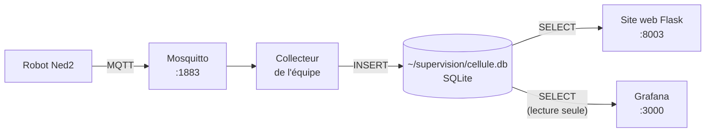

# Installation du serveur NUC (SQLite et Grafana)

Infrastructure client / serveur dans un contexte industriel

Ce document décrit, pas à pas, la préparation du serveur NUC du fab lab de l'IRUP. Il héberge le broker MQTT et, pour chacune des 6 équipes (`tech1`, `tech2` de BACHTECH24, `g1` à `g4` de B3RNSPP26), le collecteur, la base de données, le site web et l'API simulée, ainsi qu'une instance **Grafana** commune. Il démarre sur un SSD externe : le disque interne n'est ni utilisé ni modifié. Le matériel et le calendrier sont dans `progression_pedagogique/materiel_IRUP.md`.

Par rapport au NUC d'ISTP ([`install_nuc_istp.md`](install_nuc_istp.md)), le NUC ajoute **Grafana**, qui lit directement la base SQLite `cellule.db` de chaque équipe, en lecture seule, grâce à un adaptateur (le plugin communautaire `frser-sqlite-datasource`). Il n'y a qu'une base par équipe : le collecteur et le site web restent ceux des cours.

| Composant | Rôle | Port |
|---|---|---|
| Ubuntu Server 24.04 LTS | Système, sur SSD USB | |
| OpenSSH | Connexion des équipes | 22 |
| Mosquitto | Broker MQTT, ouvert (sans compte) | 1883 |
| Python 3.12 + `/opt/cellule/venv` | Collecteurs, sites web et API des équipes | 5001 à 5006, 8001 à 8006 |
| SQLite | Base `~/supervision/cellule.db` de chaque équipe, écrite par son collecteur, lue par son site web et par Grafana | |
| Grafana + adaptateur SQLite | Dashboards de production, une source de données et un dossier par équipe | 3000 |



Durée indicative : 2 heures 30, Internet nécessaire pendant la préparation (installation de Grafana et de l'adaptateur), pas pendant les séances.


## 1. Préparer le SSD externe

Le NUC démarre sur le SSD externe : Ubuntu s'installe sur ce SSD, **pas sur le disque interne**, qui contient peut-être les données de l'an dernier.

1. Sur un poste avec Internet, écrire l'image **Ubuntu Server 24.04 LTS (amd64)** sur une clé USB (Raspberry Pi Imager, Balena Etcher ou `dd`).
2. Brancher la clé et le SSD externe sur le NUC ; dans le BIOS (touche `F2` au démarrage), autoriser le démarrage sur USB et désactiver Secure Boot si l'installateur ne démarre pas.
3. Pendant l'installation :
   - disque : choisir **le SSD externe** (vérifier la taille et le modèle), « utiliser tout le disque », sans LVM chiffré ;
   - nom de la machine : `nuc-cellule` ; utilisateur `prof` ;
   - cocher **Install OpenSSH server**.
4. À la fin, retirer la clé ; dans le BIOS, placer le SSD externe en tête de l'ordre de démarrage et activer le redémarrage automatique après une coupure de courant.
5. Vérifier que le disque interne n'a pas été touché : `lsblk -f` doit montrer ses partitions inchangées, non montées.

L'installateur place le chargeur de démarrage sur le disque choisi. Si le NUC ne démarre plus sans le SSD, le disque interne n'a pas été modifié : c'est seulement l'ordre de démarrage du BIOS.


## 2. Système et heure

```bash
sudo apt update && sudo apt full-upgrade -y
sudo apt install -y mosquitto mosquitto-clients python3-venv python3-pip sqlite3 acl git curl tmux htop
sudo timedatectl set-timezone Europe/Paris
timedatectl                                     # heure juste ; NTP actif si le NUC a Internet
```

Le NUC a une horloge sauvegardée : sans Internet au fab lab, il garde l'heure. La vérifier à chaque séance. Le fuseau `Europe/Paris` sert aussi à Grafana pour convertir en UTC l'heure locale posée par les robots (section 7.7). Le paquet `acl` donne à Grafana l'accès aux bases des équipes (section 7.3).


## 3. Réseau : adresse fixe

Les scripts de ce document sont dans le dépôt du cours, copié sur le NUC dans `~/niryo2` (ou seulement son dossier `scripts/`).

```bash
cd ~/niryo2/scripts
sudo ./irup_reseau.sh
```

Le script détecte l'interface Ethernet, écrit `/etc/netplan/50-cellule.yaml` (adresse fixe `192.168.1.2/24`, routeur et DNS `192.168.1.1`) et applique la configuration. En SSH, la connexion est coupée puisque l'adresse change : garder un écran et un clavier à portée de main.

Pendant la préparation hors du fab lab, lancer `sudo ./irup_reseau.sh dhcp` : l'adresse est alors donnée par la box.


## 4. Comptes des équipes

```bash
cd ~/niryo2/scripts
sudo ./creer_comptes_equipes.sh irup        # crée comptes_irup.txt (mode 600)
```

Les comptes `tech1`, `tech2` et `g1` à `g4` ont des dossiers privés. Le même mot de passe sert pour SSH et Grafana.


## 5. Broker Mosquitto

Le broker est **ouvert** : pas de compte, pas de mot de passe, pas de droits par sujet. Il n'est joignable que sur le réseau local du module. Chaque équipe publie sous `cellule/<son identifiant>/` : c'est une **convention**, que le broker ne vérifie pas.

```bash
cd ~/niryo2/scripts
sudo ./nuc_mosquitto.sh
```

Le script écrit `/etc/mosquitto/conf.d/cellule.conf` (écoute sur le port 1883, accès anonyme), puis active et redémarre Mosquitto.

Limite connue : une équipe peut lire et écrire les topics d'une autre (identifiant mal recopié, curiosité). Deux clients MQTT de même nom, par exemple deux collecteurs lancés avec le même `EQUIPE`, se déconnectent l'un l'autre : en cas de messages qui manquent, vérifier d'abord que chaque équipe a son propre identifiant.


## 6. Python : un environnement commun

```bash
cd ~/niryo2/scripts
sudo ./nuc_python.sh
```

Le script crée `/opt/cellule/venv` avec Flask, paho-mqtt et requests, le place en tête du `PATH` et copie les paquets dans `/opt/cellule/paquets` pour une réinstallation sans Internet.

Les briques fournies aux équipes se déposent dans `/opt/cellule/fournitures` avec `sudo ./nuc_fournitures.sh`, comme sur le NUC d'ISTP (section 7 de `install_nuc_istp.md`).


## 7. Grafana et l'adaptateur SQLite

### 7.1 Installation (avec Internet)

Grafana vient du dépôt officiel de Grafana Labs. L'adaptateur SQLite, un plugin communautaire, s'installe ensuite avec la commande `grafana cli` :

```bash
cd ~/niryo2/scripts
sudo ./irup_grafana_installer.sh
```

Versions essayées : Grafana 13.2 et adaptateur 4.0. L'adaptateur n'est pas maintenu par Grafana Labs : avant une mise à jour de Grafana, vérifier sur sa page (grafana.com, « SQLite » dans les plugins) qu'il reste compatible.

### 7.2 Configuration

Dans `/etc/grafana/grafana.ini`, modifier les lignes suivantes (enlever le `;` de début de ligne) :

```ini
[server]
http_port = 3000

[security]
admin_user = admin
admin_password = MOT_DE_PASSE_ADMIN_GRAFANA

[users]
allow_sign_up = false
default_language = fr-FR

[analytics]
reporting_enabled = false
check_for_updates = false
check_for_plugin_updates = false
```

Les deux dernières options évitent que Grafana cherche Internet pendant les séances. Les réglages de sécurité de l'adaptateur restent ceux par défaut : pas d'`ATTACH` (lecture d'une autre base depuis une requête), fichiers sensibles bloqués (dont la base interne `grafana.db`).

### 7.3 Accès de Grafana aux bases des équipes

Chaque équipe range sa base à un emplacement fixe, celui de la structure de projet du cours de Flask : `~/supervision/cellule.db`, où son collecteur écrit et où son site web lit. Grafana tourne sous le compte système `grafana`, alors que les dossiers des équipes sont privés (mode 700). Des ACL lui donnent le strict nécessaire : traverser les dossiers jusqu'à la base et la lire.

```bash
cd ~/niryo2/scripts
sudo ./irup_grafana_acl.sh
```

Le script lit `comptes_irup.txt` (créé à la section 4) et, pour chaque équipe, crée `~/supervision` si besoin puis donne l'ACL à Grafana.

- Les autres équipes n'ont toujours aucun accès au dossier : `ls /home/g1` reste refusé.
- L'ACL par défaut ne vaut que pour les fichiers créés **après** elle. Pour une base qui existait déjà : `sudo setfacl -m u:grafana:r /home/g1/supervision/cellule.db`. Si une équipe supprime et recrée son dossier `supervision`, relancer le script, qui traite aussi une base déjà existante.
- Aucun réglage n'est demandé aux équipes, pas même le mode WAL : Grafana ouvre la base en lecture seule et, si le collecteur est en train d'écrire un lot, attend qu'il ait fini (section 7.4). Les écritures du collecteur, par lots courts, ne sont pas gênées.

### 7.4 Une source de données par équipe

Les sources de données sont déclarées dans un fichier (« provisioning ») : elles sont recréées à chaque démarrage, à l'identique.

```bash
cd ~/niryo2/scripts
sudo ./irup_grafana_sources.sh
```

Le script écrit `/etc/grafana/provisioning/datasources/cellule.yaml` (une source `SQLite <equipe>` par ligne de `comptes_irup.txt`), active Grafana au démarrage et le redémarre.

Les options du chemin protègent la base de l'équipe :

- `mode=ro` : ouverture en lecture seule ;
- `_pragma=query_only(1)` : toute requête d'écriture (`INSERT`, `DELETE`…) est refusée, un dashboard mal écrit ne peut rien modifier ;
- `_pragma=busy_timeout(5000)` : si le collecteur écrit, Grafana attend jusqu'à 5 secondes au lieu de renvoyer « database is locked ».

Tant que le collecteur d'une équipe n'a pas créé sa base, sa source de données renvoie « unable to open database file » : c'est normal.

### 7.5 Un utilisateur et un dossier par équipe

Chaque équipe a un compte Grafana (mêmes identifiant et mot de passe) et un dossier de dashboards où elle seule peut écrire. Le compte est créé avec le rôle « Viewer » : l'équipe ne modifie que son dossier.

```bash
cd ~/niryo2/scripts
./irup_grafana_comptes.sh          # demande le mot de passe de l'administrateur Grafana
```

Le script crée, pour chaque équipe, le compte et le dossier « Équipe <equipe> », puis remplace les droits du dossier : l'équipe modifie, l'administrateur gère, les autres ne voient pas.

Limite de la version gratuite de Grafana : toutes les sources de données sont visibles de toutes les équipes (les droits par source de données sont réservés à la version Enterprise). Chaque équipe doit choisir **sa** source `SQLite <equipe>` dans ses panneaux.

### 7.6 Données d'essai

Pour tester Grafana avant les vrais cycles, remplir la base d'une équipe de test avec 500 cycles fictifs, un par minute. Le script écrit dans la base avec le compte de l'équipe (argument : son identifiant, `g1` par défaut), à qui la base appartient ; les tables sont celles du cours de SQL.

```bash
cd ~/niryo2/scripts
sudo ./irup_grafana_donnees_essai.sh g1
```

Comme dans le collecteur, `debut` est l'heure locale posée par le robot, sans fuseau (`2026-11-17T08:30:18`). Effacer la base d'essai ensuite (le collecteur la recrée) : `sudo -u g1 rm /home/g1/supervision/cellule.db`.

### 7.7 Panneau d'essai

Se connecter à `http://192.168.1.2:3000` avec le compte `g1`, créer un dashboard dans le dossier « Équipe g1 », un panneau « Time series » sur la source `SQLite g1`, avec la requête :

```sql
SELECT unixepoch(debut, 'utc') AS time, duree AS "durée (s)"
FROM cycles
WHERE unixepoch(debut, 'utc') BETWEEN $__from / 1000 AND $__to / 1000
ORDER BY time
```

- SQLite n'a pas de type date. `unixepoch(debut, 'utc')` convertit l'heure locale du robot en secondes UTC, avec le fuseau du NUC (section 2) ; Grafana affiche ensuite l'heure locale du navigateur.
- Une colonne nommée `time` est reconnue comme l'heure du point (réglage « Time formatted columns » de l'éditeur de requête, qui contient `time` et `ts` par défaut).
- `$__from` et `$__to` sont les bornes de la période choisie en haut du dashboard, en millisecondes. La macro `$__timeFilter` des sources MySQL ou PostgreSQL n'existe pas avec cet adaptateur.

Pour compter les cycles par heure : `SELECT unixepoch(debut, 'utc') / 3600 * 3600 AS time, count(*) AS cycles FROM cycles WHERE … GROUP BY time ORDER BY time`.


## 8. Vérifications

```bash
systemctl is-active mosquitto ssh grafana-server            # 3 fois active
ss -tlnp | grep -E ':22 |:1883 |:3000 '
python3 -c "import flask, paho.mqtt, requests; print('ok')"  # depuis un compte d'équipe
sudo -u grafana sqlite3 "file:/home/g1/supervision/cellule.db?mode=ro" "SELECT count(*) FROM cycles;"   # Grafana lit la base
sudo -u g2 ls /home/g1                                   # refusé : dossier d'une autre équipe
```

- [ ] MQTT : chaque équipe publie et reçoit sur ses topics, rien sur ceux des autres (mêmes commandes que dans `install_nuc_istp.md`, section 9)
- [ ] Une équipe ne lit ni le dossier, ni les topics, ni la base d'une autre
- [ ] Grafana : connexion avec un compte d'équipe, panneau d'essai sur les données fictives, création d'un dashboard dans son dossier ; le dossier d'une autre équipe n'apparaît pas
- [ ] Collecteur d'une équipe de test en marche : ses nouveaux cycles apparaissent dans Grafana (rafraîchissement toutes les 5 s), sans erreur « database is locked » ni côté collecteur ni côté Grafana
- [ ] Redémarrage complet : les trois services repartent seuls
- [ ] Mémoire disponible avec Grafana et 6 équipes actives (`htop`)
- [ ] Le robot publie sur le broker du NUC : `~/cellule/lancer.sh ~/cellule/test.py --broker 192.168.1.2` sur le robot


## 9. Sauvegarde et restauration

- **Image complète du SSD** après l'installation, depuis un autre poste Linux, et copie sur le SSD de secours (mêmes commandes `dd` que pour le NUC d'ISTP).
- **Après chaque séance**, collecteurs arrêtés (une base copiée pendant une écriture peut être incohérente) : dossiers des équipes avec leurs bases, configuration et dashboards Grafana. L'option `--acls` conserve les droits donnés à Grafana.

  ```bash
  sudo tar czf ~/sauvegarde_$(date +%F).tgz --acls /home/tech[12] /home/g[1-4] /etc/mosquitto /etc/grafana /var/lib/grafana
  ```

- **Restauration d'une base** : `sudo tar xzf sauvegarde_2027-03-25.tgz --acls -C / home/g1/supervision/cellule.db`.
