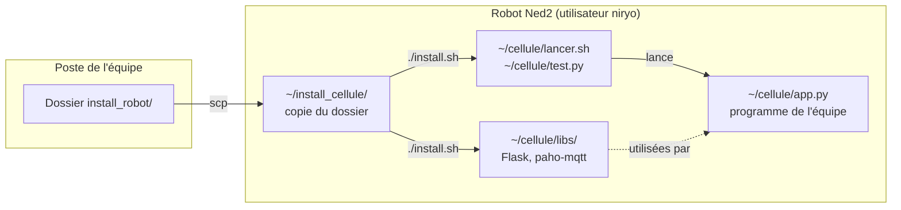

# Installation des bibliothèques Python sur le robot Ned2

Infrastructure client / serveur dans un contexte industriel

Dans le projet fil rouge, le programme du process et l'API de commande s'exécutent **sur le robot**, avec le Python ROS Wrapper de Niryo (le même que l'export de Niryo Studio). Ils ont besoin de deux bibliothèques absentes du robot : **Flask** (l'API) et **paho-mqtt** (la publication des cycles). Le robot n'a pas accès à Internet : ce dossier les installe **hors ligne**, sans toucher aux bibliothèques du système Niryo.

## Contenu du dossier

| Fichier | Rôle |
|---|---|
| `README.md` | Ce mode d'emploi |
| `paquets/` | Les paquets prêts à l'emploi (fichiers `.whl`), pour un robot ARM 64 bits et Python 3.8 à 3.12 |
| `requirements.txt` | La liste des bibliothèques et de leurs versions |
| `install.sh` | Le script d'installation, à lancer **sur le robot** |
| `lancer.sh` | Le lanceur des programmes du projet (bibliothèques + environnement ROS) |
| `test.py` | Le script qui vérifie l'installation |
| `telecharger_paquets.sh` | Pour l'enseignant : retélécharger `paquets/` depuis un poste relié à Internet |

## Ce que fait l'installation



- Les bibliothèques sont installées dans `~/cellule/libs`, un dossier à part. Le logiciel système du robot, qui contient lui-même un serveur Flask (port 5000), ne les voit pas : l'installation ne peut pas le perturber.
- Un programme du projet se lance avec `~/cellule/lancer.sh`, qui ajoute `~/cellule/libs` aux bibliothèques de Python et charge l'environnement ROS du robot.
- Pour tout désinstaller : `rm -rf ~/cellule/libs`.

## Prérequis

- Robot Ned2 avec un logiciel en version 5.3 ou plus (Ubuntu 20.04, ROS Noetic, Python 3.8) : c'est aussi la version minimale demandée par Niryo Studio.
- Un poste relié au même réseau que le robot, avec `ssh` et `scp` (Linux, macOS, ou Windows 10 et plus).
- L'adresse IP du robot (`192.168.10.21` à `.24` au fab lab) et le compte `niryo` (mot de passe par défaut `robotics`).

## Mode d'emploi

### 1. Copier le dossier sur le robot

Depuis le poste, dans le dossier qui contient `install_robot/` (remplacer `.21` par l'adresse de votre robot) :

```bash
scp -r install_robot niryo@192.168.10.21:~/install_cellule
```

### 2. Lancer l'installation sur le robot

```bash
ssh niryo@192.168.10.21
cd ~/install_cellule
./install.sh
```

Le script vérifie la version de Python, installe les paquets dans `~/cellule/libs`, copie `lancer.sh` et `test.py` dans `~/cellule`, puis lance le test. La fin attendue :

```text
== Bilan
13 OK, 0 attention, 0 échec
Installation terminée. Lancer un programme : ~/cellule/lancer.sh mon_programme.py
```

L'installation peut être relancée sans risque : elle remplace les versions déjà installées.

### 3. Vérifier l'installation

Le test peut être relancé à tout moment, avec des options :

```bash
~/cellule/lancer.sh ~/cellule/test.py                          # bibliothèques, ROS, port de l'API
~/cellule/lancer.sh ~/cellule/test.py --broker 192.168.10.10   # + connexion au broker MQTT du serveur
~/cellule/lancer.sh ~/cellule/test.py --robot                  # + lecture des axes et du capteur DI5
```

| Vérification | Ce qui est testé |
|---|---|
| Python | Version 3.8 ou plus, architecture du robot |
| Bibliothèques | Import de Flask, paho-mqtt et de leurs dépendances, versions, chargement depuis `~/cellule/libs` |
| Essai de Flask | Une route `GET /requetes/etat` et un gabarit Jinja2, sans réseau |
| Essai de paho-mqtt | Création d'un client MQTT, sans réseau |
| Python ROS Wrapper | Import de `rospy` et de `NiryoRosWrapper` |
| Port de l'API | Le port 3000 est libre (`--port-api` pour en tester un autre) |
| `--broker HOTE` | Connexion au broker MQTT (`--utilisateur` et `--mot-de-passe` si le broker en demande) |
| `--robot` | Connexion au robot par ROS, lecture des axes et de DI5. **Rien ne bouge** |

Le script se termine par un bilan ; il renvoie le code 1 si un test échoue.

### 4. Lancer un programme de l'équipe

Copier le programme depuis le poste, puis le lancer sur le robot :

```bash
scp app.py niryo@192.168.10.21:~/cellule/        # sur le poste
ssh niryo@192.168.10.21                          # puis, sur le robot :
cd ~/cellule
./lancer.sh app.py
```

Le programme s'arrête quand on ferme la session SSH. Pour qu'il continue à tourner (le test indique les outils présents sur le robot) :

| Outil | Lancer | Revenir au programme | Arrêter |
|---|---|---|---|
| `tmux` | `tmux new -s cellule`, puis `./lancer.sh app.py`, puis `Ctrl+B` et `D` | `tmux attach -t cellule` | `Ctrl+C` dans la session |
| `nohup` | `nohup ./lancer.sh app.py > app.log 2>&1 &` | `tail -f app.log` | `pkill -f app.py` |

## Points d'attention

- **Port de l'API : 3000.** Le port 5000 du robot est déjà pris par le logiciel système de Niryo (c'est par lui que Niryo Studio communique avec le robot).
- **Un nom de nœud ROS propre au programme.** L'export de Niryo Studio appelle `rospy.init_node('niryo_blockly_interpreted_code')`, le même nom que les programmes lancés depuis Niryo Studio : deux nœuds du même nom s'excluent. Dans le programme de l'équipe, utiliser un autre nom, par exemple `rospy.init_node('cellule_g1e1')`.
- **Un seul programme commande le robot à la fois.** Ne pas lancer de programme depuis Niryo Studio pendant que l'API tourne.
- **Lancer avec `lancer.sh` ou `python3`, pas avec `flask run --debug`** : le rechargeur de Flask lance le programme deux fois, donc deux connexions au robot.
- **Lancer depuis l'onglet Python de Niryo Studio** : il ne connaît pas `~/cellule/libs`. Si c'est nécessaire, ajouter en tête du programme `import sys` puis `sys.path.insert(0, "/home/niryo/cellule/libs")`.

## Dépannage

| Symptôme | Cause probable et solution |
|---|---|
| `Permission denied` en lançant `./install.sh` | Droits d'exécution perdus à la copie : `bash install.sh` |
| `il faut Python 3.8 ou plus` | Logiciel du robot trop ancien : le mettre à jour avec Niryo Studio |
| `pip est absent` | Le paquet `python3-pip` manque sur le robot : prévenir l'enseignant |
| `No matching distribution found` | Python ou architecture non prévus par `paquets/` : relancer `telecharger_paquets.sh` en ajoutant la version (voir ci-dessous) |
| `No module named 'flask'` | Programme lancé sans `lancer.sh` |
| `[ATTENTION] ... chargé depuis ...` | Une autre version de la bibliothèque est trouvée avant `~/cellule/libs` : lancer avec `lancer.sh` |
| `environnement ROS non chargé` | `lancer.sh` n'a pas trouvé le fichier `setup.bash` de ROS : vérifier le chemin `~/catkin_ws/...` dans `lancer.sh` |
| `port 3000 déjà utilisé` | Une API tourne déjà : `ss -tlnp` pour la trouver, puis l'arrêter |
| `--broker` : connexion impossible | Broker arrêté, mauvaise adresse ou pare-feu : voir le cours *Réseau TCP/IP* (dépannage) |

## Pour l'enseignant : préparer ou mettre à jour les paquets

Sur un poste relié à Internet, avec `pip3` :

```bash
cd install_robot
./telecharger_paquets.sh
```

Le script vide `paquets/`, puis télécharge les paquets de `requirements.txt` pour un Raspberry Pi 4 (`manylinux2014_aarch64`) et Python 3.8 à 3.12. Il ajoute MarkupSafe en sources, avec `setuptools` et `wheel` pour le construire : c'est un secours si le robot n'est pas en ARM 64 bits (MarkupSafe est alors installé sans son accélération en C, ce qui ne change rien pour le projet).

Les versions sont fixées dans `requirements.txt` pour rester compatibles avec Python 3.8 (Flask 3.0, Werkzeug 3.0, click 8.1) : ne pas les monter sans vérifier la version de Python des robots.

L'installation a été essayée hors ligne sous Python 3.8 (avec le `pip` 20.0.2 d'Ubuntu 20.04) et 3.12, sur PC : à valider sur un robot avant la séance d'intégration (`./install.sh --broker 192.168.10.10`, puis `test.py --robot`).
