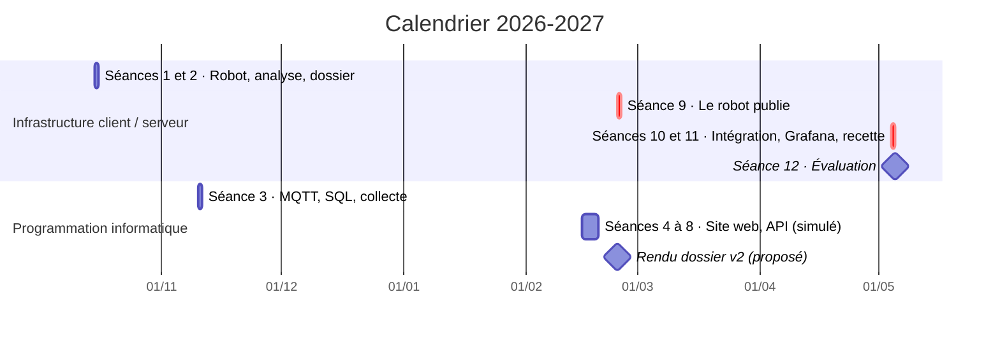
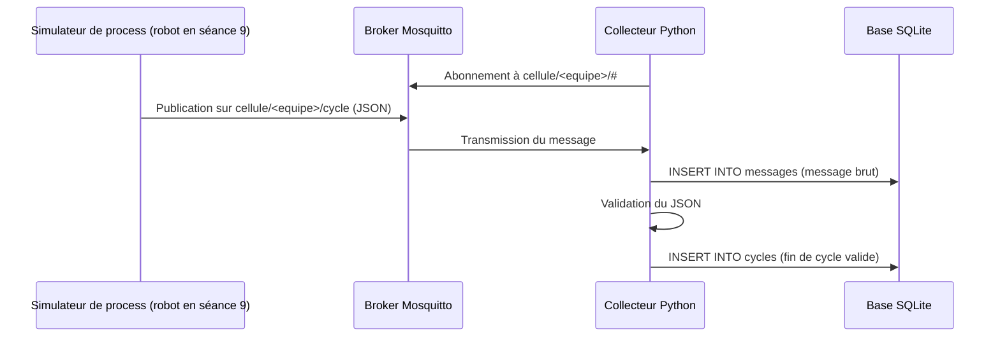
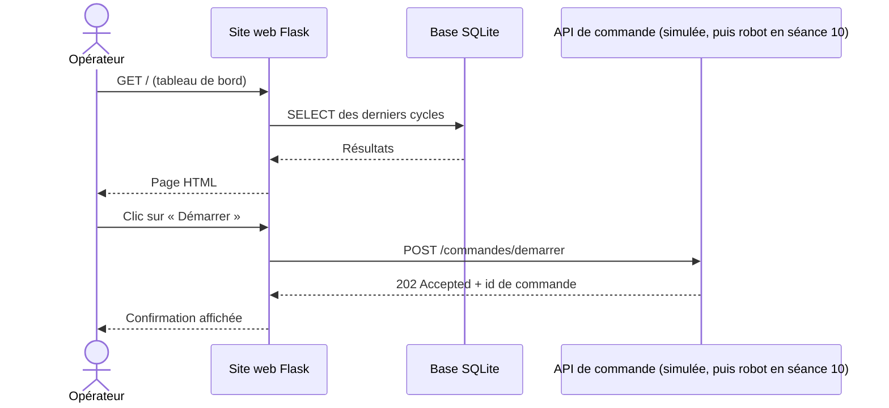

# Progression pédagogique : Infrastructure client / serveur dans un contexte industriel

- **Promotion :** B3 RNSPP 2026-0 (groupe ProN), effectif à renseigner
- **Année :** 2026-2027
- **Version :** v1.4 (brouillon), 12/10/2026
- **Prérequis :** Python (cours de programmation informatique), à confirmer (voir la section 7)
- **Sources :** `seances_B3RNSPP26.xlsx` (planning : dates et horaires) et supports 2025-2026 (dossier de l'année précédente)
- **Présentation du projet :** `README.md` à la racine (contexte, besoins, objectifs, fonctions, synoptique, données échangées), commun aux trois classes
- **Supports de cours :** dossier `cours/` (voir la fin de la section 4)

**En bref**

- 12 créneaux de 3h30, d'octobre 2026 à mai 2027, soit 42h par étudiant : 6 créneaux du module (21h) et 6 créneaux de programmation informatique (21h).
- Le collecteur MQTT, le site web et l'API sont réalisés **dans les créneaux de programmation informatique**, avant l'intégration sur les robots.
- Un projet fil rouge : une cellule robotisée supervisée, construite séance après séance.
- Le serveur est le NUC du fab lab, inaccessible depuis la salle de cours : les séances qui l'utilisent ont lieu au fab lab. 4 équipes, une par robot.
- Un dashboard Grafana de production est réalisé en fin de projet (séance 11).
- Évaluation : chaque équipe déroule son propre cahier de recette devant l'enseignant.

## 1. Intention générale

Le module est organisé en **projet fil rouge** : chaque équipe conçoit, réalise et fait recetter une **cellule robotisée supervisée**.

➡️ process robot (Niryo Ned2 + convoyeur) → remontée des données par MQTT → stockage SQL → site web et API de pilotage

Par rapport à l'an dernier :

- on part d'un **process défini par les étudiants** et non plus d'exercices techniques isolés ;
- une **phase d'analyse** (dossier, présentation, tests de recette) est ajoutée avant la partie technique ;
- la pile technique est **allégée** : SQLite au lieu de MySQL, pas de Docker, pas de Node-RED, le tableau de bord de pilotage est le site web Flask ; Grafana n'est conservé que pour l'analyse de la production (séance 11), et lit directement la base SQLite de chaque équipe sur le NUC (ni MySQL, ni double écriture) ;
- l'évaluation repose sur l'**exécution du cahier de recette** rédigé par l'équipe elle-même.

Par rapport à la classe BACHINGE24 :

- la partie programmation (collecteur, site web, API) se déroule dans le **cours de programmation informatique**, qui sert de cadre au projet : les créneaux du module restent disponibles pour le robot ;
- le robot est utilisé pendant **5 séances (17h30)**, contre 7h environ en BACHINGE24, dont trois créneaux de 3h30 consécutifs ou presque (séances 10 à 12) pour l'intégration et l'évaluation ;
- les séances de programmation sont plus longues que dans BACHINGE24 (5 séances pour le site web et l'API, au lieu d'une) : on prend le temps de tester et de corriger ;
- un **dashboard Grafana** d'analyse de la production est ajouté (séance 11) ;
- le serveur est le **NUC du fab lab**, inaccessible depuis la salle de cours : les séances qui l'utilisent (3, 6, 7 et 8, puis 9 à 12) ont lieu au fab lab, comme les séances 1 et 2.

## 2. Compétences visées

| Code | Compétence | Séances |
|------|------------|---------|
| C1 | Programmer une séquence robotisée (Blockly puis Python) | 1, 9 et 10 |
| C2 | Analyser un process industriel et le spécifier (dossier, recette) | 1, 2 et 8 |
| C3 | Mettre en œuvre une communication client / serveur (MQTT, HTTP) | 3, 4, 5, 7, 9 et 10 |
| C4 | Collecter, stocker et exploiter des données de production (SQL / SQLite, Grafana) | 3, 6 et 11 |
| C5 | Développer une interface web et une API en Python (Flask) | 4 à 8 |
| C6 | Intégrer, tester et valider un système (recette) | 10, 11 et 12 |

## 3. Architecture cible du fil rouge

L'architecture, les fonctions F1 à F7, le cycle instrumenté et le scénario complet des échanges sont présentés dans le `README.md` (sections 4 et 5). Dans cette classe, le serveur du module est le NUC du fab lab (voir section 6) et les robots sont au fab lab.

**Séance où chaque fonction est réalisée**

| Fonction | Brique | Réalisée en | Passage sur le robot réel |
|----------|--------|-------------|---------------------------|
| F1 Exécuter le cycle | Programme process | Séance 1 (Blockly, export Python) | Séances 9 et 10 |
| F2 Recevoir les commandes | API CQRS | Séances 5 (principe) et 7 (mode simulé sur le serveur) | Séance 10 |
| F3 Exposer l'état | API CQRS | Séances 5 (principe) et 7 (mode simulé sur le serveur) | Séance 10 |
| F4 Publier les événements | Client MQTT du robot | Séance 3 avec le simulateur de process fourni, puis préparé dans le programme robot à la séance 8 | Séance 9 |
| F5 Transmettre les messages | Broker Mosquitto | Préparé par l'enseignant sur le serveur (section 6) | (sur le serveur) |
| F6 Collecter et stocker | Collecteur Python + base SQLite | Séance 3 | (sur le serveur) |
| F7 Présenter | Site web Flask | Séances 4, 5, 6 et 8 | (sur le serveur) |
| F9 Analyser la production | Dashboard Grafana (fonction ajoutée, hors `README.md`, numérotation commune avec BACHTECH24) | Séance 11 | (sur le serveur) |

**Exemple de process :** une pièce est posée sur le convoyeur, le convoyeur tourne jusqu'au capteur (DI5), le robot prend la pièce, la dépose dans une zone, le cycle est compté et horodaté (diagramme dans le `README.md`, section 5, « Le cycle instrumenté »).

**Données remontées** (à définir par chaque équipe à la séance 2) : début / fin de cycle, durée de cycle, nombre de pièces, état du robot, défauts.

## 4. Vue d'ensemble des séances

| Séance | Cours (planning) | Thème | Date | Lieu | Durée | Livrable en fin de séance |
|--------|------------------|-------|------|------|-------|---------------------------|
| Séance 1 | Infrastructure client serveur (TD) | Prise en main du robot, export Python, définition du process | jeu. 15/10/2026, 08:30-12:00 | Fab lab | 3h30 | Programme Blockly et export `.py`, fiche process v0 |
| Séance 2 | Infrastructure client serveur (TD) | Analyse, dossier, présentation, tests de recette | jeu. 15/10/2026, 13:30-17:00 | Fab lab | 3h30 | Dossier d'analyse v1, cahier de recette v1 |
| Séance 3 | Programmation informatique, pratique (TP) | MQTT, rappel SQL, collecte des données dans SQLite | mar. 10/11/2026, 08:30-12:00 | Fab lab, serveur | 3h30 | Collecteur MQTT → SQLite sur le serveur, alimenté par des données simulées |
| Séance 4 | Programmation informatique (CM) | HTTP / REST, HTML et CSS, premier serveur Flask | lun. 15/02/2027, 13:30-17:00 | Salle de cours | 3h30 | Page statique du tableau de bord, premier serveur Flask |
| Séance 5 | Programmation informatique (CM) | Flask (templates, base SQLite), principe de l'API CQRS | mar. 16/02/2027, 13:30-17:00 | Salle de cours | 3h30 | Bases du site et de l'API lues, travail réparti dans l'équipe |
| Séance 6 | Programmation informatique, pratique (TP) | Site web : tableau de bord | mer. 17/02/2027, 08:30-12:00 | Fab lab, serveur | 3h30 | Tableau de bord lisant la base SQLite sur le serveur |
| Séance 7 | Programmation informatique, pratique (TP) | API de commande en mode simulé | jeu. 18/02/2027, 08:30-12:00 | Fab lab, serveur | 3h30 | API CQRS simulée sur le serveur |
| Séance 8 | Programmation informatique, pratique (TP) | Site et API ensemble, essai de bout en bout en mode simulé, dossier v2 | jeu. 18/02/2027, 13:30-17:00 | Fab lab, serveur | 3h30 | Site web et API (mode simulé) sur le serveur, dossier v2 |
| Séance 9 | Infrastructure client serveur (TD) | Le robot publie : retour sur le robot, publication MQTT | mer. 24/02/2027, 08:30-12:00 | Fab lab | 3h30 | Cycles réels remontés dans la base et affichés sur le site |
| Séance 10 | Infrastructure client serveur (TD) | Intégration : l'API sur le robot, essai de bout en bout | mar. 04/05/2027, 08:30-12:00 | Fab lab | 3h30 | Système intégré |
| Séance 11 | Infrastructure client serveur (TD) | Dashboard Grafana, recette à blanc et corrections | mar. 04/05/2027, 13:30-17:00 | Fab lab | 3h30 | Dashboard Grafana, cahier de recette pré-rempli, corrections faites |
| Séance 12 | Infrastructure client serveur (TD) | Évaluation : recette | mer. 05/05/2027, 08:30-12:00 | Fab lab | 3h30 | Recette signée, code déposé |

Dates et horaires : planning `seances_B3RNSPP26.xlsx`. Le serveur n'étant pas accessible depuis la salle de cours, les séances qui l'utilisent ont lieu au fab lab ; les réservations sont à confirmer (voir la section 7).

**Volumes horaires** (planning)

- **Par étudiant :** 12 séances de 3h30, soit **42h** (21h de créneaux « Infrastructure client serveur » et 21h de créneaux « Programmation informatique »).
- **Pour l'enseignant :** 42h si l'intervenant assure aussi les créneaux de programmation informatique (à confirmer, voir la section 7).

**Organisation des équipes**

- Effectif inférieur à 12 : **4 équipes**, une équipe par robot (4 robots), le même robot de la séance 1 à l'évaluation.
- Équipes de 2 ou 3, constituées à la séance 1 et conservées jusqu'à l'évaluation de mai.
- Identifiants des équipes : `g1` à `g4` (voir `materiel_IRUP.md`).

**Supports de cours** (dossier `cours/`, et `README.md` à la racine)

| Fichier | Titre | Séances |
|---------|-------|---------|
| `01_prise_en_main_robot.md` | Séance 1 : prise en main du robot Ned2, export Python et définition du process ; scripts d'essai sur le robot (partie 7) | 1 (partie 7 : séances sur les robots) |
| `README.md` | Présentation du projet : contexte, besoins, objectifs, fonctions, synoptique | 1 (présentation) et 2 |
| `reseau_TCP_IP.md` | Révisions réseau : TCP/IP, adressage, routage, sous-réseaux, configuration statique et DHCP | 3 (révision) et 9 |
| `collecteur_MQTT.md` | Collecteur de messages MQTT en Python vers une base de données | 3 |
| `SQL.md` | Rappels de SQL | 3 et 11 (agrégats) |
| `site_web_HTML_CSS.md` | Cours HTML et CSS : réaliser les pages d'un site web | 4 et 6 |
| `intro_flask.md` | Le framework Flask : premiers pas | 4, 5 et 6 |
| `API_CQRS_REST_Flask.md` | Une API CQRS pour le robot Niryo, comparée à REST, avec Flask | 5, 7, 8 et 10 |
| `dashboard_Grafana.md` (**à écrire**) | Dashboard de production avec Grafana et SQLite | 11 |

## 5. Détail des séances

### Séance 1 : prise en main du robot, export Python, définition du process

**Créneau :** jeu. 15/10/2026, 08:30-12:00 (planning : Infrastructure client serveur, TD)

| Lieu | Groupes | Durée | Matériel |
|------|---------|-------|----------|
| Fab lab | Classe entière (groupe ProN) | 3h30 | Robots Ned2 et convoyeurs |

**Objectifs**

- Utiliser le robot Ned2 en sécurité
- Programmer un pick & place avec convoyeur en Blockly (Niryo Studio)
- Exporter le programme en Python et en comprendre la structure
- Définir le process que l'équipe va industrialiser

**Déroulé**

| Durée | Activité |
|-------|----------|
| 20 min | **Lancement** : présentation du module et du fil rouge (`README.md`, sections 1 à 3), constitution des équipes, consignes de sécurité (zone de travail, arrêt d'urgence, vitesses) |
| 60 min | **Prise en main** : connexion Niryo Studio, calibration, mode apprentissage, mouvements articulaires et cartésiens, pince |
| 70 min | **Scénario guidé** : convoyeur jusqu'au capteur DI5, prise de la pièce, dépose, retour en position d'attente |
| 30 min | **Export Python** : lecture du code généré (`calibrate_auto`, `move_pose`, `pick_from_pose`, `control_conveyor`, `digital_read`), repérage des poses et des fonctions |
| 30 min | **Process de l'équipe** : étapes, entrées / sorties, cas d'erreur, premières données à remonter |

**Livrables**

- Programme Blockly et export `.py` déposés, avec les poses relevées (à conserver : le robot n'est pas utilisé avant la séance 9, en février)
- Fiche process v0 (une page)

**Supports de cours**

- `cours/01_prise_en_main_robot.md` (support de la séance, commun à toutes les classes : points à réaliser, fonctions du robot, fiche des poses, fiche process ; partie 7 : scripts d'essai pour les équipes en avance)

**Ressources reprises de l'an dernier**

- `essai_robot/script1_autocalibrate.py`, `script2_convoyeur.py`, `script3_convoyeur_pick.py` : repris dans le dossier `essai_robot/` de ce dépôt (`script1_calibration.py` à `script3_convoyeur_prise.py`, énoncés 1 à 3 de `cours/01_prise_en_main_robot.md`, partie 7), pour les équipes en avance
- `documentation/sdk.md`

### Séance 2 : analyse, dossier, présentation, tests de recette

**Créneau :** jeu. 15/10/2026, 13:30-17:00 (planning : Infrastructure client serveur, TD)

| Lieu | Groupes | Durée | Matériel |
|------|---------|-------|----------|
| Fab lab | Classe entière (groupe ProN) | 3h30 | Vidéoprojecteur ou écran. Pas de robot ni de serveur : séance d'analyse, à la suite de la séance 1 dans le même lieu |

**Objectifs**

- Situer le projet dans une architecture client / serveur industrielle
- Rédiger un dossier d'analyse
- Écrire des tests de recette vérifiables
- Présenter son projet à l'oral

**Déroulé**

| Durée | Activité |
|-------|----------|
| 45 min | **Cours** : architecture client / serveur en contexte industriel (niveaux terrain, supervision, gestion) ; du besoin (piloter, informer, observer) aux fonctions F1 à F7 et au rôle de chaque brique du fil rouge ; cahier des charges et recette |
| 2h | **Atelier par équipe** : rédaction du dossier d'analyse à partir d'un gabarit fourni |
| 45 min | **Présentations flash** : 5 min par équipe (4 équipes), puis retours |

**Contenu attendu du dossier d'analyse**

Le dossier peut suivre le plan du `README.md` (contexte, besoins, objectifs, fonctions, synoptique), appliqué au process de l'équipe :

- Description du process (séquence ou grafcet simplifié)
- Schéma d'architecture : composants et flux
- Dictionnaire des données : quelle donnée, à quel moment, quel format
- Fonctions attendues du site web (maquette papier acceptée)
- Cahier de recette : au moins 8 tests (identifiant, exigence, préconditions, procédure, résultat attendu)

La partie technique (topics MQTT, table SQL, routes de l'API) reste au niveau fonctionnel. Elle sera précisée dans la v2 du dossier, à la séance 8.

**Livrables**

- Dossier d'analyse v1 et cahier de recette v1

**Supports de cours**

- `README.md` (présentation du projet, à utiliser comme modèle de plan pour le dossier)

**Travail entre les séances 2 et 3 (4 semaines)**

- Finaliser la fiche process et la liste des données remontées, pour partir de la séance 3 avec des messages définis

### Séance 3 : MQTT, rappel SQL, collecte des données dans SQLite

**Créneau :** mar. 10/11/2026, 08:30-12:00 (planning : Programmation informatique, pratique, TP)

| Lieu | Groupes | Durée | Matériel |
|------|---------|-------|----------|
| Fab lab | Classe entière (groupe ProN) | 3h30 | Serveur (section 6) : broker Mosquitto, base SQLite, exécution du collecteur. Pas de robot : le process est simulé |

**Objectifs**

- Expliquer le modèle publication / abonnement
- Se connecter au serveur et y travailler à distance
- Publier et recevoir des messages JSON via le broker du serveur
- Créer une table et l'alimenter depuis Python
- Collecter les données du process de l'équipe sur le serveur

**Déroulé**

| Durée | Activité |
|-------|----------|
| 40 min | **Cours MQTT** : broker, clients, topics, payload JSON, QoS, authentification. Démonstration avec `mosquitto_pub` / `mosquitto_sub` sur le broker du serveur |
| 50 min | **TP connexion et MQTT** : connexion au serveur (SSH, VS Code Remote SSH) avec le compte de l'équipe, puis publier et s'abonner sur le broker du serveur (MQTT Explorer puis `paho-mqtt`) |
| 30 min | **Rappel SQL** : table, types, clé primaire, `CREATE`, `INSERT`, `SELECT`, `WHERE`, `GROUP BY`. SQLite (module `sqlite3`, DB Browser for SQLite) |
| 1h30 | **TP collecte** : le simulateur fourni (`simulateurs/simulateur_mqtt.py`) publie les événements du process de l'équipe ; le collecteur fourni (`collecteur/`), lu puis adapté, tourne sur le serveur, reçoit les messages, les valide et les insère dans SQLite. Requêtes de contrôle (nombre de cycles, durée moyenne) |

**Flux de collecte**

**Proposition de modèle de données (point de départ)**

Conventions reprises des supports `cours/collecteur_MQTT.md` et `cours/SQL.md` (détail et exemples de messages dans le `README.md`, section 6) :

- Topics : `cellule/<equipe>/cycle`, `cellule/<equipe>/etat` (message retenu), `cellule/<equipe>/defaut`, `cellule/<equipe>/tache` (tâches de l'API du robot), avec `<equipe>` de la forme `g1` dans cette classe (voir la section 6)
- Message : `{"evenement": "fin_cycle", "piece": 12, "duree": 18.2, "zone": "A", "horodatage": "2026-11-10T09:30:18"}`
- Tables : `messages(id, recu_le, sujet, charge, qos, retain)` (journal brut), `robots(id, nom, equipe, adresse_ip)` et `cycles(id, robot_id, debut, duree, zone, statut)` (lue par le site web)

**Livrables**

- `collecteur.py` et script de création de la base (`creer_bdd.py`) déployés sur le serveur, dans `~/supervision/`, et fonctionnels sur données simulées

**Supports de cours**

- `cours/collecteur_MQTT.md`
- `cours/SQL.md`
- `cours/reseau_TCP_IP.md` (révision : adressage, ports, connexion au serveur)

**Ressources reprises de l'an dernier**

- `code/mqtt_message/` : `sender.py` et `subscriber.py`, remplacés par le simulateur `simulateurs/simulateur_mqtt.py` et le collecteur `collecteur/` de ce dépôt (SQLite)
- `essai_robot/script4_mqtt_send.py`, `script5_mqtt_receive.py` : repris dans le dossier `essai_robot/` de ce dépôt (`script4_mqtt_envoi.py`, `script5_mqtt_reception.py`, énoncés 4 et 5 de `cours/01_prise_en_main_robot.md`, partie 7)
- `tp/fiche_configuration.md` (à adapter : comptes, topics, ports par équipe)

**Travail entre les séances 3 et 4 (3 mois)**

- Finaliser le collecteur
- Compléter la partie MQTT et SQL du dossier v2 (topics, format des messages, schéma de la base)

### Séance 4 : HTTP / REST, HTML et CSS, premier serveur Flask

**Créneau :** lun. 15/02/2027, 13:30-17:00 (planning : Programmation informatique, CM)

| Lieu | Groupes | Durée | Matériel |
|------|---------|-------|----------|
| Salle de cours | Classe entière (groupe ProN) | 3h30 | Postes étudiants avec Python et Flask. Le serveur n'est pas accessible depuis la salle |

**Objectifs**

- Mettre en place l'environnement Python du projet
- Expliquer une requête HTTP et une API REST
- Construire les pages d'un site web en HTML et CSS
- Lancer un premier serveur Flask

**Déroulé**

| Durée | Activité |
|-------|----------|
| 20 min | **Reprise** : rappel du fil rouge et de l'état du projet (collecteur de la séance 3). Environnement virtuel et `pip`, bibliothèques `flask` et `requests` |
| 40 min | **Cours HTTP / REST** : client / serveur, `GET` / `POST`, codes de retour, JSON. Tests avec `curl` |
| 1h30 | **Cours HTML et CSS** : structure d'une page, tableaux, formulaires, mise en forme, principe des routes. Réalisation d'une page statique du tableau de bord de l'équipe |
| 1h | **Premier serveur Flask** : une route, un template, démarrage en local sur le poste (le déploiement sur le serveur a lieu à la séance 6) |

**Livrables**

- Page statique du tableau de bord, premier serveur Flask qui la sert

**Supports de cours**

- `cours/site_web_HTML_CSS.md` (HTML, CSS, principe des routes)
- `cours/intro_flask.md` (début : première application)

### Séance 5 : Flask (templates, base SQLite), principe de l'API CQRS

**Créneau :** mar. 16/02/2027, 13:30-17:00 (planning : Programmation informatique, CM)

| Lieu | Groupes | Durée | Matériel |
|------|---------|-------|----------|
| Salle de cours | Classe entière (groupe ProN) | 3h30 | Postes étudiants avec Python et Flask. Le serveur n'est pas accessible depuis la salle |

**Objectifs**

- Écrire des pages dynamiques avec les templates Jinja2
- Lire la base SQLite depuis Flask
- Expliquer le principe CQRS et le comparer à REST

**Déroulé**

| Durée | Activité |
|-------|----------|
| 1h30 | **Cours Flask** : routes, templates Jinja2, formulaires, lecture de la base SQLite, appel d'une API avec `requests` |
| 1h | **Cours API CQRS** : ordres (commandes) et lecture de l'état (requêtes), comparaison avec REST, codes de retour (`202 Accepted` + id de commande), classe `RobotSimule` |
| 1h | **Lecture guidée des bases fournies** (site : `site_web/` ; API : `api_robot/` et son simulateur `simulateurs/simulateur_api.py`) et répartition du travail dans l'équipe : qui fait le site, qui fait l'API |

**Livrables**

- Bases du site et de l'API lues, tâches réparties dans l'équipe

**Supports de cours**

- `cours/intro_flask.md` (routes, templates Jinja2, formulaires, lecture de la base SQLite, appel de l'API)
- `cours/API_CQRS_REST_Flask.md` (principe CQRS, mode simulé)

### Séance 6 : site web, tableau de bord

**Créneau :** mer. 17/02/2027, 08:30-12:00 (planning : Programmation informatique, pratique, TP)

| Lieu | Groupes | Durée | Matériel |
|------|---------|-------|----------|
| Fab lab | Classe entière (groupe ProN) | 3h30 | Serveur (section 6) : exécution du site web, base SQLite de la séance 3 |

**Objectifs**

- Développer le tableau de bord de l'équipe avec Flask et l'exécuter sur le serveur
- Afficher les données de la base alimentée par le collecteur

**Déroulé**

| Durée | Activité |
|-------|----------|
| 20 min | **Mise en route** : environnement virtuel, base du tableau de bord (`site_web/`), base de données de l'équipe, port attribué (8003 à 8006, voir la section 6) |
| 1h40 | **Tableau de bord** : dernier état, liste des cycles, compteurs, lus dans la base SQLite |
| 1h | **Mise en forme et page de détail** : CSS, route paramétrée pour un cycle |
| 30 min | **Vérification** : confrontation des écrans au cahier de recette v1, écarts à corriger |

**Livrables**

- Tableau de bord déployé sur le serveur, alimenté par les données simulées de la séance 3

**Supports de cours**

- `cours/site_web_HTML_CSS.md`
- `cours/intro_flask.md`

### Séance 7 : API de commande en mode simulé

**Créneau :** jeu. 18/02/2027, 08:30-12:00 (planning : Programmation informatique, pratique, TP)

| Lieu | Groupes | Durée | Matériel |
|------|---------|-------|----------|
| Fab lab | Classe entière (groupe ProN) | 3h30 | Serveur (section 6) : exécution de l'API. Pas de robot : l'API fonctionne en mode simulé |

**Objectifs**

- Développer une API de commande selon le principe CQRS
- La tester avec `curl` et traiter les cas d'erreur

**Déroulé**

| Durée | Activité |
|-------|----------|
| 20 min | **Rappel** : mode simulé, classe `RobotSimule`, port attribué à l'équipe (5003 à 5006) |
| 1h30 | **Requêtes et commandes** : `GET /requetes/etat`, `POST /commandes/demarrer`, `/commandes/arreter`, `/commandes/calibrer` (réponse `202 Accepted` + id de commande) |
| 1h | **Tests avec `curl` et cas d'erreur** : robot occupé, commande inconnue, codes de retour |
| 40 min | **Enchaînement** : ordre « démarrer », changement d'état, fin du cycle simulé |

**Livrables**

- API CQRS en mode simulé déployée sur le serveur

**Supports de cours**

- `cours/API_CQRS_REST_Flask.md` (API de commande du robot, mode simulé)

**Ressources reprises de l'an dernier**

- `code/api_robot_test/` (API simulée du robot de l'an dernier, port 3000) : remplacée par l'API fournie (`api_robot/`, sur le robot) et son simulateur (`simulateurs/simulateur_api.py`, ports 5001 à 5008), puis par l'API CQRS du cours
- `essai_robot/script6_api.py`, `script7_API_mqtt.py` : repris dans le dossier `essai_robot/` de ce dépôt, avec un script 8 (lecture de l'état du robot) et un script 9 (`GET /robot/etat`) ; énoncés 6 à 9 de `cours/01_prise_en_main_robot.md`, partie 7

### Séance 8 : site et API ensemble, essai de bout en bout, dossier v2

**Créneau :** jeu. 18/02/2027, 13:30-17:00 (planning : Programmation informatique, pratique, TP)

| Lieu | Groupes | Durée | Matériel |
|------|---------|-------|----------|
| Fab lab | Classe entière (groupe ProN) | 3h30 | Serveur (section 6) : collecteur, base, site web et API de l'équipe |

**Objectifs**

- Relier le site web à l'API de commande
- Vérifier la chaîne complète en mode simulé
- Compléter le dossier avec la partie technique

**Déroulé**

| Durée | Activité |
|-------|----------|
| 1h | **Boutons de commande** du site appelant l'API (`requests`), message d'erreur si l'API ne répond pas |
| 1h | **Essai de bout en bout en mode simulé** : simulateur → broker → collecteur → base → site → API |
| 1h | **Dossier v2** : topics, format des messages, schéma de la base, routes de l'API ; cahier de recette complété |
| 30 min | **Préparation du retour sur le robot** : ce qui change à la séance 9 (publication MQTT dans le programme robot, adresse du robot), poses à reprendre |

**Flux de consultation et de commande**

Le scénario complet, de la commande jusqu'à l'affichage des cycles, est dans le `README.md` (section 5, « Les échanges : un scénario complet »).

**Livrables**

- Site web et API (mode simulé) déployés sur le serveur, dossier v2 (rendu proposé à la séance 9)

**Supports de cours**

- `cours/API_CQRS_REST_Flask.md` (section « Dans le projet fil rouge »)
- `cours/intro_flask.md` (appel de l'API depuis le site)

**Travail entre les séances 8 et 9**

- Aucun : la séance 9 a lieu six jours plus tard

**Consigne pour le robot (séance 9)**

- Préparer dans le programme process les appels de publication MQTT, testés avec le simulateur

### Séance 9 : le robot publie

**Créneau :** mer. 24/02/2027, 08:30-12:00 (planning : Infrastructure client serveur, TD)

| Lieu | Groupes | Durée | Matériel |
|------|---------|-------|----------|
| Fab lab | Classe entière (groupe ProN) | 3h30 | Robots, convoyeurs et serveur |

Le robot n'a pas été utilisé depuis la séance 1 (15/10). La séance commence par une reprise en main. Le collecteur, la base et le site web tournent déjà sur le serveur : la séance porte sur le robot et sa publication MQTT.

**Objectifs**

- Retrouver le robot et son programme
- Remplacer le simulateur de process par le robot réel
- Voir de vrais cycles dans la base et sur le site web

**Déroulé**

| Durée | Activité |
|-------|----------|
| 15 min | **Vérifications réseau** (préparées par l'enseignant avant la séance) : IP du robot et du serveur, accès du robot au broker, bibliothèques installées sur le robot (`install_robot/`, vérifiées avec `test.py --broker`) |
| 30 min | **Reprise en main** : consignes de sécurité, calibration, relecture de l'export Python de la séance 1 et des poses |
| 1h30 | **Déploiement** : programme process et publication MQTT sur le robot (début et fin de cycle, défaut), copié par `scp` et lancé par `~/cellule/lancer.sh`, essais avec le broker du serveur |
| 1h | **Essai de bout en bout** : le robot publie, le collecteur enregistre, le site affiche les cycles réels. Premiers écarts avec le simulateur (durées, défauts) |
| 15 min | **Bilan** : corrections à faire, mise à jour du dossier |

**Livrables**

- Cycles réels remontés dans la base et affichés sur le site, dossier v2 rendu

**Supports de cours**

- `cours/reseau_TCP_IP.md`, section « Application : le réseau de la cellule robotisée » (connexion au Ned2, flux, diagnostic)

**Ressources reprises de l'an dernier**

- `flask_arm/` et `documentation/install_package_python.md` : remplacés par le dossier `install_robot/` de ce dépôt (paquets compatibles avec le Python du robot, `install.sh`, `test.py`)

**Travail entre les séances 9 et 10 (10 semaines)**

- Stabiliser le programme process et la publication MQTT
- Tester l'API avec `RobotSimule` : seul le passage au robot réel reste à faire à la séance 10
- Relire le cahier de recette

### Séance 10 : intégration, l'API sur le robot

**Créneau :** mar. 04/05/2027, 08:30-12:00 (planning : Infrastructure client serveur, TD)

| Lieu | Groupes | Durée | Matériel |
|------|---------|-------|----------|
| Fab lab | Classe entière (groupe ProN) | 3h30 | Robots, convoyeurs et serveur |

**Objectifs**

- Déployer l'API de commande sur le robot
- Remplacer l'API simulée par l'API réelle
- Faire fonctionner la chaîne de bout en bout : robot → serveur → site web → robot

**Déroulé**

| Durée | Activité |
|-------|----------|
| 15 min | **Vérifications réseau** (préparées par l'enseignant) : accès du serveur à l'API du robot (port 3000) |
| 30 min | **Reprise** : calibration, vérification que le programme process publie toujours (non-régression de la séance 9) |
| 1h30 | **Déploiement de l'API** sur le robot : passage de `RobotSimule` aux appels réels, site web pointé vers l'adresse du robot |
| 1h | **Essai de bout en bout** : démarrer, arrêter, calibrer depuis le site ; cycles remontés et affichés ; reprise des poses si besoin |
| 15 min | **Point d'étape** : écarts à corriger pendant l'après-midi |

**Livrables**

- Système intégré : les commandes du site pilotent le robot et les cycles reviennent dans la base

**Supports de cours**

- `cours/API_CQRS_REST_Flask.md`, section « Dans le projet fil rouge » (passage de l'API simulée au robot)
- `cours/reseau_TCP_IP.md`, section « Application : le réseau de la cellule robotisée » (diagnostic)

### Séance 11 : dashboard Grafana, recette à blanc et corrections

**Créneau :** mar. 04/05/2027, 13:30-17:00 (planning : Infrastructure client serveur, TD)

| Lieu | Groupes | Durée | Matériel |
|------|---------|-------|----------|
| Fab lab | Classe entière (groupe ProN) | 3h30 | Cellule intégrée de chaque équipe (robot et serveur), Grafana sur le serveur |

**Objectifs**

- Construire un dashboard Grafana de production à partir des cycles réels du robot
- Dérouler le cahier de recette sur le système réel
- Corriger les écarts avant l'évaluation du lendemain

**Déroulé**

| Durée | Activité |
|-------|----------|
| 20 min | **Préparation** : mise en place de la cellule, relecture du cahier de recette |
| 1h10 | **Dashboard Grafana** : connexion à l'instance du serveur, source de données SQLite de l'équipe, panneaux (cycles par heure, durée de cycle, répartition par zone, dernier état) alimentés par les cycles réels du robot. Au besoin, l'enseignant ajoute un historique simulé (cycles fictifs, voir `install/install_nuc.md`) |
| 1h10 | **Recette à blanc** : l'équipe déroule ses tests, dont au moins un sur le dashboard ; l'enseignant relève les écarts (conforme / non conforme) |
| 50 min | **Corrections et finalisation** : code, configuration, cahier de recette, dossier final, dépôt du code |

**Livrables**

- Dashboard de production (au moins 3 panneaux), cahier de recette pré-rempli, corrections faites, code déposé

**Supports de cours**

- `cours/dashboard_Grafana.md` (**à écrire**)
- `cours/SQL.md` (agrégats, `GROUP BY`)

**Ressources reprises de l'an dernier**

- `tp/sujet.md` : séance « Supervision avec Grafana » (requêtes à passer de MySQL à SQLite)

### Séance 12 : évaluation par la recette

**Créneau :** mer. 05/05/2027, 08:30-12:00 (planning : Infrastructure client serveur, TD)

| Lieu | Groupes | Durée | Matériel |
|------|---------|-------|----------|
| Fab lab | Classe entière (groupe ProN) | 3h30 | Cellule intégrée de chaque équipe (robot et serveur) |

**Déroulé** (4 équipes : environ 45 min par équipe)

Pendant qu'une équipe passe, les autres finalisent leur cellule sur leur robot.

| Durée | Activité |
|-------|----------|
| 30 min | **Recette** : l'équipe déroule les tests de son cahier choisis par l'enseignant, dont un sur le dashboard Grafana ; chaque test est noté conforme ou non conforme |
| 15 min | **Questions individuelles** sur l'architecture et le code |

**Proposition de grille** (à valider)

| Élément | Poids |
|---------|-------|
| Dossier d'analyse et cahier de recette (version finale) | 30 % |
| Recette : tests conformes, fonctionnement de bout en bout | 50 % |
| Questions individuelles | 20 % |

## 6. Serveur

Le serveur est le **NUC du fab lab**, partagé avec la classe BACHTECH24 (l'autre établissement, ISTP, utilise un Raspberry Pi). Il démarre sur un disque externe (SSD USB) préparé à l'avance par l'enseignant : le disque interne n'est ni utilisé ni modifié. Le NUC n'est **pas accessible depuis la salle de cours** : toutes les séances qui l'utilisent ont lieu au fab lab. Le contenu du disque, le matériel et les vérifications sont décrits dans `materiel_IRUP.md`. La configuration (Mosquitto ouvert, comptes Linux par équipe, Python et paquets du projet, SQLite, Grafana) est la même que pour BACHTECH24. Les besoins propres à cette classe :

- **Dates d'utilisation :** séances 3 (10/11/2026), 6 à 8 (17 et 18/02/2027), 9 (24/02/2027), 10 à 12 (04 et 05/05/2027). Les séances 4 et 5 (cours en salle) n'utilisent pas le serveur. Longues périodes sans utilisation : le travail des équipes doit rester sur le disque.
- **Réseau :** toutes les séances avec serveur se déroulent sur le réseau du fab lab (`192.168.10.0/24`, NUC en `.10`, robots en `.21` à `.24`, API sur chaque robot, port 3000, le port 5000 étant pris par le logiciel système de Niryo). SSH (22), MQTT (1883), HTTP (5003 à 5006 et 8003 à 8006) et Grafana (3000) doivent être joignables depuis les postes des étudiants.
- **Identifiants et ports :** le NUC est partagé avec BACHTECH24. Les équipes de cette classe sont `g1` à `g4` (ports API 5003 à 5006, ports site 8003 à 8006) ; celles de BACHTECH24 sont `tech1` et `tech2` (ports 5001, 5002, 8001 et 8002). La classe BACHINGE24 utilise un autre serveur (le Raspberry Pi d'ISTP), avec l'adresse `192.168.10.11` les jours de séance au fab lab.
- **Grafana (séance 11) :** une instance unique sur le NUC (port 3000), qui lit directement la base SQLite de chaque équipe (`~/supervision/cellule.db`, adaptateur SQLite en lecture seule), et un dossier de dashboards par équipe (détails dans `BACHTECH24.md`, section 7 ; installation dans `install/install_nuc.md`).

## 7. Points à arbitrer

1. **Répartition avec le cours de programmation informatique.** La proposition utilise les 6 créneaux de programmation informatique (séances 3 à 8, 21h) comme cadre du projet. À valider avec le programme de ce cours.
   - Si certains créneaux sont nécessaires au programme du cours, les séances 4 et 5 (cours) peuvent être regroupées en un seul créneau.
   - À confirmer aussi : l'intervenant du module assure-t-il ces créneaux (heures de l'enseignant, section 4) ?
2. **Prérequis Python avant la séance 3.** Le TP de collecte du 10/11 précède les cours de programmation de février. Soit les bases (fonctions, modules, `pip`) sont déjà vues, soit prévoir un rappel de 30 min en début de séance 3.
3. **Effectif.** Effectif inférieur à 12 : 4 équipes, une par robot. Aucun partage de robot : les séances 9 à 12 se déroulent avec les 4 équipes en parallèle. L'évaluation (séance 12) passe équipe par équipe, environ 45 min chacune.
4. **Longs intervalles entre séances.** 4 semaines entre les séances 2 et 3, 3 mois entre les séances 3 et 4, 10 semaines entre les séances 9 et 10. Proposition de jalons : dossier v2 à la séance 9, code testé en mode simulé à la séance 10. La séance 9 commence par une reprise en main du robot (pas utilisé depuis octobre).
5. **Réservations à confirmer.** Le NUC n'est pas accessible depuis la salle de cours : 10 séances sur 12 ont lieu au fab lab (séances 1 à 3 et 6 à 12). Seules les séances 4 et 5 sont en salle de cours. Le planning ne donne pas les salles : réservations du fab lab à obtenir (voir `materiel_IRUP.md`).
6. **Identifiants d'équipe** sur le NUC partagé avec BACHTECH24 : préfixes et plages de ports proposés en section 6, à valider.
7. **Grafana en 1h10 (séance 11).** Le dashboard est découvert dans une séance déjà chargée (dashboard, recette à blanc, corrections). Si c'est trop court, le limiter à un dashboard guidé de 3 panneaux, avec un pas-à-pas fourni dans le support `dashboard_Grafana.md` (à écrire).
