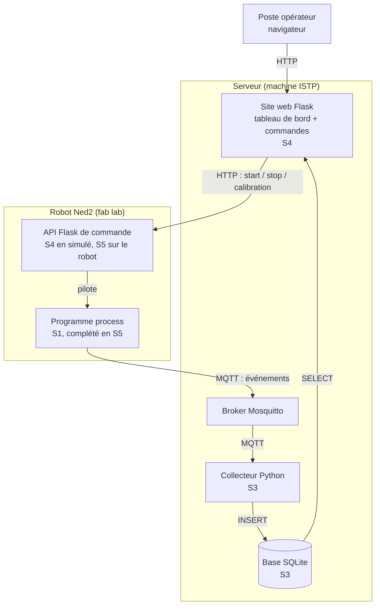
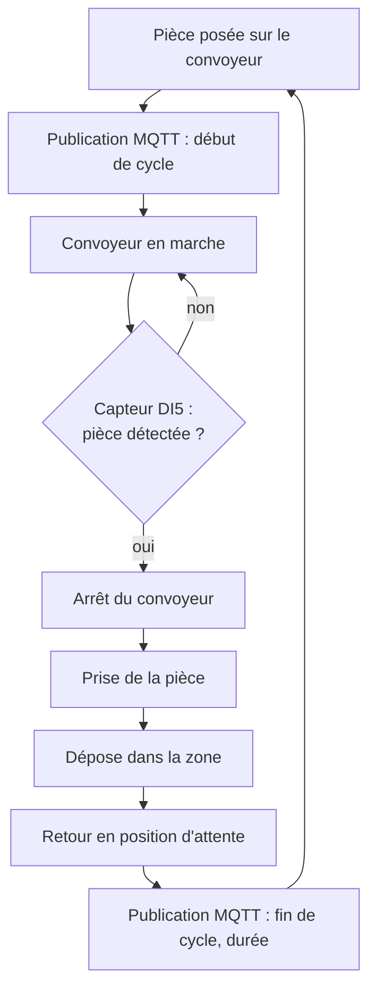
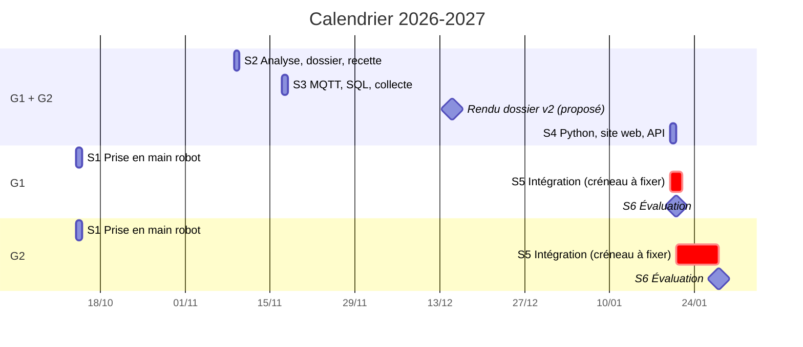
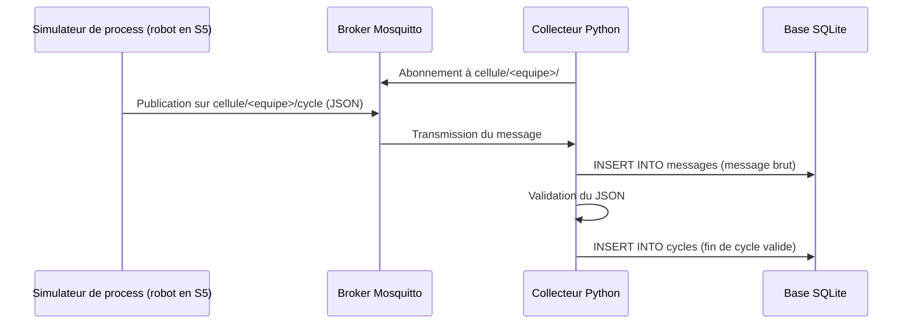
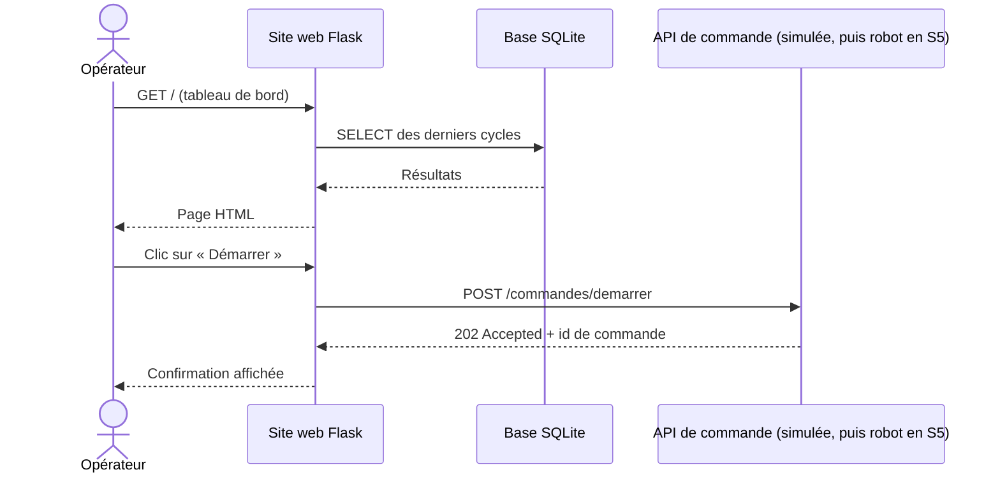
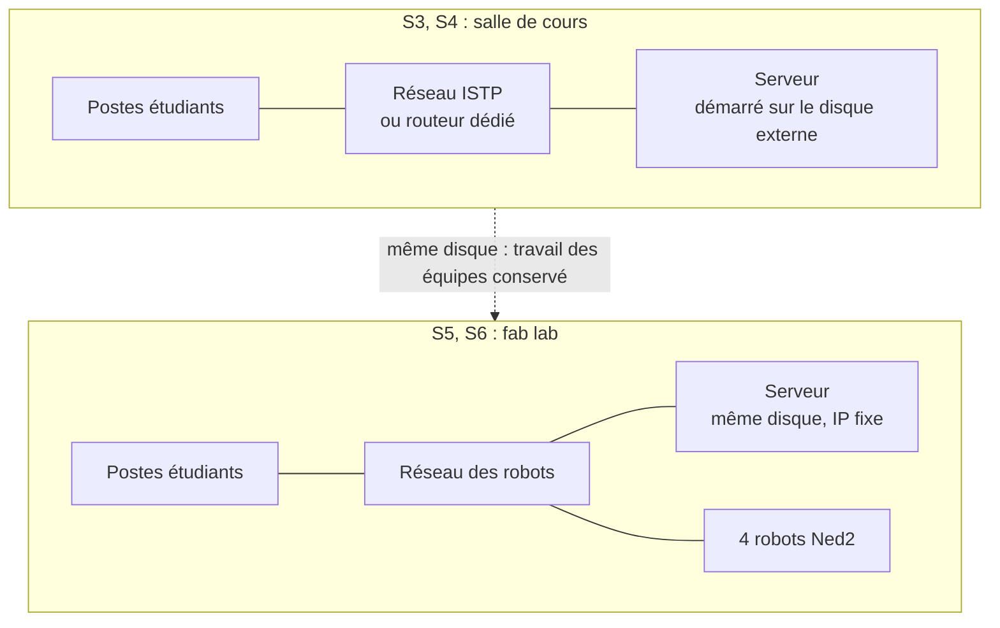

# Progression pédagogique : Infrastructure client / serveur dans un contexte industriel

**Promotion :** BACH INGE 2024-0 (3e année), 22 étudiants alternants, groupes G1 et G2
**Année :** 2026-2027
**Intervenant :** Fabrice Guichard
**Version :** v1.1 (brouillon), 01/10/2026
**Prérequis :** Python (cours de 1re année)
**Sources :** `seances.xlsx` (planning) et supports 2025-2026 (`/home/fab/cours/niryo`)
**Supports de cours :** dossier `cours/` (voir la fin de la section 4)

## 1. Intention générale

Le module est organisé en **projet fil rouge** : chaque équipe conçoit, réalise et fait recetter une **cellule robotisée supervisée**.

➡️ process robot (Niryo Ned2 + convoyeur) → remontée des données par MQTT → stockage SQL → site web et API de pilotage

Par rapport à l'an dernier :

- on part d'un **process défini par les étudiants** et non plus d'exercices techniques isolés ;
- une **phase d'analyse** (dossier, présentation, tests de recette) est ajoutée avant la partie technique ;
- la pile technique est **allégée** : SQLite au lieu de MySQL, pas de Docker, pas de Grafana ni de Node-RED, le tableau de bord est le site web Flask ;
- l'évaluation repose sur l'**exécution du cahier de recette** rédigé par l'équipe elle-même.

## 2. Compétences visées

| Code | Compétence | Séances |
|------|------------|---------|
| C1 | Programmer une séquence robotisée (Blockly puis Python) | S1, S5 |
| C2 | Analyser un process industriel et le spécifier (dossier, recette) | S1, S2 |
| C3 | Mettre en œuvre une communication client / serveur (MQTT, HTTP) | S3, S4, S5 |
| C4 | Collecter et stocker des données de production (SQL / SQLite) | S3, S5 |
| C5 | Développer une interface web et une API en Python (Flask) | S4, S5 |
| C6 | Intégrer, tester et valider un système (recette) | S5, S6 |

## 3. Architecture cible du fil rouge

Chaque brique indique la séance où elle est construite.

Exemple de process : une pièce est posée sur le convoyeur, le convoyeur tourne jusqu'au capteur (DI5), le robot prend la pièce, la dépose dans une zone, le cycle est compté et horodaté.

Données remontées (à définir par chaque équipe en S2) : début / fin de cycle, durée de cycle, nombre de pièces, état du robot, défauts.

## 4. Vue d'ensemble des séances

| Séance | Date | Groupe | Lieu | Durée | Thème | Livrable en fin de séance |
|--------|------|--------|------|-------|-------|---------------------------|
| S1 | mer. 14/10/2026 08:30-12:00 | G1 | Fab lab | 3h30 | Prise en main robot, export Python, définition du process | Programme Blockly + export `.py`, fiche process v0 |
| S1 | mer. 14/10/2026 13:30-17:00 | G2 | Fab lab | 3h30 | (idem) | (idem) |
| S2 | lun. 09/11/2026 08:30-12:00 | G1 + G2 | Salle de cours | 3h30 | Analyse, dossier, présentation, tests de recette | Dossier d'analyse v1 + cahier de recette v1 |
| S3 | mar. 17/11/2026 08:30-12:00 | G1 + G2 | Salle de cours + serveur | 3h30 | MQTT, rappel SQL, collecte des données dans SQLite | Collecteur MQTT → SQLite déployé sur le serveur, alimenté par données simulées |
| S4 | mer. 20/01/2027 08:30-12:00 | G1 + G2 | Salle de cours + serveur | 3h30 | Python, site web et API | Site web + API (mode simulé) déployés sur le serveur |
| S5 | **à planifier** | G1 | Fab lab | 3h30 ? | Intégration sur robots | Système intégré, recette à blanc |
| S5 | **à planifier** | G2 | Fab lab | 3h30 ? | Intégration sur robots | (idem) |
| S6 | jeu. 21/01/2027 15:15-17:00 | G1 | Fab lab | 1h45 | Évaluation : recette | Recette signée + code déposé |
| S6 | jeu. 28/01/2027 09:45-11:30 | G2 | Fab lab | 1h45 | Évaluation : recette | (idem) |

**Volume par étudiant :** 15h45 planifiées + intégration (3h30 si confirmée), soit **19h15**.
**Volume enseignant :** 21h au planning actuel + 7h d'intégration (2 × 3h30), soit **28h**.

**Organisation des équipes :** 4 robots, 1 équipe de 3 étudiants par robot : 4 équipes par groupe, soit 8 équipes au total (22 étudiants : 6 équipes de 3 et 2 équipes de 2). Les équipes sont constituées en S1 et restent les mêmes jusqu'à l'évaluation.

**Supports de cours** (dossier `cours/`)

| Fichier | Titre | Séances |
|---------|-------|---------|
| `reseau_TCP_IP.md` | Révisions réseau : TCP/IP, adressage, routage, sous-réseaux, configuration statique et DHCP | S3 (révision), S5 |
| `collecteur_MQTT.md` | Collecteur de messages MQTT en Python vers une base de données | S3 |
| `SQL.md` | Rappels de SQL | S3 |
| `site_web_HTML_CSS.md` | Cours HTML et CSS : réaliser les pages d'un site web | S4 |
| `intro_flask.md` | Le framework Flask : premiers pas | S4 |
| `API_CQRS_REST_Flask.md` | Une API CQRS pour le robot Niryo, comparée à REST, avec Flask | S4, S5 |

## 5. Détail des séances

### S1 – Prise en main du robot, export Python, définition du process

*Fab lab, robots. G1 le matin, G2 l'après-midi. 3h30.*

**Objectifs**

- Utiliser le robot Ned2 en sécurité
- Programmer un pick & place avec convoyeur en Blockly (Niryo Studio)
- Exporter le programme en Python et en comprendre la structure
- Définir le process que l'équipe va industrialiser

**Déroulé**

| Durée | Activité |
|-------|----------|
| 20 min | Présentation du module et du fil rouge, constitution des équipes, consignes de sécurité (zone de travail, arrêt d'urgence, vitesses) |
| 60 min | Prise en main : connexion Niryo Studio, calibration, mode apprentissage, mouvements articulaires et cartésiens, pince |
| 70 min | Scénario guidé : convoyeur jusqu'au capteur DI5, prise de la pièce, dépose, retour en position d'attente |
| 30 min | Export Python : lecture du code généré (`calibrate_auto`, `move_pose`, `pick_from_pose`, `control_conveyor`, `digital_read`), repérage des poses et des fonctions |
| 30 min | Définition du process de l'équipe : étapes, entrées / sorties, cas d'erreur, premières données à remonter |

**Livrables**

- Programme Blockly et export `.py` déposés (avec les poses relevées, à conserver pour l'intégration de janvier)
- Fiche process v0 (une page)

**Ressources reprises de l'an dernier**

- `essai_robot/script1_autocalibrate.py`, `script2_convoyeur.py`, `script3_convoyeur_pick.py`
- `documentation/sdk.md`

### S2 – Analyse, dossier, présentation, tests de recette

*Salle de cours, G1 + G2. 3h30. Pas de robot.*

**Objectifs**

- Situer le projet dans une architecture client / serveur industrielle
- Rédiger un dossier d'analyse
- Écrire des tests de recette vérifiables
- Présenter son projet à l'oral

**Déroulé**

| Durée | Activité |
|-------|----------|
| 45 min | Cours : architecture client / serveur en contexte industriel (niveaux terrain, supervision, gestion), rôle de chaque brique du fil rouge, notion de cahier des charges et de recette |
| 2h | Atelier par équipe : rédaction du dossier d'analyse à partir d'un gabarit fourni |
| 45 min | Présentations flash (5 min par équipe, 8 équipes) et retours |

**Contenu attendu du dossier d'analyse**

- Description du process (séquence ou grafcet simplifié)
- Schéma d'architecture : composants et flux
- Dictionnaire des données : quelle donnée, à quel moment, quel format
- Fonctions attendues du site web (maquette papier acceptée)
- Cahier de recette : au moins 8 tests (identifiant, exigence, préconditions, procédure, résultat attendu)

La partie technique (topics MQTT, table SQL, routes de l'API) reste au niveau fonctionnel ; elle sera précisée en v2 après S3 et S4.

**Livrables**

- Dossier d'analyse v1 et cahier de recette v1

### S3 – MQTT, rappel SQL, collecte des données dans SQLite

*Salle de cours, G1 + G2. 3h30. Serveur utilisé (voir section 6) : broker Mosquitto, base SQLite, exécution du collecteur. Pas de robot : le process est simulé.*

**Objectifs**

- Expliquer le modèle publication / abonnement
- Se connecter au serveur et y travailler à distance
- Publier et recevoir des messages JSON via le broker du serveur
- Créer une table et l'alimenter depuis Python
- Collecter les données du process de l'équipe sur le serveur

**Déroulé**

| Durée | Activité |
|-------|----------|
| 40 min | Cours MQTT : broker, clients, topics, payload JSON, QoS, authentification. Démonstration avec `mosquitto_pub` / `mosquitto_sub` sur le broker du serveur |
| 50 min | TP : connexion au serveur (SSH, VS Code Remote SSH) avec le compte de l'équipe, puis publier et s'abonner sur le broker du serveur (MQTT Explorer puis `paho-mqtt`) |
| 30 min | Rappel SQL : table, types, clé primaire, `CREATE`, `INSERT`, `SELECT`, `WHERE`, `GROUP BY`. SQLite (module `sqlite3`, DB Browser for SQLite) |
| 1h30 | TP : un simulateur publie les événements du process de l'équipe, le collecteur tourne sur le serveur, reçoit les messages, les valide et les insère dans SQLite. Requêtes de contrôle (nombre de cycles, durée moyenne) |

**Flux de collecte**

**Proposition de modèle de données (point de départ)**

Conventions reprises des supports `cours/collecteur_MQTT.md` et `cours/SQL.md` :

- Topics : `cellule/<equipe>/cycle`, `cellule/<equipe>/etat` (message retenu), `cellule/<equipe>/defaut`, avec `<equipe>` de la forme `g1e1`
- Message : `{"evenement": "fin_cycle", "piece": 12, "duree": 18.2, "zone": "A", "horodatage": "2026-11-17T08:30:18"}`
- Tables : `messages(id, recu_le, sujet, charge, qos, retain)` (journal brut), `robots(id, nom, equipe, adresse_ip)` et `cycles(id, robot_id, debut, duree, zone, statut)` (lue par le site web)

**Livrables**

- `collecteur.py` déployé sur le serveur et fonctionnel sur données simulées, script de création de la base

**Supports de cours**

- `cours/collecteur_MQTT.md`
- `cours/SQL.md`
- `cours/reseau_TCP_IP.md` (révision : adressage, ports, connexion au serveur)

**Ressources reprises de l'an dernier**

- `code/mqtt_message/` : `sender.py` (à transformer en simulateur de process) et `subscriber.py` (à passer de MySQL à SQLite)
- `essai_robot/script4_mqtt_send.py`, `script5_mqtt_receive.py`
- `tp/fiche_configuration.md` (à adapter : comptes, topics, ports par équipe)

**Travail entre S3 et S4 (2 mois)**

- Dossier v2 : topics, format des messages, schéma de la base, routes de l'API
- Finaliser le collecteur
- Préparer dans le programme robot les appels de publication MQTT

### S4 – Python, site web et API

*Salle de cours, G1 + G2. 3h30. Serveur utilisé (voir section 6) : exécution de l'API et du site web, base SQLite de S3. Pas de robot : l'API fonctionne en mode simulé.*

**Objectifs**

- Réinvestir les acquis Python de 1re année dans un projet
- Expliquer une requête HTTP et une API REST
- Développer une API de commande et un site web avec Flask, et les exécuter sur le serveur

**Déroulé**

| Durée | Activité |
|-------|----------|
| 15 min | Points Python propres au projet (le langage a été vu en 1re année) : environnement virtuel et `pip`, bibliothèques `flask` et `requests` |
| 30 min | Cours HTTP / REST : client / serveur, `GET` / `POST`, codes de retour, JSON. Tests avec `curl` |
| 1h15 | TP API : écrire l'API de commande du robot selon le principe CQRS (`GET /requetes/etat`, `POST /commandes/demarrer`, `/commandes/arreter`, `/commandes/calibrer`) en mode simulé (`RobotSimule`), sans appel au robot. Exécution sur le serveur, sur le port attribué à l'équipe (5001 à 5008) |
| 1h30 | TP site web : tableau de bord exécuté sur le serveur (port 8001 à 8008), lisant la base SQLite de S3 (dernier état, liste des cycles, compteurs), avec des boutons de commande appelant l'API |

**Flux de consultation et de commande**

**Livrables**

- Site web et API (mode simulé) déployés sur le serveur, alimentés par les données simulées de S3

**Supports de cours**

- `cours/site_web_HTML_CSS.md` (HTML, CSS, principe des routes)
- `cours/intro_flask.md` (routes, templates Jinja2, formulaires, lecture de la base SQLite, appel de l'API)
- `cours/API_CQRS_REST_Flask.md` (API de commande du robot, mode simulé)

**Ressources reprises de l'an dernier**

- `code/api_robot_test/` (API simulée du robot de l'an dernier, port 3000 : remplacée par l'API CQRS du cours, ports 5001 à 5008)
- `code/website_commande/specification.md`
- `essai_robot/script6_api.py`, `script7_API_mqtt.py`

### S5 – Intégration sur robots

*Fab lab, robots + serveur. G1 et G2 séparément. Durée et dates à confirmer.*

Le collecteur, la base et le site web tournent déjà sur le serveur depuis S3 et S4 : la séance porte sur le robot et sa liaison avec le serveur.

**Objectifs**

- Déployer le programme process et l'API sur le robot
- Remplacer le simulateur de process et l'API simulée par le robot réel
- Faire fonctionner la chaîne de bout en bout
- Dérouler la recette à blanc et corriger

**Déroulé**

| Durée | Activité |
|-------|----------|
| 30 min | Vérifications réseau : IP du robot et du serveur, accès du robot au broker, accès du serveur à l'API du robot |
| 1h | Déploiement sur le robot : programme process + publication MQTT + API (passage du mode simulé aux appels réels au robot) |
| 1h | Essais de bout en bout (robot → serveur → site web → robot), reprise des poses si le poste a bougé depuis octobre |
| 1h | Recette à blanc, corrections, mise à jour du cahier de recette |

**Livrables**

- Système intégré, cahier de recette pré-rempli

**Supports de cours**

- `cours/reseau_TCP_IP.md`, section « Application : le réseau de la cellule robotisée » (connexion au Ned2, flux, diagnostic)
- `cours/API_CQRS_REST_Flask.md`, section « Dans le projet fil rouge » (passage de l'API simulée au robot)

**Ressources reprises de l'an dernier**

- `flask_arm/` : paquets Python pour l'installation hors ligne sur le robot

### S6 – Évaluation : recette

*Fab lab. 1h45 par groupe (G1 le 21/01, G2 le 28/01).*

**Déroulé** (4 équipes par groupe, environ 25 min par équipe)

- 15 min : déroulé du cahier de recette devant l'enseignant, chaque test est noté conforme / non conforme
- 10 min : questions individuelles sur l'architecture et le code

**Proposition de grille** (à valider)

| Élément | Poids |
|---------|-------|
| Dossier d'analyse et cahier de recette (version finale) | 30 % |
| Recette : tests conformes, fonctionnement de bout en bout | 50 % |
| Questions individuelles | 20 % |

## 6. Serveur : machine ISTP démarrée sur disque externe

ISTP fournit une machine qui fait office de serveur. Elle démarre sur un disque externe (SSD USB) contenant un Linux préparé à l'avance par l'enseignant. Le disque interne de la machine n'est ni utilisé ni modifié.

Le serveur sert en S3 et S4 (salle de cours), puis en S5 et S6 (fab lab). Le travail des équipes reste sur le disque d'une séance à l'autre.

**Intérêts**

- Aucune installation sur le parc ISTP : seule la machine est demandée
- Environnement identique pour toutes les équipes, maîtrisé par l'enseignant
- Le disque suit l'enseignant : en cas de panne, il peut démarrer sur une autre machine
- Remise à zéro rapide à partir d'une image du disque

**Contenu préparé sur le disque**

- Distribution Linux (par exemple Ubuntu Server 24.04 LTS) avec serveur SSH
- Un compte par équipe (8 comptes), avec son dossier personnel
- Broker Mosquitto avec authentification : un utilisateur MQTT par équipe, limité aux topics de l'équipe
- Python 3 et les paquets du projet (`paho-mqtt`, `flask`, `requests`), installés à l'avance
- SQLite (bibliothèque et outil en ligne de commande)
- Ports attribués par équipe : 5001 à 5008 pour l'API simulée, 8001 à 8008 pour le site web
- Outils fournis aux équipes : simulateur de process (publie sur `cellule/<equipe>/…`), squelette de l'API CQRS en mode simulé

**Réseau**

- En salle de cours (S3, S4) : le serveur et les postes étudiants doivent être sur le même réseau. Soit le réseau ISTP, si SSH (22), MQTT (1883) et les ports HTTP sont autorisés entre postes, soit un routeur dédié apporté en salle.
- Au fab lab (S5, S6) : le serveur rejoint le réseau des robots avec une adresse IP fixe (plan d'adressage proposé dans `cours/reseau_TCP_IP.md` : réseau `192.168.10.0/24`, serveur en `.10`, robots en `.21` à `.24`). L'API tourne alors sur chaque robot, port 5000.

**À vérifier avec ISTP**

- Disponibilité de la machine aux dates de S3, S4, S5 et S6, en salle de cours et au fab lab
- Démarrage sur périphérique USB autorisé (réglages BIOS / UEFI, Secure Boot, mot de passe BIOS)
- Port Ethernet et port USB 3 disponibles

**Calendrier de préparation**

- Disque prêt et testé sur la machine ISTP avant S3 (17/11), par exemple lors de S2 (09/11)
- Sauvegarde du disque après chaque séance (image complète ou copie des dossiers des équipes)

**Ressources reprises de l'an dernier**

- `documentation/config_nuc.md` (IP fixe avec netplan), `documentation/config_routeur.md`
- `package_nuc/` : paquets Python pour l'installation hors ligne

## 7. Points à arbitrer

1. **Séances d'intégration (S5) absentes du planning.** Elles n'ont ni date ni créneau. Pour G1, le créneau doit tenir entre le 20/01 après-midi et le 21/01 15:15 (par exemple le 21/01 au matin). Pour G2, entre le 21/01 et le 28/01. Sans ces séances, il faudrait intégrer pendant l'évaluation, ce qui n'est pas tenable.
2. **Peu de temps sur les robots.** Les étudiants n'ont le robot qu'en S1, en S5 puis à l'évaluation. Le process doit rester simple. En S3 et S4, le travail se fait sur le serveur réel, mais avec un process simulé et une API en mode simulé.
3. **Typage des séances.** Toutes les lignes du planning sont en « CM » sauf le test du 28/01, alors que S1 et S5 sont des TP et que le 21/01 est un test.
4. **Long intervalle entre S3 et S4** (17/11 → 20/01). Fixer une date de rendu intermédiaire du dossier v2 (par exemple mi-décembre) pour maintenir le rythme.
