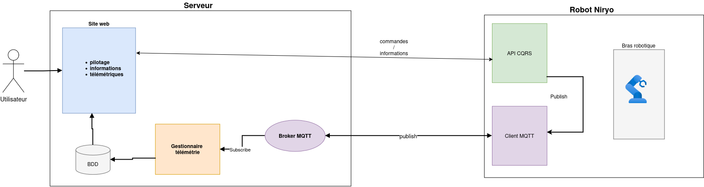
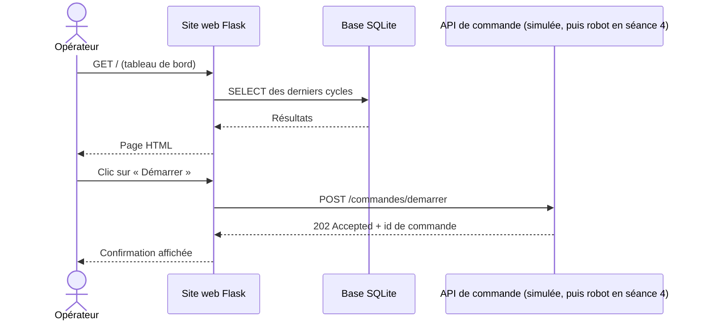
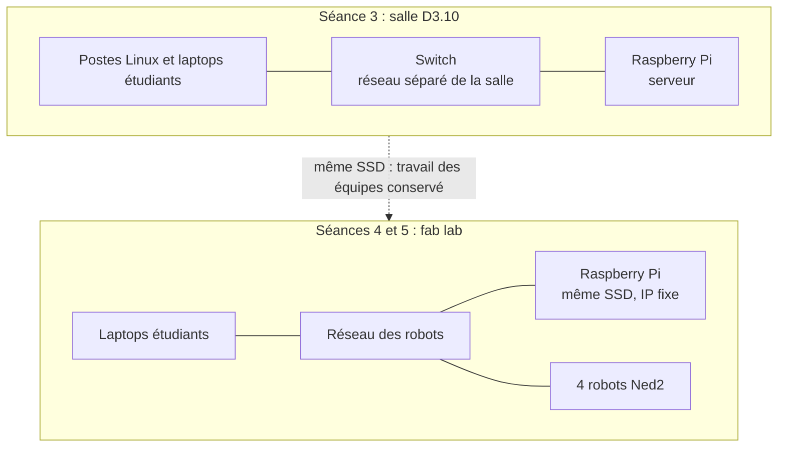

# Progression pédagogique : Infrastructure client / serveur dans un contexte industriel

- **Promotion :** BACH INGE 2024-0 (3e année), 22 étudiants alternants, groupes G1 et G2
- **Année :** 2026-2027
- **Version :** v1.7 (brouillon), 11/10/2026
- **Prérequis :** Python (cours de 1re année)
- **Sources :** `seances_BACHINGE24.xlsx` (planning : dates, horaires, salles et matériel) et supports 2025-2026 (dossier de l'année précédente)
- **Présentation du projet :** `README.md` à la racine (contexte, besoins, objectifs, fonctions, synoptique, données échangées), commun aux trois classes
- **Supports de cours :** dossier `cours/` (voir la fin de la section 4)

**En bref**

- 5 séances, du 12 octobre au 19 novembre 2026, soit 15h45 par étudiant.
- 22 étudiants en 8 équipes de 2 ou 3, sur 4 robots.
- Le serveur est un Raspberry Pi, installé en salle D3.10 (séance 3) puis au fab lab (voir `materiel_ISTP.md`).
- Un projet fil rouge : une cellule robotisée supervisée, construite séance après séance.
- Évaluation : chaque équipe déroule son propre cahier de recette devant l'enseignant.

## 1. Intention générale

Le module est organisé en **projet fil rouge** : chaque équipe conçoit, réalise et fait recetter une **cellule robotisée supervisée**.

➡️ process robot (Niryo Ned2 + convoyeur) → remontée des données par MQTT → stockage SQL → site web et API de pilotage

Par rapport à l'an dernier :

- on part d'un **process défini par les étudiants** et non plus d'exercices techniques isolés ;
- une **phase d'analyse** (dossier, présentation, tests de recette) est ajoutée avant la partie technique ;
- la pile technique est **allégée** : SQLite au lieu de MySQL, pas de Docker, pas de Grafana ni de Node-RED, le tableau de bord est le site web Flask ;
- l'évaluation repose sur l'**exécution du cahier de recette** rédigé par l'équipe elle-même.

## 2. Compétences visées

| Code | Compétence | Séances |
|------|------------|---------|
| C1 | Programmer une séquence robotisée (Blockly puis Python) | 1 et 4 |
| C2 | Analyser un process industriel et le spécifier (dossier, recette) | 1 et 2 |
| C3 | Mettre en œuvre une communication client / serveur (MQTT, HTTP) | 2, 3 et 4 |
| C4 | Collecter et stocker des données de production (SQL / SQLite) | 2, 3 et 4 |
| C5 | Développer une interface web et une API en Python (Flask) | 2, 3 et 4 |
| C6 | Intégrer, tester et valider un système (recette) | 4 et 5 |

## 3. Architecture cible du fil rouge

L'architecture, les fonctions F1 à F7, le cycle instrumenté et le scénario complet des échanges sont présentés dans le `README.md` (sections 4 et 5). Dans cette classe, le serveur du module est un Raspberry Pi (voir section 6) et les robots sont au fab lab.

**Séance où chaque fonction est réalisée**

| Fonction | Brique | Réalisée en | Passage sur le robot réel |
|----------|--------|-------------|---------------------------|
| F1 Exécuter le cycle | Programme process | Séance 1 (Blockly, export Python) | Séance 4 |
| F2 Recevoir les commandes | API CQRS | Cours en libre service, développement sur laptop à partir des exemples fournis (séance 2), puis déploiement en séance 3, en mode simulé sur le serveur | Séance 4 |
| F3 Exposer l'état | API CQRS | Cours en libre service, développement sur laptop à partir des exemples fournis (séance 2), puis déploiement en séance 3, en mode simulé sur le serveur | Séance 4 |
| F4 Publier les événements | Client MQTT du robot | Séance 3 avec le simulateur de process fourni, puis entre les séances 3 et 4 dans le programme robot | Séance 4 |
| F5 Transmettre les messages | Broker Mosquitto | Préparé par l'enseignant sur le serveur (section 6) | (sur le serveur) |
| F6 Collecter et stocker | Collecteur Python + base SQLite | Cours en libre service, développement sur laptop à partir des exemples fournis (séance 2), puis déploiement en séance 3 | (sur le serveur) |
| F7 Présenter | Site web Flask | Cours en libre service, développement sur laptop à partir des exemples fournis (séance 2), puis déploiement en séance 3 | (sur le serveur) |

**Exemple de process :** une pièce est posée sur le convoyeur, le convoyeur tourne jusqu'au capteur (DI5), le robot prend la pièce, la dépose dans une zone, le cycle est compté et horodaté (diagramme dans le `README.md`, section 5, « Le cycle instrumenté »).

**Données remontées** (à définir par chaque équipe à la séance 2) : début / fin de cycle, durée de cycle, nombre de pièces, état du robot, défauts.

## 4. Vue d'ensemble des séances

| Séance | Thème | Groupe | Date | Lieu | Durée | Livrable en fin de séance |
|--------|-------|--------|------|------|-------|---------------------------|
| Séance 1 | Prise en main du robot, export Python, définition du process | G1 | lun. 12/10/2026, 08:30-12:00 | Fab lab | 3h30 | Programme Blockly et export `.py`, fiche process v0 |
| Séance 1 | (idem) | G2 | lun. 12/10/2026, 13:30-17:00 | Fab lab | 3h30 | (idem) |
| Séance 2 | Analyse, dossier, tests de recette, mise en place du poste de développement (cours techniques en libre service) | G1 + G2 | mer. 14/10/2026, 08:30-12:00 | Salle C1.07 | 3h30 | Dossier d'analyse v1, cahier de recette v1 |
| Séance 3 | Intégration sur le serveur : MQTT, collecte dans SQLite, site web et API | G1 + G2 | lun. 09/11/2026, 08:30-12:00 | Salle D3.10, serveur | 3h30 | Collecteur, site web et API (mode simulé) sur le serveur, alimentés par des données simulées |
| Séance 4 | Intégration sur les robots, recette à blanc | G1 | mar. 17/11/2026, 08:30-12:00 | Fab lab | 3h30 | Système intégré, recette à blanc |
| Séance 4 | (idem) | G2 | mar. 17/11/2026, 13:30-17:00 | Fab lab | 3h30 | (idem) |
| Séance 5 | Évaluation : recette | G1 | jeu. 19/11/2026, 13:30-15:15 | Fab lab | 1h45 | Recette signée, code déposé |
| Séance 5 | (idem) | G2 | jeu. 19/11/2026, 15:15-17:00 | Fab lab | 1h45 | (idem) |

Dates, horaires, salles et matériel : planning `seances_BACHINGE24.xlsx`. Les salles sont réservées (voir la section 7).

**Volumes horaires** (planning)

- **Par étudiant :** 4 séances de 3h30 + 1 séance de 1h45, soit **15h45**.
- **Pour l'enseignant :** séances 1 et 4 assurées deux fois (4 × 3h30) + séances 2 et 3 (2 × 3h30) + séance 5 assurée deux fois (2 × 1h45), soit **24h30**.

**Organisation des équipes**

- 4 robots, une équipe par robot dans chaque groupe : 4 équipes par groupe, 8 équipes au total.
- 22 étudiants : 6 équipes de 3 et 2 équipes de 2.
- Les équipes sont constituées à la séance 1 et restent les mêmes jusqu'à l'évaluation.
- Identifiants `g1e1` à `g2e4` et noms (thème des métaux) : voir `materiel_ISTP.md`.

**Supports de cours** (dossier `cours/`, et `README.md` à la racine)

| Fichier | Titre | Séances |
|---------|-------|---------|
| `01_prise_en_main_robot.md` | Séance 1 : prise en main du robot Ned2, export Python et définition du process ; scripts d'essai sur le robot (partie 7) | 1 (partie 7 : séances sur les robots) |
| `README.md` | Présentation du projet : contexte, besoins, objectifs, fonctions, synoptique | 1 (présentation) et 2 |
| `reseau_TCP_IP.md` | Révisions réseau : TCP/IP, adressage, routage, sous-réseaux, configuration statique et DHCP | 3 (révision) et 4 |
| `collecteur_MQTT.md` | Collecteur de messages MQTT en Python vers une base de données | 2 (libre service) et 3 |
| `SQL.md` | Rappels de SQL | 2 (libre service) et 3 |
| `site_web_HTML_CSS.md` | Cours HTML et CSS : réaliser les pages d'un site web | 2 (libre service) et 3 |
| `intro_flask.md` | Le framework Flask : premiers pas | 2 (libre service) et 3 |
| `API_CQRS_REST_Flask.md` | Une API CQRS pour le robot Niryo, comparée à REST, avec Flask | 2 (libre service), 3 et 4 |

## 5. Détail des séances

### Séance 1 : prise en main du robot, export Python, définition du process

| Lieu | Groupes | Durée | Matériel |
|------|---------|-------|----------|
| Fab lab | G1 le matin, G2 l'après-midi | 3h30 | Robots Ned2 et convoyeurs |

**Objectifs**

- Utiliser le robot Ned2 en sécurité
- Programmer un pick & place avec convoyeur en Blockly (Niryo Studio)
- Exporter le programme en Python et en comprendre la structure
- Définir le process que l'équipe va industrialiser

**Déroulé**

| Durée | Activité |
|-------|----------|
| 20 min | **Lancement** : présentation du module et du fil rouge (`README.md`, sections 1 à 3), constitution des équipes, consignes de sécurité (zone de travail, arrêt d'urgence, vitesses) |
| 60 min | **Prise en main** : connexion Niryo Studio, calibration, mode apprentissage, mouvements articulaires et cartésiens, pince |
| 70 min | **Scénario guidé** : convoyeur jusqu'au capteur DI5, prise de la pièce, dépose, retour en position d'attente |
| 30 min | **Export Python** : lecture du code généré (`calibrate_auto`, `move_pose`, `pick_from_pose`, `control_conveyor`, `digital_read`), repérage des poses et des fonctions |
| 30 min | **Process de l'équipe** : étapes, entrées / sorties, cas d'erreur, premières données à remonter |

**Livrables**

- Programme Blockly et export `.py` déposés (avec les poses relevées, à conserver pour l'intégration du 17/11)
- Fiche process v0 (une page)

**Supports de cours**

- `cours/01_prise_en_main_robot.md` (support de la séance, commun à toutes les classes : points à réaliser, fonctions du robot, fiche des poses, fiche process ; partie 7 : scripts d'essai pour les équipes en avance)

**Ressources reprises de l'an dernier**

- `essai_robot/script1_autocalibrate.py`, `script2_convoyeur.py`, `script3_convoyeur_pick.py` : repris dans le dossier `essai_robot/` de ce dépôt (`script1_calibration.py` à `script3_convoyeur_prise.py`, énoncés 1 à 3 de `cours/01_prise_en_main_robot.md`, partie 7), pour les équipes en avance
- `documentation/sdk.md`

### Séance 2 : analyse, dossier, recette et mise en place du poste de développement

| Lieu | Groupes | Durée | Matériel |
|------|---------|-------|----------|
| Salle C1.07 | G1 + G2 ensemble (22 étudiants) | 3h30 | Pas de robot, pas de serveur. Vidéoprojecteur, laptops des étudiants |

La séance ne contient qu'un seul cours en présentiel (l'architecture). Les cours techniques (MQTT, SQL, Python, HTTP, Flask, API) sont **en libre service** : les supports de `cours/` sont lus et pratiqués à son rythme, sur le laptop, entre les séances 2 et 3. Pour avancer sans serveur, l'enseignant fournit un jeu d'exemples prêts à adapter (voir ci-dessous). Le déploiement sur le serveur a lieu à la séance 3.

**Objectifs**

- Situer le projet dans une architecture client / serveur industrielle
- Rédiger un dossier d'analyse et écrire des tests de recette vérifiables
- Présenter son projet à l'oral
- Disposer d'un laptop prêt pour le développement, avec la chaîne complète qui tourne en local
- Savoir quoi adapter dans les exemples fournis et dans quel ordre

**Dossier de départ** (à préparer avant la séance, remis à chaque équipe) : il regroupe les documents à remplir (gabarits et exemples) et les briques logicielles fournies par l'enseignant, pour que la séance serve à adapter et non à partir de zéro.

| Fourniture | Contenu | À adapter par l'équipe |
|------------|---------|------------------------|
| Gabarit et exemple de dossier d'analyse | Dossier complet d'un process fictif différent des projets (par exemple le tri de pièces par zone), au plan du `README.md` | Le process, les données, le schéma d'architecture, la maquette du site |
| Exemple de cahier de recette | Tableau de 3 tests entièrement rédigés (identifiant, exigence, préconditions, procédure, résultat attendu), et la liste des 8 exigences à couvrir | Les 8 tests au moins, propres au process de l'équipe |
| Exemple de présentation flash | Une page ou 3 diapositives : process, architecture, données, un test de recette | Le contenu |
| Howto du poste de développement | Pas à pas (Linux, Windows, macOS) : Python 3 et environnement virtuel, `pip install`, Mosquitto local ou broker public de test, SQLite et DB Browser, VS Code, et un script `verifier_poste.py` qui publie un message, le reçoit et écrit dans SQLite | Rien : il sert à valider le poste |
| Simulateurs de process et de robot (`simulateurs/`) | `simulateur_mqtt.py` envoie au choix, dans un menu, les événements `cycle`, `etat`, `defaut` et `tache` sur `cellule/<equipe>/…`, ainsi que des messages mal formés et des rafales pour éprouver le collecteur ; `simulateur_api.py` a les endpoints de l'API fournie (`api_robot/`) sans robot ; classe `RobotSimule` pour l'API CQRS | L'équipe et le mot de passe MQTT (en tête de chaque fichier), les messages propres au process |
| Collecteur MQTT configurable | Collecteur Python complet (abonnement, validation du JSON, insertion dans `messages` et `cycles`) lisant un fichier de configuration | L'adresse du broker, les topics, les champs du message |
| Site web Flask de base | Tableau de bord minimal : dernier état, liste des cycles lue dans `cellule.db`, un bouton de commande qui appelle l'API simulée | Les pages, les compteurs, la mise en forme, les commandes |

**Déroulé**

| Durée | Activité |
|-------|----------|
| 30 min | **Cours** : architecture client / serveur en contexte industriel (niveaux terrain, supervision, gestion) ; du besoin (piloter, informer, observer) aux fonctions F1 à F7 et au rôle de chaque brique du fil rouge ; cahier des charges et recette |
| 30 min | **Démonstration de la chaîne** avec les fournitures : le simulateur publie, le broker transmet, le collecteur écrit dans SQLite, le site affiche. Chaque brique est reliée à son support de cours (MQTT, SQL, Flask, API) et aux éléments à adapter |
| 25 min | **Poste de développement** : suivre le howto et lancer `verifier_poste.py`. Les équipes dont le poste n'est pas valide terminent à la maison ; le howto couvre aussi leur cas |
| 70 min | **Atelier par équipe** : dossier d'analyse et cahier de recette, à partir du gabarit et des exemples |
| 40 min | **Présentations flash** : 5 min par équipe (8 équipes), puis retours |
| 15 min | **Plan de travail** jusqu'à la séance 3 : jalons, répartition dans l'équipe, consignes de dépôt |

**Contenu attendu du dossier d'analyse**

Le dossier peut suivre le plan du `README.md` (contexte, besoins, objectifs, fonctions, synoptique), appliqué au process de l'équipe :

- Description du process (séquence ou grafcet simplifié)
- Schéma d'architecture : composants et flux
- Dictionnaire des données : quelle donnée, à quel moment, quel format
- Fonctions attendues du site web (maquette papier acceptée)
- Cahier de recette : au moins 8 tests (identifiant, exigence, préconditions, procédure, résultat attendu)

La partie technique (topics MQTT, table SQL, routes de l'API) reste au niveau fonctionnel. Elle sera précisée dans la v2 du dossier, après la séance 3 (rendu proposé : lun. 16/11/2026, avant la séance 4).

**Livrables de la séance** (déposés en fin de séance, ou au plus tard dans la semaine)

| Livrable | Critère de validation |
|----------|-----------------------|
| Dossier d'analyse v1 | Les 5 rubriques ci-dessus sont présentes, le process et les données sont décrits |
| Cahier de recette v1 | Au moins 8 tests complets, chacun relié à une exigence |
| Présentation flash | Présentée en 5 min |
| Poste validé | `verifier_poste.py` affiche « poste prêt » (capture ou sortie déposée) |

**Supports de cours**

- `README.md` (présentation du projet, à utiliser comme modèle de plan pour le dossier)
- `cours/collecteur_MQTT.md`, `cours/SQL.md`, `cours/site_web_HTML_CSS.md`, `cours/intro_flask.md` et `cours/API_CQRS_REST_Flask.md` (libre service, à pratiquer entre les séances 2 et 3)

**Travail entre les séances 2 et 3 (4 semaines, sur laptop)**

Mosquitto, SQLite et Flask s'exécutent sans serveur. Chaque équipe travaille sur son laptop, avec un broker local ou un broker public de test, pour arriver à la séance 3 avec une chaîne qui fonctionne en local.

| Jalon | Travail | Support |
|-------|---------|---------|
| Semaine 1 | Poste validé, fournitures lancées en local, données du process définies (topics, message JSON) | Howto, `cours/collecteur_MQTT.md` |
| Semaine 2 | Simulateur adapté aux données de l'équipe, collecteur configuré, tables SQLite créées | `cours/SQL.md`, `cours/collecteur_MQTT.md` |
| Semaine 3 | Site web adapté (dernier état, cycles, compteurs) | `cours/site_web_HTML_CSS.md`, `cours/intro_flask.md` |
| Semaine 4 | API de commande en mode simulé reliée au site, dossier complété | `cours/API_CQRS_REST_Flask.md` |

**Broker public de test.** Sans serveur, les équipes peuvent utiliser un broker MQTT public (par exemple `test.mosquitto.org` ou `broker.hivemq.com`, sans compte) pour tester d'un poste à l'autre. À respecter : ces brokers sont ouverts à tous, donc préfixer les topics par un identifiant propre à l'équipe (`cellule/g1e1-<mot aléatoire>/…`), n'y envoyer aucune donnée sensible, et ne pas compter sur leur disponibilité. Le broker local reste la référence ; à la séance 3, on passe au broker authentifié du serveur en changeant le fichier de configuration.

### Séance 3 : intégration sur le serveur (MQTT, collecte dans SQLite, site web et API)

| Lieu | Groupes | Durée | Matériel |
|------|---------|-------|----------|
| Salle D3.10 | G1 + G2 ensemble (22 étudiants) | 3h30 | Serveur Raspberry Pi (section 6) sur le réseau séparé de la salle, postes Linux et laptops des étudiants. Pas de robot : le process est simulé et l'API fonctionne en mode simulé |

Les équipes ont avancé sur leur laptop pendant quatre semaines, à partir des exemples fournis à la séance 2 (simulateur, collecteur, site web de base) : la séance est un TP d'intégration. Il s'agit de déployer sur le serveur réel ce qui a été développé en local (voir la section 7 si une équipe arrive sans rien de prêt).

**Objectifs**

- Se connecter au serveur et y travailler à distance
- Publier et recevoir des messages JSON via le broker du serveur
- Déployer le collecteur et la base SQLite de l'équipe sur le serveur
- Déployer l'API de commande (mode simulé) et le site web de l'équipe sur le serveur

**Déroulé**

| Durée | Activité |
|-------|----------|
| 40 min | **Démonstration par équipe** (5 min chacune, sur laptop, en local) : le simulateur, le collecteur, la base SQLite, le site web et l'API fonctionnent ensemble. Une équipe dont un sous-ensemble ne fonctionne pas le signale et repart des fournitures de la séance 2 |
| 20 min | **Accès au serveur** : l'enseignant remet à chaque équipe ses codes d'accès (compte Linux, utilisateur MQTT) une fois les démonstrations faites. Connexion (SSH, avec VS Code Remote SSH si la salle a accès à Internet) ; mêmes identifiant et mot de passe sur le serveur et sur les postes Linux de la salle |
| 30 min | **MQTT sur le serveur** : publier et s'abonner sur le broker du serveur avec l'authentification et les topics de l'équipe (MQTT Explorer puis `paho-mqtt`), passage du broker local au broker du serveur par le fichier de configuration |
| 40 min | **Collecte** : le simulateur publie les événements du process de l'équipe ; le collecteur tourne sur le serveur, reçoit les messages, les valide et les insère dans SQLite. Requêtes de contrôle (nombre de cycles, durée moyenne) |
| 40 min | **API** : API de commande du robot selon le principe CQRS (`GET /requetes/etat`, `POST /commandes/demarrer`, `/commandes/arreter`, `/commandes/calibrer`) en mode simulé (`RobotSimule`), sans appel au robot. Exécution sur le serveur, sur le port attribué à l'équipe (5001 à 5008) |
| 40 min | **Site web** : tableau de bord exécuté sur le serveur (port 8001 à 8008), lisant la base SQLite (dernier état, liste des cycles, compteurs), avec des boutons de commande appelant l'API |

**Flux de collecte**

**Flux de consultation et de commande**

Le scénario complet, de la commande jusqu'à l'affichage des cycles, est dans le `README.md` (section 5, « Les échanges : un scénario complet »).

**Proposition de modèle de données (point de départ)**

Conventions reprises des supports `cours/collecteur_MQTT.md` et `cours/SQL.md` (détail et exemples de messages dans le `README.md`, section 6) :

- Topics : `cellule/<equipe>/cycle`, `cellule/<equipe>/etat` (message retenu), `cellule/<equipe>/defaut`, avec `<equipe>` de la forme `g1e1`
- Message : `{"evenement": "fin_cycle", "piece": 12, "duree": 18.2, "zone": "A", "horodatage": "2026-11-17T08:30:18"}`
- Tables : `messages(id, recu_le, sujet, charge, qos, retain)` (journal brut), `robots(id, nom, equipe, adresse_ip)` et `cycles(id, robot_id, debut, duree, zone, statut)` (lue par le site web)

**Livrables**

- `collecteur.py` et script de création de la base déployés sur le serveur et fonctionnels sur données simulées
- Site web et API (mode simulé) déployés sur le serveur, alimentés par les données simulées

**Supports de cours**

- `cours/collecteur_MQTT.md`
- `cours/SQL.md`
- `cours/site_web_HTML_CSS.md` (HTML, CSS, principe des routes)
- `cours/intro_flask.md` (routes, templates Jinja2, formulaires, lecture de la base SQLite, appel de l'API)
- `cours/API_CQRS_REST_Flask.md` (API de commande du robot, mode simulé)
- `cours/reseau_TCP_IP.md` (révision : adressage, ports, connexion au serveur)

**Ressources reprises de l'an dernier**

- `code/mqtt_message/` : `sender.py` (à transformer en simulateur de process) et `subscriber.py` (à passer de MySQL à SQLite)
- `code/api_robot_test/` (API simulée du robot de l'an dernier, port 3000 : remplacée par l'API CQRS du cours, ports 5001 à 5008)
- `code/website_commande/specification.md`
- `essai_robot/script4_mqtt_send.py` à `script7_API_mqtt.py` : repris dans le dossier `essai_robot/` de ce dépôt, avec un script 8 (lecture de l'état du robot) et un script 9 (`GET /robot/etat`) ; énoncés 4 à 9 de `cours/01_prise_en_main_robot.md`, partie 7, à préparer avant la séance 4 et à exécuter sur le robot pendant la séance 4
- `tp/fiche_configuration.md` (à adapter : comptes, topics, ports par équipe)

**Travail entre les séances 3 et 4 (8 jours)**

- Terminer le dossier v2 (rendu proposé : lun. 16/11/2026)
- Préparer dans le programme robot les appels de publication MQTT
- Tester le programme process et l'API en mode simulé : seul le passage au robot réel doit rester à faire à la séance 4

### Séance 4 : intégration sur les robots

| Lieu | Groupes | Durée | Matériel |
|------|---------|-------|----------|
| Fab lab | Par groupe : G1 le matin, G2 l'après-midi | 3h30 | Robots, convoyeurs et serveur (Raspberry Pi apporté de la salle D3.10) |

Le collecteur, la base et le site web tournent déjà sur le serveur depuis la séance 3 : la séance porte sur le robot et sa liaison avec le serveur.

Chaque groupe a le fab lab pendant 3h30, avec une équipe par robot (4 équipes, 4 robots). Le robot n'a pas été utilisé depuis la séance 1, cinq semaines plus tôt : la séance commence par une reprise en main. L'intégration n'est possible dans ce temps que si le programme process et l'API ont été testés en mode simulé avant la séance (voir la section 7).

**Objectifs**

- Déployer le programme process et l'API sur le robot
- Remplacer le simulateur de process et l'API simulée par le robot réel
- Faire fonctionner la chaîne de bout en bout
- Dérouler la recette à blanc et corriger

**Déroulé**

| Durée | Activité |
|-------|----------|
| 15 min | **Vérifications réseau** (préparées par l'enseignant avant la séance) : IP du robot et du serveur, accès du robot au broker, accès du serveur à l'API du robot (port 3000), bibliothèques installées sur le robot (`install_robot/`, vérifiées avec `test.py --broker`) |
| 30 min | **Reprise en main** : consignes de sécurité, calibration, relecture de l'export Python de la séance 1 et des poses relevées |
| 1h30 | **Déploiement** sur le robot : programme process, publication MQTT et API (passage de `RobotSimule` à `RobotNiryo`), copiés par `scp` et lancés par `~/cellule/lancer.sh`, reprise des poses si besoin |
| 45 min | **Essai de bout en bout** (robot → serveur → site web → robot) et **recette à blanc** sur une sélection de tests du cahier |
| 30 min | **Bilan** : corrections à faire avant l'évaluation, deux jours plus tard, mise à jour du cahier de recette |

**Livrables**

- Système intégré, cahier de recette pré-rempli

**Supports de cours**

- `cours/reseau_TCP_IP.md`, section « Application : le réseau de la cellule robotisée » (connexion au Ned2, flux, diagnostic)
- `cours/API_CQRS_REST_Flask.md`, section « Dans le projet fil rouge » (passage de l'API simulée au robot)

**Ressources reprises de l'an dernier**

- `flask_arm/` et `documentation/install_package_python.md` : remplacés par le dossier `install_robot/` de ce dépôt (paquets compatibles avec le Python du robot, `install.sh`, `test.py`)

### Séance 5 : évaluation par la recette

| Lieu | Groupes | Durée | Matériel |
|------|---------|-------|----------|
| Fab lab | Par groupe : G1 de 13:30 à 15:15, G2 de 15:15 à 17:00 | 1h45 | Cellule intégrée de chaque équipe (robot et serveur) |

**Déroulé** (4 équipes par groupe, environ 25 min par équipe)

Pendant qu'une équipe passe, l'équipe suivante prépare sa cellule sur un autre robot.

| Durée | Activité |
|-------|----------|
| 18 min | **Recette** : l'équipe déroule les tests de son cahier choisis par l'enseignant ; chaque test est noté conforme ou non conforme |
| 7 min | **Questions individuelles** sur l'architecture et le code |

**Proposition de grille** (à valider)

| Élément | Poids |
|---------|-------|
| Dossier d'analyse et cahier de recette (version finale) | 30 % |
| Recette : tests conformes, fonctionnement de bout en bout | 50 % |
| Questions individuelles | 20 % |

## 6. Serveur : Raspberry Pi

ISTP met à disposition un Raspberry Pi qui fait office de serveur. Il démarre sur un SSD USB contenant un Linux préparé à l'avance par l'enseignant. Le matériel demandé, le réseau, les comptes et les vérifications sont détaillés dans `materiel_ISTP.md`.

Le serveur sert à la séance 3 (salle D3.10, sur un réseau séparé), puis aux séances 4 et 5 (fab lab). Le travail des équipes reste sur le SSD d'une séance à l'autre.

**Intérêts**

- Aucune installation sur le parc ISTP, hors les comptes du projet sur les postes Linux de la salle D3.10
- Environnement identique pour toutes les équipes, maîtrisé par l'enseignant
- Le Pi se transporte facilement de la salle D3.10 au fab lab ; en cas de panne, le SSD de secours démarre sur un autre Raspberry Pi
- Remise à zéro rapide à partir d'une image du SSD

**Contenu préparé sur le SSD** (procédure complète dans `install/install_raspberry.md`)

- Distribution Linux 64 bits pour Raspberry Pi (par exemple Ubuntu Server 24.04 LTS) avec serveur SSH
- Un compte par équipe (8 comptes : `g1e1` à `g2e4`), avec son dossier personnel, créés avec `scripts/creer_comptes_equipes.sh` (mêmes comptes sur les postes Linux de la salle D3.10)
- Broker Mosquitto avec authentification : un utilisateur MQTT par équipe, limité aux topics de l'équipe
- Python 3 et les paquets du projet (`paho-mqtt`, `flask`, `requests`), installés à l'avance
- SQLite (bibliothèque et outil en ligne de commande)
- Ports attribués par équipe : 5001 à 5008 pour l'API simulée, 8001 à 8008 pour le site web
- Outils fournis aux équipes : simulateurs de process et d'API (`simulateurs/`), API fournie du robot (`api_robot/`), squelette de l'API CQRS en mode simulé

**Réseau**

- **En salle D3.10 (séance 3)** : un réseau séparé permet d'utiliser le serveur. Les postes Linux de la salle y sont raccordés ; un switch apporté par l'enseignant connecte les laptops des étudiants et le Pi. SSH (22), MQTT (1883) et les ports HTTP (5001 à 5008 et 8001 à 8008) doivent être autorisés entre les postes et le Pi.
- **Au fab lab (séances 4 et 5)** : le serveur rejoint le réseau des robots avec une adresse IP fixe (plan d'adressage proposé dans `cours/reseau_TCP_IP.md` : réseau `192.168.10.0/24`, robots en `.21` à `.24`). Le NUC de l'IRUP occupe l'adresse `.10` : le Pi prend `.11` (voir `materiel_ISTP.md`). L'API tourne alors sur chaque robot (Python ROS Wrapper), port 3000 : le port 5000 du robot est pris par le logiciel système de Niryo. Les bibliothèques Python du projet sont installées à l'avance sur chaque robot avec le dossier `install_robot/`.

**À vérifier avec ISTP**

- Disponibilité de la salle C1.07 (séance 2), de la salle D3.10 (séance 3) et du fab lab (séances 1, 4 et 5), ainsi que de la salle D3.10 la veille de la séance 3 pour l'installation
- Réseau séparé de la salle D3.10 : distribution d'adresses, nombre de prises, ports autorisés, accès à Internet
- Postes Linux de la salle D3.10 : nombre, état, droits pour créer les comptes
- Fourniture du Raspberry Pi et de ses accessoires (demande du 06/10/2026), délai de livraison

**Calendrier de préparation**

- Robots et fab lab vérifiés avant la séance 1 (lun. 12/10)
- Salle D3.10 remise en état et Raspberry Pi prêt et testé avant la séance 3, soit au plus tard le ven. 06/11 (installation sur place la veille ou une heure avant la séance, lun. 09/11). Si le Pi n'est pas livré à temps, un serveur de secours (laptop de l'intervenant avec la même configuration) assure la séance 3
- Sauvegarde du SSD après chaque séance (image complète ou copie des dossiers des équipes)

**Ressources reprises de l'an dernier**

- `documentation/config_nuc.md` (IP fixe avec netplan), `documentation/config_routeur.md`
- `package_nuc/` : paquets Python pour l'installation hors ligne

## 7. Points à arbitrer

Points arbitrés le 10/10/2026.

1. **Alléger la séance 2.** Un dossier de départ est remis à chaque équipe : documents à remplir (gabarits et exemples de dossier, de recette et de présentation) et briques fournies (howto du poste, simulateur, collecteur configurable, site web de base). Son contenu est détaillé à la séance 2 (section 5). À écrire avant le 14/10.
   - Les laptops doivent porter Python 3, Mosquitto, SQLite, `paho-mqtt`, `flask` et `requests` : le howto couvre Linux, Windows et macOS, et `verifier_poste.py` valide le poste.
   - Sans serveur, les tests entre postes passent par un broker public (`test.mosquitto.org`, `broker.hivemq.com`) : topics préfixés par un identifiant propre à l'équipe, aucune donnée sensible. À vérifier : filtrage éventuel du port 1883 sur le réseau de l'établissement.
   - Le dossier v1 peut être terminé dans la semaine si l'atelier de 70 min ne suffit pas.
2. **Début de la séance 3.** Chaque équipe démontre d'abord le fonctionnement des sous-ensembles sur son laptop (simulateur, collecteur, base, site web, API). L'enseignant remet ensuite les codes d'accès au serveur. Les équipes qui n'ont pas de démonstration complète repartent des fournitures de la séance 2.
3. **Fin de module en trois jours.** Tout doit être prêt avant la séance 3 : serveur, salle D3.10, comptes et fiches d'accès (liste dans `materiel_ISTP.md`). Les séances 3, 4 et 5 sont séparées de 8 jours, puis de 2 jours (09/11, 17/11, 19/11) : le programme process et l'API sont testés en mode simulé avant le 17/11, et les corrections se font entre la séance 4 et l'évaluation.
   - Rendu du dossier v2 proposé le lun. 16/11, avant la séance 4 ; dossier final à l'évaluation.
   - La recette de l'évaluation (environ 25 min par équipe, dont 18 min de recette) porte sur une sélection de tests ; les questions individuelles sont courtes.
4. **Salles.** Les salles sont déjà réservées : C1.07 (séance 2), D3.10 (séance 3), fab lab (séances 1, 4 et 5). Reste à vérifier sur place l'équipement de la salle C1.07 (vidéoprojecteur, prises pour 22 laptops) et le réseau séparé de la salle D3.10.
5. **Peu de temps sur les robots.** Contrainte de planning non modifiable : les étudiants n'ont le robot qu'à la séance 1 (3h30), à la séance 4 (3h30) et à l'évaluation (25 min par équipe). Le process doit rester simple. À la séance 3, le travail se fait sur le serveur réel, avec un process simulé et une API en mode simulé.
6. **Typage des séances.** Le typage du planning (« CM » et « TEST ») est conservé tel quel.
7. **Intervalle de 4 semaines entre les séances 2 et 3** (14/10 → 09/11). Travail en autonomie sur laptop, avec le calendrier de la séance 2 ; la démonstration du début de la séance 3 sert de point d'étape.
