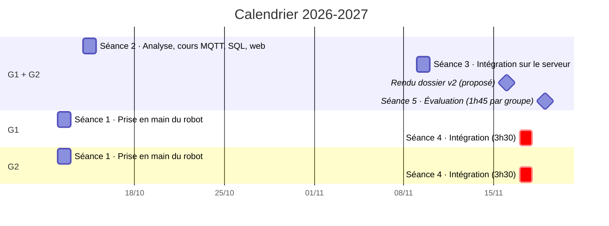
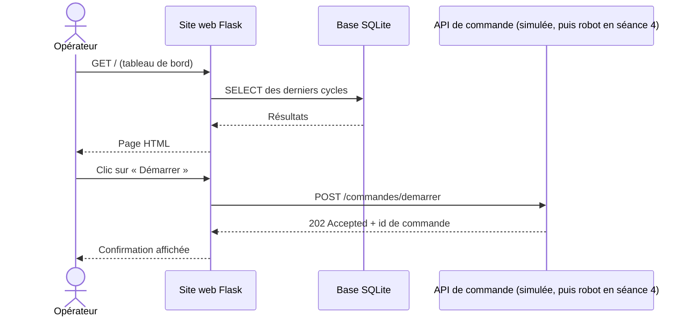
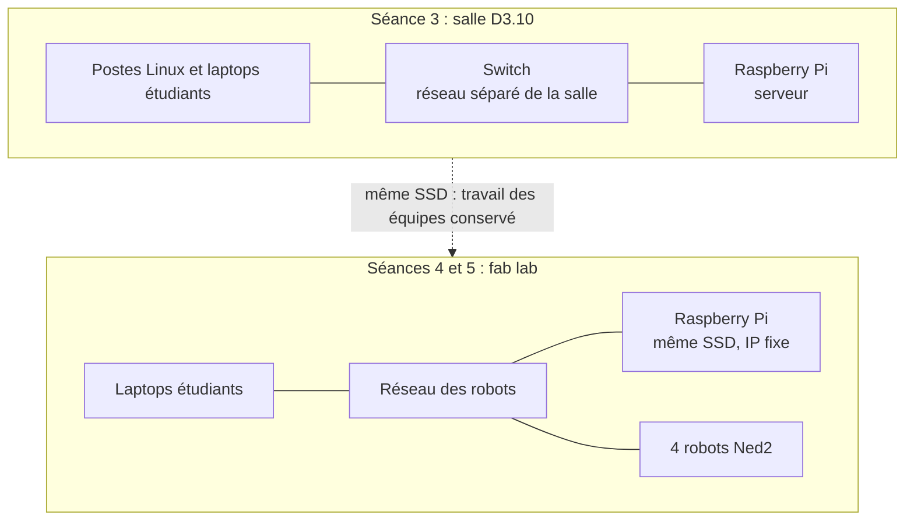

# Progression pédagogique : Infrastructure client / serveur dans un contexte industriel

- **Promotion :** BACH INGE 2024-0 (3e année), 22 étudiants alternants, groupes G1 et G2
- **Année :** 2026-2027
- **Version :** v1.6 (brouillon), 10/10/2026
- **Prérequis :** Python (cours de 1re année)
- **Sources :** `seances_BACHINGE24.xlsx` (planning : dates, horaires, salles et matériel, à confirmer) et supports 2025-2026 (dossier de l'année précédente)
- **Présentation du projet :** `README.md` à la racine (contexte, besoins, objectifs, fonctions, synoptique, données échangées), commun aux trois classes
- **Supports de cours :** dossier `cours/` (voir la fin de la section 4)

**En bref**

- 5 séances, du 12 octobre au 19 novembre 2026, soit 15h45 par étudiant.
- 22 étudiants en 8 équipes de 2 ou 3, sur 4 robots.
- Le serveur est un Raspberry Pi, installé en salle D3.10 (séance 3) puis au fab lab (voir `materiel_ISTP.md`).
- Un projet fil rouge : une cellule robotisée supervisée, construite séance après séance.
- Évaluation : chaque équipe déroule son propre cahier de recette devant l'enseignant.

## 1. Intention générale

Le module est organisé en **projet fil rouge** : chaque équipe conçoit, réalise et fait recetter une **cellule robotisée supervisée**.

➡️ process robot (Niryo Ned2 + convoyeur) → remontée des données par MQTT → stockage SQL → site web et API de pilotage

Par rapport à l'an dernier :

- on part d'un **process défini par les étudiants** et non plus d'exercices techniques isolés ;
- une **phase d'analyse** (dossier, présentation, tests de recette) est ajoutée avant la partie technique ;
- la pile technique est **allégée** : SQLite au lieu de MySQL, pas de Docker, pas de Grafana ni de Node-RED, le tableau de bord est le site web Flask ;
- l'évaluation repose sur l'**exécution du cahier de recette** rédigé par l'équipe elle-même.

## 2. Compétences visées

| Code | Compétence | Séances |
|------|------------|---------|
| C1 | Programmer une séquence robotisée (Blockly puis Python) | 1 et 4 |
| C2 | Analyser un process industriel et le spécifier (dossier, recette) | 1 et 2 |
| C3 | Mettre en œuvre une communication client / serveur (MQTT, HTTP) | 2, 3 et 4 |
| C4 | Collecter et stocker des données de production (SQL / SQLite) | 2, 3 et 4 |
| C5 | Développer une interface web et une API en Python (Flask) | 2, 3 et 4 |
| C6 | Intégrer, tester et valider un système (recette) | 4 et 5 |

## 3. Architecture cible du fil rouge

L'architecture, les fonctions F1 à F7, le cycle instrumenté et le scénario complet des échanges sont présentés dans le `README.md` (sections 4 et 5). Dans cette classe, le serveur du module est un Raspberry Pi (voir section 6) et les robots sont au fab lab.

**Séance où chaque fonction est réalisée**

| Fonction | Brique | Réalisée en | Passage sur le robot réel |
|----------|--------|-------------|---------------------------|
| F1 Exécuter le cycle | Programme process | Séance 1 (Blockly, export Python) | Séance 4 |
| F2 Recevoir les commandes | API CQRS | Cours en séance 2, développement sur laptop puis déploiement en séance 3, en mode simulé sur le serveur | Séance 4 |
| F3 Exposer l'état | API CQRS | Cours en séance 2, développement sur laptop puis déploiement en séance 3, en mode simulé sur le serveur | Séance 4 |
| F4 Publier les événements | Client MQTT du robot | Séance 3 avec le simulateur de process fourni, puis entre les séances 3 et 4 dans le programme robot | Séance 4 |
| F5 Transmettre les messages | Broker Mosquitto | Préparé par l'enseignant sur le serveur (section 6) | (sur le serveur) |
| F6 Collecter et stocker | Collecteur Python + base SQLite | Cours en séance 2, développement sur laptop puis déploiement en séance 3 | (sur le serveur) |
| F7 Présenter | Site web Flask | Cours en séance 2, développement sur laptop puis déploiement en séance 3 | (sur le serveur) |

**Exemple de process :** une pièce est posée sur le convoyeur, le convoyeur tourne jusqu'au capteur (DI5), le robot prend la pièce, la dépose dans une zone, le cycle est compté et horodaté (diagramme dans le `README.md`, section 5, « Le cycle instrumenté »).

**Données remontées** (à définir par chaque équipe à la séance 2) : début / fin de cycle, durée de cycle, nombre de pièces, état du robot, défauts.

## 4. Vue d'ensemble des séances

| Séance | Thème | Groupe | Date | Lieu | Durée | Livrable en fin de séance |
|--------|-------|--------|------|------|-------|---------------------------|
| Séance 1 | Prise en main du robot, export Python, définition du process | G1 | lun. 12/10/2026, 08:30-12:00 | Fab lab | 3h30 | Programme Blockly et export `.py`, fiche process v0 |
| Séance 1 | (idem) | G2 | lun. 12/10/2026, 13:30-17:00 | Fab lab | 3h30 | (idem) |
| Séance 2 | Analyse, dossier, présentation, tests de recette ; cours MQTT, SQL, Python, site web et API | G1 + G2 | mer. 14/10/2026, 08:30-12:00 | Salle C1.07 | 3h30 | Dossier d'analyse v1, cahier de recette v1 |
| Séance 3 | Intégration sur le serveur : MQTT, collecte dans SQLite, site web et API | G1 + G2 | lun. 09/11/2026, 08:30-12:00 | Salle D3.10, serveur | 3h30 | Collecteur, site web et API (mode simulé) sur le serveur, alimentés par des données simulées |
| Séance 4 | Intégration sur les robots, recette à blanc | G1 | mar. 17/11/2026, 08:30-12:00 | Fab lab | 3h30 | Système intégré, recette à blanc |
| Séance 4 | (idem) | G2 | mar. 17/11/2026, 13:30-17:00 | Fab lab | 3h30 | (idem) |
| Séance 5 | Évaluation : recette | G1 | jeu. 19/11/2026, 13:30-15:15 | Fab lab | 1h45 | Recette signée, code déposé |
| Séance 5 | (idem) | G2 | jeu. 19/11/2026, 15:15-17:00 | Fab lab | 1h45 | (idem) |

Dates, horaires, salles et matériel : planning `seances_BACHINGE24.xlsx`. Les dates et les salles sont à confirmer (voir la section 7).

**Volumes horaires** (planning)

- **Par étudiant :** 4 séances de 3h30 + 1 séance de 1h45, soit **15h45**.
- **Pour l'enseignant :** séances 1 et 4 assurées deux fois (4 × 3h30) + séances 2 et 3 (2 × 3h30) + séance 5 assurée deux fois (2 × 1h45), soit **24h30**.

**Organisation des équipes**

- 4 robots, une équipe par robot dans chaque groupe : 4 équipes par groupe, 8 équipes au total.
- 22 étudiants : 6 équipes de 3 et 2 équipes de 2.
- Les équipes sont constituées à la séance 1 et restent les mêmes jusqu'à l'évaluation.
- Identifiants `g1e1` à `g2e4` et noms (thème des métaux) : voir `materiel_ISTP.md`.

**Supports de cours** (dossier `cours/`, et `README.md` à la racine)

| Fichier | Titre | Séances |
|---------|-------|---------|
| `README.md` | Présentation du projet : contexte, besoins, objectifs, fonctions, synoptique | 1 (présentation) et 2 |
| `reseau_TCP_IP.md` | Révisions réseau : TCP/IP, adressage, routage, sous-réseaux, configuration statique et DHCP | 3 (révision) et 4 |
| `collecteur_MQTT.md` | Collecteur de messages MQTT en Python vers une base de données | 2 (cours) et 3 |
| `SQL.md` | Rappels de SQL | 2 (cours) et 3 |
| `site_web_HTML_CSS.md` | Cours HTML et CSS : réaliser les pages d'un site web | 2 (cours) et 3 |
| `intro_flask.md` | Le framework Flask : premiers pas | 2 (cours) et 3 |
| `API_CQRS_REST_Flask.md` | Une API CQRS pour le robot Niryo, comparée à REST, avec Flask | 2 (cours), 3 et 4 |

## 5. Détail des séances

### Séance 1 : prise en main du robot, export Python, définition du process

| Lieu | Groupes | Durée | Matériel |
|------|---------|-------|----------|
| Fab lab | G1 le matin, G2 l'après-midi | 3h30 | Robots Ned2 et convoyeurs |

**Objectifs**

- Utiliser le robot Ned2 en sécurité
- Programmer un pick & place avec convoyeur en Blockly (Niryo Studio)
- Exporter le programme en Python et en comprendre la structure
- Définir le process que l'équipe va industrialiser

**Déroulé**

| Durée | Activité |
|-------|----------|
| 20 min | **Lancement** : présentation du module et du fil rouge (`README.md`, sections 1 à 3), constitution des équipes, consignes de sécurité (zone de travail, arrêt d'urgence, vitesses) |
| 60 min | **Prise en main** : connexion Niryo Studio, calibration, mode apprentissage, mouvements articulaires et cartésiens, pince |
| 70 min | **Scénario guidé** : convoyeur jusqu'au capteur DI5, prise de la pièce, dépose, retour en position d'attente |
| 30 min | **Export Python** : lecture du code généré (`calibrate_auto`, `move_pose`, `pick_from_pose`, `control_conveyor`, `digital_read`), repérage des poses et des fonctions |
| 30 min | **Process de l'équipe** : étapes, entrées / sorties, cas d'erreur, premières données à remonter |

**Livrables**

- Programme Blockly et export `.py` déposés (avec les poses relevées, à conserver pour l'intégration du 17/11)
- Fiche process v0 (une page)

**Ressources reprises de l'an dernier**

- `essai_robot/script1_autocalibrate.py`, `script2_convoyeur.py`, `script3_convoyeur_pick.py`
- `documentation/sdk.md`

### Séance 2 : analyse, dossier, présentation, tests de recette, cours MQTT, SQL, Python, site web et API

| Lieu | Groupes | Durée | Matériel |
|------|---------|-------|----------|
| Salle C1.07 | G1 + G2 ensemble (22 étudiants) | 3h30 | Pas de robot, pas de serveur. Vidéoprojecteur, laptops des étudiants |

Cette séance regroupe l'analyse et tous les cours du module : sans serveur, les cours sont suivis avec de courts exemples exécutés sur le laptop. Les TP sont faits en autonomie sur le laptop (travail entre les séances 2 et 3), puis déployés sur le serveur à la séance 3.

**Objectifs**

- Situer le projet dans une architecture client / serveur industrielle
- Rédiger un dossier d'analyse
- Écrire des tests de recette vérifiables
- Présenter son projet à l'oral
- Expliquer le modèle publication / abonnement (MQTT), les bases de SQL et de SQLite, une requête HTTP et une API REST, et les principes de Flask

**Déroulé**

| Durée | Activité |
|-------|----------|
| 30 min | **Cours** : architecture client / serveur en contexte industriel (niveaux terrain, supervision, gestion) ; du besoin (piloter, informer, observer) aux fonctions F1 à F7 et au rôle de chaque brique du fil rouge ; cahier des charges et recette |
| 55 min | **Atelier par équipe** : rédaction du dossier d'analyse à partir d'un gabarit fourni (à terminer dans la semaine si besoin) |
| 40 min | **Présentations flash** : 5 min par équipe (8 équipes), puis retours |
| 30 min | **Cours MQTT** : broker, clients, topics, payload JSON, QoS, authentification. Démonstration avec `mosquitto_pub` / `mosquitto_sub` sur le laptop de l'enseignant |
| 20 min | **Rappel SQL** : table, types, clé primaire, `CREATE`, `INSERT`, `SELECT`, `WHERE`, `GROUP BY`. SQLite (module `sqlite3`, DB Browser for SQLite), collecte des données du process dans une base SQLite |
| 35 min | **Cours Python, HTTP et web** : environnement virtuel et `pip`, bibliothèques `flask` et `requests` ; client / serveur, `GET` / `POST`, codes de retour, JSON, tests avec `curl` ; principe d'un site Flask et d'une API de commande (CQRS) |

**Contenu attendu du dossier d'analyse**

Le dossier peut suivre le plan du `README.md` (contexte, besoins, objectifs, fonctions, synoptique), appliqué au process de l'équipe :

- Description du process (séquence ou grafcet simplifié)
- Schéma d'architecture : composants et flux
- Dictionnaire des données : quelle donnée, à quel moment, quel format
- Fonctions attendues du site web (maquette papier acceptée)
- Cahier de recette : au moins 8 tests (identifiant, exigence, préconditions, procédure, résultat attendu)

La partie technique (topics MQTT, table SQL, routes de l'API) reste au niveau fonctionnel. Elle sera précisée dans la v2 du dossier, après la séance 3 (rendu proposé : lun. 16/11/2026, avant la séance 4).

**Livrables**

- Dossier d'analyse v1 et cahier de recette v1

**Supports de cours**

- `README.md` (présentation du projet, à utiliser comme modèle de plan pour le dossier)
- `cours/collecteur_MQTT.md`, `cours/SQL.md`, `cours/site_web_HTML_CSS.md`, `cours/intro_flask.md` et `cours/API_CQRS_REST_Flask.md` (cours de la séance, repris en autonomie pour les TP)

**Travail entre les séances 2 et 3 (4 semaines, sur laptop)**

Mosquitto, SQLite et Flask s'exécutent sans serveur : chaque équipe peut avancer sur son laptop, avec un broker local, pour arriver à la séance 3 avec un début de réalisation.

- Installer sur le laptop Python 3, Mosquitto, SQLite et les paquets `paho-mqtt`, `flask`, `requests` (liste donnée en fin de séance)
- Simulateur de process, collecteur et base SQLite en local
- Squelette de l'API CQRS en mode simulé et premières pages du site web
- Compléter le dossier (topics, format des messages, schéma de la base, routes de l'API)

### Séance 3 : intégration sur le serveur (MQTT, collecte dans SQLite, site web et API)

| Lieu | Groupes | Durée | Matériel |
|------|---------|-------|----------|
| Salle D3.10 | G1 + G2 ensemble (22 étudiants) | 3h30 | Serveur Raspberry Pi (section 6) sur le réseau séparé de la salle, postes Linux et laptops des étudiants. Pas de robot : le process est simulé et l'API fonctionne en mode simulé |

Les cours ont eu lieu à la séance 2 et les équipes ont avancé sur leur laptop pendant quatre semaines : la séance est un TP d'intégration. Il s'agit de déployer sur le serveur réel ce qui a été développé en local (voir la section 7 si une équipe arrive sans rien de prêt).

**Objectifs**

- Se connecter au serveur et y travailler à distance
- Publier et recevoir des messages JSON via le broker du serveur
- Déployer le collecteur et la base SQLite de l'équipe sur le serveur
- Déployer l'API de commande (mode simulé) et le site web de l'équipe sur le serveur

**Déroulé**

| Durée | Activité |
|-------|----------|
| 20 min | **Reprise** : point d'étape sur l'avancement de chaque équipe, connexion au serveur (SSH, avec VS Code Remote SSH si la salle a accès à Internet) avec le compte de l'équipe (mêmes identifiant et mot de passe sur le serveur et sur les postes Linux de la salle) |
| 50 min | **TP MQTT sur le serveur** : publier et s'abonner sur le broker du serveur avec l'authentification et les topics de l'équipe (MQTT Explorer puis `paho-mqtt`), passage du broker local au broker du serveur |
| 50 min | **TP collecte** : un simulateur publie les événements du process de l'équipe ; le collecteur tourne sur le serveur, reçoit les messages, les valide et les insère dans SQLite. Requêtes de contrôle (nombre de cycles, durée moyenne) |
| 45 min | **TP API** : API de commande du robot selon le principe CQRS (`GET /requetes/etat`, `POST /commandes/demarrer`, `/commandes/arreter`, `/commandes/calibrer`) en mode simulé (`RobotSimule`), sans appel au robot. Exécution sur le serveur, sur le port attribué à l'équipe (5001 à 5008) |
| 45 min | **TP site web** : tableau de bord exécuté sur le serveur (port 8001 à 8008), lisant la base SQLite (dernier état, liste des cycles, compteurs), avec des boutons de commande appelant l'API |

**Flux de collecte**

**Flux de consultation et de commande**

Le scénario complet, de la commande jusqu'à l'affichage des cycles, est dans le `README.md` (section 5, « Les échanges : un scénario complet »).

**Proposition de modèle de données (point de départ)**

Conventions reprises des supports `cours/collecteur_MQTT.md` et `cours/SQL.md` (détail et exemples de messages dans le `README.md`, section 6) :

- Topics : `cellule/<equipe>/cycle`, `cellule/<equipe>/etat` (message retenu), `cellule/<equipe>/defaut`, avec `<equipe>` de la forme `g1e1`
- Message : `{"evenement": "fin_cycle", "piece": 12, "duree": 18.2, "zone": "A", "horodatage": "2026-11-17T08:30:18"}`
- Tables : `messages(id, recu_le, sujet, charge, qos, retain)` (journal brut), `robots(id, nom, equipe, adresse_ip)` et `cycles(id, robot_id, debut, duree, zone, statut)` (lue par le site web)

**Livrables**

- `collecteur.py` et script de création de la base déployés sur le serveur et fonctionnels sur données simulées
- Site web et API (mode simulé) déployés sur le serveur, alimentés par les données simulées

**Supports de cours**

- `cours/collecteur_MQTT.md`
- `cours/SQL.md`
- `cours/site_web_HTML_CSS.md` (HTML, CSS, principe des routes)
- `cours/intro_flask.md` (routes, templates Jinja2, formulaires, lecture de la base SQLite, appel de l'API)
- `cours/API_CQRS_REST_Flask.md` (API de commande du robot, mode simulé)
- `cours/reseau_TCP_IP.md` (révision : adressage, ports, connexion au serveur)

**Ressources reprises de l'an dernier**

- `code/mqtt_message/` : `sender.py` (à transformer en simulateur de process) et `subscriber.py` (à passer de MySQL à SQLite)
- `code/api_robot_test/` (API simulée du robot de l'an dernier, port 3000 : remplacée par l'API CQRS du cours, ports 5001 à 5008)
- `code/website_commande/specification.md`
- `essai_robot/script4_mqtt_send.py`, `script5_mqtt_receive.py`, `script6_api.py`, `script7_API_mqtt.py`
- `tp/fiche_configuration.md` (à adapter : comptes, topics, ports par équipe)

**Travail entre les séances 3 et 4 (8 jours)**

- Terminer le dossier v2 (rendu proposé : lun. 16/11/2026)
- Préparer dans le programme robot les appels de publication MQTT
- Tester le programme process et l'API en mode simulé : seul le passage au robot réel doit rester à faire à la séance 4

### Séance 4 : intégration sur les robots

| Lieu | Groupes | Durée | Matériel |
|------|---------|-------|----------|
| Fab lab | Par groupe : G1 le matin, G2 l'après-midi | 3h30 | Robots, convoyeurs et serveur (Raspberry Pi apporté de la salle D3.10) |

Le collecteur, la base et le site web tournent déjà sur le serveur depuis la séance 3 : la séance porte sur le robot et sa liaison avec le serveur.

Chaque groupe a le fab lab pendant 3h30, avec une équipe par robot (4 équipes, 4 robots). Le robot n'a pas été utilisé depuis la séance 1, cinq semaines plus tôt : la séance commence par une reprise en main. L'intégration n'est possible dans ce temps que si le programme process et l'API ont été testés en mode simulé avant la séance (voir la section 7).

**Objectifs**

- Déployer le programme process et l'API sur le robot
- Remplacer le simulateur de process et l'API simulée par le robot réel
- Faire fonctionner la chaîne de bout en bout
- Dérouler la recette à blanc et corriger

**Déroulé**

| Durée | Activité |
|-------|----------|
| 15 min | **Vérifications réseau** (préparées par l'enseignant avant la séance) : IP du robot et du serveur, accès du robot au broker, accès du serveur à l'API du robot |
| 30 min | **Reprise en main** : consignes de sécurité, calibration, relecture de l'export Python de la séance 1 et des poses relevées |
| 1h30 | **Déploiement** sur le robot : programme process, publication MQTT et API (passage du mode simulé aux appels réels), reprise des poses si besoin |
| 45 min | **Essai de bout en bout** (robot → serveur → site web → robot) et **recette à blanc** sur une sélection de tests du cahier |
| 30 min | **Bilan** : corrections à faire avant l'évaluation, deux jours plus tard, mise à jour du cahier de recette |

**Livrables**

- Système intégré, cahier de recette pré-rempli

**Supports de cours**

- `cours/reseau_TCP_IP.md`, section « Application : le réseau de la cellule robotisée » (connexion au Ned2, flux, diagnostic)
- `cours/API_CQRS_REST_Flask.md`, section « Dans le projet fil rouge » (passage de l'API simulée au robot)

**Ressources reprises de l'an dernier**

- `flask_arm/` : paquets Python pour l'installation hors ligne sur le robot

### Séance 5 : évaluation par la recette

| Lieu | Groupes | Durée | Matériel |
|------|---------|-------|----------|
| Fab lab | Par groupe : G1 de 13:30 à 15:15, G2 de 15:15 à 17:00 | 1h45 | Cellule intégrée de chaque équipe (robot et serveur) |

**Déroulé** (4 équipes par groupe, environ 25 min par équipe)

Pendant qu'une équipe passe, l'équipe suivante prépare sa cellule sur un autre robot.

| Durée | Activité |
|-------|----------|
| 18 min | **Recette** : l'équipe déroule les tests de son cahier choisis par l'enseignant ; chaque test est noté conforme ou non conforme |
| 7 min | **Questions individuelles** sur l'architecture et le code |

**Proposition de grille** (à valider)

| Élément | Poids |
|---------|-------|
| Dossier d'analyse et cahier de recette (version finale) | 30 % |
| Recette : tests conformes, fonctionnement de bout en bout | 50 % |
| Questions individuelles | 20 % |

## 6. Serveur : Raspberry Pi

ISTP met à disposition un Raspberry Pi qui fait office de serveur. Il démarre sur un SSD USB contenant un Linux préparé à l'avance par l'enseignant. Le matériel demandé, le réseau, les comptes et les vérifications sont détaillés dans `materiel_ISTP.md`.

Le serveur sert à la séance 3 (salle D3.10, sur un réseau séparé), puis aux séances 4 et 5 (fab lab). Le travail des équipes reste sur le SSD d'une séance à l'autre.

**Intérêts**

- Aucune installation sur le parc ISTP, hors les comptes du projet sur les postes Linux de la salle D3.10
- Environnement identique pour toutes les équipes, maîtrisé par l'enseignant
- Le Pi se transporte facilement de la salle D3.10 au fab lab ; en cas de panne, le SSD de secours démarre sur un autre Raspberry Pi
- Remise à zéro rapide à partir d'une image du SSD

**Contenu préparé sur le SSD**

- Distribution Linux 64 bits pour Raspberry Pi (par exemple Ubuntu Server 24.04 LTS) avec serveur SSH
- Un compte par équipe (8 comptes : `g1e1` à `g2e4`), avec son dossier personnel, créés avec `scripts/creer_comptes_equipes.sh` (mêmes comptes sur les postes Linux de la salle D3.10)
- Broker Mosquitto avec authentification : un utilisateur MQTT par équipe, limité aux topics de l'équipe
- Python 3 et les paquets du projet (`paho-mqtt`, `flask`, `requests`), installés à l'avance
- SQLite (bibliothèque et outil en ligne de commande)
- Ports attribués par équipe : 5001 à 5008 pour l'API simulée, 8001 à 8008 pour le site web
- Outils fournis aux équipes : simulateur de process (publie sur `cellule/<equipe>/…`), squelette de l'API CQRS en mode simulé

**Réseau**

- **En salle D3.10 (séance 3)** : un réseau séparé permet d'utiliser le serveur. Les postes Linux de la salle y sont raccordés ; un switch apporté par l'enseignant connecte les laptops des étudiants et le Pi. SSH (22), MQTT (1883) et les ports HTTP (5001 à 5008 et 8001 à 8008) doivent être autorisés entre les postes et le Pi.
- **Au fab lab (séances 4 et 5)** : le serveur rejoint le réseau des robots avec une adresse IP fixe (plan d'adressage proposé dans `cours/reseau_TCP_IP.md` : réseau `192.168.10.0/24`, robots en `.21` à `.24`). Le NUC de l'IRUP occupe l'adresse `.10` : le Pi prend `.11` (voir `materiel_ISTP.md`). L'API tourne alors sur chaque robot, port 5000.

**À vérifier avec ISTP**

- Disponibilité de la salle C1.07 (séance 2), de la salle D3.10 (séance 3) et du fab lab (séances 1, 4 et 5), ainsi que de la salle D3.10 la veille de la séance 3 pour l'installation
- Réseau séparé de la salle D3.10 : distribution d'adresses, nombre de prises, ports autorisés, accès à Internet
- Postes Linux de la salle D3.10 : nombre, état, droits pour créer les comptes
- Fourniture du Raspberry Pi et de ses accessoires (demande du 06/10/2026), délai de livraison

**Calendrier de préparation**

- Robots et fab lab vérifiés avant la séance 1 (lun. 12/10)
- Salle D3.10 remise en état et Raspberry Pi prêt et testé avant la séance 3, soit au plus tard le ven. 06/11 (installation sur place la veille ou une heure avant la séance, lun. 09/11). Si le Pi n'est pas livré à temps, un serveur de secours (laptop de l'intervenant avec la même configuration) assure la séance 3
- Sauvegarde du SSD après chaque séance (image complète ou copie des dossiers des équipes)

**Ressources reprises de l'an dernier**

- `documentation/config_nuc.md` (IP fixe avec netplan), `documentation/config_routeur.md`
- `package_nuc/` : paquets Python pour l'installation hors ligne

## 7. Points à arbitrer

1. **Séance 2 très dense.** Le planning regroupe en une seule matinée (mer. 14/10, salle C1.07) l'analyse, le dossier, les présentations et tous les cours : MQTT, SQL, Python, site web et API. Sans serveur, les cours sont suivis avec des exemples sur le laptop et les TP sont faits en autonomie. Le dossier v1 risque d'être terminé après la séance.
   - Alternative : déplacer les présentations flash au début de la séance 3, ou limiter le cours de la séance 2 à MQTT et SQL et faire le cours Flask / API au début de la séance 3.
   - Les laptops doivent porter Python 3, Mosquitto, SQLite, `paho-mqtt`, `flask` et `requests` : liste à donner avant ou pendant la séance 2.
2. **Séance 3 : trois briques à déployer en 3h30** (collecteur, API, site web), après quatre semaines sans cours. Une équipe qui n'a rien préparé sur laptop ne terminera pas.
   - Prévoir un point d'étape en début de séance et des squelettes fournis (simulateur de process, collecteur, API simulée, site web) pour rattraper les équipes en retard.
   - Raspberry Pi et salle D3.10 à préparer pour le lun. 09/11 (liste dans `materiel_ISTP.md`) : plus de contrainte au 13/10, ce qui laisse du temps pour la livraison du Pi.
3. **Fin de module en trois jours.** Les séances 3, 4 et 5 sont séparées de 8 jours, puis de 2 jours (09/11, 17/11, 19/11). Le programme process et l'API doivent être testés en mode simulé avant le 17/11, et les corrections se font entre la séance 4 et l'évaluation.
   - Rendu du dossier v2 proposé le lun. 16/11, avant la séance 4 ; dossier final à l'évaluation.
   - La recette de l'évaluation (environ 25 min par équipe, dont 18 min de recette) porte sur une sélection de tests ; les questions individuelles sont courtes.
4. **Salles à confirmer.** Le planning donne les salles : C1.07 (séance 2), D3.10 (séance 3), fab lab (séances 1, 4 et 5). À vérifier : l'équipement de la salle C1.07 (vidéoprojecteur, prises pour 22 laptops) et le réseau séparé de la salle D3.10. Les dates restent à confirmer.
5. **Peu de temps sur les robots.** Les étudiants n'ont le robot qu'à la séance 1 (3h30), à la séance 4 (3h30) et à l'évaluation (25 min par équipe). Le process doit rester simple. À la séance 3, le travail se fait sur le serveur réel, mais avec un process simulé et une API en mode simulé.
6. **Typage des séances.** Toutes les lignes du planning sont en « CM » sauf l'évaluation du 19/11 (« TEST »), alors que les séances 1 et 4 sont des TP, la séance 2 un atelier et la séance 3 un TP d'intégration.
7. **Intervalle de 4 semaines entre les séances 2 et 3** (14/10 → 09/11). Le travail sur laptop n'est ni encadré ni vérifié : un point d'étape en début de séance 3 suffit à maintenir le rythme.
