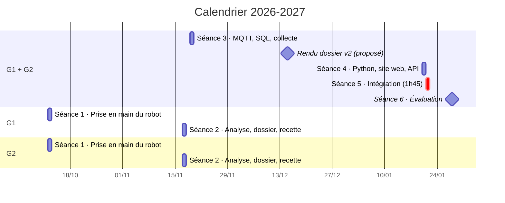
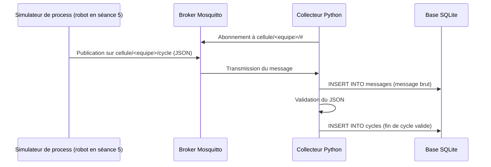
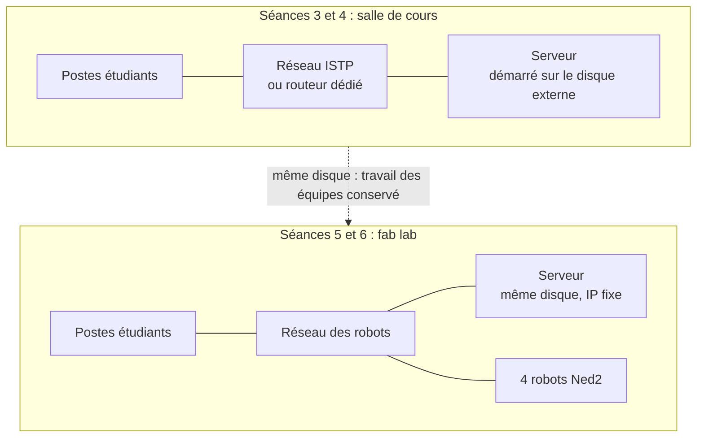

# Progression pédagogique : Infrastructure client / serveur dans un contexte industriel

- **Promotion :** BACH INGE 2024-0 (3e année), 22 étudiants alternants, groupes G1 et G2
- **Année :** 2026-2027
- **Intervenant :** Fabrice Guichard
- **Version :** v1.4 (brouillon), 04/10/2026
- **Prérequis :** Python (cours de 1re année)
- **Sources :** `seances_planifie.xlsx` (planning officiel : dates et horaires), `seances_prevu.xlsx` (planning envisagé : lieux et matériel) et supports 2025-2026 (`/home/fab/cours/niryo`)
- **Présentation du projet :** `README.md` à la racine (contexte, besoins, objectifs, fonctions, synoptique, données échangées), commun aux trois classes
- **Supports de cours :** dossier `cours/` (voir la fin de la section 4)

**En bref**

- 6 séances, d'octobre 2026 à janvier 2027, soit 17h30 par étudiant.
- 22 étudiants en 8 équipes de 2 ou 3, sur 4 robots.
- Un projet fil rouge : une cellule robotisée supervisée, construite séance après séance.
- Évaluation : chaque équipe déroule son propre cahier de recette devant l'enseignant.

## 1. Intention générale

Le module est organisé en **projet fil rouge** : chaque équipe conçoit, réalise et fait recetter une **cellule robotisée supervisée**.

➡️ process robot (Niryo Ned2 + convoyeur) → remontée des données par MQTT → stockage SQL → site web et API de pilotage

Par rapport à l'an dernier :

- on part d'un **process défini par les étudiants** et non plus d'exercices techniques isolés ;
- une **phase d'analyse** (dossier, présentation, tests de recette) est ajoutée avant la partie technique ;
- la pile technique est **allégée** : SQLite au lieu de MySQL, pas de Docker, pas de Grafana ni de Node-RED, le tableau de bord est le site web Flask ;
- l'évaluation repose sur l'**exécution du cahier de recette** rédigé par l'équipe elle-même.

## 2. Compétences visées

| Code | Compétence | Séances |
|------|------------|---------|
| C1 | Programmer une séquence robotisée (Blockly puis Python) | 1 et 5 |
| C2 | Analyser un process industriel et le spécifier (dossier, recette) | 1 et 2 |
| C3 | Mettre en œuvre une communication client / serveur (MQTT, HTTP) | 3, 4 et 5 |
| C4 | Collecter et stocker des données de production (SQL / SQLite) | 3 et 5 |
| C5 | Développer une interface web et une API en Python (Flask) | 4 et 5 |
| C6 | Intégrer, tester et valider un système (recette) | 5 et 6 |

## 3. Architecture cible du fil rouge

L'architecture, les fonctions F1 à F7, le cycle instrumenté et le scénario complet des échanges sont présentés dans le `README.md` (sections 4 et 5). Dans cette classe, le serveur du module est une machine ISTP (voir section 6) et les robots sont au fab lab.

**Séance où chaque fonction est réalisée**

| Fonction | Brique | Réalisée en | Passage sur le robot réel |
|----------|--------|-------------|---------------------------|
| F1 Exécuter le cycle | Programme process | Séance 1 (Blockly, export Python) | Séance 5 |
| F2 Recevoir les commandes | API CQRS | Séance 4, en mode simulé sur le serveur | Séance 5 |
| F3 Exposer l'état | API CQRS | Séance 4, en mode simulé sur le serveur | Séance 5 |
| F4 Publier les événements | Client MQTT du robot | Séance 3 avec le simulateur de process fourni, puis entre les séances 3 et 4 dans le programme robot | Séance 5 |
| F5 Transmettre les messages | Broker Mosquitto | Préparé par l'enseignant sur le serveur (section 6) | (sur le serveur) |
| F6 Collecter et stocker | Collecteur Python + base SQLite | Séance 3 | (sur le serveur) |
| F7 Présenter | Site web Flask | Séance 4 | (sur le serveur) |

**Exemple de process :** une pièce est posée sur le convoyeur, le convoyeur tourne jusqu'au capteur (DI5), le robot prend la pièce, la dépose dans une zone, le cycle est compté et horodaté (diagramme dans le `README.md`, section 5, « Le cycle instrumenté »).

**Données remontées** (à définir par chaque équipe à la séance 2) : début / fin de cycle, durée de cycle, nombre de pièces, état du robot, défauts.

## 4. Vue d'ensemble des séances

| Séance | Thème | Groupe | Date | Lieu | Durée | Livrable en fin de séance |
|--------|-------|--------|------|------|-------|---------------------------|
| Séance 1 | Prise en main du robot, export Python, définition du process | G1 | lun. 12/10/2026, 08:30-12:00 | Fab lab | 3h30 | Programme Blockly et export `.py`, fiche process v0 |
| Séance 1 | (idem) | G2 | lun. 12/10/2026, 13:30-17:00 | Fab lab | 3h30 | (idem) |
| Séance 2 | Analyse, dossier, présentation, tests de recette | G2 | mar. 17/11/2026, 08:30-12:00 | Salle de cours | 3h30 | Dossier d'analyse v1, cahier de recette v1 |
| Séance 2 | (idem) | G1 | mar. 17/11/2026, 13:30-17:00 | Salle de cours | 3h30 | (idem) |
| Séance 3 | MQTT, rappel SQL, collecte des données dans SQLite | G1 + G2 | jeu. 19/11/2026, 13:30-17:00 | Salle de cours, serveur | 3h30 | Collecteur MQTT → SQLite sur le serveur, alimenté par des données simulées |
| Séance 4 | Python, site web et API | G1 + G2 | mer. 20/01/2027, 08:30-12:00 | Salle de cours, serveur | 3h30 | Site web et API (mode simulé) sur le serveur |
| Séance 5 | Intégration sur les robots, recette à blanc | G1 + G2 | jeu. 21/01/2027, 15:15-17:00 | Fab lab | 1h45 | Système intégré, recette à blanc |
| Séance 6 | Évaluation : recette | G1 + G2 | jeu. 28/01/2027, 09:45-11:30 | Fab lab | 1h45 | Recette signée, code déposé |

Dates et horaires : planning officiel (`seances_planifie.xlsx`). Lieux et matériel : ceux du planning envisagé (`seances_prevu.xlsx`), à confirmer pour les créneaux qui ont changé (voir la section 7).

**Volumes horaires** (planning officiel)

- **Par étudiant :** 4 séances de 3h30 + 2 séances de 1h45, soit **17h30**.
- **Pour l'enseignant :** séances 1 et 2 assurées deux fois (4 × 3h30) + séances 3 et 4 (2 × 3h30) + séances 5 et 6 (2 × 1h45), soit **24h30**.

**Organisation des équipes**

- 4 robots, une équipe par robot dans chaque groupe : 4 équipes par groupe, 8 équipes au total.
- 22 étudiants : 6 équipes de 3 et 2 équipes de 2.
- Les équipes sont constituées à la séance 1 et restent les mêmes jusqu'à l'évaluation.

**Supports de cours** (dossier `cours/`, et `README.md` à la racine)

| Fichier | Titre | Séances |
|---------|-------|---------|
| `README.md` | Présentation du projet : contexte, besoins, objectifs, fonctions, synoptique | 1 (présentation) et 2 |
| `reseau_TCP_IP.md` | Révisions réseau : TCP/IP, adressage, routage, sous-réseaux, configuration statique et DHCP | 3 (révision) et 5 |
| `collecteur_MQTT.md` | Collecteur de messages MQTT en Python vers une base de données | 3 |
| `SQL.md` | Rappels de SQL | 3 |
| `site_web_HTML_CSS.md` | Cours HTML et CSS : réaliser les pages d'un site web | 4 |
| `intro_flask.md` | Le framework Flask : premiers pas | 4 |
| `API_CQRS_REST_Flask.md` | Une API CQRS pour le robot Niryo, comparée à REST, avec Flask | 4 et 5 |

## 5. Détail des séances

### Séance 1 : prise en main du robot, export Python, définition du process

| Lieu | Groupes | Durée | Matériel |
|------|---------|-------|----------|
| Fab lab | G1 le matin, G2 l'après-midi | 3h30 | Robots Ned2 et convoyeurs |

**Objectifs**

- Utiliser le robot Ned2 en sécurité
- Programmer un pick & place avec convoyeur en Blockly (Niryo Studio)
- Exporter le programme en Python et en comprendre la structure
- Définir le process que l'équipe va industrialiser

**Déroulé**

| Durée | Activité |
|-------|----------|
| 20 min | **Lancement** : présentation du module et du fil rouge (`README.md`, sections 1 à 3), constitution des équipes, consignes de sécurité (zone de travail, arrêt d'urgence, vitesses) |
| 60 min | **Prise en main** : connexion Niryo Studio, calibration, mode apprentissage, mouvements articulaires et cartésiens, pince |
| 70 min | **Scénario guidé** : convoyeur jusqu'au capteur DI5, prise de la pièce, dépose, retour en position d'attente |
| 30 min | **Export Python** : lecture du code généré (`calibrate_auto`, `move_pose`, `pick_from_pose`, `control_conveyor`, `digital_read`), repérage des poses et des fonctions |
| 30 min | **Process de l'équipe** : étapes, entrées / sorties, cas d'erreur, premières données à remonter |

**Livrables**

- Programme Blockly et export `.py` déposés (avec les poses relevées, à conserver pour l'intégration de janvier)
- Fiche process v0 (une page)

**Ressources reprises de l'an dernier**

- `essai_robot/script1_autocalibrate.py`, `script2_convoyeur.py`, `script3_convoyeur_pick.py`
- `documentation/sdk.md`

### Séance 2 : analyse, dossier, présentation, tests de recette

| Lieu | Groupes | Durée | Matériel |
|------|---------|-------|----------|
| Salle de cours | Par groupe : G2 le matin, G1 l'après-midi | 3h30 | Pas de robot |

**Objectifs**

- Situer le projet dans une architecture client / serveur industrielle
- Rédiger un dossier d'analyse
- Écrire des tests de recette vérifiables
- Présenter son projet à l'oral

**Déroulé**

| Durée | Activité |
|-------|----------|
| 45 min | **Cours** : architecture client / serveur en contexte industriel (niveaux terrain, supervision, gestion) ; du besoin (piloter, informer, observer) aux fonctions F1 à F7 et au rôle de chaque brique du fil rouge ; cahier des charges et recette |
| 2h | **Atelier par équipe** : rédaction du dossier d'analyse à partir d'un gabarit fourni |
| 45 min | **Présentations flash** : 5 min par équipe (4 équipes par groupe), puis retours |

**Contenu attendu du dossier d'analyse**

Le dossier peut suivre le plan du `README.md` (contexte, besoins, objectifs, fonctions, synoptique), appliqué au process de l'équipe :

- Description du process (séquence ou grafcet simplifié)
- Schéma d'architecture : composants et flux
- Dictionnaire des données : quelle donnée, à quel moment, quel format
- Fonctions attendues du site web (maquette papier acceptée)
- Cahier de recette : au moins 8 tests (identifiant, exigence, préconditions, procédure, résultat attendu)

La partie technique (topics MQTT, table SQL, routes de l'API) reste au niveau fonctionnel. Elle sera précisée dans la v2 du dossier, après les séances 3 et 4.

**Livrables**

- Dossier d'analyse v1 et cahier de recette v1

**Supports de cours**

- `README.md` (présentation du projet, à utiliser comme modèle de plan pour le dossier)

### Séance 3 : MQTT, rappel SQL, collecte des données dans SQLite

| Lieu | Groupes | Durée | Matériel |
|------|---------|-------|----------|
| Salle de cours | G1 + G2 ensemble | 3h30 | Serveur (section 6) : broker Mosquitto, base SQLite, exécution du collecteur. Pas de robot : le process est simulé |

**Objectifs**

- Expliquer le modèle publication / abonnement
- Se connecter au serveur et y travailler à distance
- Publier et recevoir des messages JSON via le broker du serveur
- Créer une table et l'alimenter depuis Python
- Collecter les données du process de l'équipe sur le serveur

**Déroulé**

| Durée | Activité |
|-------|----------|
| 40 min | **Cours MQTT** : broker, clients, topics, payload JSON, QoS, authentification. Démonstration avec `mosquitto_pub` / `mosquitto_sub` sur le broker du serveur |
| 50 min | **TP connexion et MQTT** : connexion au serveur (SSH, VS Code Remote SSH) avec le compte de l'équipe, puis publier et s'abonner sur le broker du serveur (MQTT Explorer puis `paho-mqtt`) |
| 30 min | **Rappel SQL** : table, types, clé primaire, `CREATE`, `INSERT`, `SELECT`, `WHERE`, `GROUP BY`. SQLite (module `sqlite3`, DB Browser for SQLite) |
| 1h30 | **TP collecte** : un simulateur publie les événements du process de l'équipe ; le collecteur tourne sur le serveur, reçoit les messages, les valide et les insère dans SQLite. Requêtes de contrôle (nombre de cycles, durée moyenne) |

**Flux de collecte**

**Proposition de modèle de données (point de départ)**

Conventions reprises des supports `cours/collecteur_MQTT.md` et `cours/SQL.md` (détail et exemples de messages dans le `README.md`, section 6) :

- Topics : `cellule/<equipe>/cycle`, `cellule/<equipe>/etat` (message retenu), `cellule/<equipe>/defaut`, avec `<equipe>` de la forme `g1e1`
- Message : `{"evenement": "fin_cycle", "piece": 12, "duree": 18.2, "zone": "A", "horodatage": "2026-11-17T08:30:18"}`
- Tables : `messages(id, recu_le, sujet, charge, qos, retain)` (journal brut), `robots(id, nom, equipe, adresse_ip)` et `cycles(id, robot_id, debut, duree, zone, statut)` (lue par le site web)

**Livrables**

- `collecteur.py` déployé sur le serveur et fonctionnel sur données simulées, script de création de la base

**Supports de cours**

- `cours/collecteur_MQTT.md`
- `cours/SQL.md`
- `cours/reseau_TCP_IP.md` (révision : adressage, ports, connexion au serveur)

**Ressources reprises de l'an dernier**

- `code/mqtt_message/` : `sender.py` (à transformer en simulateur de process) et `subscriber.py` (à passer de MySQL à SQLite)
- `essai_robot/script4_mqtt_send.py`, `script5_mqtt_receive.py`
- `tp/fiche_configuration.md` (à adapter : comptes, topics, ports par équipe)

**Travail entre les séances 3 et 4 (2 mois)**

- Dossier v2 : topics, format des messages, schéma de la base, routes de l'API
- Finaliser le collecteur
- Préparer dans le programme robot les appels de publication MQTT

### Séance 4 : Python, site web et API

| Lieu | Groupes | Durée | Matériel |
|------|---------|-------|----------|
| Salle de cours | G1 + G2 ensemble | 3h30 | Serveur (section 6) : exécution de l'API et du site web, base SQLite de la séance 3. Pas de robot : l'API fonctionne en mode simulé |

**Objectifs**

- Réinvestir les acquis Python de 1re année dans un projet
- Expliquer une requête HTTP et une API REST
- Développer une API de commande et un site web avec Flask, et les exécuter sur le serveur

**Déroulé**

| Durée | Activité |
|-------|----------|
| 15 min | **Python pour le projet** (le langage a été vu en 1re année) : environnement virtuel et `pip`, bibliothèques `flask` et `requests` |
| 30 min | **Cours HTTP / REST** : client / serveur, `GET` / `POST`, codes de retour, JSON. Tests avec `curl` |
| 1h15 | **TP API** : écrire l'API de commande du robot selon le principe CQRS (`GET /requetes/etat`, `POST /commandes/demarrer`, `/commandes/arreter`, `/commandes/calibrer`) en mode simulé (`RobotSimule`), sans appel au robot. Exécution sur le serveur, sur le port attribué à l'équipe (5001 à 5008) |
| 1h30 | **TP site web** : tableau de bord exécuté sur le serveur (port 8001 à 8008), lisant la base SQLite de la séance 3 (dernier état, liste des cycles, compteurs), avec des boutons de commande appelant l'API |

**Flux de consultation et de commande**

Le scénario complet, de la commande jusqu'à l'affichage des cycles, est dans le `README.md` (section 5, « Les échanges : un scénario complet »).

**Livrables**

- Site web et API (mode simulé) déployés sur le serveur, alimentés par les données simulées de la séance 3

**Supports de cours**

- `cours/site_web_HTML_CSS.md` (HTML, CSS, principe des routes)
- `cours/intro_flask.md` (routes, templates Jinja2, formulaires, lecture de la base SQLite, appel de l'API)
- `cours/API_CQRS_REST_Flask.md` (API de commande du robot, mode simulé)

**Ressources reprises de l'an dernier**

- `code/api_robot_test/` (API simulée du robot de l'an dernier, port 3000 : remplacée par l'API CQRS du cours, ports 5001 à 5008)
- `code/website_commande/specification.md`
- `essai_robot/script6_api.py`, `script7_API_mqtt.py`

### Séance 5 : intégration sur les robots

| Lieu | Groupes | Durée | Matériel |
|------|---------|-------|----------|
| Fab lab | G1 + G2 ensemble | 1h45 | Robots et serveur |

Le collecteur, la base et le site web tournent déjà sur le serveur depuis les séances 3 et 4 : la séance porte sur le robot et sa liaison avec le serveur.

Le créneau est court : 1h45 pour les 8 équipes, soit deux équipes par robot (une de G1, une de G2). L'intégration n'est possible dans ce temps que si le programme process et l'API ont été testés en mode simulé à la séance 4 (voir la section 7).

**Objectifs**

- Déployer le programme process et l'API sur le robot
- Remplacer le simulateur de process et l'API simulée par le robot réel
- Faire fonctionner la chaîne de bout en bout
- Dérouler la recette à blanc et corriger

**Déroulé**

| Durée | Activité |
|-------|----------|
| 15 min | **Vérifications réseau** (préparées par l'enseignant avant la séance) : IP du robot et du serveur, accès du robot au broker, accès du serveur à l'API du robot |
| 2 × 40 min | **Passage sur le robot**, une équipe après l'autre sur chaque robot : déploiement du programme process, de la publication MQTT et de l'API (passage du mode simulé aux appels réels), essai de bout en bout (robot → serveur → site web → robot), reprise des poses si besoin, recette à blanc. Pendant ce temps, l'autre équipe prépare son déploiement |
| 10 min | **Bilan** : corrections à faire avant l'évaluation, mise à jour du cahier de recette |

**Livrables**

- Système intégré, cahier de recette pré-rempli

**Supports de cours**

- `cours/reseau_TCP_IP.md`, section « Application : le réseau de la cellule robotisée » (connexion au Ned2, flux, diagnostic)
- `cours/API_CQRS_REST_Flask.md`, section « Dans le projet fil rouge » (passage de l'API simulée au robot)

**Ressources reprises de l'an dernier**

- `flask_arm/` : paquets Python pour l'installation hors ligne sur le robot

### Séance 6 : évaluation par la recette

| Lieu | Groupes | Durée | Matériel |
|------|---------|-------|----------|
| Fab lab | G1 + G2 ensemble | 1h45 | Cellule intégrée de chaque équipe (robot et serveur) |

**Déroulé** (8 équipes, environ 12 min par équipe)

Pendant qu'une équipe passe, l'équipe suivante prépare sa cellule sur un autre robot.

| Durée | Activité |
|-------|----------|
| 8 min | **Recette** : l'équipe déroule les tests de son cahier choisis par l'enseignant ; chaque test est noté conforme ou non conforme |
| 4 min | **Questions individuelles** sur l'architecture et le code |

**Proposition de grille** (à valider)

| Élément | Poids |
|---------|-------|
| Dossier d'analyse et cahier de recette (version finale) | 30 % |
| Recette : tests conformes, fonctionnement de bout en bout | 50 % |
| Questions individuelles | 20 % |

## 6. Serveur : machine ISTP démarrée sur disque externe

ISTP fournit une machine qui fait office de serveur. Elle démarre sur un disque externe (SSD USB) contenant un Linux préparé à l'avance par l'enseignant. Le disque interne de la machine n'est ni utilisé ni modifié.

Le serveur sert aux séances 3 et 4 (salle de cours), puis aux séances 5 et 6 (fab lab). Le travail des équipes reste sur le disque d'une séance à l'autre.

**Intérêts**

- Aucune installation sur le parc ISTP : seule la machine est demandée
- Environnement identique pour toutes les équipes, maîtrisé par l'enseignant
- Le disque suit l'enseignant : en cas de panne, il peut démarrer sur une autre machine
- Remise à zéro rapide à partir d'une image du disque

**Contenu préparé sur le disque**

- Distribution Linux (par exemple Ubuntu Server 24.04 LTS) avec serveur SSH
- Un compte par équipe (8 comptes), avec son dossier personnel
- Broker Mosquitto avec authentification : un utilisateur MQTT par équipe, limité aux topics de l'équipe
- Python 3 et les paquets du projet (`paho-mqtt`, `flask`, `requests`), installés à l'avance
- SQLite (bibliothèque et outil en ligne de commande)
- Ports attribués par équipe : 5001 à 5008 pour l'API simulée, 8001 à 8008 pour le site web
- Outils fournis aux équipes : simulateur de process (publie sur `cellule/<equipe>/…`), squelette de l'API CQRS en mode simulé

**Réseau**

- **En salle de cours (séances 3 et 4)** : le serveur et les postes étudiants doivent être sur le même réseau. Soit le réseau ISTP, si SSH (22), MQTT (1883) et les ports HTTP sont autorisés entre postes, soit un routeur dédié apporté en salle.
- **Au fab lab (séances 5 et 6)** : le serveur rejoint le réseau des robots avec une adresse IP fixe (plan d'adressage proposé dans `cours/reseau_TCP_IP.md` : réseau `192.168.10.0/24`, serveur en `.10`, robots en `.21` à `.24`). L'API tourne alors sur chaque robot, port 5000.

**À vérifier avec ISTP**

- Disponibilité de la machine aux dates des séances 3 à 6, en salle de cours et au fab lab
- Démarrage sur périphérique USB autorisé (réglages BIOS / UEFI, Secure Boot, mot de passe BIOS)
- Port Ethernet et port USB 3 disponibles

**Calendrier de préparation**

- Disque prêt et testé sur la machine ISTP avant la séance 3 (19/11), par exemple lors de la séance 2 (17/11)
- Sauvegarde du disque après chaque séance (image complète ou copie des dossiers des équipes)

**Ressources reprises de l'an dernier**

- `documentation/config_nuc.md` (IP fixe avec netplan), `documentation/config_routeur.md`
- `package_nuc/` : paquets Python pour l'installation hors ligne

## 7. Points à arbitrer

1. **Intégration trop courte.** Le planning officiel ne prévoit qu'un créneau commun de 1h45 (séance 5, jeu. 21/01) pour les 8 équipes, au lieu des 3h30 par groupe envisagées.
   - Le déroulé proposé (deux passages de 40 min par robot) ne suffit que si le code a été testé en mode simulé à la séance 4.
   - Si possible, demander un créneau par groupe au fab lab entre le 21/01 et le 28/01.
2. **Évaluation resserrée.** La séance 6 (jeu. 28/01, 1h45) réunit les deux groupes : environ 12 min par équipe au lieu des 25 min envisagées. La recette porte donc sur une sélection de tests ; les questions individuelles sont courtes.
3. **Lieux à confirmer.** Le planning officiel ne donne pas les salles. À vérifier pour les créneaux qui ont changé : séance 2 par groupe (17/11), séance 3 (19/11), séance 5 (21/01, fab lab avec les robots).
4. **Peu de temps sur les robots.** Les étudiants n'ont le robot qu'à la séance 1, à la séance 5 (1h45) et à l'évaluation. Le process doit rester simple. Aux séances 3 et 4, le travail se fait sur le serveur réel, mais avec un process simulé et une API en mode simulé.
5. **Typage des séances.** Toutes les lignes du planning sont en « CM » sauf l'évaluation du 28/01 (« TEST »), alors que les séances 1 et 5 sont des TP et la séance 2 un atelier.
6. **Long intervalle entre les séances 3 et 4** (19/11 → 20/01). Fixer une date de rendu intermédiaire du dossier v2 (par exemple mi-décembre) pour maintenir le rythme.
