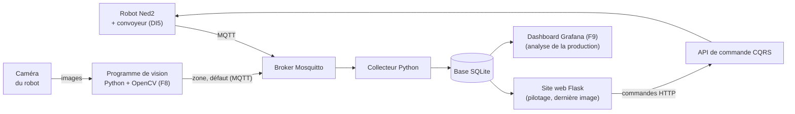
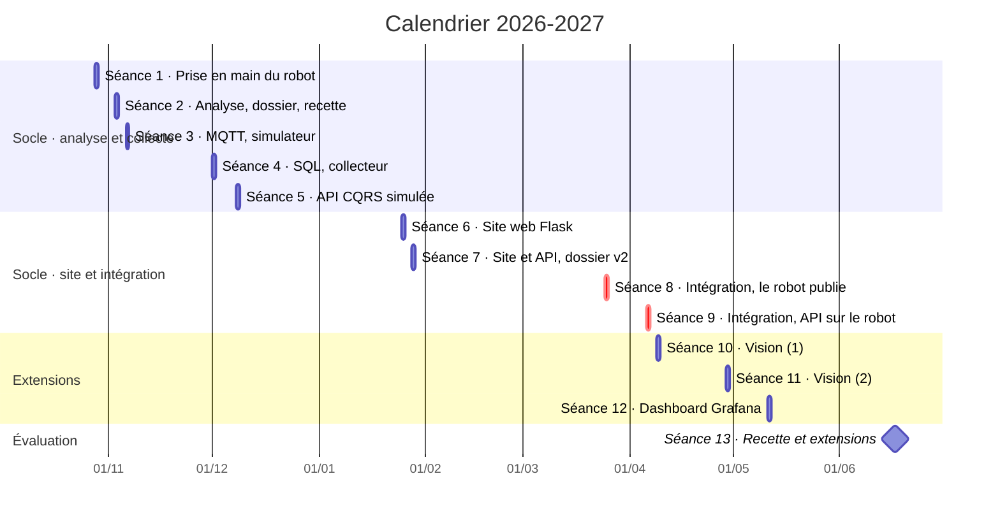
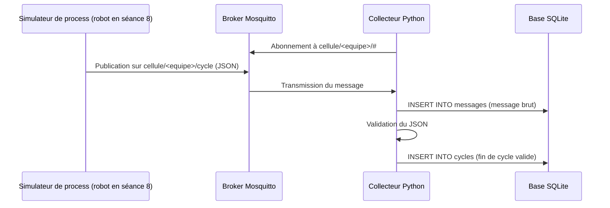
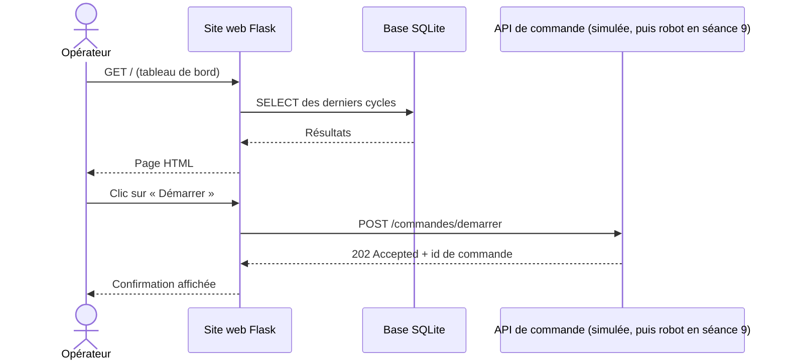

# Progression pédagogique : Infrastructure client / serveur dans un contexte industriel

- **Promotion :** BACH TECH 2024-0, groupe G1 (seul groupe du planning), effectif à renseigner
- **Année :** 2026-2027
- **Version :** v1.1 (brouillon), 11/10/2026
- **Prérequis :** Python, à confirmer (voir la section 8)
- **Sources :** `seances_BACHTECH24.xlsx` (planning : dates et horaires ; intitulé « Fils Rouges ») et supports 2025-2026 (dossier de l'année précédente)
- **Présentation du projet :** `README.md` à la racine (contexte, besoins, objectifs, fonctions, synoptique, données échangées), commun aux trois classes
- **Supports de cours :** dossier `cours/` (voir la fin de la section 4)

**En bref**

- 13 séances de 3h30, d'octobre 2026 à juin 2027, soit 45h30 par étudiant.
- Un projet fil rouge : une cellule robotisée supervisée. Le **socle** (séances 1 à 9) est celui des autres classes, déroulé sans précipitation. Trois séances d'**extension** s'y ajoutent : exploitation de la caméra du robot avec OpenCV (séances 10 et 11) et dashboard Grafana (séance 12).
- Évaluation : recette du cahier rédigé par l'équipe, et démonstration des extensions (séance 13).

## 1. Intention générale

Le module est organisé en **projet fil rouge** : chaque équipe conçoit, réalise et fait recetter une **cellule robotisée supervisée**.

➡️ process robot (Niryo Ned2 + convoyeur) → remontée des données par MQTT → stockage SQL → site web et API de pilotage

Par rapport à l'an dernier :

- on part d'un **process défini par les étudiants** et non plus d'exercices techniques isolés ;
- une **phase d'analyse** (dossier, présentation, tests de recette) est ajoutée avant la partie technique ;
- la pile technique du socle est **allégée** : SQLite au lieu de MySQL, pas de Docker, pas de Node-RED, le tableau de bord de pilotage est le site web Flask ;
- l'évaluation repose sur l'**exécution du cahier de recette** rédigé par l'équipe elle-même.

Par rapport aux autres classes (BACHINGE24 et B3RNSPP26) :

- le socle occupe **9 séances (31h30)** au lieu de 14h en BACHINGE24 : cours, TP et intégration sont plus longs, et le robot est disponible plus souvent (séances 1, 8, 9, 10, 11 et 13) ;
- la classe ajoute deux **extensions propres** : la **vision** (caméra du robot et OpenCV) et le **dashboard Grafana**. Grafana sort de la pile allégée du socle : il sert ici à l'analyse de la production, pas au pilotage (la classe B3RNSPP26 l'utilise aussi, de façon plus légère) ;
- une liste de **propositions complémentaires** (section 6) permet d'enrichir le parcours selon le niveau du groupe.

## 2. Compétences visées

| Code | Compétence | Séances |
|------|------------|---------|
| C1 | Programmer une séquence robotisée (Blockly puis Python, avec la caméra) | 1, 8, 10 et 11 |
| C2 | Analyser un process industriel et le spécifier (dossier, recette) | 1, 2 et 7 |
| C3 | Mettre en œuvre une communication client / serveur (MQTT, HTTP) | 3, 5, 7, 8, 9 et 11 |
| C4 | Collecter et stocker des données de production (SQL / SQLite), les exploiter (KPI) | 4 et 12 |
| C5 | Développer une interface web et une API en Python (Flask) | 5, 6, 7 et 11 |
| C6 | Intégrer, tester et valider un système (recette) | 8, 9 et 13 |

Les extensions s'appuient sur C1 (programmation avec la caméra), C3 (publication des résultats de la vision) et C4 (exploitation des données dans Grafana). Des compétences dédiées (par exemple « exploiter une image » et « analyser des données de production ») peuvent être ajoutées si le référentiel de la filière le permet (voir la section 8).

## 3. Architecture cible du fil rouge

L'architecture, les fonctions F1 à F7, le cycle instrumenté et le scénario complet des échanges sont présentés dans le `README.md` (sections 4 et 5). Dans cette classe, le serveur du module est le NUC du fab lab (voir section 7) et les robots sont au fab lab.

**Séance où chaque fonction est réalisée**

| Fonction | Brique | Réalisée en | Passage sur le robot réel |
|----------|--------|-------------|---------------------------|
| F1 Exécuter le cycle | Programme process | Séance 1 (Blockly, export Python) | Séances 8 et 9 |
| F2 Recevoir les commandes | API CQRS | Séances 5 (mode simulé) et 7 (site et API) | Séance 9 |
| F3 Exposer l'état | API CQRS | Séances 5 (mode simulé) et 7 (site et API) | Séance 9 |
| F4 Publier les événements | Client MQTT du robot | Séance 3 avec un simulateur de process écrit par l'équipe | Séance 8 |
| F5 Transmettre les messages | Broker Mosquitto | Préparé par l'enseignant sur le serveur (section 7) | (sur le serveur) |
| F6 Collecter et stocker | Collecteur Python + base SQLite | Séance 4 | (sur le serveur) |
| F7 Présenter | Site web Flask | Séances 6 et 7 | (sur le serveur) |

**Fonctions ajoutées dans cette classe** (hors `README.md` ; F9 est aussi réalisée en B3RNSPP26)

| Fonction | Rôle | Brique | Technologie | Séances |
|----------|------|--------|-------------|---------|
| F8 Inspecter par la vision | Détecter la pièce sur l'image de la caméra : couleur, forme, conformité, et en déduire la zone de dépose ou le rebut | Programme de vision | `pyniryo`, OpenCV (`cv2`) | 10 et 11 |
| F9 Analyser la production | Cadence, durée de cycle, taux de rebut, indicateur de rendement, alertes | Dashboard | Grafana, SQLite | 12 |

**Pas de nouveau format de message.** La vision réutilise le modèle de données du socle : la couleur détectée détermine la `zone` du message `fin_cycle`, et une pièce non conforme déclenche un message sur le topic `cellule/<equipe>/defaut`. Les tables `messages`, `robots` et `cycles` ne changent pas.

**Exemple de process :** une pièce est posée sur le convoyeur, le convoyeur tourne jusqu'au capteur (DI5), le robot prend la pièce, la dépose dans une zone, le cycle est compté et horodaté (diagramme dans le `README.md`, section 5, « Le cycle instrumenté »). Avec la vision, la caméra regarde la pièce avant la prise : la zone de dépose dépend de ce qu'elle voit.

**Données remontées** (à définir par chaque équipe à la séance 2) : début / fin de cycle, durée de cycle, nombre de pièces, état du robot, défauts. Avec la vision : couleur ou forme détectée (traduite en zone), pièce non conforme.

## 4. Vue d'ensemble des séances

| Séance | Thème | Date | Lieu | Durée | Livrable en fin de séance |
|--------|-------|------|------|-------|---------------------------|
| Séance 1 | Prise en main du robot, export Python, définition du process | mer. 28/10/2026, 08:30-12:00 | Fab lab | 3h30 | Programme Blockly et export `.py`, fiche process v0 |
| Séance 2 | Analyse, dossier, présentation, tests de recette | mar. 03/11/2026, 13:30-17:00 | Salle de cours | 3h30 | Dossier d'analyse v1, cahier de recette v1 |
| Séance 3 | MQTT : connexion au serveur, simulateur de process | ven. 06/11/2026, 13:30-17:00 | Fab lab, serveur | 3h30 | Simulateur de process publiant sur le broker du serveur |
| Séance 4 | Rappel SQL, collecteur MQTT vers SQLite | mar. 01/12/2026, 13:30-17:00 | Fab lab, serveur | 3h30 | Collecteur MQTT → SQLite sur le serveur, script de création de la base |
| Séance 5 | Python, HTTP / REST, API CQRS en mode simulé | mar. 08/12/2026, 08:30-12:00 | Fab lab, serveur | 3h30 | API CQRS simulée sur le serveur |
| Séance 6 | Site web Flask : tableau de bord | lun. 25/01/2027, 13:30-17:00 | Fab lab, serveur | 3h30 | Tableau de bord lisant la base SQLite |
| Séance 7 | Site et API ensemble, mise en exploitation, dossier v2 | jeu. 28/01/2027, 13:30-17:00 | Fab lab, serveur | 3h30 | Site web et API (mode simulé) en service sur le serveur, dossier v2 |
| Séance 8 | Intégration (1) : le robot publie | jeu. 25/03/2027, 08:30-12:00 | Fab lab | 3h30 | Cycles réels remontés dans la base et affichés sur le site |
| Séance 9 | Intégration (2) : l'API sur le robot, recette à blanc | mar. 06/04/2027, 13:30-17:00 | Fab lab | 3h30 | Système intégré, recette à blanc |
| Séance 10 | Extension vision (1) : caméra du robot et OpenCV | ven. 09/04/2027, 13:30-17:00 | Fab lab | 3h30 | Jeu d'images, détection de la pièce par seuillage |
| Séance 11 | Extension vision (2) : la vision dans le cycle | jeu. 29/04/2027, 08:30-12:00 | Fab lab | 3h30 | Tri par la vision, résultats publiés en MQTT, image sur le site |
| Séance 12 | Extension dashboard Grafana | mar. 11/05/2027, 13:30-17:00 | Fab lab, serveur | 3h30 | Dashboard de production de l'équipe |
| Séance 13 | Évaluation : recette et démonstration des extensions | jeu. 17/06/2027, 13:30-17:00 | Fab lab | 3h30 | Recette signée, code déposé |

Dates et horaires : planning `seances_BACHTECH24.xlsx` (toutes les lignes sont des TP, groupe G1). Le serveur n'étant pas accessible depuis la salle de cours, les séances qui l'utilisent ont lieu au fab lab ; les réservations sont à confirmer (voir la section 8).

**Volumes horaires** (planning)

- **Par étudiant :** 13 séances de 3h30, soit **45h30** (socle : 31h30, extensions : 10h30, évaluation : 3h30).
- **Pour l'enseignant :** 45h30 (un seul groupe dans le planning).

**Organisation des équipes**

- Effectif inférieur à 12 : **2 équipes**, chacune sur son robot. À partir de la séance 8, ce sont des robots équipés d'une caméra, conservés jusqu'à l'évaluation de juin.
- Équipes constituées à la séance 1 (taille selon l'effectif) et conservées jusqu'à l'évaluation.
- Noms proposés (identifiant, nom) : `t1e1` Vega, `t1e2` Altair (voir `materiel_IRUP.md`).

**Supports de cours** (dossier `cours/`, et `README.md` à la racine)

| Fichier | Titre | Séances |
|---------|-------|---------|
| `01_prise_en_main_robot.md` | Séance 1 : prise en main du robot Ned2, export Python et définition du process ; scripts d'essai sur le robot (partie 7) | 1 (partie 7 : séances sur les robots) |
| `README.md` | Présentation du projet : contexte, besoins, objectifs, fonctions, synoptique | 1 (présentation) et 2 |
| `reseau_TCP_IP.md` | Révisions réseau : TCP/IP, adressage, routage, sous-réseaux, configuration statique et DHCP | 3 (révision) et 8 |
| `collecteur_MQTT.md` | Collecteur de messages MQTT en Python vers une base de données | 3 et 4 |
| `SQL.md` | Rappels de SQL | 4 et 12 |
| `site_web_HTML_CSS.md` | Cours HTML et CSS : réaliser les pages d'un site web | 6 |
| `intro_flask.md` | Le framework Flask : premiers pas | 6 et 7 |
| `API_CQRS_REST_Flask.md` | Une API CQRS pour le robot Niryo, comparée à REST, avec Flask | 5, 7 et 9 |
| `vision_OpenCV.md` (**à écrire**) | Vision industrielle : la caméra du Ned2 et OpenCV | 10 et 11 |
| `dashboard_Grafana.md` (**à écrire**) | Dashboard de production avec Grafana et SQLite | 12 |

Les deux supports à écrire sont communs à toutes les classes qui voudraient les utiliser : ils restent donc génériques (ni promotion, ni numéro de séance).

## 5. Détail des séances

### Séance 1 : prise en main du robot, export Python, définition du process

**Créneau :** mer. 28/10/2026, 08:30-12:00

| Lieu | Groupes | Durée | Matériel |
|------|---------|-------|----------|
| Fab lab | G1 | 3h30 | Robots Ned2 et convoyeurs |

**Objectifs**

- Utiliser le robot Ned2 en sécurité
- Programmer un pick & place avec convoyeur en Blockly (Niryo Studio)
- Exporter le programme en Python et en comprendre la structure
- Définir le process que l'équipe va industrialiser

**Déroulé**

| Durée | Activité |
|-------|----------|
| 20 min | **Lancement** : présentation du module et du fil rouge (`README.md`, sections 1 à 3), constitution des équipes, consignes de sécurité (zone de travail, arrêt d'urgence, vitesses) |
| 60 min | **Prise en main** : connexion Niryo Studio, calibration, mode apprentissage, mouvements articulaires et cartésiens, pince |
| 70 min | **Scénario guidé** : convoyeur jusqu'au capteur DI5, prise de la pièce, dépose, retour en position d'attente |
| 30 min | **Export Python** : lecture du code généré (`calibrate_auto`, `move_pose`, `pick_from_pose`, `control_conveyor`, `digital_read`), repérage des poses et des fonctions |
| 30 min | **Process de l'équipe** : étapes, entrées / sorties, cas d'erreur, premières données à remonter |

**Livrables**

- Programme Blockly et export `.py` déposés, avec les poses relevées (à conserver : le robot n'est pas utilisé avant la séance 8, en mars)
- Fiche process v0 (une page)

**Supports de cours**

- `cours/01_prise_en_main_robot.md` (support de la séance, commun à toutes les classes : points à réaliser, fonctions du robot, fiche des poses, fiche process ; partie 7 : scripts d'essai pour les équipes en avance)

**Ressources reprises de l'an dernier**

- `essai_robot/script1_autocalibrate.py`, `script2_convoyeur.py`, `script3_convoyeur_pick.py` : repris dans le dossier `essai_robot/` de ce dépôt (`script1_calibration.py` à `script3_convoyeur_prise.py`, énoncés 1 à 3 de `cours/01_prise_en_main_robot.md`, partie 7), pour les équipes en avance
- `documentation/sdk.md`

### Séance 2 : analyse, dossier, présentation, tests de recette

**Créneau :** mar. 03/11/2026, 13:30-17:00

| Lieu | Groupes | Durée | Matériel |
|------|---------|-------|----------|
| Salle de cours | G1 | 3h30 | Pas de robot |

**Objectifs**

- Situer le projet dans une architecture client / serveur industrielle
- Rédiger un dossier d'analyse
- Écrire des tests de recette vérifiables
- Présenter son projet à l'oral

**Déroulé**

| Durée | Activité |
|-------|----------|
| 45 min | **Cours** : architecture client / serveur en contexte industriel (niveaux terrain, supervision, gestion) ; du besoin (piloter, informer, observer) aux fonctions F1 à F7 et au rôle de chaque brique du fil rouge ; cahier des charges et recette |
| 2h | **Atelier par équipe** : rédaction du dossier d'analyse à partir d'un gabarit fourni |
| 45 min | **Présentations flash** : 5 min par équipe (8 équipes au plus), puis retours |

**Contenu attendu du dossier d'analyse**

Le dossier peut suivre le plan du `README.md` (contexte, besoins, objectifs, fonctions, synoptique), appliqué au process de l'équipe :

- Description du process (séquence ou grafcet simplifié)
- Schéma d'architecture : composants et flux
- Dictionnaire des données : quelle donnée, à quel moment, quel format
- Fonctions attendues du site web (maquette papier acceptée)
- Cahier de recette : au moins 8 tests (identifiant, exigence, préconditions, procédure, résultat attendu)

La partie technique (topics MQTT, table SQL, routes de l'API) reste au niveau fonctionnel. Elle sera précisée dans la v2 du dossier, à la séance 7. Les extensions (vision, dashboard) seront ajoutées au dossier après la séance 9.

**Livrables**

- Dossier d'analyse v1 et cahier de recette v1

**Supports de cours**

- `README.md` (présentation du projet, à utiliser comme modèle de plan pour le dossier)

### Séance 3 : MQTT, connexion au serveur, simulateur de process

**Créneau :** ven. 06/11/2026, 13:30-17:00

| Lieu | Groupes | Durée | Matériel |
|------|---------|-------|----------|
| Fab lab | G1 | 3h30 | Serveur (section 7) : broker Mosquitto. Pas de robot : le process est simulé |

**Objectifs**

- Expliquer le modèle publication / abonnement
- Se connecter au serveur et y travailler à distance
- Publier et recevoir des messages JSON via le broker du serveur
- Écrire un simulateur qui publie les événements du process de l'équipe

**Déroulé**

| Durée | Activité |
|-------|----------|
| 40 min | **Cours MQTT** : broker, clients, topics, payload JSON, QoS, authentification. Démonstration avec `mosquitto_pub` / `mosquitto_sub` sur le broker du serveur |
| 50 min | **TP connexion et MQTT** : connexion au serveur (SSH, VS Code Remote SSH) avec le compte de l'équipe, puis publier et s'abonner sur le broker du serveur (MQTT Explorer puis `paho-mqtt`) |
| 1h40 | **TP simulateur de process** : un programme Python publie les événements du process de l'équipe (début et fin de cycle, état, défaut) sur `cellule/<equipe>/…`, avec des messages JSON conformes au format convenu |
| 20 min | **Contrôle** : abonnement à `cellule/<equipe>/#` pour vérifier les messages, bilan |

**Livrables**

- Simulateur de process publiant sur le broker du serveur

**Supports de cours**

- `cours/collecteur_MQTT.md` (principes MQTT, format des messages)
- `cours/reseau_TCP_IP.md` (révision : adressage, ports, connexion au serveur)

**Ressources reprises de l'an dernier**

- `code/mqtt_message/sender.py` (à transformer en simulateur de process)
- `essai_robot/script4_mqtt_send.py` : repris dans le dossier `essai_robot/` de ce dépôt (`script4_mqtt_envoi.py`, énoncés 4 et 5 de `cours/01_prise_en_main_robot.md`, partie 7)
- `tp/fiche_configuration.md` (à adapter : comptes, topics, ports par équipe)

### Séance 4 : rappel SQL, collecteur MQTT vers SQLite

**Créneau :** mar. 01/12/2026, 13:30-17:00

| Lieu | Groupes | Durée | Matériel |
|------|---------|-------|----------|
| Fab lab | G1 | 3h30 | Serveur (section 7) : broker Mosquitto, base SQLite, exécution du collecteur. Pas de robot |

**Objectifs**

- Créer une table et l'alimenter depuis Python
- Collecter les données du process de l'équipe sur le serveur
- Interroger la base pour contrôler la collecte

**Déroulé**

| Durée | Activité |
|-------|----------|
| 40 min | **Rappel SQL** : table, types, clé primaire, `CREATE`, `INSERT`, `SELECT`, `WHERE`, `GROUP BY` |
| 40 min | **SQLite** : module `sqlite3`, DB Browser for SQLite, script de création des tables `messages`, `robots`, `cycles` |
| 1h40 | **TP collecteur** : abonnement, validation du JSON, insertion du message brut puis du cycle dans SQLite. Le simulateur de la séance 3 alimente le collecteur |
| 30 min | **Requêtes de contrôle** : nombre de cycles, durée moyenne, cycles par zone |

**Flux de collecte**

**Proposition de modèle de données (point de départ)**

Conventions reprises des supports `cours/collecteur_MQTT.md` et `cours/SQL.md` (détail et exemples de messages dans le `README.md`, section 6) :

- Topics : `cellule/<equipe>/cycle`, `cellule/<equipe>/etat` (message retenu), `cellule/<equipe>/defaut`, avec `<equipe>` de la forme `t1e1` dans cette classe (voir la section 7)
- Message : `{"evenement": "fin_cycle", "piece": 12, "duree": 18.2, "zone": "A", "horodatage": "2026-12-01T14:30:18"}`
- Tables : `messages(id, recu_le, sujet, charge, qos, retain)` (journal brut), `robots(id, nom, equipe, adresse_ip)` et `cycles(id, robot_id, debut, duree, zone, statut)` (lue par le site web et par Grafana)

**Livrables**

- `collecteur.py` déployé sur le serveur et fonctionnel sur données simulées, script de création de la base

**Supports de cours**

- `cours/collecteur_MQTT.md`
- `cours/SQL.md`

**Ressources reprises de l'an dernier**

- `code/mqtt_message/subscriber.py` (à passer de MySQL à SQLite)
- `database/creation.sql` (schéma de l'an dernier, à adapter à SQLite)

**Travail entre les séances 4 et 5**

- Finaliser le collecteur, compléter la partie MQTT et SQL du dossier v2

### Séance 5 : Python, HTTP / REST, API CQRS en mode simulé

**Créneau :** mar. 08/12/2026, 08:30-12:00

| Lieu | Groupes | Durée | Matériel |
|------|---------|-------|----------|
| Fab lab | G1 | 3h30 | Serveur (section 7) : exécution de l'API. Pas de robot : l'API fonctionne en mode simulé |

**Objectifs**

- Mettre en place l'environnement Python du projet
- Expliquer une requête HTTP et une API REST, puis le principe CQRS
- Développer une API de commande avec Flask et l'exécuter sur le serveur

**Déroulé**

| Durée | Activité |
|-------|----------|
| 15 min | **Python pour le projet** : environnement virtuel et `pip`, bibliothèques `flask` et `requests` |
| 40 min | **Cours HTTP / REST** : client / serveur, `GET` / `POST`, codes de retour, JSON. Tests avec `curl` |
| 40 min | **Cours API CQRS** : ordres (commandes) et lecture de l'état (requêtes), comparaison avec REST, `202 Accepted` + id de commande, classe `RobotSimule` |
| 1h55 | **TP API** : `GET /requetes/etat`, `POST /commandes/demarrer`, `/commandes/arreter`, `/commandes/calibrer` en mode simulé, sans appel au robot. Exécution sur le serveur, sur le port attribué à l'équipe (5001 et suivants). Tests avec `curl`, cas d'erreur |

**Livrables**

- API CQRS en mode simulé déployée sur le serveur

**Supports de cours**

- `cours/API_CQRS_REST_Flask.md` (API de commande du robot, mode simulé)

**Ressources reprises de l'an dernier**

- `code/api_robot_test/` (API simulée du robot de l'an dernier, port 3000 : remplacée par l'API CQRS du cours, ports 5001 à 5008)
- `essai_robot/script6_api.py` : repris dans le dossier `essai_robot/` de ce dépôt, avec un script 8 (lecture de l'état du robot) et un script 9 (`GET /robot/etat`) ; énoncés 6 à 9 de `cours/01_prise_en_main_robot.md`, partie 7

**Travail entre les séances 5 et 6 (7 semaines)**

- Compléter le dossier v2 : routes de l'API
- Relire `cours/site_web_HTML_CSS.md` avant la séance 6

### Séance 6 : site web Flask, tableau de bord

**Créneau :** lun. 25/01/2027, 13:30-17:00

| Lieu | Groupes | Durée | Matériel |
|------|---------|-------|----------|
| Fab lab | G1 | 3h30 | Serveur (section 7) : exécution du site web, base SQLite de la séance 4 |

**Objectifs**

- Construire les pages d'un site web en HTML et CSS
- Développer le tableau de bord de l'équipe avec Flask et l'exécuter sur le serveur
- Afficher les données de la base alimentée par le collecteur

**Déroulé**

| Durée | Activité |
|-------|----------|
| 50 min | **Cours HTML et CSS** : structure d'une page, tableaux, formulaires, mise en forme, principe des routes |
| 40 min | **Cours Flask** : routes, templates Jinja2, lecture de la base SQLite |
| 2h | **TP tableau de bord** : dernier état, liste des cycles, compteurs, lus dans la base SQLite. Exécution sur le serveur, port attribué (8001 et suivants) |

**Livrables**

- Tableau de bord déployé sur le serveur, alimenté par les données simulées

**Supports de cours**

- `cours/site_web_HTML_CSS.md` (HTML, CSS, principe des routes)
- `cours/intro_flask.md` (routes, templates Jinja2, lecture de la base SQLite)

**Ressources reprises de l'an dernier**

- `code/website_commande/specification.md`

### Séance 7 : site et API ensemble, mise en exploitation, dossier v2

**Créneau :** jeu. 28/01/2027, 13:30-17:00

| Lieu | Groupes | Durée | Matériel |
|------|---------|-------|----------|
| Fab lab | G1 | 3h30 | Serveur (section 7) : collecteur, base, site web et API de l'équipe |

**Objectifs**

- Relier le site web à l'API de commande
- Vérifier la chaîne complète en mode simulé
- Faire tourner les programmes de l'équipe comme des services
- Compléter le dossier avec la partie technique

**Déroulé**

| Durée | Activité |
|-------|----------|
| 1h | **Boutons de commande** du site appelant l'API (`requests`), message d'erreur si l'API ne répond pas |
| 50 min | **Essai de bout en bout en mode simulé** : simulateur → broker → collecteur → base → site → API |
| 50 min | **Mise en exploitation** : collecteur, API et site lancés comme services de l'utilisateur (`systemd --user`), lecture des journaux (`journalctl`), sauvegarde de la base SQLite |
| 50 min | **Dossier v2** : topics, format des messages, schéma de la base, routes de l'API ; cahier de recette complété |

**Flux de consultation et de commande**

Le scénario complet, de la commande jusqu'à l'affichage des cycles, est dans le `README.md` (section 5, « Les échanges : un scénario complet »).

**Livrables**

- Site web et API (mode simulé) en service sur le serveur, dossier v2

**Supports de cours**

- `cours/API_CQRS_REST_Flask.md` (section « Dans le projet fil rouge »)
- `cours/intro_flask.md` (appel de l'API depuis le site)

**Travail entre les séances 7 et 8 (8 semaines)**

- Préparer dans le programme process les appels de publication MQTT, testés avec le simulateur
- Tester l'API avec `RobotSimule` : seul le passage au robot réel reste à faire

### Séance 8 : intégration (1), le robot publie

**Créneau :** jeu. 25/03/2027, 08:30-12:00

| Lieu | Groupes | Durée | Matériel |
|------|---------|-------|----------|
| Fab lab | G1 | 3h30 | Robots, convoyeurs et serveur |

Le robot n'a pas été utilisé depuis la séance 1 (28/10). La séance commence par une reprise en main. Le collecteur, la base et le site web tournent déjà sur le serveur : la séance porte sur le robot et sa publication MQTT.

**Objectifs**

- Retrouver le robot et son programme
- Remplacer le simulateur de process par le robot réel
- Voir de vrais cycles dans la base et sur le site web

**Déroulé**

| Durée | Activité |
|-------|----------|
| 15 min | **Vérifications réseau** (préparées par l'enseignant avant la séance) : IP du robot et du serveur, accès du robot au broker, bibliothèques installées sur le robot (`install_robot/`, vérifiées avec `test.py --broker`) |
| 30 min | **Reprise en main** : consignes de sécurité, calibration, relecture de l'export Python de la séance 1 et des poses |
| 1h30 | **Déploiement** : programme process et publication MQTT sur le robot (début et fin de cycle, défaut), copié par `scp` et lancé par `~/cellule/lancer.sh`, essais avec le broker du serveur |
| 1h | **Essai de bout en bout** : le robot publie, le collecteur enregistre, le site affiche les cycles réels. Premiers écarts avec le simulateur (durées, défauts) |
| 15 min | **Bilan** : corrections à faire, mise à jour du dossier |

**Livrables**

- Cycles réels remontés dans la base et affichés sur le site

**Supports de cours**

- `cours/reseau_TCP_IP.md`, section « Application : le réseau de la cellule robotisée » (connexion au Ned2, flux, diagnostic)

**Ressources reprises de l'an dernier**

- `flask_arm/` et `documentation/install_package_python.md` : remplacés par le dossier `install_robot/` de ce dépôt (paquets compatibles avec le Python du robot, `install.sh`, `test.py`)

### Séance 9 : intégration (2), l'API sur le robot, recette à blanc

**Créneau :** mar. 06/04/2027, 13:30-17:00

| Lieu | Groupes | Durée | Matériel |
|------|---------|-------|----------|
| Fab lab | G1 | 3h30 | Robots, convoyeurs et serveur |

**Objectifs**

- Déployer l'API de commande sur le robot
- Faire fonctionner la chaîne de bout en bout : robot → serveur → site web → robot
- Dérouler une première fois le cahier de recette

**Déroulé**

| Durée | Activité |
|-------|----------|
| 15 min | **Vérifications réseau** (préparées par l'enseignant) : accès du serveur à l'API du robot (port 3000) |
| 1h30 | **Déploiement de l'API** sur le robot : passage de `RobotSimule` aux appels réels, site web pointé vers l'adresse du robot |
| 1h | **Essai de bout en bout** : démarrer, arrêter, calibrer depuis le site ; cycles remontés et affichés ; reprise des poses si besoin |
| 45 min | **Recette à blanc** : l'équipe déroule une sélection de tests de son cahier ; écarts et corrections à prévoir |

**Livrables**

- Système intégré, cahier de recette pré-rempli

**Supports de cours**

- `cours/API_CQRS_REST_Flask.md`, section « Dans le projet fil rouge » (passage de l'API simulée au robot)
- `cours/reseau_TCP_IP.md`, section « Application : le réseau de la cellule robotisée » (diagnostic)

**Travail entre les séances 9 et 10 (3 jours)**

- Aucun : la séance 10 enchaîne sur la même installation

### Séance 10 : extension vision (1), la caméra du robot et OpenCV

**Créneau :** ven. 09/04/2027, 13:30-17:00

| Lieu | Groupes | Durée | Matériel |
|------|---------|-------|----------|
| Fab lab | G1 | 3h30 | Robots avec caméra, convoyeurs, pièces de plusieurs couleurs et formes, espace de travail calibré. Postes étudiants avec `pyniryo` et OpenCV |

**Objectifs**

- Acquérir des images de la caméra du Ned2 depuis Python
- Expliquer ce qu'est une image numérique (tableau de pixels) et les espaces de couleur BGR et HSV
- Détecter une pièce par seuillage de couleur et analyse de contours avec OpenCV

**Déroulé**

| Durée | Activité |
|-------|----------|
| 30 min | **Cours** : la vision dans l'industrie (contrôle, tri, guidage), éclairage et cadrage, image = tableau `numpy`, BGR et HSV |
| 45 min | **TP acquisition** : lecture de l'image de la caméra avec `pyniryo` (`get_img_compressed`, `uncompress_image`), correction de la distorsion (`undistort_image`), enregistrement d'un jeu d'images de pièces (`cv2.imwrite`) |
| 1h15 | **TP traitement d'image** : seuillage HSV par couleur, opérations morphologiques, contours (`cv2.findContours`), aire, barycentre, boîte englobante. Réglage des seuils sur le jeu d'images |
| 1h | **TP mesures et décision** : nombre de pièces, position dans l'image, couleur, forme (carré ou rond) ; règle de décision « conforme / non conforme » écrite par l'équipe |

**Livrables**

- Jeu d'images et script de détection (couleur, forme, conformité) validé sur le jeu d'images

**Supports de cours**

- `cours/vision_OpenCV.md` (**à écrire**)

**Ressources reprises de l'an dernier**

- Aucune : la caméra n'était pas utilisée l'an dernier

**Travail entre les séances 10 et 11 (3 semaines)**

- Compléter le dossier avec la partie vision (fonction F8, règles de décision, tests de recette associés)
- Éviter de dépendre de l'éclairage du fab lab : prévoir un réglage des seuils au début de la séance 11

### Séance 11 : extension vision (2), la vision dans le cycle

**Créneau :** jeu. 29/04/2027, 08:30-12:00

| Lieu | Groupes | Durée | Matériel |
|------|---------|-------|----------|
| Fab lab | G1 | 3h30 | Robots avec caméra, convoyeurs, serveur |

**Objectifs**

- Intégrer la décision de la vision au cycle du robot
- Publier le résultat de la vision par MQTT et le retrouver dans la base
- Afficher la dernière image analysée sur le site web

**Déroulé**

| Durée | Activité |
|-------|----------|
| 20 min | **Reprise** : calibration, réglage des seuils avec l'éclairage du jour |
| 1h10 | **Vision dans le cycle** : prise d'image quand le capteur DI5 détecte la pièce, décision (couleur : zone A ou B ; pièce non conforme : rebut), dépose du robot dans la zone correspondante |
| 50 min | **Publication MQTT** : la zone dans le message `fin_cycle`, un message sur `cellule/<equipe>/defaut` pour une pièce non conforme ; vérification dans la base et sur le site |
| 50 min | **Image dans le site web** : route Flask qui sert la dernière image annotée (contours et décision dessinés), affichée sur le tableau de bord |
| 20 min | **Bilan** : nouveaux tests ajoutés au cahier de recette (détection, tri, rebut) |

**Livrables**

- Cycle avec tri par la vision, résultats publiés en MQTT, dernière image visible sur le site, cahier de recette complété

**Supports de cours**

- `cours/vision_OpenCV.md` (**à écrire**)
- `cours/intro_flask.md` (route qui renvoie une image)

**Pistes pour les équipes en avance** (« défis », voir la section 6)

- Pilotage de la prise par la vision (le robot prend la pièce là où la caméra la voit) avec les fonctions de vision de `pyniryo` (`vision_pick`, `detect_object`), à comparer avec le traitement OpenCV de l'équipe
- Flux vidéo en direct sur le site (diffusion MJPEG par Flask)

### Séance 12 : extension dashboard Grafana

**Créneau :** mar. 11/05/2027, 13:30-17:00

| Lieu | Groupes | Durée | Matériel |
|------|---------|-------|----------|
| Fab lab | G1 | 3h30 | Serveur (section 7) : Grafana, base SQLite de l'équipe. Pas de robot |

**Objectifs**

- Expliquer la différence entre le tableau de bord de pilotage (site Flask) et le dashboard d'analyse de la production (Grafana)
- Interroger la base SQLite de l'équipe depuis Grafana et construire des panneaux
- Calculer des indicateurs de production et poser une alerte

**Déroulé**

| Durée | Activité |
|-------|----------|
| 30 min | **Cours** : indicateurs de production (cadence, durée de cycle, taux de rebut, disponibilité, indicateur de rendement simplifié), pilotage et analyse |
| 20 min | **Mise en service** : connexion à l'instance Grafana du serveur, source de données SQLite de l'équipe, première requête SQL dans un panneau |
| 1h30 | **TP panneaux** : cycles par heure, durée de cycle (série temporelle et moyenne), répartition par zone, pièces rejetées, dernier état ; plage de temps et variable d'équipe |
| 40 min | **Indicateurs en SQL** : vue SQL du taux de rebut et du rendement simplifié (disponibilité × performance × qualité) à partir de `cycles` |
| 30 min | **Alertes et lien avec le site** : alerte sur la durée de cycle ou l'absence de cycle ; lien du site Flask vers le dashboard |

**Données de la séance.** Les cycles réels des séances 8 à 11 sont peu nombreux. L'enseignant fournit un script qui ajoute un historique simulé de plusieurs semaines à une **copie** de la base de l'équipe, pour que les panneaux soient lisibles. La base de production n'est pas modifiée.

**Livrables**

- Dashboard de production de l'équipe (au moins 5 panneaux, 1 alerte), vue SQL des indicateurs

**Supports de cours**

- `cours/dashboard_Grafana.md` (**à écrire**)
- `cours/SQL.md` (agrégats, `GROUP BY`, vues)

**Ressources reprises de l'an dernier**

- `tp/sujet.md` : séance « Supervision avec Grafana » (requêtes à passer de MySQL à SQLite)
- `tp/fiche_configuration.md` : rubrique Grafana (l'an dernier, un conteneur Grafana par équipe sur le port 300X ; cette année, une instance unique)

### Séance 13 : évaluation, recette et démonstration des extensions

**Créneau :** jeu. 17/06/2027, 13:30-17:00

| Lieu | Groupes | Durée | Matériel |
|------|---------|-------|----------|
| Fab lab | G1 | 3h30 | Cellule intégrée de chaque équipe (robot, serveur, Grafana) |

**Déroulé** (2 équipes : environ 95 min par équipe)

Pendant qu'une équipe passe, l'autre finalise sa cellule sur son robot. La séance 13 a lieu cinq semaines après la séance 12 : prévoir 15 min de vérification de chaque cellule avant le début.

| Durée | Activité |
|-------|----------|
| 45 min | **Recette** : l'équipe déroule les tests de son cahier choisis par l'enseignant ; chaque test est noté conforme ou non conforme |
| 25 min | **Démonstration des extensions** : tri par la vision, dashboard Grafana |
| 25 min | **Questions individuelles** sur l'architecture et le code |

**Proposition de grille** (à valider)

| Élément | Poids |
|---------|-------|
| Dossier d'analyse et cahier de recette (version finale) | 25 % |
| Recette : tests conformes, fonctionnement de bout en bout | 40 % |
| Extensions : vision et dashboard (démonstration) | 20 % |
| Questions individuelles | 15 % |

## 6. Propositions complémentaires

Le plan ci-dessus occupe les 13 séances. Les propositions suivantes enrichissent le parcours. Une proposition retenue prend la place d'une partie d'une séance (voir la dernière colonne) ou est proposée comme **défi** aux équipes en avance, sans séance dédiée, et valorisée dans la part « extensions » de la note.

| Proposition | Intérêt en contexte industriel | Durée estimée | Prérequis et matériel | Place proposée |
|-------------|--------------------------------|---------------|-----------------------|----------------|
| **Mise en exploitation** (services `systemd`, journaux, sauvegarde) | Une application industrielle tourne sans personne connectée et se relance seule | 50 min | Programmes des équipes sur le serveur | **Intégrée** à la séance 7 |
| **Indicateurs de production** (rendement simplifié, taux de rebut) | Le langage de l'atelier : un chiffre qui se compare d'une semaine à l'autre | 40 min | Base `cycles` | **Intégrée** à la séance 12 |
| **Recette automatisée** (`pytest`, `requests`, `paho-mqtt`) | Le cahier de recette devient un script rejouable à chaque modification (non-régression) | 1/2 séance | Dossier v2 (tests écrits), API et collecteur en service | Défi, ou ajoutée à la séance 9 si l'intégration est rapide |
| **Sécuriser la cellule** (MQTT avec TLS et authentification, jeton pour l'API) | Les réseaux industriels sont de plus en plus exposés ; ouverture sur la sécurité des systèmes industriels | 1 séance | Autorité de certification de la classe, configuration Mosquitto, `paho-mqtt` | Défi, ou en remplacement d'une demi-séance du socle (point 7 de la section 8) |
| **Maintenance prédictive simple** (dérive de la durée de cycle, seuil statistique) | Détecter une usure avant la panne, à partir des cycles déjà collectés | 1/2 séance | Historique de cycles, panneau Grafana de la séance 12 | Défi, à la suite de la séance 12 |
| **Découverte d'OPC UA** (passerelle Python entre la base et un serveur OPC UA, lecture avec un client) | Le protocole standard des automates et des MES : le comparer à MQTT | 1 séance | Bibliothèque `asyncua`, client OPC UA sur poste | Défi, ou en remplacement d'une demi-séance du socle (point 7 de la section 8) |
| **Git en équipe** (dépôt, branches, fusion) | Travailler à 2 ou 3 sur le même code sans se marcher dessus | 30 min | Dépôt sur le serveur (SSH) | À glisser dans la séance 3 |
| **Pilotage de la prise par la vision** et **flux vidéo sur le site** | Guidage par vision, supervision à distance | 1h environ | Séance 11 terminée | Défi, séance 11 |

Recommandation : conserver les deux propositions intégrées, proposer en défi la recette automatisée et la maintenance prédictive (elles réutilisent ce qui existe déjà), et réserver la sécurité et OPC UA à un éventuel allègement du socle (voir la section 8).

## 7. Serveur

Le serveur est le **NUC du fab lab**, partagé avec la classe B3RNSPP26 (l'autre établissement, ISTP, utilise un Raspberry Pi). Il démarre sur un disque externe (SSD USB) préparé à l'avance par l'enseignant : le disque interne n'est ni utilisé ni modifié. Le NUC n'est **pas accessible depuis la salle de cours** : toutes les séances qui l'utilisent ont lieu au fab lab. Le contenu du disque, le matériel et les vérifications sont décrits dans `materiel_IRUP.md`. La configuration de base (Mosquitto avec authentification, comptes par équipe, Python et paquets du projet, SQLite) est la même que pour les autres classes. Les besoins propres à cette classe :

- **Dates d'utilisation :** séances 3 à 7 (06/11/2026 au 28/01/2027), 8 et 9 (25/03 et 06/04/2027), 11 (29/04/2027), 12 (11/05/2027) et 13 (17/06/2027), toutes au fab lab. Les séances 1, 2 et 10 n'ont pas besoin du serveur.
- **Grafana (séance 12) :** une instance unique pour toute la classe (port 3000, valeur par défaut), installée et configurée par l'enseignant. Grafana lit directement la base **SQLite** de chaque équipe (`~/supervision/cellule.db`, celle du collecteur et du site web) avec l'adaptateur communautaire `frser-sqlite-datasource`, installé avec un accès Internet pendant la préparation. La base est ouverte en lecture seule, Grafana attend la fin d'une écriture du collecteur : ni MySQL, ni double écriture, ni mode WAL, rien à changer dans le collecteur. SQLite n'ayant pas de type date, les requêtes convertissent l'heure du robot avec `unixepoch(debut, 'utc')`. Chaque équipe dispose d'un dossier de dashboards à elle. Installation détaillée dans `install/install_nuc.md`.
- **Vision (séances 10 et 11) :** le traitement d'image s'exécute sur le poste de l'équipe (installation de `pyniryo` et `opencv-python` avec `pip`), pas sur le serveur : pas de charge supplémentaire côté serveur, seuls les résultats passent par le broker.
- **Charge :** 6 équipes au plus sur le NUC (2 de cette classe, 4 de B3RNSPP26), jamais en même temps. Grafana s'ajoute aux autres services : à mesurer sur le NUC (mémoire disponible à vérifier).
- **Réseau :** toutes les séances avec serveur se déroulent sur le réseau du fab lab (`192.168.10.0/24`, NUC en `.10`, robots en `.21` à `.24`, API sur chaque robot, port 3000, le port 5000 étant pris par le logiciel système de Niryo). SSH (22), MQTT (1883), HTTP (5001, 5002, 8001 et 8002) et Grafana (3000) doivent être joignables depuis les postes des étudiants.
- **Identifiants et ports :** le NUC est partagé avec B3RNSPP26. Les équipes de cette classe sont `t1e1` (Vega) et `t1e2` (Altair), avec les ports API 5001 et 5002 et les ports site 8001 et 8002 ; celles de B3RNSPP26 sont `r1e1` à `r1e4` (ports 5003 à 5006 et 8003 à 8006). La classe BACHINGE24 utilise un autre serveur (le Raspberry Pi d'ISTP), avec l'adresse `192.168.10.11` les jours de séance au fab lab.

## 8. Points à arbitrer

1. **Intitulé du planning.** Le planning officiel désigne le cours sous le nom « Fils Rouges », et non « Infrastructure client / serveur dans un contexte industriel ». À confirmer : même module, même référentiel de compétences, volume de 45h30. Si le référentiel le permet, ajouter deux compétences pour les extensions (exploiter une image, analyser des données de production).
2. **Effectif.** Effectif inférieur à 12 : 2 équipes (`t1e1` Vega, `t1e2` Altair), chacune sur son robot avec caméra. Pas de partage de robot : les séances 8 à 11 et 13 se déroulent avec les 2 équipes en parallèle.
3. **Matériel de vision.** Plusieurs robots du fab lab ont une caméra : les identifier (2 au moins, un par équipe) et les affecter à `t1e1` et `t1e2` dès la séance 8. À vérifier avant de s'engager : un espace de travail (workspace) calibré dans Niryo Studio, des pièces de plusieurs couleurs et formes, un éclairage stable. Les noms des fonctions de vision de `pyniryo` cités dans les séances 10 et 11 sont à vérifier dans la version installée.
4. **Où s'exécute le programme de vision ?** Proposition : sur le poste de l'équipe, avec `pyniryo` à distance (le robot est piloté depuis le poste). L'API de commande, elle, tourne sur le robot avec le programme embarqué du socle (Python ROS Wrapper) : un programme de vision qui pilote aussi le bras par `pyniryo` ne doit pas tourner en même temps qu'un cycle lancé par l'API ; relier la commande « démarrer » au cycle avec vision est à trancher (soit la vision reste un programme séparé lancé par l'équipe, soit l'API le démarre).
5. **Grafana et la pile allégée.** Grafana n'est pas dans la pile du socle (`README.md`, section 4). Le choix reste une extension, utilisée aussi en B3RNSPP26 (séance 11). Retenu : Grafana lit directement les bases SQLite des équipes avec l'adaptateur communautaire `frser-sqlite-datasource` (voir la section 7), essayé avec Grafana 13.2 ; une seule base par équipe, comme dans le socle. Revers : l'adaptateur n'est pas maintenu par Grafana Labs (vérifier sa compatibilité avant une mise à jour de Grafana) et les requêtes du TP de l'an dernier, écrites pour MySQL, sont à adapter.
6. **Longs intervalles entre séances.** 7 semaines entre les séances 5 et 6, 8 semaines entre les séances 7 et 8, 5 semaines entre les séances 12 et 13. Le robot n'est pas utilisé entre la séance 1 (28/10) et la séance 8 (25/03). Proposition : dossier v2 à la séance 7, code testé en mode simulé avant la séance 8, vérification de chaque cellule avant la séance 13.
7. **Choix des propositions complémentaires.** Aucune séance n'est libre dans le plan. Pour en retenir une (sécurité, OPC UA), il faut alléger le socle : les séances 6 et 7 (site web et API) peuvent être réduites d'une demi-séance chacune si le groupe est à l'aise avec Python.
8. **Prérequis Python.** Le niveau en Python du groupe n'est pas connu. S'il est faible, la séance 5 (Python pour le projet) est à renforcer, au détriment des extensions.
9. **Réservations à confirmer.** Le NUC n'est pas accessible depuis la salle de cours : 12 séances sur 13 ont lieu au fab lab (toutes sauf la séance 2). Le planning ne donne pas les salles : réservations du fab lab à obtenir (voir `materiel_IRUP.md`).
10. **Identifiants d'équipe** sur le NUC partagé avec B3RNSPP26 : préfixes et plages de ports proposés en section 7, à valider. BACHINGE24 utilise un autre serveur (Raspberry Pi d'ISTP), au fab lab les 12/10, 17/11 et 19/11/2026 : aucun chevauchement avec les séances de BACHTECH24, mais les deux serveurs gardent des adresses différentes.
