<!-- _class: lead -->
<!-- _paginate: false -->
<!-- _header: "" -->
<!-- _footer: "" -->

# Infrastructure client / serveur dans un contexte industriel

## Une cellule robotisée supervisée, de la prise en main du robot à la recette

B3 RNSPP 2026-0 · groupe ProN
12 séances, du 15 octobre 2026 au 5 mai 2027

---

# Le projet fil rouge

Chaque équipe conçoit, réalise et fait recetter une **cellule robotisée supervisée**.

Dans l'industrie, un poste de production n'est plus isolé : les machines remontent leurs données vers des serveurs, qui les stockent, les affichent aux opérateurs et renvoient des ordres aux machines. Cette chaîne repose sur des architectures **client / serveur** et des protocoles standards (TCP/IP, MQTT, HTTP, SQL).

**La démarche de la présentation**, celle du `README.md` :

1. **Contexte** : la cellule telle qu'elle existe
2. **Besoins** : ce qui lui manque
3. **Objectifs** : le résultat attendu
4. **Fonctions** : ce qu'il faut réaliser
5. **Synoptique** : comment tout s'assemble et communique

---

# 1. Contexte : la cellule robotisée existante

Un poste de pick & place du fab lab, qui fonctionne déjà de façon autonome :

- un **robot Niryo Ned2** (bras six axes avec pince) ;
- un **convoyeur** piloté par le robot, avec un **capteur de présence** de pièce câblé sur l'entrée **DI5** du robot ;
- un **PC avec Niryo Studio**, pour programmer le robot en Blockly et lancer le programme. Le programme s'exporte en Python (Python ROS Wrapper) et s'exécute sur le robot.


Quatre postes identiques : chaque équipe garde **le même robot** de la séance 1 à l'évaluation.

---

# Ce que fait la cellule aujourd'hui


**Ses limites** : la cellule fonctionne en îlot.

- Pour savoir ce que fait le robot, il faut être devant lui ou devant le PC qui le programme.
- Rien n'est conservé : nombre de pièces, durées de cycle et défauts sont perdus à la fin du programme.
- Le programme se lance depuis Niryo Studio : aucun autre poste ne peut démarrer, arrêter ou calibrer la cellule.
- Chaque robot est isolé : aucune vue d'ensemble des cellules de l'atelier.

---

# 2. Besoins : piloter, informer, observer


| Besoin | Question | Exemple |
|--------|----------|---------|
| **Piloter** | « Que doit faire le robot ? » | Démarrer une série de 10 pièces, arrêter, calibrer, à distance |
| **Informer** | « Que fait le robot maintenant ? » | En cycle, au repos, arrêté, hors ligne |
| **Observer** | « Qu'a fait le robot ? » | Cycles, durées, pièces, défauts, conservés dans le temps |

**Contraintes** : tout se consulte depuis un **navigateur** ; plusieurs cellules partagent le même serveur et **chaque équipe ne voit et ne commande que la sienne** ; le fonctionnement est **prouvé** par un cahier de recette.

---

# 3. Objectifs : le résultat attendu

À la fin du projet, chaque équipe démontre sa cellule supervisée :

1. depuis un navigateur, l'opérateur ouvre le tableau de bord de sa cellule et voit l'état du robot ;
2. il clique sur « Démarrer » : le robot enchaîne les cycles sans passer par Niryo Studio ;
3. chaque cycle apparaît dans le tableau de bord peu après sa fin, avec sa durée ;
4. l'historique et les compteurs (pièces produites, durée moyenne, défauts) restent disponibles après l'arrêt du robot, et un **dashboard Grafana** analyse la production ;
5. chaque test du cahier de recette, rédigé par l'équipe, est déroulé et déclaré conforme.

**Livrables** : dossier d'analyse (process, architecture, dictionnaire des données), cahier de recette, code (programme process, collecteur, site web, API), dashboard Grafana.

Vous définissez **votre propre process** : une pièce arrive, le robot la prend, la dépose dans une zone, le cycle est compté et horodaté.

---

# Ce que vous saurez faire à la fin

| Compétence | |
|-----------|---|
| C1 | Programmer une séquence robotisée (Blockly puis Python) |
| C2 | Analyser un process industriel et le spécifier (dossier, recette) |
| C3 | Mettre en œuvre une communication client / serveur (MQTT, HTTP) |
| C4 | Collecter, stocker et exploiter des données de production (SQL / SQLite, Grafana) |
| C5 | Développer une interface web et une API en Python (Flask) |
| C6 | Intégrer, tester et valider un système (recette) |

Prérequis : bases de Python (cours de programmation informatique), notions de réseau (révisées dans le support `reseau_TCP_IP`).

---

# 4. Fonctions : ce qu'il faut réaliser

<div class="petit">

| Fonction | Rôle | Besoin | Brique |
|----------|------|--------|--------|
| F1 Exécuter le cycle | Convoyeur, détection DI5, prise, dépose : le cycle existant, repris en Python | (existant) | Programme process |
| F2 Recevoir les commandes | Accepter « démarrer », « arrêter », « calibrer » et les exécuter sur le robot | Piloter | API de commande |
| F3 Exposer l'état | Répondre à tout moment à « que fait le robot ? », sans gêner un mouvement | Informer | API de commande |
| F4 Publier les événements | Signaler début et fin de cycle, changements d'état, défauts | Observer | Client MQTT du robot |
| F5 Transmettre les messages | Recevoir les messages des robots, les distribuer, séparer les équipes par sujet | Observer | Broker Mosquitto |
| F6 Collecter et stocker | S'abonner, valider les messages, enregistrer le journal et les cycles | Observer | Collecteur + base SQLite |
| F7 Présenter | Tableau de bord (état, cycles, compteurs) et boutons de commande | Les trois | Site web Flask |
| F9 Analyser la production | Cycles par heure, durées, répartition par zone, sur plusieurs jours | Observer | Dashboard Grafana |

</div>

Pile volontairement légère : Python, Mosquitto, SQLite, Flask. Le tableau de bord de pilotage est le site Flask ; Grafana lit la même base SQLite pour l'analyse.

---

# 5. Synoptique : la chaîne complète


| Canal | Modèle | Qui parle à qui | Besoins |
|-------|--------|-----------------|---------|
| HTTP | Requête / réponse : le client attend une réponse | Navigateur → site web, site web → API du robot | Piloter, informer |
| MQTT | Publication / abonnement : l'émetteur ne sait pas qui écoute | Robot → broker → collecteur | Observer |
| SQL | Écriture puis lecture d'une base commune | Collecteur → base → site web, Grafana | Observer |

L'historique ne passe pas par l'API : l'API répond à « que fait le robot maintenant ? », la base à « qu'a-t-il fait ? ».

---

# Architecture : le robot et le serveur du module


- **Robot** : programme process (F1), client MQTT (F4), API de commande (F2, F3), port 3000
- **Serveur du module** (NUC du fab lab) : broker (F5), collecteur et base (F6), site web (F7), Grafana (F9)
- L'opérateur n'utilise qu'un **navigateur**

---

# Le cycle instrumenté

Par rapport au cycle existant, seules les **publications MQTT** sont ajoutées (en couleur) : le mouvement du robot ne change pas.


Exemples de messages (JSON), sur `cellule/<equipe>/cycle` :

```json
{"evenement": "debut_cycle", "piece": 12, "horodatage": "2027-02-24T09:30:00"}
{"evenement": "fin_cycle", "piece": 12, "duree": 18.2, "zone": "A", "horodatage": "2027-02-24T09:30:18"}
```

---

# Données échangées

<div class="petit">

| Élément | Convention (proposition de départ, fixée par chaque équipe dans son dossier) |
|---------|------------|
| Topics MQTT | `cellule/<equipe>/cycle`, `…/etat` (message retenu), `…/defaut`, `…/tache` (tâches de l'API) ; `<equipe>` de `g1` à `g4` |
| Tables SQLite | `messages` (journal brut), `robots`, `cycles` (lue par le site web et par Grafana), dans `cellule.db` |
| API du robot | Fournie : `GET /robot/etat`, `POST /robot/home`, `/robot/autocalibrate`, `/robot/ledring/<couleur>` ; cible CQRS : `GET /requetes/etat`, `POST /commandes/demarrer`, `/arreter`, `/calibrer` |
| Ports | API simulées 5003 à 5006, sites web 8003 à 8006 (un par équipe), API sur le robot 3000, MQTT 1883, Grafana 3000 (sur le serveur) |

</div>

| Équipe | `g1` | `g2` | `g3` | `g4` |
|--------|--------|--------|--------|--------|
| API simulée / site web | 5003 / 8003 | 5004 / 8004 | 5005 / 8005 | 5006 / 8006 |

---

# Le réseau du fab lab

Les robots quittent leur Wi-Fi propre et rejoignent le réseau du fab lab, où ils peuvent joindre le serveur du module, le **NUC du fab lab**.



Le NUC n'est **pas accessible depuis la salle de cours** : toutes les séances avec serveur ont lieu au fab lab. Chaque équipe a son compte sur le serveur et sur le broker : elle ne voit et ne commande que sa cellule.

---

# Démarche : le serveur d'abord, le robot ensuite


Le robot n'est disponible qu'au fab lab : la partie serveur est développée en premier, avec des éléments **simulés**, puis le robot réel prend leur place lors de l'intégration.

| Élément réel | Remplacé avant l'intégration par |
|--------------|----------------------------------|
| Programme process du robot | Le **simulateur de process** (`simulateur_mqtt.py`) : mêmes messages, mêmes topics |
| API sur le robot | Le **simulateur d'API** (`simulateur_api.py`), ou l'API CQRS en mode simulé (`RobotSimule`) |

Chaque brique a un **point de départ fourni**, volontairement simple, que vous adaptez à votre process.

---

<!-- _class: lead -->

# Le module pour B3 RNSPP 2026-0

## Séances, livrables, fournitures

---

# Déroulement en 12 séances

<div class="petit">

| Séance | Date | Créneau (planning) | Lieu | Thème |
|--------|------|--------------------|------|-------|
| 1 | jeu. 15/10/2026, 08:30 | Infrastructure client serveur | Fab lab | Prise en main du robot, export Python, process |
| 2 | jeu. 15/10/2026, 13:30 | Infrastructure client serveur | Fab lab | Analyse, dossier, présentation, recette |
| 3 | mar. 10/11/2026, 08:30 | Programmation informatique | Fab lab, serveur | MQTT, rappel SQL, collecte dans SQLite |
| 4 | lun. 15/02/2027, 13:30 | Programmation informatique | Salle de cours | HTTP / REST, HTML et CSS, premier serveur Flask |
| 5 | mar. 16/02/2027, 13:30 | Programmation informatique | Salle de cours | Flask (templates, base SQLite), principe CQRS |
| 6 | mer. 17/02/2027, 08:30 | Programmation informatique | Fab lab, serveur | Site web : tableau de bord |
| 7 | jeu. 18/02/2027, 08:30 | Programmation informatique | Fab lab, serveur | API de commande en mode simulé |
| 8 | jeu. 18/02/2027, 13:30 | Programmation informatique | Fab lab, serveur | Site et API ensemble, dossier v2 |
| 9 | mer. 24/02/2027, 08:30 | Infrastructure client serveur | Fab lab | Le robot publie en MQTT |
| 10 | mar. 04/05/2027, 08:30 | Infrastructure client serveur | Fab lab | Intégration : l'API sur le robot |
| 11 | mar. 04/05/2027, 13:30 | Infrastructure client serveur | Fab lab | Dashboard Grafana, recette à blanc |
| 12 | mer. 05/05/2027, 08:30 | Infrastructure client serveur | Fab lab | Évaluation par la recette |

</div>

---

# Le rythme du module

3h30 par séance, **42h** dont 21h dans les créneaux de programmation informatique · **4 équipes** de 2 ou 3, une par robot, jusqu'en mai

| Octobre | Novembre | Février | Mai |
|---------|----------|---------|-----|
| Séances 1 et 2 (15/10) : robot, analyse | Séance 3 (10/11) : collecte | Séances 4 à 8 (15 au 18/02) : site et API ; séance 9 (24/02) : le robot publie | Séances 10 à 12 (04 et 05/05) : intégration, Grafana, évaluation |

- **Entre les séances 2 et 3** : 4 semaines, pour finaliser le process et les données remontées
- **Entre les séances 3 et 4** : 3 mois, pour finaliser le collecteur et la partie MQTT et SQL du dossier
- **Entre les séances 9 et 10** : 10 semaines, pour stabiliser le programme du robot et tester l'API en mode simulé

Le robot sert aux séances 1, 9, 10, 11 et 12 : **gardez votre export Python et vos poses** d'octobre à février.

---

# Livrables à chaque étape

<div class="petit">

| Étape | Livrables |
|-------|-----------|
| Séance 1 | Programme Blockly et export `.py` (avec les poses), fiche process v0 (une page) |
| Séance 2 | Dossier d'analyse v1, cahier de recette v1 (8 tests au moins), présentation flash |
| Séance 3 | Collecteur et script de création de la base sur le serveur, alimentés par le simulateur |
| Séances 4 et 5 | Page statique et premier serveur Flask ; bases du site et de l'API lues, travail réparti |
| Séance 6 | Tableau de bord sur le serveur, lisant la base SQLite |
| Séance 7 | API de commande en mode simulé sur le serveur |
| Séance 8 | Site web et API reliés, essai de bout en bout en mode simulé ; dossier v2 |
| Séance 9 | Cycles réels du robot dans la base et sur le site ; dossier v2 rendu |
| Séance 10 | Système intégré : les commandes du site pilotent le robot |
| Séance 11 | Dashboard Grafana (3 panneaux au moins), cahier de recette pré-rempli, code déposé |
| Séance 12 | Recette signée, dossier final |

</div>

---

# Ce qui vous est fourni

| Documents | Briques logicielles (à adapter à votre process) |
|-----------|---------------------|
| `README.md` : plan du dossier d'analyse | **Simulateurs** du robot : messages MQTT et API (`simulateurs/`) |
| Gabarit de **dossier d'analyse** (séance 2) | **Collecteur MQTT** et création de la base (`collecteur/`) |
| Cours dans `cours/` : réseau, MQTT, SQL, HTML et CSS, Flask, API CQRS | **Site web Flask** de base : commandes, état, messages (`site_web/`) |
| | **API du robot** à compléter avec vos tâches (`api_robot/`) |

**Aussi fournis**

- Un **compte par équipe** sur le serveur (NUC du fab lab) et sur le **broker**, à partir de la séance 3
- Les robots, convoyeurs et pièces, avec Flask et paho-mqtt **déjà installés** sur chaque robot
- **Grafana** sur le serveur, avec la base de votre équipe déjà reliée (séance 11)

---

# Connaissances nécessaires à chaque étape

<div class="petit">

| Étape | Vous devez savoir | Support |
|-------|-------------------|---------|
| Séance 1 | Bases de Python, consignes de sécurité du robot | `01_prise_en_main_robot`, `README.md` |
| Séance 2 | Notion de client / serveur, format JSON, plan d'un dossier | `README.md` |
| Séance 3 | Fonctions et modules Python, `pip` ; publier et recevoir en MQTT ; `CREATE` / `INSERT` / `SELECT` ; SSH | `collecteur_MQTT`, `SQL`, `reseau_TCP_IP` |
| Séances 4 et 5 | Requêtes HTTP `GET` / `POST`, HTML et CSS, routes et templates Flask, principe CQRS | `site_web_HTML_CSS`, `intro_flask`, `API_CQRS_REST_Flask` |
| Séances 6 à 8 | Lire la base depuis Flask, appeler une API avec `requests`, tester avec `curl` | `intro_flask`, `API_CQRS_REST_Flask` |
| Séances 9 et 10 | Réseau de la cellule, passage du simulé au robot réel | `reseau_TCP_IP`, `API_CQRS_REST_Flask` |
| Séance 11 | Agrégats SQL (`GROUP BY`), panneaux Grafana | `SQL`, `dashboard_Grafana` |
| Séance 12 | Dérouler un test de recette, expliquer son architecture et son code | Votre dossier |

</div>

---

<!-- _class: lead -->

# Scénario de tâches

## Ce que chaque équipe fait, séance après séance

---

# Séance 1 : prise en main du robot

**Lieu** : fab lab · **Durée** : 3h30 · **Matériel** : robot Ned2 et convoyeur

| Durée | Tâche à réaliser |
|-------|------------------|
| 20 min | Constituer l'équipe, suivre les consignes de sécurité (zone, arrêt d'urgence, vitesses) |
| 60 min | Connecter Niryo Studio, calibrer, utiliser le mode apprentissage, la pince |
| 70 min | **Scénario guidé** : convoyeur jusqu'au capteur DI5, prise de la pièce, dépose, retour en attente |
| 30 min | Exporter en Python, repérer `calibrate_auto`, `move_pose`, `pick_from_pose`, `control_conveyor`, `digital_read` |
| 30 min | Décrire le process : étapes, entrées / sorties, cas d'erreur, premières données à remonter |

**À déposer** : programme Blockly et `.py` (avec les poses, à conserver : le robot ne revient qu'à la séance 9, en février), fiche process v0
**Support** : `cours/01_prise_en_main_robot.md` (points à réaliser, fonctions du robot, fiche des poses)

---

# Séance 2 : analyse, dossier, présentation, recette

**Lieu** : fab lab, l'après-midi de la séance 1 · **Durée** : 3h30 · **Matériel** : vidéoprojecteur, pas de robot

| Durée | Tâche à réaliser |
|-------|------------------|
| 45 min | Cours : architecture client / serveur, du besoin (piloter, informer, observer) aux fonctions F1 à F7, cahier des charges et recette |
| 2h | **Atelier par équipe** : rédiger le **dossier d'analyse** et le **cahier de recette** à partir du gabarit fourni |
| 45 min | **Présentation flash** : 5 min par équipe, puis retours |

**Le dossier d'analyse** suit le plan du `README.md` : description du process, schéma d'architecture, dictionnaire des données, fonctions du site web (maquette papier acceptée), cahier de recette (8 tests au moins : identifiant, exigence, préconditions, procédure, résultat attendu).

**À déposer** : dossier d'analyse v1, cahier de recette v1

---

# Séance 3 : MQTT, rappel SQL, collecte dans SQLite

**Lieu** : fab lab · **Durée** : 3h30 · **Matériel** : serveur (NUC), pas de robot : le process est simulé

| Durée | Tâche à réaliser |
|-------|------------------|
| 40 min | Cours MQTT : broker, clients, topics, JSON, QoS, authentification |
| 50 min | Se connecter au serveur (SSH, VS Code Remote SSH), publier et s'abonner sur le broker (MQTT Explorer, `paho-mqtt`) |
| 30 min | Rappel SQL : `CREATE`, `INSERT`, `SELECT`, `WHERE`, `GROUP BY` ; SQLite |
| 1h30 | **Collecte** : le simulateur fourni publie vos événements ; le **collecteur fourni**, lu puis adapté, les range dans SQLite. Requêtes de contrôle (nombre de cycles, durée moyenne) |

**À déposer** : `creer_bdd.py` et `collecteur.py` dans `~/supervision/` sur le serveur, fonctionnels sur données simulées

---

# Séances 4 et 5 : cours de programmation, en salle

**Lieu** : salle de cours, sans serveur · **Durée** : 2 × 3h30 · **Matériel** : postes avec Python et Flask

| Séance | Durée | Tâche à réaliser |
|--------|-------|------------------|
| 4 | 20 min | Reprise : le fil rouge, votre collecteur ; environnement virtuel, `pip`, `flask`, `requests` |
| 4 | 40 min | Cours HTTP / REST : `GET` / `POST`, codes de retour, JSON, essais avec `curl` |
| 4 | 1h30 | Cours HTML et CSS : **page statique** du tableau de bord de votre équipe |
| 4 | 1h | **Premier serveur Flask** : une route, un template, en local |
| 5 | 1h30 | Cours Flask : templates Jinja2, formulaires, lecture de la base SQLite, appel d'une API |
| 5 | 1h | Cours API CQRS : commandes et requêtes, comparaison avec REST, `202 Accepted` |
| 5 | 1h | Lecture guidée des bases fournies (`site_web/`, `api_robot/`, simulateur d'API), **répartition** : qui fait le site, qui fait l'API |

---

# Séance 6 : site web, tableau de bord

**Lieu** : fab lab · **Durée** : 3h30 · **Matériel** : serveur, base SQLite de la séance 3

| Durée | Tâche à réaliser |
|-------|------------------|
| 20 min | Mise en route : base du tableau de bord (`site_web/`), base de l'équipe, port attribué (8003 à 8006) |
| 1h40 | **Tableau de bord** : dernier état, liste des cycles, compteurs, lus dans la base SQLite |
| 1h | Mise en forme (CSS) et **page de détail** d'un cycle (route paramétrée) |
| 30 min | Vérification : vos écrans face à votre cahier de recette, écarts à corriger |

**À déposer** : tableau de bord déployé sur le serveur, alimenté par les données simulées

---

# Séance 7 : API de commande en mode simulé

**Lieu** : fab lab · **Durée** : 3h30 · **Matériel** : serveur, pas de robot : l'API fonctionne en mode simulé

| Durée | Tâche à réaliser |
|-------|------------------|
| 20 min | Rappel : mode simulé, `RobotSimule`, port attribué (5003 à 5006) |
| 1h30 | **Requêtes et commandes** : `GET /requetes/etat`, `POST /commandes/demarrer`, `/arreter`, `/calibrer` (`202 Accepted` + id) |
| 1h | Tests avec `curl` et **cas d'erreur** : robot occupé, commande inconnue, codes de retour |
| 40 min | Enchaînement : ordre « démarrer », changement d'état, fin du cycle simulé |

**À déposer** : API en mode simulé déployée sur le serveur

---

# Séance 8 : site et API ensemble, dossier v2

**Lieu** : fab lab · **Durée** : 3h30 · **Matériel** : serveur (collecteur, base, site, API de l'équipe)

| Durée | Tâche à réaliser |
|-------|------------------|
| 1h | **Boutons de commande** du site appelant l'API (`requests`), message si l'API ne répond pas |
| 1h | **Essai de bout en bout** en mode simulé : simulateur → broker → collecteur → base → site → API |
| 1h | **Dossier v2** : topics, format des messages, schéma de la base, routes de l'API ; cahier de recette complété |
| 30 min | Préparer le retour sur le robot : publication MQTT dans le programme process, adresse du robot, poses |

**À déposer** : site web et API (mode simulé) sur le serveur ; dossier v2 rendu à la séance 9

**D'ici la séance 9 (six jours)** : préparer dans le programme process les appels de publication MQTT, testés avec le simulateur

---

# Séance 9 : le robot publie

**Lieu** : fab lab · **Durée** : 3h30 · **Matériel** : robot, convoyeur, serveur

| Durée | Tâche à réaliser |
|-------|------------------|
| 15 min | Vérifier le réseau : IP du robot et du serveur, accès du robot au broker |
| 30 min | **Reprise en main** : sécurité, calibration, relecture de l'export Python et des poses d'octobre |
| 1h30 | **Déployer** le programme process et la publication MQTT sur le robot : copie par `scp`, lancement par `~/cellule/lancer.sh` |
| 1h | **Essai de bout en bout** : le robot publie, le collecteur enregistre, le site affiche les cycles réels |
| 15 min | Bilan : corrections à faire, mise à jour du dossier |

**À déposer** : cycles réels dans la base et sur le site, dossier v2

**D'ici la séance 10 (10 semaines)** : stabiliser le programme, tester l'API en mode simulé

---

# Séance 10 : intégration, l'API sur le robot

**Lieu** : fab lab · **Durée** : 3h30 · **Matériel** : robot, convoyeur, serveur

| Durée | Tâche à réaliser |
|-------|------------------|
| 15 min | Vérifier le réseau : accès du serveur à l'API du robot (port 3000) |
| 30 min | Reprise : calibration, le programme process publie toujours (non-régression) |
| 1h30 | **Déployer l'API** sur le robot : du mode simulé aux appels réels, site web pointé vers l'adresse du robot |
| 1h | **Essai de bout en bout** : démarrer, arrêter, calibrer depuis le site ; cycles remontés et affichés |
| 15 min | Point d'étape : écarts à corriger l'après-midi |

**À déposer** : système intégré, les commandes du site pilotent le robot et les cycles reviennent dans la base

---

# Séance 11 : dashboard Grafana, recette à blanc

**Lieu** : fab lab · **Durée** : 3h30 · **Matériel** : cellule intégrée, Grafana sur le serveur

| Durée | Tâche à réaliser |
|-------|------------------|
| 20 min | Préparation : mise en place de la cellule, relecture du cahier de recette |
| 1h10 | **Dashboard Grafana** : source de données SQLite de l'équipe, panneaux (cycles par heure, durée de cycle, répartition par zone, dernier état) |
| 1h10 | **Recette à blanc** : vous déroulez vos tests, dont un sur le dashboard ; l'enseignant relève les écarts |
| 50 min | Corrections et finalisation : code, cahier de recette, dossier final, dépôt du code |

**À déposer** : dashboard (3 panneaux au moins), cahier de recette pré-rempli, code déposé

---

# Séance 12 : évaluation par la recette

**Lieu** : fab lab · **Durée** : 3h30, environ 45 min par équipe

Pendant qu'une équipe passe, les autres finalisent leur cellule sur leur robot.

| Durée | Déroulé |
|-------|---------|
| 30 min | **Recette** : vous déroulez les tests de votre cahier choisis par l'enseignant, dont un sur le dashboard Grafana ; chaque test est conforme ou non conforme |
| 15 min | **Questions individuelles** sur l'architecture et le code |

**Proposition de grille** (à valider)

| Élément | Poids |
|---------|-------|
| Dossier d'analyse et cahier de recette (version finale) | 30 % |
| Recette : tests conformes, fonctionnement de bout en bout | 50 % |
| Questions individuelles | 20 % |

---

# Les points de vigilance

- **Longs intervalles** : 4 semaines, puis 3 mois, puis 10 semaines sans séance du module. Notez où vous en êtes à la fin de chaque séance et déposez votre code
- **Python avant la séance 3** : le TP de collecte (novembre) précède les cours de programmation de février ; révisez fonctions, modules et `pip`
- **Le robot revient en février** : gardez l'export Python et les poses de la séance 1
- **Temps robot** (séances 1 et 9 à 12) : un process simple, bien testé en mode simulé avant chaque séance au robot
- **Fin de module serrée** : intégration, Grafana, recette à blanc et évaluation en deux jours (04 et 05/05)

**Chaque équipe déroule son propre cahier de recette : écrivez des tests que vous saurez réussir et expliquer.**

---

<!-- _class: lead -->

# Questions ?

Supports : `README.md` et dossier `cours/`
Briques fournies : `simulateurs/`, `collecteur/`, `site_web/`, `api_robot/` (mode d'emploi dans le `README.md` de chaque dossier)
Progression détaillée : `progression_pedagogique/B3RNSPP26.md`
