<!-- _class: lead -->
<!-- _paginate: false -->
<!-- _header: "" -->
<!-- _footer: "" -->

# Infrastructure client / serveur dans un contexte industriel

## Une cellule robotisée supervisée, de la prise en main du robot à la recette

BACH INGE 2024-0 (3e année) · groupes G1 et G2
5 séances, du 12 octobre au 19 novembre 2026

---

# Le projet fil rouge

Chaque équipe conçoit, réalise et fait recetter une **cellule robotisée supervisée**.

Dans l'industrie, un poste de production n'est plus isolé : les machines remontent leurs données vers des serveurs, qui les stockent, les affichent aux opérateurs et renvoient des ordres aux machines. Cette chaîne repose sur des architectures **client / serveur** et des protocoles standards (TCP/IP, MQTT, HTTP, SQL).

**La démarche de la présentation**, celle du `README.md` :

1. **Contexte** : la cellule telle qu'elle existe
2. **Besoins** : ce qui lui manque
3. **Objectifs** : le résultat attendu
4. **Fonctions** : ce qu'il faut réaliser
5. **Synoptique** : comment tout s'assemble et communique

---

# 1. Contexte : la cellule robotisée existante

Un poste de pick & place du fab lab, qui fonctionne déjà de façon autonome :

- un **robot Niryo Ned2** (bras six axes avec pince) ;
- un **convoyeur** piloté par le robot, avec un **capteur de présence** de pièce câblé sur l'entrée **DI5** du robot ;
- un **PC avec Niryo Studio**, pour programmer le robot en Blockly et lancer le programme. Le programme s'exporte en Python (Python ROS Wrapper) et s'exécute sur le robot.


Quatre postes identiques : un robot par équipe dans chaque groupe.

---

# Ce que fait la cellule aujourd'hui



**Ses limites** : la cellule fonctionne en îlot.

- Pour savoir ce que fait le robot, il faut être devant lui ou devant le PC qui le programme.
- Rien n'est conservé : nombre de pièces, durées de cycle et défauts sont perdus à la fin du programme.
- Le programme se lance depuis Niryo Studio : aucun autre poste ne peut démarrer, arrêter ou calibrer la cellule.
- Chaque robot est isolé : aucune vue d'ensemble des cellules de l'atelier.

---

# 2. Besoins : piloter, informer, observer


| Besoin | Question | Exemple |
|--------|----------|---------|
| **Piloter** | « Que doit faire le robot ? » | Démarrer une série de 10 pièces, arrêter, calibrer, à distance |
| **Informer** | « Que fait le robot maintenant ? » | En cycle, au repos, arrêté, hors ligne |
| **Observer** | « Qu'a fait le robot ? » | Cycles, durées, pièces, défauts, conservés dans le temps |

**Contraintes** : tout se consulte depuis un **navigateur** ; plusieurs cellules partagent le même serveur et **chaque équipe ne voit et ne commande que la sienne** ; le fonctionnement est **prouvé** par un cahier de recette.

---

# 3. Objectifs : le résultat attendu

À la fin du projet, chaque équipe démontre sa cellule supervisée :

1. depuis un navigateur, l'opérateur ouvre le tableau de bord de sa cellule et voit l'état du robot ;
2. il clique sur « Démarrer » : le robot enchaîne les cycles sans passer par Niryo Studio ;
3. chaque cycle apparaît dans le tableau de bord peu après sa fin, avec sa durée ;
4. l'historique et les compteurs (pièces produites, durée moyenne, défauts) restent disponibles après l'arrêt du robot ;
5. chaque test du cahier de recette, rédigé par l'équipe, est déroulé et déclaré conforme.

**Livrables** : dossier d'analyse (process, architecture, dictionnaire des données), cahier de recette, code (programme process, collecteur, site web, API).

Vous définissez **votre propre process** : une pièce arrive, le robot la prend, la dépose dans une zone, le cycle est compté et horodaté.

---

# Ce que vous saurez faire à la fin

| Compétence | |
|-----------|---|
| C1 | Programmer une séquence robotisée (Blockly puis Python) |
| C2 | Analyser un process industriel et le spécifier (dossier, recette) |
| C3 | Mettre en œuvre une communication client / serveur (MQTT, HTTP) |
| C4 | Collecter et stocker des données de production (SQL / SQLite) |
| C5 | Développer une interface web et une API en Python (Flask) |
| C6 | Intégrer, tester et valider un système (recette) |

Prérequis : bases de Python, notions de réseau (révisées dans le support `reseau_TCP_IP`).

---

# 4. Fonctions : ce qu'il faut réaliser

<div class="petit">

| Fonction | Rôle | Besoin | Brique |
|----------|------|--------|--------|
| F1 Exécuter le cycle | Convoyeur, détection DI5, prise, dépose : le cycle existant, repris en Python | (existant) | Programme process |
| F2 Recevoir les commandes | Accepter « démarrer », « arrêter », « calibrer » et les exécuter sur le robot | Piloter | API de commande |
| F3 Exposer l'état | Répondre à tout moment à « que fait le robot ? », sans gêner un mouvement | Informer | API de commande |
| F4 Publier les événements | Signaler début et fin de cycle, changements d'état, défauts | Observer | Client MQTT du robot |
| F5 Transmettre les messages | Recevoir les messages des robots, les distribuer, isoler les équipes | Observer | Broker Mosquitto |
| F6 Collecter et stocker | S'abonner, valider les messages, enregistrer le journal et les cycles | Observer | Collecteur + base SQLite |
| F7 Présenter | Tableau de bord (état, cycles, compteurs) et boutons de commande | Les trois | Site web Flask |

</div>

Pile volontairement légère : Python, Mosquitto, SQLite, Flask. Pas de Docker, pas de serveur de base de données : le tableau de bord est le site Flask.

---

# 5. Synoptique : la chaîne complète



| Canal | Modèle | Qui parle à qui | Besoins |
|-------|--------|-----------------|---------|
| HTTP | Requête / réponse : le client attend une réponse | Navigateur → site web, site web → API du robot | Piloter, informer |
| MQTT | Publication / abonnement : l'émetteur ne sait pas qui écoute | Robot → broker → collecteur | Observer |
| SQL | Écriture puis lecture d'une base commune | Collecteur → base → site web | Observer |

L'historique ne passe pas par l'API : l'API répond à « que fait le robot maintenant ? », la base à « qu'a-t-il fait ? ».

---

# Architecture : le robot et le serveur du module


- **Robot** : programme process (F1), client MQTT (F4), API de commande (F2, F3), port 3000
- **Serveur du module** : broker (F5), collecteur et base (F6), site web (F7)
- L'opérateur n'utilise qu'un **navigateur**

---

# Le cycle instrumenté

Par rapport au cycle existant, seules les **publications MQTT** sont ajoutées (en couleur) : le mouvement du robot ne change pas.



Exemples de messages (JSON), sur `cellule/<equipe>/cycle` :

```json
{"evenement": "debut_cycle", "piece": 12, "horodatage": "2026-11-17T08:30:00"}
{"evenement": "fin_cycle", "piece": 12, "duree": 18.2, "zone": "A", "horodatage": "2026-11-17T08:30:18"}
```

---

# Données échangées et réseau

<div class="petit">

| Élément | Convention (proposition de départ, fixée par chaque équipe dans son dossier) |
|---------|------------|
| Topics MQTT | `cellule/<equipe>/cycle`, `…/etat` (message retenu), `…/defaut`, `…/tache` (tâches de l'API) ; `<equipe>` de la forme `g1e1` |
| Tables SQLite | `messages` (journal brut), `robots`, `cycles` (lue par le site web), dans `cellule.db` |
| API du robot | Fournie : `GET /robot/etat`, `POST /robot/home`, `/robot/autocalibrate`, `/robot/ledring/<couleur>` ; cible CQRS : `GET /requetes/etat`, `POST /commandes/demarrer`, `/arreter`, `/calibrer` |
| Ports | API simulées 5001 à 5008, sites web 8001 à 8008 (un par équipe), API sur le robot 3000, MQTT 1883 |

</div>

---

# Le réseau du fab lab

Pour le projet, les robots quittent leur Wi-Fi propre et rejoignent le réseau du fab lab, où ils peuvent joindre le serveur du module.



Chaque équipe a son compte sur le serveur et sur le broker : elle ne voit et ne commande que sa cellule.

---

# Démarche : le serveur d'abord, le robot ensuite


Le robot n'est disponible qu'au fab lab : la partie serveur est développée en premier, avec des éléments **simulés**, puis le robot réel prend leur place lors de l'intégration.

| Élément réel | Remplacé avant l'intégration par |
|--------------|----------------------------------|
| Programme process du robot | Le **simulateur de process** (`simulateur_mqtt.py`) : mêmes messages, mêmes topics |
| API sur le robot | Le **simulateur d'API** (`simulateur_api.py`), ou l'API CQRS en mode simulé (`RobotSimule`) |

Chaque brique a un **point de départ fourni**, volontairement simple, que vous adaptez à votre process.

---

<!-- _class: lead -->

# Le module pour BACH INGE 2024-0

## Séances, livrables, fournitures

---

# Déroulement en 5 séances

| Séance | Date | Lieu | Thème |
|--------|------|------|-------|
| 1 | lun. 12/10 (G1 matin, G2 après-midi) | Fab lab | Prise en main du robot, export Python, process |
| 2 | mer. 14/10, 08:30-12:00 | Salle C1.07 | Analyse, dossier, recette, poste de développement |
| 3 | lun. 09/11, 08:30-12:00 | Salle D3.10 | Intégration sur le serveur |
| 4 | mar. 17/11 (G1 matin, G2 après-midi) | Fab lab | Intégration sur les robots, recette à blanc |
| 5 | jeu. 19/11 (G1 13:30, G2 15:15) | Fab lab | Évaluation par la recette |

- 3h30 par séance, sauf l'évaluation (1h45 par groupe) : **15h45** au total
- 22 étudiants, **8 équipes de 2 ou 3**, 4 robots : une équipe par robot dans chaque groupe
- Les équipes sont constituées à la séance 1 et restent les mêmes jusqu'à la fin

---

# Le rythme du module

| 12/10 | 14/10 | 4 semaines | 09/11 | 16/11 | 17/11 | 19/11 |
|-------|-------|------------|-------|-------|-------|-------|
| Séance 1 : robot | Séance 2 : analyse et poste | Travail sur votre laptop | Séance 3 : serveur | Dossier v2 | Séance 4 : robots | Séance 5 : évaluation |

- **Entre les séances 2 et 3** : 4 semaines de travail **autonome** sur laptop, sans serveur
- **Entre les séances 3 et 4** : 8 jours, pour tester le process et l'API en mode simulé
- **Entre les séances 4 et 5** : 2 jours, pour corriger avant l'évaluation

Le robot n'est disponible qu'aux séances 1, 4 et 5 : **préparez tout le reste avant**.

---

# Livrables à chaque étape

| Étape | Livrables |
|-------|-----------|
| Séance 1 | Programme Blockly et export `.py` (avec les poses), fiche process v0 (une page) |
| Séance 2 | Dossier d'analyse v1, cahier de recette v1 (8 tests au moins), présentation flash, poste validé |
| Entre 2 et 3 | Chaîne complète en local : simulateur, collecteur, base SQLite, site web, API simulée |
| Séance 3 | Collecteur, site web et API (mode simulé) déployés sur le serveur |
| Avant la séance 4 | Dossier v2 (lun. 16/11), programme process et API testés en mode simulé |
| Séance 4 | Système intégré sur le robot, cahier de recette pré-rempli |
| Séance 5 | Recette signée, code déposé, dossier final |

---

# Ce qui vous est fourni

**Dossier de départ remis à la séance 2**

| Documents à remplir | Briques logicielles (à adapter à votre process) |
|---------------------|---------------------|
| Gabarit et exemple de **dossier d'analyse** | **Howto** du poste de développement + `verifier_poste.py` |
| Exemple de **cahier de recette** (3 tests rédigés) | **Simulateurs** du robot : messages MQTT et API (`simulateurs/`) |
| Exemple de **présentation flash** | **Collecteur MQTT** et création de la base (`collecteur/`) |
| | **Site web Flask** de base : commandes, état, messages (`site_web/`) |
| | **API du robot** à compléter avec vos tâches (`api_robot/`) |

**Aussi fournis**

- Cours en **libre service** : MQTT, SQL, Python et HTTP, HTML / CSS, Flask, API CQRS, réseau TCP/IP
- Un **compte par équipe** sur le serveur (séance 3), le **broker** et le serveur Raspberry Pi
- Les robots, convoyeurs et pièces (séances 1, 4 et 5), avec Flask et paho-mqtt **déjà installés** sur chaque robot

---

# Connaissances nécessaires à chaque étape

| Étape | Vous devez savoir | Support |
|-------|-------------------|---------|
| Séance 1 | Bases de Python (1re année), consignes de sécurité du robot | `01_prise_en_main_robot`, `README.md` |
| Séance 2 | Notion de client / serveur, format JSON, plan d'un dossier | `README.md` |
| Entre 2 et 3 | Publier et recevoir en MQTT, `CREATE` / `INSERT` / `SELECT`, routes Flask | `collecteur_MQTT`, `SQL`, `intro_flask` |
| Entre 2 et 3 | HTML / CSS de base, requêtes HTTP `GET` / `POST` | `site_web_HTML_CSS`, `API_CQRS_REST_Flask` |
| Séance 3 | SSH, adresse IP et ports | `reseau_TCP_IP` |
| Séance 4 | Réseau de la cellule, passage de l'API simulée au robot | `reseau_TCP_IP`, `API_CQRS_REST_Flask` |
| Séance 5 | Dérouler un test de recette, expliquer son architecture et son code | Votre dossier |

---

<!-- _class: lead -->

# Scénario de tâches

## Ce que chaque équipe fait, séance après séance

---

# Séance 1 : prise en main du robot

**Lieu** : fab lab · **Durée** : 3h30 · **Matériel** : robot Ned2 et convoyeur

| Durée | Tâche à réaliser |
|-------|------------------|
| 20 min | Constituer l'équipe, suivre les consignes de sécurité (zone, arrêt d'urgence, vitesses) |
| 60 min | Connecter Niryo Studio, calibrer, utiliser le mode apprentissage, la pince |
| 70 min | **Scénario guidé** : convoyeur jusqu'au capteur DI5, prise de la pièce, dépose, retour en attente |
| 30 min | Exporter en Python, repérer `calibrate_auto`, `move_pose`, `pick_from_pose`, `control_conveyor`, `digital_read` |
| 30 min | Décrire le process : étapes, entrées / sorties, cas d'erreur, premières données à remonter |

**À déposer** : programme Blockly et `.py` (avec les poses, à conserver pour la séance 4), fiche process v0
**Support** : `cours/01_prise_en_main_robot.md` (points à réaliser, fonctions du robot, fiche des poses)

---

# Séance 2 : analyse, dossier, poste de développement

**Lieu** : salle C1.07 · **Durée** : 3h30 · **Matériel** : votre laptop

| Durée | Tâche à réaliser |
|-------|------------------|
| 30 min | Cours : architecture client / serveur, fonctions F1 à F7, cahier des charges |
| 30 min | Observer la chaîne fournie : simulateur → broker → collecteur → SQLite → site |
| 25 min | Installer le poste avec le howto et lancer `verifier_poste.py` |
| 70 min | Rédiger le **dossier d'analyse** et le **cahier de recette** à partir des exemples |
| 40 min | **Présentation flash** : 5 min par équipe |
| 15 min | Répartir le travail et fixer les jalons jusqu'à la séance 3 |

**À déposer** : dossier v1, recette v1 (8 tests au moins), présentation, poste validé

---

# Entre les séances 2 et 3 : 4 semaines en autonomie

| Semaine | Tâches | Cours à lire |
|---------|--------|--------------|
| 1 | Poste validé, fournitures lancées en local, **topics et message JSON** définis | `collecteur_MQTT` |
| 2 | **Simulateur** adapté à vos données, **collecteur** configuré, tables SQLite créées | `SQL`, `collecteur_MQTT` |
| 3 | **Site web** adapté : dernier état, liste des cycles, compteurs | `site_web_HTML_CSS`, `intro_flask` |
| 4 | **API de commande** en mode simulé reliée au site, dossier complété | `API_CQRS_REST_Flask` |

- Broker : Mosquitto en local, ou un broker public de test (topics préfixés par un identifiant propre à l'équipe, aucune donnée sensible)
- Vous arrivez à la séance 3 avec une **chaîne qui fonctionne en local**

---

# Séance 3 : intégration sur le serveur

**Lieu** : salle D3.10 · **Durée** : 3h30 · **Matériel** : serveur Raspberry Pi, laptops

| Durée | Tâche à réaliser |
|-------|------------------|
| 40 min | **Démonstration** de votre chaîne en local (5 min par équipe) |
| 20 min | Recevoir vos codes d'accès, se connecter au serveur (SSH) |
| 30 min | Passer du broker local au **broker du serveur** (paramètres en tête de chaque programme) |
| 40 min | Déployer le **collecteur** et la base SQLite, vérifier par des requêtes (nombre de cycles, durée moyenne) |
| 40 min | Déployer l'**API** simulée (port 5001 à 5008) |
| 40 min | Déployer le **site web** (port 8001 à 8008) avec ses boutons de commande |

**À déposer** : collecteur, base, API et site fonctionnels sur le serveur

---

# Entre les séances 3 et 4 : 8 jours

- Terminer le **dossier v2** : topics, format des messages, schéma de la base, routes de l'API (**rendu lun. 16/11**)
- Préparer dans le programme du robot les **appels de publication MQTT**
- Tester le programme process et l'API **en mode simulé** : seul le passage au robot réel doit rester à faire
- Relire l'export Python de la séance 1 et les poses relevées

> Vous n'avez le robot que 3h30 à la séance 4 : tout ce qui n'est pas prêt avant ne sera pas terminé.

---

# Séance 4 : intégration sur les robots

**Lieu** : fab lab · **Durée** : 3h30 · **Matériel** : robot, convoyeur, serveur

| Durée | Tâche à réaliser |
|-------|------------------|
| 15 min | Vérifier le réseau : IP du robot et du serveur, accès du robot au broker, accès du serveur à l'API (port 3000) |
| 30 min | **Reprise en main** : sécurité, calibration, relecture des poses |
| 1h30 | **Déployer** sur le robot le programme process, la publication MQTT et l'API (`RobotNiryo`) : copie par `scp`, lancement par `~/cellule/lancer.sh` |
| 45 min | **Essai de bout en bout** (robot → serveur → site web → robot) et recette à blanc |
| 30 min | **Bilan** : corrections avant l'évaluation, mise à jour du cahier de recette |

**À déposer** : système intégré, cahier de recette pré-rempli

---

# Séance 5 : évaluation par la recette

**Lieu** : fab lab · **Durée** : 1h45 par groupe, environ 25 min par équipe

Pendant qu'une équipe passe, la suivante prépare sa cellule sur un autre robot.

| Durée | Déroulé |
|-------|---------|
| 18 min | **Recette** : vous déroulez les tests de votre cahier choisis par l'enseignant, chaque test est conforme ou non conforme |
| 7 min | **Questions individuelles** sur l'architecture et le code |

**Proposition de grille** (à valider)

| Élément | Poids |
|---------|-------|
| Dossier d'analyse et cahier de recette (version finale) | 30 % |
| Recette : tests conformes, fonctionnement de bout en bout | 50 % |
| Questions individuelles | 20 % |

---

# Les points de vigilance

- **Séance 2 courte** : appuyez-vous sur les exemples fournis, terminez le dossier dans la semaine si besoin
- **Quatre semaines sans encadrement** : suivez les jalons semaine par semaine
- **Séance 3** : sans démonstration locale, vous repartez des fournitures de la séance 2
- **Temps robot limité** (séances 1, 4 et 5) : un process simple, bien testé en simulé
- **Fin de module serrée** : séance 3 le 09/11, séance 4 le 17/11, évaluation le 19/11

**Chaque équipe déroule son propre cahier de recette : écrivez des tests que vous saurez réussir et expliquer.**

---

<!-- _class: lead -->

# Questions ?

Supports : `README.md` et dossier `cours/`
Briques fournies : `simulateurs/`, `collecteur/`, `site_web/`, `api_robot/` (mode d'emploi dans le `README.md` de chaque dossier)
Progression détaillée : `progression_pedagogique/BACHINGE24.md`
