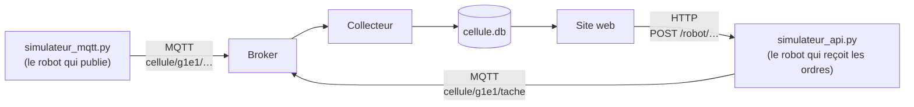

# Simulateurs du robot

Infrastructure client / serveur dans un contexte industriel

Tant que le robot n'est pas intégré, deux simulateurs prennent sa place :



| Fichier | Rôle |
|---|---|
| `simulateur_mqtt.py` | Envoie au broker, au choix dans un menu, les messages du robot : pour tester le **collecteur** |
| `simulateur_api.py` | Les endpoints de l'API du robot (`api_robot/`), sans robot : pour développer le **site web** |

Ils fonctionnent sur un poste ou sur le serveur du module, avec `flask` et `paho-mqtt` (déjà installés sur le serveur). Avant de les lancer, adapter les **paramètres en haut de chaque fichier** : identifiant de l'équipe (`EQUIPE`, qui sert aussi de compte MQTT), mot de passe MQTT, adresse du broker.


## Tester sans le serveur du module : broker public

Pendant les tests, par exemple chez soi ou avant d'avoir accès au serveur, on peut utiliser un **broker public** : un broker sur Internet, ouvert à tous, sans compte ni mot de passe.

| Broker public | Adresse | Port |
|---|---|---|
| Eclipse Mosquitto | `test.mosquitto.org` | 1883 |
| HiveMQ | `broker.hivemq.com` | 1883 |
| EMQX | `broker.emqx.io` | 1883 |

Dans les paramètres en haut de chaque fichier :

```python
EQUIPE = "g1e1_k7q2"                   # identifiant rendu unique : voir ci-dessous
MOT_DE_PASSE = ""                      # "" : pas de compte, le broker est sans mot de passe
BROKER = "test.mosquitto.org"
```

Avec `MOT_DE_PASSE = ""`, le simulateur se connecte sans compte. Le collecteur doit utiliser le même broker et s'abonner au même identifiant (`cellule/g1e1_k7q2/#`). Enlever de son code le vrai mot de passe de l'équipe, sinon il est envoyé au broker public. Ces réglages valent aussi pour MQTT Explorer.

Précautions, car un broker public est partagé avec le monde entier :

- **Tout le monde peut lire et écrire vos messages** : n'y envoyer que des données d'essai, jamais de mot de passe ni d'information personnelle.
- **Rendre l'identifiant unique** en ajoutant quelques caractères au hasard (`g1e1_k7q2`) : d'autres utilisateurs publient peut-être déjà sur `cellule/g1e1/…`. Ce nom sert aussi à l'identifiant de client MQTT : deux clients de même nom se déconnectent l'un l'autre.
- **Les messages retenus restent** sur le broker (état du robot) : ne pas s'étonner d'en recevoir d'anciens.
- **Aucune garantie** : le broker peut être lent, saturé ou arrêté, et le réseau de l'établissement peut bloquer le port 1883. Les mesures de charge (rafale) n'y ont pas de sens.

Pour les séances, revenir au broker du module : `EQUIPE` sans suffixe, le mot de passe de l'équipe, `BROKER = "192.168.10.10"` (ou `"localhost"` sur le serveur).


## Simulateur MQTT

```bash
python3 simulateur_mqtt.py
```

```text
Simulateur MQTT, équipe g1e1, broker localhost
  1. Cycle complet (début puis fin)
  2. Début de cycle
  3. Fin de cycle
  4. Changer l'état du robot
  5. Défaut
  6. Tâche de l'API (début puis fin)
  7. Messages mal formés
  8. Production : plusieurs cycles à la suite
  9. Rafale de 1000 messages
 10. Message libre
  0. Quitter
Votre choix :
```

Chaque message envoyé s'affiche, avec son sujet. Les choix 7 et 9 éprouvent le collecteur :

- **Messages mal formés** : six messages incorrects (pas du JSON, JSON coupé, durée manquante, durée qui n'est pas un nombre, liste au lieu d'un objet, message vide). Le collecteur doit les enregistrer dans `messages`, sans en tirer de cycle, et **continuer à fonctionner**.
- **Rafale** : 1000 fins de cycle envoyées d'un coup. Le collecteur doit toutes les enregistrer.

Vérifier ensuite la base : `sqlite3 cellule.db "SELECT sujet, count(*) FROM messages GROUP BY sujet;"`.

Sur le broker du module, une équipe ne peut publier que sous `cellule/<son identifiant>/` : un message publié ailleurs est perdu, sans aucune erreur.


## Simulateur d'API

```bash
python3 simulateur_api.py
```

Il ne fait rien bouger. Pour chaque appel, il affiche l'endpoint et ses paramètres, envoie un message MQTT de début de tâche, attend le temps que mettrait le robot, envoie un message de fin de tâche, puis répond.

| Méthode | Endpoint | Fonction appelée | Durée simulée |
|---|---|---|---|
| `GET` | `/robot/etat` | `etat()` | aucune (valeurs inventées) |
| `POST` | `/robot/home` | `home()` | 4 s |
| `POST` | `/robot/autocalibrate` | `autocalibrate()` | 20 s |
| `POST` | `/robot/ledring/<couleur>` | `ledring(couleur)` | 2 s |

```bash
curl http://127.0.0.1:5001/robot/etat
curl -X POST http://127.0.0.1:5001/robot/ledring/vert       # {"couleur": "vert", "statut": "terminee", "tache": "ledring"}
mosquitto_sub -h localhost -u g1e1 -P mot-de-passe-equipe -t 'cellule/g1e1/tache' -v
```

Les endpoints, les réponses et les messages MQTT sont **ceux de l'API du robot** : le site web passe de l'un à l'autre en changeant seulement l'adresse (`http://127.0.0.1:5001` puis `http://192.168.10.21:3000`). Comme sur le robot, une seule tâche s'exécute à la fois : une demande qui arrive pendant une tâche est refusée tout de suite (`409`, « robot occupé »), et `GET /robot/etat` répond même pendant une tâche, avec le champ `tache_en_cours` (nom de la tâche, ou `null`). Le détail est dans `api_robot/README.md`.

**Ajouter une tâche** : copier le modèle en fin de fichier (une fonction et son endpoint, du même nom), enlever les `#` et remplacer `cycle` par le nom de la tâche et `18` par sa durée en secondes. L'endpoint garde la forme des autres (`commencer`, la fonction, `terminer`). Une fois la tâche validée avec le site web, l'écrire de la même façon dans l'API du robot, avec les vrais appels au robot.


## Essais réalisés

Avec un broker Mosquitto configuré comme celui du serveur du module (un compte par équipe) :

- simulateur MQTT : chaque choix du menu ; le collecteur fourni (`collecteur/`) a enregistré les 1023 messages envoyés et en a tiré les 1005 cycles attendus ; mauvais mot de passe et broker absent signalés ;
- simulateur d'API : les quatre endpoints, la couleur inconnue (`400`), les messages MQTT de début et de fin, le refus `409` pendant une tâche (une seule demande acceptée sur cinq envoyées en même temps), `tache_en_cours` lu pendant une calibration avec une réponse immédiate.
