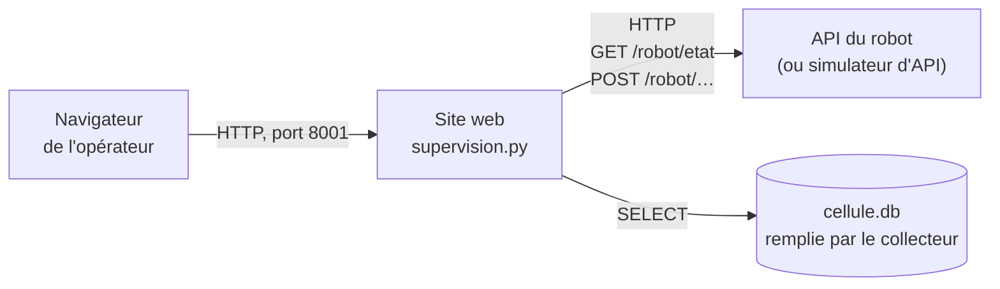

# Site web de supervision : base du tableau de bord

Infrastructure client / serveur dans un contexte industriel

Le site web est le tableau de bord de l'opérateur, ouvert dans un navigateur. Ce dossier en est la **base** : une seule page, volontairement simple et sans mise en forme recherchée, que chaque équipe complète et embellit (cours *HTML et CSS* et *Le framework Flask*). La page :

- propose les **commandes** du robot sous forme de boutons, avec un paramètre si besoin (la couleur de l'anneau de LED) ;
- affiche l'**état du robot**, mis à jour toutes les 2 secondes ;
- affiche les **20 derniers messages MQTT** enregistrés par le collecteur, mis à jour en même temps.



| Fichier | Rôle |
|---|---|
| `supervision.py` | Le site : paramètres en haut du fichier, une route par page et par commande |
| `templates/accueil.html` | La page : titre, boutons de commande, et quelques lignes de JavaScript qui rechargent l'état |
| `templates/etat.html` | La partie « état du robot et derniers messages », rechargée toutes les 2 secondes |
| `static/style.css` | La mise en forme, minimale |

Le site utilise Flask et `requests` (déjà installés sur le serveur ; sur un poste : `pip install flask requests`).


## Mode d'emploi sur le serveur du module

1. **Copier le site** dans `~/supervision/`, à côté du collecteur et de sa base `cellule.db` :

   ```bash
   cp -r /opt/cellule/fournitures/site_web/* ~/supervision/
   ```

   Le dossier contient alors `creer_bdd.py`, `collecteur.py`, `cellule.db`, `supervision.py`, `templates/` et `static/`.

2. **Adapter les paramètres** en haut de `supervision.py` :

   ```python
   EQUIPE = "g1e1"                        # identifiant de l'équipe, affiché en titre
   URL_API = "http://127.0.0.1:5001"      # simulateur d'API ; le robot : "http://192.168.10.21:3000"
   BASE = "cellule.db"                    # base remplie par le collecteur
   PORT_SITE = 8001                       # 8000 + numéro de l'équipe (8001 à 8008)
   ```

   Chaque équipe a ses ports : site `8000 + n`, simulateur d'API `5000 + n` (paramètre `PORT_API` du simulateur), où `n` est le numéro de l'équipe.

3. **Lancer** le site, depuis `~/supervision` :

   ```bash
   cd ~/supervision
   python3 supervision.py
   ```

4. **Ouvrir** la page dans un navigateur : `http://192.168.10.10:8001` depuis un poste du fab lab (adresse du serveur, port de l'équipe).

Comme le collecteur, le site peut tourner dans une session `tmux` pour continuer après la fermeture du terminal (voir `collecteur/README.md`).

Avec `debug=True` (dernière ligne de `supervision.py`), le site redémarre tout seul à chaque modification d'un fichier : il suffit de recharger la page dans le navigateur. En cas d'erreur dans le code, le message s'affiche dans le terminal.


## Essayer sans robot

Le site a besoin de deux choses : une API qui répond (pour l'état et les commandes) et une base remplie par le collecteur (pour les messages). Sans robot, on les remplace par les simulateurs (`simulateurs/README.md`), copiés dans le dossier personnel avec les mêmes paramètres que le site et le collecteur (`EQUIPE`, `MOT_DE_PASSE`, `BROKER`, et `PORT_API` pour le simulateur d'API) :

```bash
cp /opt/cellule/fournitures/simulateurs/*.py ~/
```

Puis, dans quatre terminaux, depuis `~/supervision` :

| Terminal | Commande | Rôle |
|---|---|---|
| 1 | `python3 collecteur.py` | Enregistre les messages MQTT dans `cellule.db` (après `python3 creer_bdd.py`, une fois) |
| 2 | `python3 ~/simulateur_api.py` | Remplace l'API du robot, sur le port `5000 + n` |
| 3 | `python3 supervision.py` | Le site, sur le port `8000 + n` |
| 4 | `python3 ~/simulateur_mqtt.py` | Envoie des messages de cycle, d'état, de défaut |

Vérifier :

- l'heure « mis à jour à » change toutes les 2 secondes ;
- **Calibration** : le message « commande envoyée, tâche en cours » s'affiche, « Tâche en cours » passe à `autocalibrate`, puis revient à « aucune » après 20 secondes ; les messages `debut_tache` puis `fin_tache` apparaissent dans la liste ;
- **Position home** pendant la calibration : « refusée, robot occupé : tâche autocalibrate en cours » ;
- un message envoyé par le simulateur MQTT apparaît dans la liste au plus 2 secondes plus tard ;
- simulateur d'API arrêté : « API du robot injoignable » dans l'état et après chaque commande ; collecteur arrêté : la liste des messages ne bouge plus.

Pour passer au vrai robot, il suffit de changer `URL_API` (`http://192.168.10.21:3000`, adresse du robot de l'équipe) et de relancer le site : les endpoints, les réponses et les messages de l'API du robot sont ceux du simulateur.


## Comment il fonctionne

| Route | Rôle |
|---|---|
| `GET /` | Affiche la page `accueil.html` : titre, messages de la dernière commande, boutons |
| `GET /etat` | Demande l'état du robot à l'API (`lire_etat`), lit les 20 derniers messages dans la base (`derniers_messages`), et renvoie le morceau de page `etat.html` |
| `POST /commande/home`, `/commande/autocalibrate`, `/commande/ledring` | Un bouton chacun : envoie la commande à l'API (`envoyer`), puis revient à la page d'accueil, qui affiche le résultat |

**La mise à jour toutes les 2 secondes** : à la fin de `accueil.html`, quelques lignes de JavaScript demandent `/etat` au site toutes les 2 secondes et remplacent le contenu du bloc `<div id="etat">` par la réponse. Seule cette partie de la page change : les boutons et la couleur choisie restent en place. Le morceau de page est fabriqué par Flask avec un template, comme une page entière.

**Les commandes** : chaque bouton est un petit formulaire qui envoie un `POST` au site ; le site relaie la commande à l'API du robot avec `requests`, puis revient à la page d'accueil (schéma Post / Redirect / Get du cours de Flask) et affiche le résultat avec un message `flash`. L'API du robot ne répond qu'**à la fin de la tâche** (20 secondes pour une calibration) : le site n'attend qu'une seconde (`timeout=1`). Passé ce délai, il affiche « commande envoyée, tâche en cours » ; la tâche continue sur le robot, et sa fin se voit dans l'état (« Tâche en cours : aucune ») et dans les messages (`fin_tache`, avec `statut` `terminee` ou `erreur`).

| Résultat affiché | Cause |
|---|---|
| `tâche terminée` | La tâche a duré moins d'une seconde |
| `commande envoyée, tâche en cours` | La tâche dure plus d'une seconde : elle continue sur le robot |
| `refusée, robot occupé : tâche ... en cours` | Une autre tâche est en cours (`409`) |
| `refusée, couleur inconnue : ...` | Paramètre refusé par l'API (`400`) |
| `commande inconnue de l'API du robot` | La route n'existe pas dans l'API (`404`) : commande ajoutée au site mais pas à l'API |
| `API du robot injoignable` | API arrêtée, mauvaise adresse dans `URL_API` |

Le site ne fait que **lire** la base : seul le collecteur y écrit.


## Adapter le site

**Ajouter une commande** (une tâche ajoutée à l'API du robot et à son simulateur) :

1. dans `supervision.py`, copier le modèle en fin de fichier, enlever les `#` et remplacer `cycle` par le nom de la tâche ;
2. dans `templates/accueil.html`, copier le modèle de bouton (entre `{#` et `#}`), le sortir du commentaire et remplacer `cycle`.

Pour une commande avec un paramètre, prendre modèle sur l'anneau de LED : un champ dans le formulaire (`<select name="couleur">`, ou `<input name="nombre" type="number">`), lu dans la route avec `request.form["couleur"]` et ajouté au chemin de l'API.

**Afficher autre chose** : ajouter une fonction de lecture dans `supervision.py` (sur le modèle de `derniers_messages`, avec une requête `SELECT`), passer son résultat au template dans la route `etat`, l'afficher dans `etat.html`. Par exemple : le nombre de cycles du jour et la durée moyenne (table `cycles`, cours de SQL), le dernier défaut.

**Pistes pour aller plus loin** :

- présenter l'état du robot de façon lisible : un voyant « libre / occupé », la valeur du capteur DI5 en clair (« pièce présente »), des températures arrondies, plutôt que le tableau brut ;
- griser les boutons pendant une tâche (`tache_en_cours`) ;
- afficher les messages de façon lisible, une couleur par sujet ; filtrer par sujet ;
- ajouter des pages : liste des cycles, détail d'un cycle, incidents (cours *Le framework Flask*) ;
- soigner la mise en forme (cours *HTML et CSS*) : en-tête, cartes, couleurs, affichage sur téléphone.


## Essais réalisés

Avec un broker Mosquitto configuré comme celui du serveur du module, le collecteur, le simulateur d'API et le simulateur MQTT :

- page d'accueil et mise à jour de l'état toutes les 2 secondes, vérifiées dans un navigateur (Chrome) sur un écran d'ordinateur et à la largeur d'un téléphone ;
- les trois commandes : « commande envoyée, tâche en cours » en une seconde, « Tâche en cours » qui passe à `autocalibrate` puis revient à « aucune » après 20 secondes, messages `debut_tache` et `fin_tache` affichés ;
- refus pendant une tâche (`409`), couleur inconnue (`400`), simulateur d'API arrêté (« API du robot injoignable ») ;
- messages du simulateur MQTT, y compris mal formés, affichés dans la liste.
